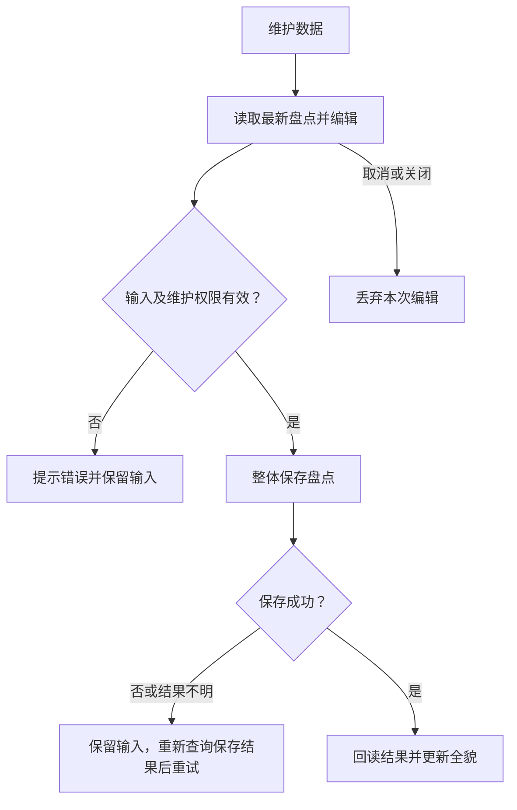
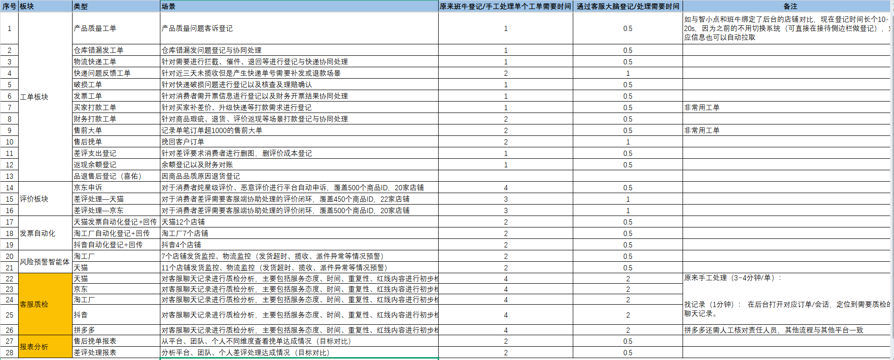

# 客服系统｜人效报表｜首次新增 PRD

产品版本：人效报表首期（不代表客服系统版本）｜文档版本：V1.1｜日期：2026-11-18

状态：原型及核心公式已确认；交互复查修订稿，长周期曲线策略已确认，仍含待确认的其他图表交互与业务计数边界，暂不可直接作为开发冻结稿；未进入开发、未上线。

对应原型：[人效报表](dashboard-demo/ai-efficiency-home-v2.html)。当前基线为已确认的离线原型，业务接入实现未核验；本文为该模块首次正式PRD。

|文档版本|日期|摘要|影响范围|状态|
|---|---|---|---|---|
|V1.0|2026-11-18|首次定义全局成果、AI全貌维护、业务统计及计算口径|人效报表新增页面|历史初稿|
|V1.1|2026-11-18|补充提示/图标/弹窗契约、长周期图形建议、计数与异常边界复查|统计交互、数据映射、验收|待确认修订稿|

# 1. 本期需求与AI能力概览及CHG索引

|编号|模块|功能点|变更类型|AI能力变化|价值|
|---|---|---|---|---|---|
|CHG-01|报表入口|报表管理下新增人效报表及查看权限|新增|—|统一入口|
|CHG-02|人效成果|固定人员对比、全局累计节省时间|新增|—|呈现阶段投入变化及等效工作量|
|CHG-03|AI应用全貌|10板块应用及成熟度统计|新增|—|呈现覆盖范围|
|CHG-04|全貌维护|月份、各板块成熟度数量录入及维护权限|新增|—|客服自主更新盘点|
|CHG-05|业务提效统计|7类业务卡片及统一日期筛选|新增|—|按周期查看成效|
|CHG-06|统计图形|累计趋势及模块贡献环图|新增|—|看累计变化与贡献|
|CHG-07|业务使用结构|7模块33子项双列条目|新增|—|解释业务贡献来源|
|CHG-08|计算与说明|自动取数、状态去重、基数折算、统计说明|新增|—|形成一致可核算口径|

本期是效果统计功能，不新增模型、Agent执行或智能决策能力，不改变现有业务处理SOP。

# 2. 目标、基线与范围

目标：客服管理者在一页看到人员投入变化、AI应用范围、业务量及折算节省人天，并能核对到业务子项；客服按权限维护应用全貌。以可追溯的业务完成量和人工基数计算，不将AI处理速度等同于节省时间。

既有业务及子报表作为取数来源，不改其执行逻辑。人效报表为新功能，历史未计算过；首期按统一基数计算系统内全部可用历史记录。原型中的数字为演示，不是已实现取数能力。

成功标准：业务卡片、图表、子项在同一时间范围使用同一份去重数据；原始完成记录和附录基数可复算结果；全局块不受业务日期影响；仅获授权人员可维护全貌，保存后其他有查看权限用户可读到最新值。

范围外：金额折算、团队整体人效提升率、将节省人天直接换成减员人数、自动调整人员数据、ROI基数维护页面、历史基数版本/快照、修改其他报表和Agent执行能力、全貌场景明细维护。将来修改基数时统一修改，不在本期增加版本机制。

# 3. 页面层级与交互

## 3.1 入口与全局区（CHG-01～04）

菜单：报表管理 → 人效报表，为报表管理首个子项，位于AI工单Agent之前，进入时高亮。

全局区包含：

- 人效成果：固定“总部一线客服25人→14人”，减少11人，人员规模下降44%（11÷25）。不维护人员，不推导团队人效提升率或认定全部人员变化由AI造成。
- 累计节省人工时间：按第5章合格记录计算全部可用历史的小时、人天，不设置固定业务起点，不显示累计日期区间或“实际起点待确认”。不受下方日期筛选控制。
- AI应用全貌：展示当前保存的盘点月份、10板块、应用总数及已上线/试点/规划总数；两行五列板块卡片。不使用该盘点数量计算节省人天。手工盘点和业务自动取数分别展示，不强制一一对应。

原型可见“演示”标识属于原型状态；正式上线必须使用真实数据，不能带入演示常量。

## 3.2 统一业务统计区（CHG-05～07）

将以下内容包在同一个“业务提效统计”容器内，只保留右上角一组日期筛选，依次呈现：

1. 本期业务成效：智能体工单、工单板块、评价板块、发票自动化、风险预警智能体、客服质检、报表分析，共7张，桌面上4下3。各自展示业务量和单位、节省人天、操作说明。
2. 业务提效分析：累计节省人天面积趋势＋7模块人天贡献环图。
3. 业务使用结构：模块标题及合计横跨整行，每行左右两个子项；每侧为序号、名称、简短说明、细贡献条、业务量和浅灰底红色人天。子项按行从左到右读，奇数末项右侧留空。窄屏按原始顺序单列展示，不重复计数。

全部内容同页完整展开，无查看更多、分页、折叠或内部明细滚动区域。页面自然滚动。不同模块不强制等高。

模块子项：智能体6平台；工单12项；评价3项；发票3项；风险2项；质检5项；报表2项，共33项。智能体顺序为大健康、天猫国际、淘宝、淘工厂、拼多多、抖音；其他子项按附录原表顺序。附录序号13本期完全排除。

## 3.3 日期与统计说明（CHG-05、08）

时区北京时间 Asia/Shanghai。默认近30天=今天及前29个自然日，近7天=今天及前6日，本月=本月1日至今天。自定义含起止当日；实现采用开始日00:00至结束日次日00:00的左闭右开范围。今天尚未发生的记录自然不计。

自定义必填，开始日不得晚于结束日；无效日期提示并保留上次有效结果。统一联动卡片、图形、子项，不改变全局成果或全貌。筛选刷新应整区采用同一有效周期，避免新旧结果混搭。

统计说明按钮打开说明弹窗，覆盖全页统计维度、智能体300单/人天、其他业务按人工耗时差、去重与汇总、非减员及不折金额；关闭返回原筛选位置。正式计算按第5章，不采用原型旧参数。

## 3.4 可见控件、图标及提示契约（复查补充）

本表区分当前原型行为和产品需补全的交互。未列为按钮的图标不推导点击能力，不新增详情页。

|元素|触发与呈现|关闭、结果与边界|
|---|---|---|
|统计说明|点击打开标题为“统计说明”的模态弹窗，正文使用本节下方完整文案|关闭按钮、Escape关闭；遮罩不关闭；正文超出视口时弹窗内滚动；关闭后焦点回按钮，筛选不变|
|打印汇报|当前原型已有按钮，点击调用浏览器打印预览|取消不改变页面；打印全局区及当前已成功加载业务周期，不打印侧栏、按钮、弹窗、悬浮框和演示提示；打印显示本期日期，双列条目不裁切；加载/失败时不以缺数结果打印正式汇报。保留入口，不表示新增独立导出PDF服务|
|维护数据|仅有查看且有维护权限时可见；点击先加载最新共享盘点，再允许编辑|加载中禁用保存并提示“正在加载盘点数据”；失败提示“盘点数据加载失败，请重试”，不以旧默认值覆盖服务端|
|保存|校验通过后显示“保存中…”并禁用重复提交，整份保存|成功回读后提示“保存成功”，关窗刷新全貌；失败保留输入、恢复保存按钮；更新结果不明先查询，不盲目再覆盖|
|取消/关闭/Escape|未保存状态下关闭维护弹窗，丢弃本次编辑|不额外增加确认弹窗；遮罩不关闭。保存请求进行中禁止取消/重复提交，结果明确后恢复操作，防止误报取消已提交写入|
|日期预设|点击近7天/近30天/本月后提交相应周期|高亮与成功展示的有效周期一致；加载时整区显示加载状态，不允许前一请求迟到覆盖后一选择|
|自定义|点击显示两个日期输入框，预填当前有效区间；两端有效后自动提交，无新增查询按钮|缺一端显示“请选择开始和结束日期”；颠倒显示“开始日期不能晚于结束日期”，不清空已有有效结果。输入暂未完成不提交，报错文案不含原型独有731天限制|
|全貌板块图标、成熟度圆点|仅装饰/颜色标识，配文字名称和状态，不可点击|无跳转、筛选或明细弹窗；不只依赖颜色传达状态|
|侧栏图标、箭头|复用系统实际导航；报表管理展开后高亮人效报表|原型其他静态菜单不是本期新增页面；图标本身不额外触发其他操作|
|业务成效卡片|静态显示模块业务量、单位和人天，无点击行为|不切换模块，不影响图表，不跳转。文字溢出换行，窄屏不省略关键数字|
|子项序号圆点|模块内1起连续编号，仅辅助阅读|无排行含义、不点击；移动端保持逐行阅读顺序|
|子项细贡献条|鼠标悬停条形显示“本模块节省时间占比：X.X%”|离开隐藏；0时显示0.0%，未取数时“暂不可用”；不显示为全页占比，不点击。触屏点击条形显示，再点外部关闭|
|子项名称、业务量、红色人天|静态信息，无原型旧版明细弹窗|同名子项按模块区分；长名称换行，不省略关键信息。模块内合计不等于已四舍五入行值直接相加|
|全貌保存提示|全貌区保存成功提示“保存成功”|不显示原型“已保存到当前浏览器”；提示不改变业务筛选|
|错误重试|失败模块/区域提示“数据加载失败，请重试”及重试按钮|重试当前有效周期；全局、全貌、业务统计分别有状态，不因一块失败清空无关区域|

统计说明弹窗正文：

> **统计范围**：人效成果展示总部一线客服人员投入变化及全局累计节省时间；AI应用全貌由客服手工维护，按板块统计应用数量及已上线、试点、规划分布；业务提效统计按业务类型及子项展示业务量、节省人天与贡献，统一受所选日期控制。
> **节省人天计算**：1人天＝8小时＝480分钟。智能体工单按人工每人每天300单计算，节省人天＝AI独立完成工单量÷300。其他业务节省人天＝累计节省人工分钟÷480；累计节省分钟＝成功业务量×单项前后人工耗时差。
> **汇总口径**：子项汇总为模块，模块汇总为整体；同一操作去重，不同单位业务量不直接相加。节省人天为等效人工工作量，不等同实际减员；人员变化单独展示，不折算金额。

加载期间保留区域标题和有效日期，数字显示骨架/“加载中”，不能以0替代。有效零记录：卡片和子项为0，趋势为0基线，环图空态文案“所选周期暂无节省时间数据”。真实小值如0.004人天按已确认2位精度显示0.00，但贡献比例按未舍入值计算，不把显示0.00当作无业务。

## 3.5 图表交互及长周期展示（CHG-06）

当前原型每日一点、自动抽稀日期标签，未定义长周期规则；自定义最多731天是原型临时校验，不是已确认业务限制。用户于2026-11-18确认以下日/周/月自动切换及累计展示规则；本节末尾另列的环图图例与日期限制仍待确认：

|自然日跨度（含首尾）|图形粒度|分桶与标签|
|---|---|---|
|1～60天|日|北京时间自然日；标签同年MM-DD，跨年YYYY-MM-DD|
|61～366天|周|周一至周日，首尾桶按所选区间截断；标签显示实际桶起始日|
|367天及以上|月|自然月，首尾桶截断；标签YYYY-MM|

页面图表标题旁显示“按日/按周/按月”。不得按显示粒度改变取数区间和业务卡片；数据先在选中区间精确去重求日增量，再合并周/月。

每个绘制点表示该桶实际结束时的区间累计人天；例如周点为截至该周所选最后一天的累计，不是本周增量，不把每日累计值相加。第一点即第一桶末累计，单日区间只有一个有值点；所选区间前值为0但不伪造一个成功记录。最后一点必须包括结束日且等于本期总人天。周/月聚合只压缩图形，不截断统计数据。

X轴桌面最多约8个标签、窄屏最多约4个，优先保留首尾并防重叠；标签抽稀不等于删数据。Y轴从0起，标注单位“人天”，自动调整上限；数值可用万/亿缩写，悬浮值仍展示完整千分位和2位小数。只有一个点时显示可见圆点；无增量日期累计走平。采用折线/单调插值，不能因平滑出现向下或负数的假趋势。

趋势悬浮：鼠标移动或触屏点选显示实际日期/桶日期区间、“本日/本周/本月节省：X.XX人天”和“所选周期累计节省：X.XX人天”；离开图形或触屏点外部关闭。定位到最近有效绘制点，浮层不超出视口，无点击下钻或额外筛选。

环图悬浮扇区显示“模块名／节省人工：X.XX人天／占本期：X.X%”；中心显示本期总人天和“节省人工/人天”。7个图例全部显示且自动换行。建议图例仅作说明，禁用默认点击隐藏扇区，以避免中心总量与可见扇区不一致；悬浮图例仅高亮对应模块，点击不筛选业务区。色彩在卡片/条目/环图中不承担额外状态含义。

自定义不新增固定业务起点；未来日期是否允许及最大查询跨度待本轮确认，推荐结束日不晚于今天，允许选择全部可用历史。任何技术查询限制需给出明确范围提示，禁止静默截断后显示完整周期标签。

# 4. AI应用全貌维护（CHG-03、04）

## 4.1 展示与初始盘点

初始盘点月份2026-10，板块与成熟度如下。成熟度为表内盘点，不表示独立核验当前上线状态。

|板块|已上线|试点|规划|合计|
|---|---:|---:|---:|---:|
|后台端-工单|25|0|0|25|
|办公提效|11|1|0|12|
|后台端-退款|4|0|0|4|
|风险监控|3|0|1|4|
|咨询端|2|0|0|2|
|后台端-发票|1|0|0|1|
|评价业务|1|0|0|1|
|会话质检|0|1|0|1|
|工单系统|1|0|0|1|
|退款挽留|1|0|0|1|
|合计|49|2|1|52|

固定10个板块，本期不提供新增/删除/改名板块。板块数为10，即使某板块维护为0仍保留；应用总数为全部成熟度数量之和，非已上线数量。月份为手工盘点的截至月份，不随业务日期筛选变化。

## 4.2 操作契约

|场景|顺序与结果|
|---|---|
|打开维护|有维护权限 → 点击全貌右上“维护数据” → 回填已保存月份及30个数量输入框 → 各行及总计自动计算|
|保存|输入校验 → 服务端验证权限和完整数据 → 整体保存成功 → 回读已保存值 → 刷新全貌并关闭弹窗|
|取消/关闭/Escape|丢弃本次未保存编辑，不改变已保存值|
|保存失败|保持弹窗及已输入值，显示失败，可重试，不提示成功，不部分更新页面|

盘点月份必填，格式YYYY-MM；各板块成熟度数量必填，为0～999999非负整数，禁止小数、负数及空值；合计只读且自动计算。正式系统使用服务端共享存储，不使用原型localStorage作为正式保存方案。保存整张盘点，避免只更新总量或部分行造成不一致。并发编辑不能静默覆盖：打开时取得当前版本标识，保存时若已被别人更新，提示“盘点数据已被其他人员更新，请重新加载后修改”，保留本次输入供对照，不自动覆盖；重新加载需用户主动触发。版本标识实现由技术确定，该标识用于并发校验，不是新增业务历史版本功能。

# 5. 自动取数与计算规则（CHG-02、05～08）

## 5.1 来源、统计对象与状态

业务量由客服系统自动获取，ROI附件仅提供业务子项及人工分钟基数，不从附件中的“每月约/每周约”文字推算所选周期业务量，不把应用项数或店铺数作为完成量。

统计对象为“业务记录的具体操作”。仅计成功完成：智能体必须AI独立处理成功，转人工、失败、处理中均不计。其他模块允许人机协同，但对应被节省人工的操作必须成功完成，不能仅依据任务创建、触发或通知发送判定全部业务成功。

统一按该被统计操作的成功完成时间归属。创建日不决定归属。实际字段、成功状态和系统模块映射需开发逐项核验，不虚构接口或表名。不能在缺少成功记录时退化为页面访问、登录量、生成中数量或按当前时间填补完成时间。

|模块|业务量单位|成功记录的业务含义|时间基数|
|---|---|---|---|
|智能体工单|单|对应平台AI独立完成的工单|300单/人天|
|工单板块|单|相应子项登记操作成功；不等待整张工单后续所有协同完结才承认登记完成|ROI前后人工分钟差|
|评价板块|条|对应申诉/差评处理操作成功完成；申诉受理动作与平台最终申诉结果的源状态映射须技术核验|同上|
|发票自动化|张|对应发票自动登记及回传流程成功，不把登记与回传各算一次完整节省|同上|
|风险预警智能体|条|去重后的有效预警条数；预警成功生成并送达客服才计入，以首次成功送达时间归属日期；不等人工处置闭环|同上|
|客服质检|次|一个质检业务记录对应操作成功完成，不以同一会话重复读取累加|同上|
|报表分析|次|一个报表分析业务记录成功完成，不以普通访问、刷新报表页面次数替代|同上|

如果现有系统不存在上述粒度的完成记录，开发需明确缺项及补充采集方案，经评审后接入；不能编造历史成功量。模块是否能取全量历史数据需技术核实。

风险预警专项口径（2026-11-18用户确认）：仅扫描订单、发现异常但未成功送达、发送失败或发送中均不计量。以来源系统/平台/店铺＋订单＋异常类型识别预警，同一订单同一异常的重复扫描、重试、重复提醒仅计一次，不因跨日期再次提醒重复计入；同订单不同异常类型分别计数。以首次成功送达客服的北京时间作为完成时间，不等待人工处置结束。送达状态及异常类型映射由开发核验，无法证明送达的记录不当作成功。风险节省人天按有效预警条数×（2−0.5）÷480测算；ROI中2分钟和0.5分钟是否对应一条预警仍待客服核实，核实前不得标记为已验证的实际节省值。

## 5.2 去重与跨模块计数

同一来源系统范围、同一业务记录、同一操作只计一次。去重身份需包含平台/店铺等必要来源范围，防止不同来源单号相同被误合并。重复回调、重试、重复扫描不增量计数；失败后成功只在首次有效成功时间计一次。源系统应提供规范的成功记录及其时间，重复成功事件不能移动已归属日期。

同一订单分别完成发票、评价等不同操作，可分别计各自时间。发票工单人工登记与发票自动化流程若实际指向同一登记操作，不能跨模块重复计时；不同操作的节省范围必须可区分。具体同源映射由技术核验记录到字段映射表，不能只按订单号全局去重，也不能按模块边界放任重复。

## 5.3 核心公式与精度

统一1人天=8小时=480分钟。

**智能体工单：**节省人天=成功独立完成的工单量÷300；节省小时=人天×8，等效每单1.6分钟。6个平台统一该基数，不使用2分钟/单旧演示参数。

**其他业务：**单项节省分钟=ROI表原人工分钟−使用后人工分钟；子项累计节省分钟=该子项成功去重业务量×单项节省分钟；节省人天=分钟÷480；节省小时=分钟÷60。使用后时间指仍需人工操作时间，不是扣除AI运行时长。

**模块与整体：**先用未舍入精度求各子项时间，再汇总为模块、周期整体及全局累计。不得先把各子项显示人天四舍五入后相加。数量显示整数和单位，小时/人天显示2位小数，百分比显示1位小数。尾差由显示四舍五入产生，不强行改子项数据凑总。

模块贡献占比=模块节省分钟÷所选周期全部模块节省分钟；子项细条=子项节省分钟÷本模块节省分钟。总时间为0时占比不计算，贡献图显示暂无数据，条宽0。不同单位业务量不相加，不展示全业务“总单量”。

## 5.4 图表、全局和缺失数据

趋势：北京时间按日汇总合格操作节省分钟，在所选区间从0开始累积；无业务日期补0增量，不带入所选开始日之前的累计值。末值等于本期全部模块人天。环图同一周期、同一去重数据。

全局累计：所有纳入范围业务在系统内全部可用成功历史，使用同一规则求和。无固定起点，不显示时间区间；不是把本次选择周期的累计作为全局。AI全貌、人员固定数据不参与此求和。

“品退售后登记（喜佑）”因无前后基数，首期不展示、不计业务量、不计人天。未来未映射子项不能自动套平均基数或混入模块总计；应列为技术数据质量异常，补齐后再明确是否纳入。

无成功记录=真实0；获取失败/无取数能力不等于0，相关卡片或区域显示暂不可用和重试。不能用部分模块成功值冒充完整整体总量，失败范围及整体不可完整汇总状态应可见。刷新页面、进入页面和切换有效日期重新读取，实时推送及定时轮询不在本期要求中。

# 6. 数据契约与权限

以下为产品字段语义，非既有接口字段名；技术评审落实实际字段及映射。

|对象|字段|类型|约束/取值|
|---|---|---|---|
|业务完成记录|来源范围|object/string|平台、店铺及来源系统，满足唯一身份与既有数据权限|
|业务完成记录|业务记录标识、操作标识| string |必填，构成去重身份；不能用重试执行ID代替业务身份|
|业务完成记录|模块、子项|enum/string|7模块及本期33子项，映射到附录|
|业务完成记录|成功状态|enum|源状态映射至成功/失败/处理中/转人工；枚举为产品语义|
|业务完成记录|完成主体|string/enum|智能体要求AI独立完成；其他按相应操作判断|
|业务完成记录|成功完成时间|datetime|明确时区，不得用创建时间替代|
|全貌盘点|截至月份|string|YYYY-MM，必填|
|全貌盘点|板块|string/enum|固定10板块|
|全貌盘点|已上线、试点、规划|integer|0～999999，各自必填|
|统计输出|业务量|integer|非负；附单位，不能直接跨单位累加|
|统计输出|节省时间|decimal|内部保留计算精度，对外2位显示|

权限复用客服系统权限设置，不限定客服主管等固定岗位：新增“人效报表查看”和“AI应用全貌维护”权限项。查看权限控制菜单、页面及取数；维护权限在有查看权限前提下控制按钮和保存。未授权请求服务端拒绝；不能仅隐藏按钮。维护权限不开放ROI参数编辑。数据范围沿用系统既有授权，统计不得超出可见来源；全局指当前有权限的数据全量而非绕过数据权限。

# 7. 原型与正式交付差异

冻结原型用于布局和交互，不作为取数实现。正式交付必须替换合成业务量、把智能体参数由2分钟/单改为300单/人天、把其他模块统一演示参数改为附录逐项差值、移除喜佑子项、把全貌localStorage改为共享服务端存储及权限控制。原型33/34子项等历史演示差异以本文33项为准。本次输出PRD不修改已确认原型文件，开发以本文统计规则为准。

# 8. 验收标准

以下为构造验收样例，不是真实成效。核验应留业务成功记录、聚合结果与页面截图。

|编号/关联|前置与操作|可观察结果|
|---|---|---|
|AC-01 CHG-01|授权用户打开报表管理|首项人效报表可进入并高亮；其他报表保留|
|AC-02 CHG-01/04|只查看权限用户、无查看权限用户分别访问及直接请求保存|前者可看无维护按钮且保存被拒绝，后者无法读取报表；不越权|
|AC-03 CHG-02|切换业务近7天/自定义|25→14、11人、44%不变；全局累计不变；不展示累计起止日期|
|AC-04 CHG-03|初始化全貌|10板块52项，49上线2试点1规划；业务筛选不改变全貌|
|AC-05 CHG-04|维护工单上线25改30，保存2026-11|总应用57、上线54，试点2规划1；重新进入及其他授权用户可读已保存值|
|AC-06 CHG-04|负数、小数、空值、取消编辑、保存失败|非法输入不提交；取消不变；保存失败保留输入且不提示成功|
|AC-07 CHG-05|北京时间11月18日选择近7天/近30天/本月|分别覆盖11月12日/10月20日/11月1日起至当天；卡片图形子项周期一致|
|AC-08 CHG-05|自定义起止颠倒、查询成功零记录、查询失败|颠倒保留上次周期并提示；真实无记录为0；失败显示不可用不伪装成0|
|AC-09 CHG-08|智能体成功300单、失败10单、转人工20单|仅计300单，人天1.00，小时8.00；不能得到1.25人天|
|AC-10 CHG-08|财务打款成功100单，前2后0.5分钟|节省150分钟=2.50小时=0.3125人天，显示0.31|
|AC-11 CHG-08|京东申诉成功100条，前4后0.5分钟|350分钟，显示5.83小时、0.73人天；不是按原4分钟全计|
|AC-12 CHG-08|同一操作回调3次、失败后成功、不同店同号|重复只计1次，失败后计首次有效成功；不同店合法记录不误合并|
|AC-13 CHG-08|1日创建2日成功；北京2日00:00成功|计2日，不计1日，边界不重复|
|AC-14 CHG-06/07|智能体300单+财务打款100单+申诉100条|总980分钟=16.333…小时=2.04166…人天，显示16.33、2.04；趋势末值与环图未舍入总和一致|
|AC-15 CHG-06|有部分日无记录、总时间为0|缺日补0增量，累计不下降；总0不出现NaN或假贡献|
|AC-16 CHG-07|查看桌面与窄屏|7模块33子项全展开，6个平台齐全，喜佑不出现；移动端顺序一致不重复显示统计|
|AC-17 CHG-08|同订单分别发票和评价；同登记跨模块重复上报|不同操作各计，重复操作不跨模块重复计时|
|AC-18 CHG-02/05|历史含所选区间外成功记录|全局含合格历史，本期只含选中完成日期；全貌手工修改不改变人天|
|AC-19 CHG-08|打开统计说明|描述全局/业务维度、300单/人天、耗时差、480分钟、去重和非减员口径|
|AC-20 CHG-06|分别选择60/61/366/367天（已确认）|日/周/周/月切换；首尾不丢数，最后点与周期合计一致|
|AC-21 CHG-06|跨年、自定义起止跨周/月、首尾仅1天|标签区分年份，首尾桶只含所选日期，不借整周/月扩大取数|
|AC-22 CHG-06|单日、长期零增量、巨大累计值|单日点可见、无负数或假下降；缩略坐标悬浮显示完整值|
|AC-23 CHG-06/07|悬浮/触屏点选曲线、扇区和细条|展示本节指定字段及正确分母，不越界；离开/点外部关闭，无意外跳转|
|AC-24 CHG-04|两人同时编辑同一盘点、保存中连点/关闭|一次有效提交；后保存冲突有提示不静默覆盖，结果不明先回读|
|AC-25 CHG-05|连续快速切换周期，旧请求后返回|最终只显示最后有效请求对应整区结果，不混周期|
|AC-26 CHG-08|打开说明、键盘Tab/关闭/Escape、点击遮罩|焦点限定弹窗，Escape返回触发按钮，遮罩不丢编辑；长正文可读|
|AC-27 CHG-08|打印预览及取消|仅打印完整有效数据和本期日期，不含遮罩、菜单、控件；取消不改页面|
|AC-28 CHG-05|部分模块接口失败、成功零记录|失败不当0，整体不展示不完整总量；真实0有零基线和明确空态|
|AC-29 CHG-08|同来源同订单同异常重复发送、跨日提醒；同订单不同异常；生成但发送失败，失败后送达|同异常只计首次成功送达一次，不同异常分别计；未送达不计，成功后按首次送达日期计，不等人工处置结束|

# 9. 技术评审与交付结论

复查结论：可用于产品与技术联合评审，暂不可作为无歧义的开发冻结稿。核心公式、布局、状态大原则已明确，但下列业务计数边界及环图图例、日期限制建议仍待确认。原V1.0“产品规则可提交开发”结论过宽，本版更正；不代表已授权开发或功能测试通过。以下是接入前必须完成的技术核验，若缺少记录则不能宣称相应模块可上线：

|事项|产品约束|核验角色及输出|
|---|---|---|
|33子项源映射|来源身份、状态、完成主体、成功时间、单位与操作粒度可取|客服系统开发逐项出字段/状态映射及样本；尤其风险监控、质检、报表分析完成记录|
|成功语义|评价申诉等区分动作成功与最终业务结果，映射必须与被替代人工操作一致|开发说明源流程状态，产品核对，不得擅用提交数或访问数|
|跨模块身份|工单发票与发票自动化操作重叠需去重|开发确认同源关系及去重键|
|历史可用范围|只用可靠记录；不可补造历史量|开发核验历史字段及各模块可用范围|
|聚合与共享保存|同一周期快照一致、全局独立、维护服务端保存、失败可恢复|开发确认接口、存储、聚合方式及并发保存策略，不预设架构|
|权限接入|查看/维护独立配置且后端校验，遵守现有数据范围|开发与权限管理员核验配置及越权用例|

## 9.1 ROI对照与接入核验项

统一依据（2026-11-18用户确认）：业务子项、原人工耗时及使用后耗时统一以ROI表Sheet1-副本为准；全貌表仅用于应用覆盖展示。已确认的专项统计规则继续适用。ROI未明确的计数对象、状态和完成时间映射，由产品与开发对照原表场景及现有业务记录核验，不自行假设，不扩展功能，不将未核实指标标为已验证。不再逐项要求用户重新制定规则；仅在核验发现影响统计结果的实质冲突时，集中呈报具体差异。

|优先级|问题|为什么不能仅视为技术字段映射|建议确认方式|
|---|---|---|---|
|高|风险预警计量已确认，ROI的2→0.5分钟是否对应处理一条有效预警仍待核实|计数按首次成功送达、订单及异常类型去重；耗时若对应逐单巡查则不能直接套用|客服核实耗时对象，开发提供送达状态及去重样本；未核实不标实际节省已验证|
|高|客服质检在AI分析完成还是人工复核完成计次？|ROI使用后仍需2分钟人工；不同成功终点会改变计入量和归属日|对照ROI场景及现有质检记录核验计次对象与完成状态，不预设必须人工复核完成|
|高|报表分析一次是什么，现有系统是否有成功分析记录？|若只是静态报表打开就没有已确认的生成任务；原PRD擅用“分析成功记录”可能隐含新增采集能力|产品/开发先核实当前操作，客服确认一次可替代的整理分析对象；不按浏览量自行计次|
|高|评价申诉动作提交成功还是平台申诉通过计成功？差评处理闭环终点是什么？|平台不通过仍可能已替代人工提交，二者不能由开发任择|按对应人工被替代动作确定；取得业务确认后写入状态表|
|中|发票登记成功但回传失败时，完整1.5分钟是否计？|既定规则要求流程成功，当前暂不计；若未来计部分节省需拆基数，本期不擅拆|首期按完整登记回传成功，技术确认可识别该终点|
|中|产品质量备注部分店铺登记更慢，但数值列仍统一节省0.5分钟|用户已选择ROI数值列，属于测算与实际差异披露，不能把统一基数说成逐店实测|本期沿用确认数值，不另扩展分店基数；备注保留|

以上事项统一按ROI及现有记录核验，不再逐项追问用户；未核实的映射仍需保留其不确定性和影响，不视为开发就绪。此前建议质检以人工复核完成为终点未获确认，不作为规则。

## 9.2 本轮推荐待确认项

长周期日/周/月阈值（60/366天）、桶末累计、首尾截断、标签抽稀及悬浮增量/累计规则已于2026-11-18获用户确认。图例禁用点击筛选、日期结束不晚于今天及不设固定查询跨度仍为推荐交互，待确认。弹窗提示与现有功能补齐的文案可直接进入评审，原型未因本次文档复查被修改。

文档自查覆盖范围、字段、公式、图形、权限、输入和异常、去重边界及验收样例；Mermaid仅完成结构静态检查，未将规则推演当实现验证。

# 10. 附录：ROI基数与客服盘点内容

附件原文件：[客服大脑功能使用盘点及ROI评估.xlsx](../01_业务输入/客服大脑功能使用盘点及ROI评估.xlsx)。采用“Sheet1-副本”为计算依据；原Excel保持原样，包含另一个工作表供查阅，但不混用其单量、ROI文字或其他子项。以下将采用工作表的全部28条内容附入文档，明确27条纳入及1条排除。

## 10.1 前后人工耗时及计算基数

|序号|模块|业务子项|原人工分钟/次|使用后人工分钟/次|单项节省分钟|本期|
|---|---|---|---:|---:|---:|---|
|1|工单板块|产品质量工单|1|0.5|0.5|纳入|
|2|工单板块|仓库错漏发工单|1|0.5|0.5|纳入|
|3|工单板块|物流快递工单|1|0.5|0.5|纳入|
|4|工单板块|快递问题反馈工单|2|1|1|纳入|
|5|工单板块|破损工单|1|0.5|0.5|纳入|
|6|工单板块|发票工单|1|0.5|0.5|纳入|
|7|工单板块|买家打款工单|1|0.5|0.5|纳入|
|8|工单板块|财务打款工单|2|0.5|1.5|纳入|
|9|工单板块|售前大单|2|0.5|1.5|纳入|
|10|工单板块|售后挽单|2|1|1|纳入|
|11|工单板块|差评支出登记|1|0.5|0.5|纳入|
|12|工单板块|返现余额登记|1|0.5|0.5|纳入|
|13|工单板块|品退售后登记（喜佑）|未填写|未填写|—|排除，不展示不汇总|
|14|评价板块|京东申诉|4|0.5|3.5|纳入|
|15|评价板块|差评处理—天猫|3|1|2|纳入|
|16|评价板块|差评处理—京东|3|1|2|纳入|
|17|发票自动化|天猫发票自动化登记+回传|2|0.5|1.5|纳入|
|18|发票自动化|淘工厂自动化登记+回传|2|0.5|1.5|纳入|
|19|发票自动化|抖音自动化登记+回传|2|0.5|1.5|纳入|
|20|风险预警智能体|淘工厂|2|0.5|1.5|纳入|
|21|风险预警智能体|天猫|2|0.5|1.5|纳入|
|22|客服质检|天猫|4|2|2|纳入|
|23|客服质检|京东|4|2|2|纳入|
|24|客服质检|淘工厂|4|2|2|纳入|
|25|客服质检|抖音|4|2|2|纳入|
|26|客服质检|拼多多|4|2|2|纳入|
|27|报表分析|售后挽单报表|2|0.5|1.5|纳入|
|28|报表分析|差评处理报表|2|0.5|1.5|纳入|

智能体6平台统一按300单/人天，非本表分钟参数。客服质检备注中的时间区间不替代数值列4→2；产品质量备注指出部分旧系统绑定店铺可能比当前快10～20秒，本期按用户确认的数值列1→0.5统一计算，不能宣称每店实测均节省；若后续更正基数则统一修改。备注中的商品/店铺覆盖为附件盘点背景，不作为实时数量或固定过滤名单。

## 10.2 原表截图

