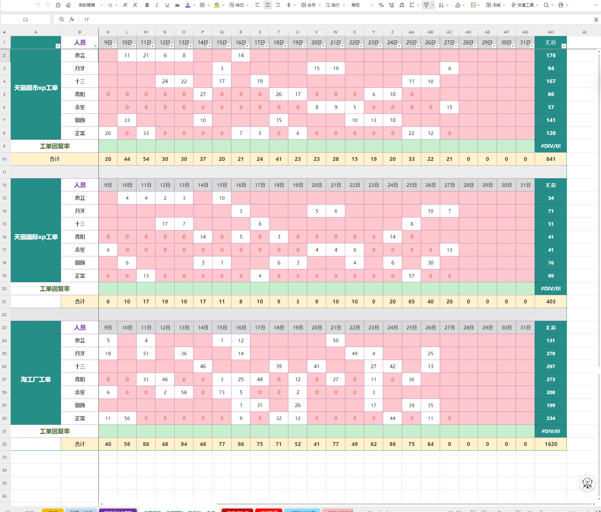
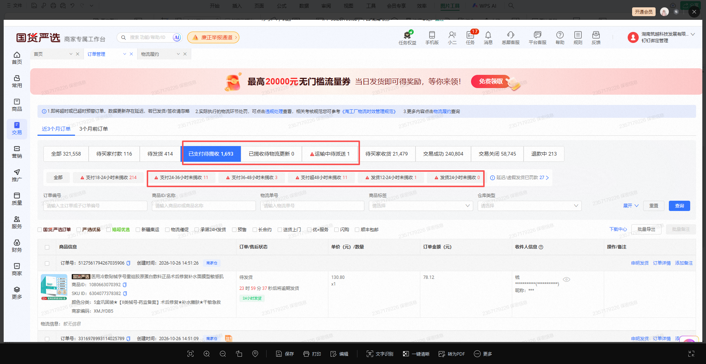
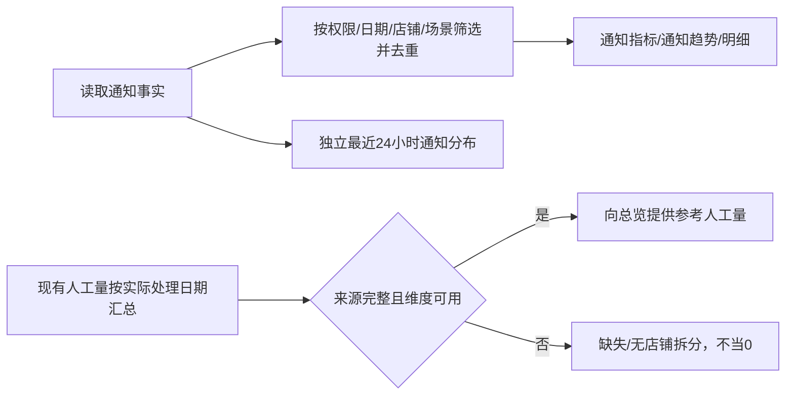

# 客服Agent看板｜淘工厂开发分册 V1.1

版本：2026-11-03修订。状态：规则已确认，待技术对接；原型合成数据已演示，不代表接入或上线。

本册可单独阅读。仅规定淘工厂通知子报表及其向跨平台总览提供的数据，不修改原业务监控/通知SOP。总览契约见[汇总PRD V1.1](../客服Agent看板_跨平台总览（汇总报表）PRD_V1.1.md)，原型见[当前原型](../../#prototype)。

## 本次增量边界（优先遵守）

已有数据直接复用本分册对应子报表，不要求重新采集、重建或重算整套指标。下文保留完整口径便于单册阅读，不表示全部功能重新开发。本次新增的是工单总量（参考）取数；仅依赖它的AI覆盖率、跨平台参考合计及缺失状态新增计算。总览已确认的完成日统计复用现有完成记录；若现有接口只返回创建日聚合，只补受影响的完成日查询/映射，子报表日期口径不变。已确认的平台自行结束、来源隔离等修正也只处理实际受影响项。已有合规字段登记复用位置及样本即可，不重复建设。

## 1. 本期范围与职责

| 变更 | 内容 | 开发职责 |
|---|---|---|
| 调整 | 淘工厂本期只监控、通知，AI实际处理为0 | 输出通知事实，不把通知记作处理完成 |
| 调整 | 详情展示通知量、通知趋势、最近24小时通知分布 | 本线开发提供通知时间/唯一键/场景/店铺 |
| 调整 | 总览参考工单总量复用现有子报表人工已处理量 | 本线开发提供现有人工量字段、实际处理日期、合计和读取状态；不重复建表 |

本期不新增AI判断/执行能力，不新增表格或通知渠道，不把淘工厂加入仅含大健康/天猫国际的页面填报弹窗。

## 2. 参考人工量取数

- 来源：用户已确认现有线上子报表已有人工量，本期直接复用其人工已处理量接口，按实际处理日期归属；开发核验接口和真实字段。不读取外部人工表，不纳入本次填报弹窗。
- 范围：已支付待揽收、已揽收待更新物流、运输中待派送；排除“支付18—24小时未揽收”“延迟/虚假发货”。
- 已支付待揽收五分类：支付24—36小时未揽收、支付36—48小时未揽收、支付超48小时未揽收、发货12—24小时未揽收、发货24小时未揽收。
- 人工表没有五类拆分，不按比例估算、不用差额补齐；按既有接口真实支持维度筛选；未提供维度不拆分、不分摊。原型仅演示平台日合计，不代表生产一定无店铺维度。
- 后台异常列表随物流更新/揽收移出，属于当前存量，不能把列表每日数累加成新增量，也不能把减少量当人工完成。
- 监控通知场景可能包含人工参考范围排除的场景；通知量与人工量不可直接对比、相减。

以下旧人工登记截图仅说明业务范围，系统不再从该表取数；本版来源为现有子报表。

## 3. 页面与字段计算

| 页面/字段 | 来源/计算 | 日期与显示 |
|---|---|---|
| 总览工单总量（参考） | 现有子报表人工已处理量按实际处理日期求和，不重复叠加合计/小计 | 人工实际处理日期；缺失不当0 |
| 总览Agent纯自动完成 | 0 | 本期仅通知、没有AI实际处理 |
| 总览进入自动化、已完成、转人工完成、尚未完成 | 不适用 | 显示“—”，不能从通知状态推算 |
| 总览AI覆盖率、AI完成占比 | 不适用 | “—”；不参与处理量趋势和排名 |
| 详情监控通知量 | 按通知业务唯一记录去重后计数；重试重复发送不增量 | 按通知发生时间筛选 |
| 详情人工已处理量（参考） | 复用现有人工量接口 | 按实际处理日，与通知量分别展示；不是自动化内转人工完成量 |
| 详情自动化已完成/尚未完成/自动化率 | 不适用 | 显示“—”；AI实际处理为0 |
| 通知趋势 | 去重通知量按通知日期分桶 | 1—31天日，32—180天自然周，≥181天自然月 |
| 最近24小时通知分布 | 本线通知事件，从查询时刻往前24小时至查询时刻的窗口（含起点，不含终点），24个小时桶 | 按通知发生时间，独立于顶部日期/店铺/场景筛选，仍受权限限制 |
| 场景列表 | 按配置场景分别统计通知量 | 无点击下钻，不显示虚构AI/人工处理量 |
| 明细状态/结果/完成时间 | 已通知 / 已发送监控通知 / — | 通知时间不能填入实际完成时间 |

保留当前原型监控场景，不据人工参考范围删除监控场景；前三类售后场景均不存在时隐藏业务类型拆分入口。类型是否存在由场景配置判断，与数量无关。

## 4. 查询、权限与异常

- 日期：默认近七天，今日/近七天/近30天/自定义，近N天含当天；北京时间，左闭右开，只统计已发生事件。
- 日期、店铺、场景条件自动查询；自定义完整选择后应用；非法日期保留原有效结果。没有查询/重置按钮。
- 指定店铺时通知明细正常按已知店铺筛选；人工量按接口已核验店铺/场景维度筛选；无该维度或尚未核验时显示“—/维度不支持”。不把平台全量泄露给只拥有部分店铺权限的人。
- 源数据完整的真零通知量为0；读取失败/未提供人工量为缺失，不能补0。总览合计标部分数据，不计算不完整的参考覆盖率。
- 明细状态与结果筛选只刷新明细、回第1页，不改变上方通知量/趋势。最近24小时图保持独立。
- 连续切换条件只有最后有效请求更新；失败保留上次有效结果及其查询范围，明确标记错误。

## 5. 数据契约与分工

| 逻辑字段 | 含义与约束 | 责任 |
|---|---|---|
| 平台/业务线 | 淘工厂稳定业务标识 | 本线配置 |
| 通知唯一标识 | 通知业务唯一键，隔离平台/店铺/任务；重复重试不增数 | 本线开发映射源字段 |
| 通知时间 | 实际通知发生时间，不是物流更新时间或完成时间 | 本线开发 |
| 店铺标识、场景标识、场景类型 | 店铺与监控场景配置，不能按名称/数量猜测 | 本线开发 |
| 参考数据归属日期、参考工单或处理量 | 现有子报表人工实际处理日期及非负整数合计；未提供时保留为空，不当作0 | 数据对接 |
| 来源数据状态、本次统计截至时间 | 来源完整性、缺失日期和数据截至时刻 | 数据对接/汇总开发 |

以上为逻辑字段，不指定接口和库表。通知去重键、既有人工接口的字段/实际处理日/维度/更新时点/失败恢复方式均需技术核验；不把大健康/天猫国际页面填报要求自动套在本线既有人工接口上，不伪造接入状态。

## 6. 验收

| AC | 场景 | 可观察预期 |
|---|---|---|
| AC-01 | 同条通知重试读取3次 | 通知量计1，不出现AI完成 |
| AC-02 | 后台物流揽收后异常列表减少 | 不把减少量计为人工完成或当日新增 |
| AC-03 | 查询本线总览行 | AI完成0，进入自动化/已完成/转人工完成量/尚未完成量/处理率均“—”；处理趋势与排名不含本线 |
| AC-04 | 现有人工源当天为0/缺失/读取失败 | 分别显示有效0、缺失、失败/缺失，状态可区分 |
| AC-05 | 选择具体店铺 | 通知范围按店铺变化；按接口已核验维度筛选；无维度则人工参考量“—/维度不支持” |
| AC-06 | 改日期、场景、明细状态 | 通知趋势/明细按各自范围联动；最近24小时不随顶部缩放 |
| AC-07 | 通知发生在小时桶起点/终点 | 起点纳入、终点排除，同事件只入一桶 |
| AC-08 | 监控含支付18—24小时场景 | 保留通知监控；人工参考量按已确认排除，不把两种范围混为一谈 |

交付物：通知源字段与去重映射、既有人工量接口映射与刷新说明、权限样本、零/缺失/失败与重复读取对账。原型演示不替代真实数据验收，不代表已开发或上线。

## 7. 对接前必须核验

现有人工字段必须能返回实际处理日的数据，不能直接把创建日人工完成结果换成处理日标签。提供源接口/字段、去重规则、合计与人员小计关系、权限/店铺/场景支持清单、覆盖日期、最后同步时间和失败恢复方式。实际接口尚未核验，不编造字段或刷新时限。
