# 客服Agent看板｜跨平台总览开发分册 V1.1（2026-11-03修订）

本册可独立阅读，包含汇总字段、公式、来源、钉钉、状态和验收；已有指标优先复用各线现有子报表，新增计算范围见第3.1节。

## 0. 文档信息

| 项目 | 内容 |
|---|---|
| 所属项目/模块 | 客服 Agent 看板：跨平台总览及各业务线提供汇总数据的契约 |
| 目标版本 | V1.1，汇总口径与取数规则更新 |
| 需求类型 | 调整 / 优化 |
| 文档版本与状态 | V1.1 / 2026-11-03修订，业务规则已确认，待技术评审与生产字段核验 |
| 当前有效PRD | 本版为当前总览PRD；V1.0中的子报表创建日、交互及明细规则继续有效，淘工厂仅通知规则以本版为准 |
| 对应方案/原型 | [当前业务确认原型](../../#prototype)；交付版见 `客服Agent看板_业务确认原型.html` |
| 当前实现证据 | HTML 合成数据原型已核验；真实平台接口、钉钉读取任务及淘工厂既有人工量接口尚未核验 |
| 总文档 | [汇总PRD V1.1修订版](../客服Agent看板_统计口径与交互优化_增量PRD_V1.1.md)，本册契约与其一致 |

### 版本记录

| 版本 | 日期 | 状态 | 变更摘要 |
|---|---|---|---|
| V1.0 | 2026-09-29 | 历史版本 | 创建日筛选、自动化指标、交互优化初版 |
| V1.1 | 2026-11-02 | 首版 | 总览完成日口径、参考工单总量、钉钉填报、平台取数规则、拼多多拆行、截图与边界 |
| V1.1修订 | 2026-11-03 | 当前版本 | 公式显示修正、来源隔离去重、异常完成状态、平台自行结束排除、淘工厂复用现有人工量、独立分册与对接清单补齐 |

## 1. 本期需求与 AI 能力概览及 CHG 索引

| CHG编号 | 功能模块 | 本期功能点 | 变更类型 | AI 能力变化 | 预期价值 |
|---|---|---|---|---|---|
| CHG-01 | 总览字段 | 完成量与完成趋势按实际完成日期，尚未完成按创建日当前存量 | 调整 | — | 直接回答每日实际处理产出，避免把创建日与完成日混为一谈 |
| CHG-02 | 总览指标 | 增加 AI 完成占比，保留参考工单总量和 AI 覆盖率参考标识 | 调整 | — | 明确可比指标与参考指标的边界 |
| CHG-03 | 平台取数 | 写入各平台参考工单总量来源、筛选、日期、去重和影响 | 调整 | — | 开发可按平台规则对接，业务可追溯数字来源 |
| CHG-04 | 拼多多汇总 | 汇总表拆分“平台工单”和“退款”两行，分别展示 | 优化 | — | 客服可分开查看工单与退款工作量 |
| CHG-05 | 钉钉取数 | 使用一张人工处理量记录表，9:30首取，失败项每30分钟补取，成功停止 | 新增 | — | 形成可按日期查询的人工参考量 |
| CHG-06 | 规则说明 | 工单总量仅保留表头一个说明入口，集中展示规则与数据影响 | 优化 | — | 减少页面重复说明，降低误读 |
| CHG-07 | 子报表边界 | 明确总览与子报表日期、指标和平台外人工的关系 | 调整 | — | 防止跨模块自行改公式或重复计数 |
| CHG-08 | 有效统计范围 | 平台自行结束且AI/人工均未处理的任务，排除有效处理统计 | 调整 | — | 不把平台动作记成AI或人工产出 |

本期不新增模型、Agent动作或业务执行能力，AI能力变化为“—”。

## 2. 背景、目标与成功标准

### 2.1 当前问题和基线

客服希望同时看到平台参考工单总量、AI处理量和人工处理量。当前可取得的数据来自不同来源：子报表按任务创建日期统计自动化任务，人工数据按实际处理日期登记，部分平台后台只提供申请量或当前存量。若直接相加或相减，数字可能不属于同一批工单。

### 2.2 本次目标与非目标

- **目标**：总览按完成日期展示自动化处理产出；保留创建日口径的进入自动化量与当前未完成存量；把各平台客服取数规则、钉钉取数和数据影响写成可开发、可验收契约。
- **目标**：拼多多平台工单与退款在汇总表分行；大健康、天猫国际人工数据按钉钉实际处理日期归属。
- **非目标**：不把参考工单总量当作统一新增需处理量；不由参考总量反推平台外人工完成、自动化内人工完成或尚未完成；不修改各业务线Agent执行SOP。

### 2.3 成功标准与统计口径

- 总览已完成、AI独立完成、转人工完成和处理趋势按实际完成日期；1号创建、2号完成，计入2号总览完成量。
- 总览尚未完成按所选创建日期统计查询时仍未完成的任务；1号创建且当前仍未完成，计入1号尚未完成。后续完成后该存量减少，不保留历史日终快照。
- 总览不再要求“进入自动化量＝本期已完成＋本期尚未完成”；该等式只保留在子报表的同一创建日任务集合内。
- 总览“AI完成占比”＝完成日集合内AI独立完成÷自动化内已完成；分母为0显示“—”。
- 参考工单总量缺失、不支持店铺拆分或钉钉人工未补齐时，不以0代替，显示缺失状态。

## 3. 当前能力与差异基线

| 编号 | 当前能力/规则 | 产品状态 | 当前实现 | 本次处理 |
|---|---|---|---|---|
| BASE-01 | 子报表按任务创建日期筛选，读取查询时最新状态 | 已确认 | 原型及旧PRD已有 | 沿用子报表；总览完成字段另按完成日 |
| BASE-02 | Agent纯自动完成与转人工最终人工完成互斥 | 已确认 | 原型演示 | 沿用，平台外人工填报不加入M |
| BASE-03 | 工单总量按各平台客服规则取得 | 已确认 | 原型为合成数据 | 本版补齐平台来源、日期、去重和影响 |
| BASE-04 | 大健康、天猫国际每日人工量在钉钉表填写 | 已确认 | 表格已建立，自动读取未核验 | 本版定义字段与补取状态 |
| BASE-05 | 淘工厂当前仅通知，不执行Agent处理 | 已确认 | 原型已区分通知与处理 | AI完成为0，通知不进处理指标 |
| BASE-06 | 小红书、天猫超市本期不纳入 | 已确认 | 原型已排除 | 不生成本期汇总数据 |
| BASE-07 | 淘工厂线上子报表已有人工量 | 用户2026-11-03确认 | 本次未核验生产接口 | 参考总量直接复用该人工量，不读取金山表、不增加钉钉列 |

### 3.1 本次开发改动边界：已有指标复用，仅扩展受影响项

各分册对应的子报表是已有数据的提供方。本次不要求各业务线重新采集、重建或重新计算整套子报表指标；分册保留完整口径供独立查阅，不表示这些功能都要重新开发。

| 数据/功能 | 本次处理 |
|---|---|
| 已有进入自动化量、完成归属、未完成、场景、分类、明细与24小时数据 | 直接复用对应分册的现有接口/任务记录；子报表创建日口径与原有展示继续沿用，不因新增参考总量改变 |
| 总览已确认的完成日A/M/C、完成日趋势及AI完成占比 | 优先复用已有真实完成时间、主体及完成记录，在汇总查询按完成日取数；不能直接拿子报表创建日聚合值改标签。现有接口不能返回时只补所需查询/映射，不重算整套子报表 |
| 新增工单总量（参考） | 按R-04各平台规则获取；大健康/天猫国际接钉钉H并与同日已有AI完成量A相加；淘工厂复用现有人工量 |
| 依赖新增总量的AI覆盖率、跨平台参考合计和缺失状态 | 按新参考量重新计算和联动；原有A/M/C/U不由参考量差值倒推 |
| 来源冲突、平台自行结束排除等已确认修正 | 仅在现有结果确实受影响时修正对应记录与关联指标，不扩成所有业务线全面重算 |

第9节是接口核验清单，已存在且符合口径的字段只需登记复用位置及样本，不要求重复建设。发现真实缺口仅列受影响字段、最小补充和责任方；若需改变已确认业务含义，先提交产品确认。

### 与旧版的差异和当前处理

| 编号 | 冲突/差异 | 高优先级事实 | 本次处理 | 影响 |
|---|---|---|---|---|
| DIFF-01 | 旧PRD把总览所有字段放在创建日任务集合内 | 用户最新确认总览完成量按完成日，尚未完成按创建日当前存量 | 总览拆分字段日期契约；子报表旧规则不改 | 总览不再套用T=C+U等式 |
| DIFF-02 | 旧总览只有自动化率 | 完成日展示需要同口径占比 | 总览改为AI完成占比；子报表仍保留自动化率 | 两者不能互换 |
| DIFF-03 | 旧平台说明缺少钉钉同步规则和截图 | 钉钉字段及9:30/补取规则已确认 | 本版补充六字段、状态和原图 | 技术仍需核验权限/API |
| DIFF-04 | 旧版拼多多只有一行；当前原型已拆两行 | 客服要求工单、退款分开看 | 汇总表拆两行，详情仍为原拼多多页面 | 两来源分别去重与对账 |
| DIFF-05 | 淘工厂旧版人工来源指向金山表 | 本期AI只通知；用户确认复用现有子报表人工量 | 参考总量读取本线既有人工量；通知仍不计处理 | 不新增钉钉列；人工量不混入自动化内M |

## 4. 本期范围边界

### 4.1 明确不做

| 不做事项 | 原因/依据 |
|---|---|
| 小红书、天猫超市进入本期汇总 | 用户已确认本期不做/不纳入 |
| 用参考工单总量减AI量推算人工完成或尚未完成 | 各平台来源、日期、范围不一致 |
| 用钉钉人工量补写子报表M（自动化内人工完成） | 钉钉记录的是平台外客服人工已处理参考量 |
| 淘工厂通知计入AI完成、处理趋势、自动化率或排名 | 当前仅通知、未处理 |
| 通过场景名称或订单数量猜测业务类型/拼多多来源 | 生产必须使用已确认业务配置和来源字段 |
| 新增独立汇总页面、审批、导出、消息通知 | 当前沿用原跨平台总览，用户未确认新增流程 |
| 金山表取数或新增淘工厂钉钉填报列 | 用户确认淘工厂直接复用现有子报表人工量；钉钉保持大健康/天猫国际六字段 |

### 4.2 限制事项

| 限制事项 | 适用范围 | 限制说明 |
|---|---|---|
| 参考工单总量 | 全平台 | 仅供客服参考，不代表统一新增需处理量 |
| 大健康、天猫国际人工量 | 钉钉表 | 只有平台日总量，无店铺/人员/业务类型拆分；选具体店铺时显示“—” |
| 人工数据时效 | 大健康、天猫国际 | 当天数据次日9:30前填写并读取；未成功前显示缺失，不当0 |
| 淘工厂后台量 | 淘工厂 | 异常列表随揽收/物流更新移出，是当前存量，不能累计为每日新增 |
| 淘工厂人工维度 | 现有子报表人工量 | 核验实际处理日、店铺/场景能力；原型仅演示平台日量，不能据此断言生产无该维度 |
| 真实数据接入 | 全平台 | 原型数据为合成演示；平台接口、钉钉权限、淘工厂现有人工量接口和字段映射待技术核验 |

## 5. 用户、角色与完整流程

### 5.1 角色和权限前提

| 角色 | 使用入口 | 可见/可执行范围 | 限制 |
|---|---|---|---|
| 客服主管/运营 | 原跨平台总览及业务线详情 | 既有授权平台、店铺、日期、场景筛选；只读查看 | 不可在看板修改平台业务数据 |
| 客服填报人员 | 钉钉在线表格 | 填写昨日大健康、天猫国际人工量 | 不填系统计算字段；不修改已成功取数的历史行 |
| 跨平台总览开发 | 看板服务 | 汇总标准化数据、计算总览指标 | 不自行定义平台底层状态或取数口径 |
| 各平台开发/数据对接 | 对应业务系统 | 提供字段映射、状态、来源和对账样本 | 必须遵守本版统一字段与日期契约 |
| 测试 | 看板、数据源、钉钉 | 执行字段、公式、异常、权限和截图验收 | 不以合成原型通过替代生产对账 |

### 5.2 主流程

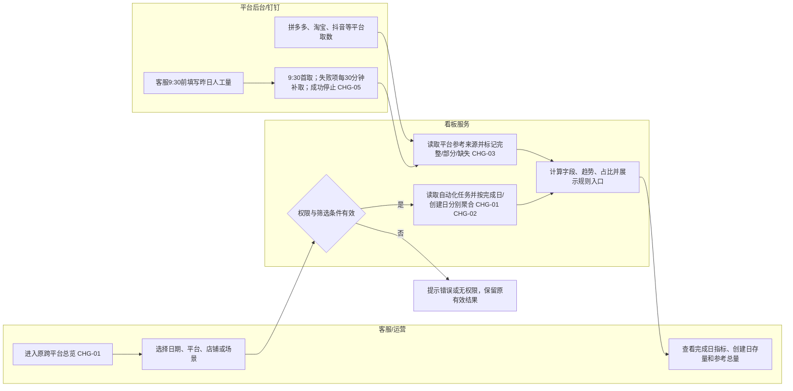

### 5.3 分支、异常和再次使用

1. 条件切换自动查询；日期自定义必须选择完整起止范围后查询。请求失败保留上次有效结果，并明确失败范围，不显示为0。
2. 钉钉按“实际处理日期＋平台”独立判断成功。一个平台成功、另一个平台缺失时，只更新成功平台；缺失项继续补取。
3. 同一任务重复扫描、重试或状态更新不重复计数；平台参考来源按各自唯一键去重。
4. 参考总量不完整时仍可展示已提供部分，但标记“部分数据/待补齐”；完全缺失显示“—”。0是有效数据。

## 6. 页面与交互变化

| 页面/区域 | 控件/内容 | 触发条件 | 系统反馈 | 关联变更 |
|---|---|---|---|---|
| 日期与筛选 | 今日、近七天、近30天、自定义；默认近七天，近N天含当天；条件靠左 | 切换日期、店铺、业务线 | 自动查询；自定义完整选择后应用，非法输入保留上次有效结果；无查询/重置按钮 | CHG-01 |
| 总览KPI | 工单总量（参考）、AI独立完成、AI覆盖率（参考）、AI完成占比；下方依次为进入自动化、已完成、转人工完成、尚未完成 | 进入总览或条件变化 | 自动刷新；缺失显示“—”或“部分数据” | CHG-01/02 |
| 汇总表 | 拼多多平台工单、拼多多退款分别成行 | 选择全部业务线 | 各行分别展示参考量与处理指标；点击业务线仍进入原拼多多详情 | CHG-04 |
| 汇总表表头 | 工单总量后保留一个“？”入口 | 点击入口 | 弹窗展示当前所选平台来源、日期、范围和影响；原始截图附于本文，不新增产品弹窗图片功能 | CHG-03/06 |
| 完成字段 | 已完成、Agent纯自动完成、转人工完成 | 总览查询 | 按实际完成日期；显示“完成日”提示 | CHG-01 |
| 尚未完成 | 当前未完成存量 | 总览查询 | 按创建日期；显示“创建日存量”提示 | CHG-01 |
| 趋势 | 各业务线处理量趋势 | 总览查询 | 按实际完成日期分桶，31天内按日、32—180天按周、181天及以上按月 | CHG-01 |
| 排名 | AI完成占比排名 | 总览查询 | AI完成÷自动化内已完成；不含平台外人工填报 | CHG-02 |
| 子报表 | 原有自动化率、进入自动化量和详情 | 从总览进入业务线详情 | 保留日期和店铺，场景/明细状态恢复全部；继续按任务创建日期，保留原T/A/M/U契约 | CHG-07 |
| 业务场景 | 总量/已完成卡片的拆分图标 | 存在对应配置场景 | 只显示实际存在的类型；前三类都不存在时不显示拆分 | 沿用V1.0 |

### 用户可见文案

| 场景 | 文案 |
|---|---|
| 总表说明 | `完成量按实际完成日；尚未完成按所选创建日统计当前存量。进入自动化仍按创建日。完成＋尚未完成不要求等于进入量。` |
| 工单总量 | `参考数据` |
| 缺失人工 | `部分数据 · 人工待补齐`；完全缺失为`— / 人工待补齐` |
| 无店铺拆分 | `— / 无店铺拆分` |
| AI完成占比 | `按实际完成日期：AI独立完成 ÷ 自动化内已完成；不含平台外人工量。` |
| AI覆盖率 | `进入自动化单量 ÷ 参考工单总量，仅供参考。` |

## 7. 功能与业务规则

### R-01 总览与子报表日期契约

- **关联变更**：CHG-01、CHG-07。
- **总览完成集合**：按实际完成时间`actual_completed_at`落在查询日期范围内的有效任务；包括此前创建、在所选时段完成的任务。
- **总览尚未完成集合**：按任务首次创建时间`created_at`落在查询范围内的有效任务，读取查询时最新状态，筛出当前未完成任务。
- **子报表集合**：仍按`created_at`筛选同一批有效任务，再读取当前最新状态，维持`T=C+U`。
- **示例**：1号创建、2号完成，进入2号总览完成量；查询1号子报表时仍属于1号创建集合，状态为已完成；1号创建且当前未完成计入1号尚未完成。
- 日期均按北京时间Asia/Shanghai，范围为开始日00:00:00至结束日次日00:00:00，左闭右开；今日只统计截至查询时刻已发生的数据。总表完成日与创建日集合不相加、不相减。

### R-02 自动化内完成归属、去重与状态

- 统计对象是已进入对应Agent范围的有效唯一工单/售后任务，不是扫描次数、订单商品件数或平台外人工量。
- 按平台＋业务来源命名空间＋店铺＋业务任务唯一键去重；拼多多来源必须明确为平台工单或售后退款，缺失时返回来源待映射，不默认归工单、不静默少算；同订单不同售后单分别计数；拼多多平台工单与售后退款编号即使相同也分别计数，跨平台不因裸编号相同而合并。
- **AI独立完成 A**：Agent独立处理并在实际业务终态完成，未由人工最终完成。
- **自动化内人工完成 M**：已转人工、最终由人工处理并结束；仅转交、接单、处理中或通知不计M。
- **自动化内已完成 C**：`C=A+M`，两类互斥；按实际业务结束时刻归属总览完成日期。
- **进入自动化 T**：子报表创建日集合中的有效唯一任务数。
- **尚未完成 U**：子报表集合中业务状态确认为尚未结束的任务数；`U=T-C_t`仅在子报表创建日集合且状态/完成归属完整时成立。已结束但时间/主体缺失的记录不计U；受影响的完成指标、拆分和比例显示数据不完整。
- 直接跳过、撤销且不进入处理范围的任务不进入T、A、M、U或总览完成量。
- **平台自行结束排除（CHG-08）**：任务已进入自动化后，有可信平台自行退款/关闭/终止证据，且明确AI、人工均未实际处理的，标记`platform_ended_without_handling`，排除T、A、M、C、U、类型拆分、处理趋势、排名、最近24小时处理量及核心处理明细。原始记录保留在源系统用于核查，不新增第三类已完成。
- 排除按查询时最新可信状态生效，因此对应首次创建日的有效进入量、完成/未完成进度可能减少；同批有效任务的子报表T=C_t+U仍成立。此规则只调整自动化有效集合，不改变淘宝等平台参考总量的客服筛选（例如“全部状态”仍包含关闭/撤销）。
- 平台关闭状态本身不等于“无人处理”：若已有真实AI/人工完成证据，仍按实际业务终态归属A/M；未核实处理主体时标数据不完整，不默认排除，也不算AI或人工完成。
- 原始结果未知后经人工核验并关单的有效任务归M；退款拒绝、人工撤销等真实终态按最终完成主体归属，不能统一改写为退款成功。进入范围后真实完成的跨日任务不因当前已结束而被误作“跳过”。
- 已结束但实际结束时刻/完成主体缺失或冲突时，不能归入U凑等式，也不能用其他指标差值推算。对应完成日指标/比率标为不可完整统计；保留可核验数据并返回缺失状态，待源字段补齐。

### R-03 总览字段公式

设`S_c`为完成时间落在所选范围的自动化有效任务，`S_t`为创建时间落在所选范围的自动化有效任务。

| 字段 | 计算规则 |
|---|---|
| 工单总量（参考） | 各平台按R-04的客服规则取得；不是统一的`T`，不可与T/C/U做差额计算 |
| 进入自动化单量 | `T=COUNT(S_t)`，按创建日期，沿用子报表 |
| 已完成 | `C=COUNT(S_c)`，仅统计实际已完成的自动化任务 |
| Agent纯自动完成 | `A=COUNT(S_c中completion_mode=pure_auto)` |
| 转人工完成 | `M=COUNT(S_c中completion_mode=manual_assisted)`；不含钉钉平台外人工量 |
| 尚未完成 | `U=COUNT(S_t中当前状态确认为未完成的任务)`；是当前存量，不是历史日终快照 |
| AI覆盖率（参考） | `T÷工单总量（参考）×100%`；分母不完整/为0/不支持时显示“—”，不截断超过100% |
| AI完成占比 | `A÷C×100%`；C为0显示“—”，只统计自动化内完成任务 |
| 子报表自动化率 | `A_t÷T×100%`；`A_t`是S_t中截至查询时已纯自动完成的数量，不使用总表完成日A；只在子报表使用，不与AI完成占比互换 |
| 完成量趋势 | 按实际完成日期分桶，桶内计`A+M`；查询跨度≤31天按日、32—180天按周、≥181天按月 |
| 最近24小时 | 独立滚动窗口，按实际完成事件时间计数；不受顶部日期、店铺、场景筛选影响，淘工厂使用通知时间和通知量 |

`COUNT`表示对符合条件的有效唯一任务计数，先去重再聚合。完成日查询必须直接按真实完成时间查全量有效任务，不能先按创建日缩小集合后再筛完成日。子报表完成集合记为`C_t`，与总览完成日`C`明确区分。

总览各业务线行、顶部卡片和图表使用相同筛选范围及数据截至时刻。数量先汇总再计算比例，不平均业务线百分比；比例展示保留1位小数，排名按未舍入的A/C排序，无完成分母的业务线不参与排名。人工数据补齐只改变对应参考量及参考覆盖率，不改变自动化内A/M/C/U和AI完成占比。

总览的业务类型拆分复用现有点击图标浮层：进入自动化按S_t拆分、已完成按S_c拆分，占比分母分别为T/C。分类依真实场景类型配置，配置存在但当期0仍显示0；退货退款/仅退款/换货均无时隐藏拆分入口。业务线能力不同则说明覆盖范围，不用差额制造“其他工单”。

### R-03A 趋势分桶与缺失数据

- 查询天数包含首尾：1—31天按日，32—180天按自然周（周一至周日），181天及以上按自然月。
- 首尾桶只取与查询范围的交集，不扩展查询范围。横轴正序、跨年显示年份；悬停显示实际起止日期和数量。
- 来源完整且确实无记录的桶补0；来源缺失/失败/完成字段不完整的桶标缺失或部分数据，不补0；有数据缺失时不能把桶和排名作为完整结果。
- 完成趋势各桶计同完成日集合的A+M，与已完成合计对账。来源、状态与截至时刻相同才校验；只调整粒度不改变数量。
- 比例按未舍入值排序；相同占比沿用业务线既有顺序，显示保留1位小数。无完成分母或来源不完整的线不参加排名。

### R-04 各平台参考工单总量取数规则

| 平台/业务 | 来源与筛选 | 日期 | 去重/合计 | 主要影响 |
|---|---|---|---|---|
| 拼多多·平台工单 | 后台→工单管理，按工单创建时间筛选，取工单数量；不取有效完结率 | 工单创建时间 | 来源内按工单唯一标识；与退款行分开 | 包含尚未处理工单，不是当天完成量 |
| 拼多多·退款 | 售后工作台，操作类型为“商家同意退款”，按申请时间取数量 | 售后申请时间 | 来源内按店铺＋售后编号；与平台工单分别计数 | 不区分AI/人工，不得直接当人工完成 |
| 阿里大健康 | 总览完成日内AI实际独立完成量＋钉钉对应日期人工已处理量 | AI和人工均按实际完成/处理日期；人工次日填报前一日 | AI任务去重；钉钉按日期＋平台取一次 | 是处理量参考，不是全部新增需处理量；与子报表创建日结果可能不同 |
| 天猫国际 | 总览完成日内AI实际独立完成量＋钉钉对应日期人工已处理量 | AI和人工均按实际完成/处理日期；人工次日填报前一日 | AI任务去重；钉钉按日期＋平台取一次 | 人工只有平台日总量，无店铺拆分；人工缺失不当0 |
| 淘工厂 | 淘工厂现有子报表人工已处理量，按实际处理日期直接复用；AI仅通知，AI处理量为0 | 人工实际处理日期 | 按现有人工量的去重/日合计契约汇总，不重复叠加人员小计和合计，不推算五分类 | 异常列表是当前存量；物流更新/揽收后移出，不能累计为每日新增 |
| 淘宝 | 退款管理分别查询未收货退款、已收货退款、退货退款、退运费、换货；状态全部，合并分页总条数 | 售后申请时间 | 按店铺＋售后单号去重；同订单不同售后单不合并 | 是售后申请参考量，不是人工完成量 |
| 抖音 | 售后工作台状态“退款成功”，类型为已发货退款、退货退款、换货 | 售后申请时间 | 按平台售后唯一键去重 | 不含未发货退款及全部待处理售后 |

淘工厂人工参考量范围：已支付待揽收、已揽收待更新物流、运输中待派送，排除支付18—24小时未揽收及延迟/虚假发货。已支付待揽收五分类为：支付24—36小时未揽收、支付36—48小时未揽收、支付超48小时未揽收、发货12—24小时未揽收、发货24小时未揽收。既有人工汇总未提供五分类数据，不估算各类数量；通知监控场景范围不必与人工参考量范围相同，不以通知量替代人工量。

淘宝统计“全部售后状态”，包含处理中、已结束、关闭/撤销等，不擅自排除；取完整分页总条数，不取勾选数或当前页条数。该规则替代历史账号合计/生意参谋口径，历史规则不再参与本期计算。抖音退款成功三类型的参考量与自动化子报表范围不相同，不能据此倒推出未完成或人工数量。

### R-05 拼多多汇总拆行

- 汇总表展示“拼多多·平台工单”和“拼多多·退款”两行。
- 两行分别展示参考工单总量、进入自动化量、完成量、AI完成、转人工完成、尚未完成、AI覆盖率和AI完成占比。
- 顶部跨平台卡片按平台/业务来源合计，拼多多两行各计一次，不再叠加第三个拼多多合计行；同一订单同时有工单和售后单时，按两个业务任务分别计数，不按订单合并。
- 两行点击均进入原拼多多详情页；详情页不新增独立子报表，开发通过来源字段区分展示和对账。

### R-06 钉钉人工填报与读取

钉钉表：[数据看板人工处理量记录](https://alidocs.dingtalk.com/i/nodes/gwva2dxOW4KpnamQHnoO3pZy8bkz3BRL?utm_scene=person_space)。一张数据表，每天一行，客服只填写业务数据和备注。

| 字段 | 填写/系统规则 |
|---|---|
| 实际处理日期 | 填昨日完整日期；数据归属该日期，不归属录入日期 |
| 阿里大健康人工处理量 | 昨日人工已处理总量，非负整数；0有效；不拆业务类型 |
| 天猫国际人工处理量 | 昨日人工已处理总量，非负整数；0有效；不混入其他平台 |
| 修改人 | 表格自动记录，不作为统计日期 |
| 修改时间 | 表格自动记录，不作为统计日期 |
| 备注 | 可选；迟填、异常、更正原因可说明 |

读取规则：

1. 客服每天北京时间9:30前填写昨天数据；没有处理量填0，未填留空。
2. 系统每天9:30首次读取昨天记录；按“实际处理日期＋平台”独立判断，非负整数（含0）才算成功。
3. 未填、读取失败或格式异常的日期＋平台，每30分钟重试；跨日继续补取，不影响新一天首次读取。
4. 某日期＋平台成功后停止补取，不重复刷新成功数据；另一平台仍可继续补取。
5. 同日期多行、非法日期、负数、小数不入统计；修正后按失败项重新读取。重试必须幂等。
6. 未成功不是0；页面标记缺失。成功后用户原则上不修改，确需更正走单独更正流程。
7. 今日人工量在次日首次读取成功后才可见；数据归属昨日。
8. “成功停止”只针对日期＋平台的人工填报H，不冻结AI完成量A或整个参考总量。若AI完成事件延迟同步，A补齐后自动重算参考量A+H及覆盖率；H不重取、不重复累加。
9. 调度恢复时将启用后漏执行的日期＋平台加入未成功队列，按原补偿周期重试；首日启用日期、需回填历史的最早日期及既有成功检查点由技术评审记录，未接入/未覆盖历史明确标缺失。
10. 本期不增加历史更正页面。成功数据确需更正，由业务确认日期、平台及正确值，技术按同一键审计更正；不得通过新增同日行或备注实现自动二次累加。

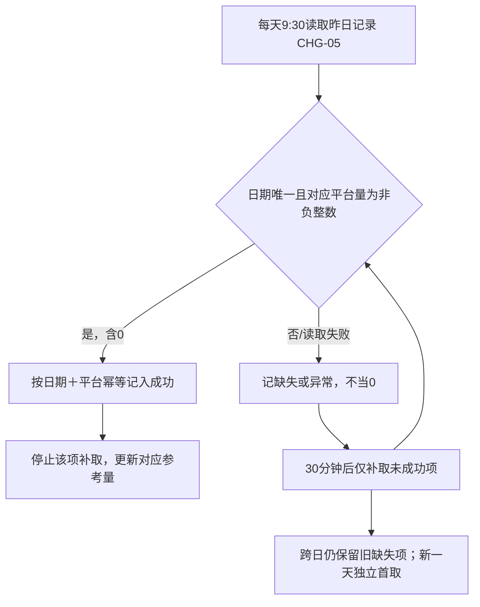

例：2号9:30读取到1号大健康人工量20、天猫国际为空，则大健康1号20取数成功并停止，天猫国际1号继续于10:00、10:30……补取。若次日仍未成功，旧缺失项继续补取，同时正常启动2号数据的首次读取；不重复累加已成功的20。

内部状态需记录读取状态、失败原因、成功时间、读取批次和数据截至时间，不新增客服填写字段。钉钉权限、API能力、自动记录修改人/修改时间、定时任务调度方式由开发技术核验。

### R-07 缺失、店铺和平台边界

- 参考量部分日期有效时展示数字并标“部分数据·人工待补齐”；完全无有效数据时显示“—”。
- 0是有效值，不能与缺失混淆。
- 大健康、天猫国际钉钉人工来源无店铺拆分；选择具体店铺时参考量显示“—/无店铺拆分”。淘工厂按既有人工量接口已核验的维度筛选，未核验或无店铺/场景拆分时显示“—/维度不支持”，不强分摊平台合计；通知任务仍按其店铺/场景筛选。
- 淘工厂通知记录不进入T、C、A、M、U、趋势或AI完成占比；详情使用“监控通知量”和通知时间。
- 小红书、天猫超市不进入本期导航、筛选、汇总、图表和排名。
- 参考合计为各有效来源之和，任何所选业务线/日期缺失或不支持时整体标“部分数据”；没有有效来源则为“—”。AI覆盖率仅在全部所选来源完整且参考总量大于0时计算；不能剔除缺失平台后保留全部平台的分子计算。

### R-07A 参考量缺失与部分数据展示

| 来源及情形 | 参考工单总量 | 完整性/比例 |
|---|---|---|
| 大健康/天猫国际：所选范围人工H全部未取得，即使A已知 | —，标人工待补齐；A在AI独立完成卡正常展示 | 参考覆盖率— |
| 部分日期H已成功，其他日期缺失 | 所选范围全部可核验A＋已成功日期的H；不剔除缺人工日期的已知A | 部分数据，保留缺失日期；覆盖率— |
| H成功且填0 | A＋0；0是有效人工值 | 其他来源完整时按规则计算 |
| H完整但AI完成源失败/不完整 | 展示已核验的来源部分并标数据不完整；不能把未知A当0 | 覆盖率—；AI相关占比也不可用 |
| 淘工厂现有人工量部分日期可用 | 有效日期人工量求和，标部分数据；全部缺失则— | 不从通知量推算 |
| 指定店铺但人工源无相同维度 | —/无店铺拆分 | 覆盖率—；自动化任务仍按店铺筛选 |
| 跨平台部分来源缺失 | 已提供参考量相加并标部分数据；无有效来源则— | 必须保留缺失业务线及日期；覆盖率— |

人工源只有平台总数时，不向仅有部分店铺权限的账号展示越权平台合计。`data_as_of`表示本次统计截点，另带各来源最近成功同步时刻与覆盖日期，不能用看板刷新时间冒充源数据更新时间。平台人工量、自动化完成源的最新数据可以有不同延迟，页面和接口需明确完整性。

### R-08 规则截图与来源

截图仅用于说明客服原始取数位置和筛选条件，截图中的历史数字不作为看板实时数据。以下图片保留原图，不裁剪、不脱敏、不上传第三方。旧客服人工登记表截图仅用于解释业务范围，不作为本版系统读取入口；淘工厂改复用现有子报表人工量，钉钉只读取大健康/天猫国际。

#### 拼多多

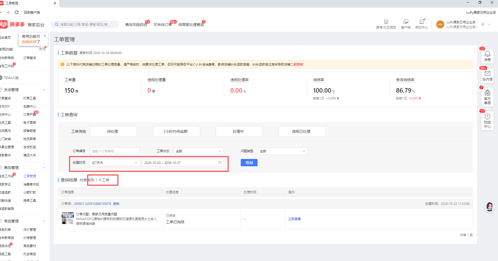

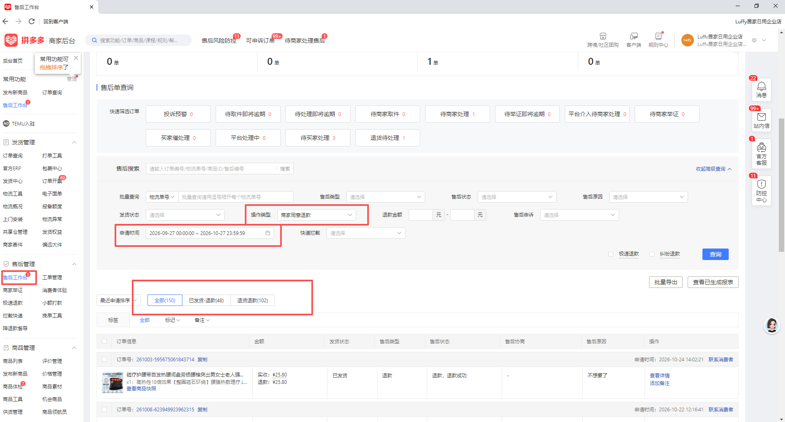

#### 阿里大健康与天猫国际

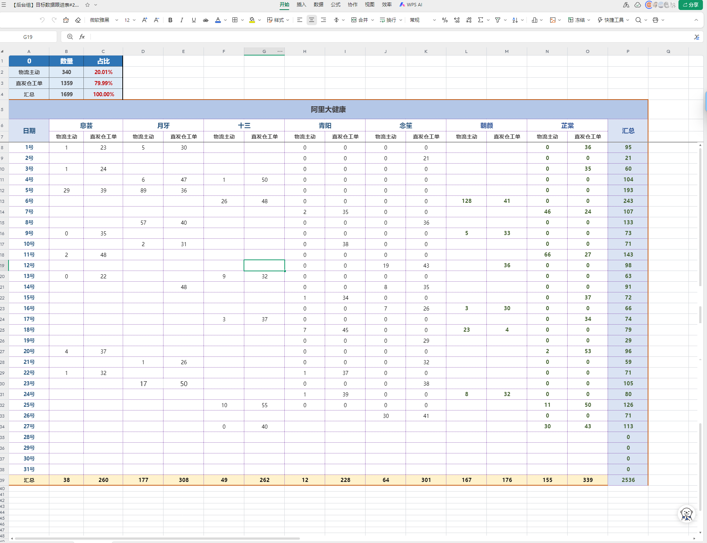

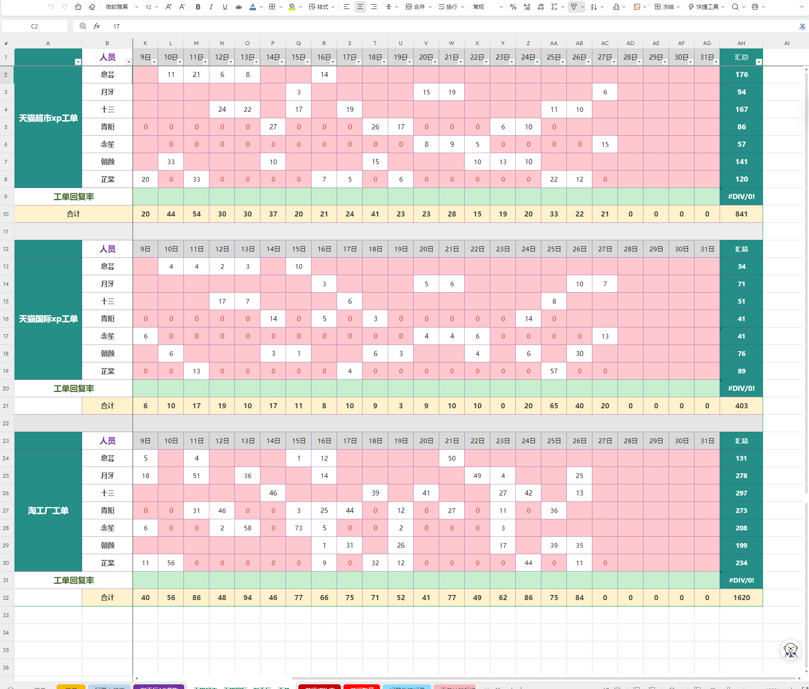

上图保留客服完整原表，其中其他业务区域仅作原图背景；本期钉钉只登记阿里大健康、天猫国际，不增加天猫超市。

#### 淘工厂

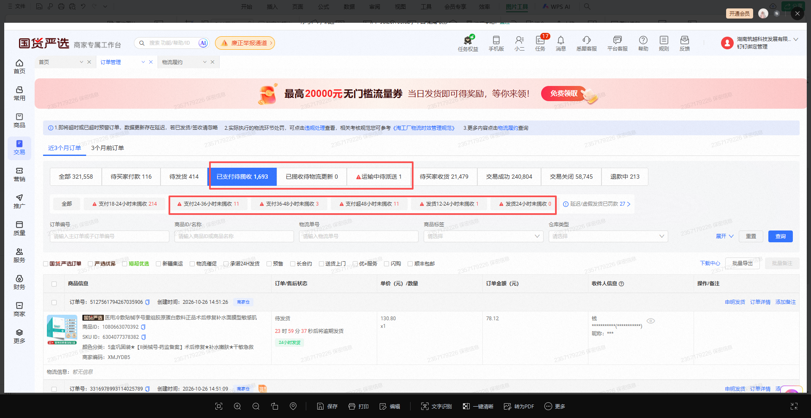

#### 淘宝与抖音

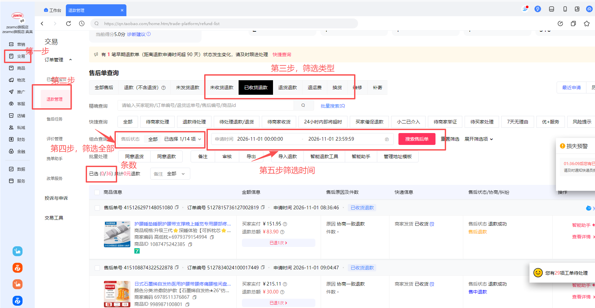

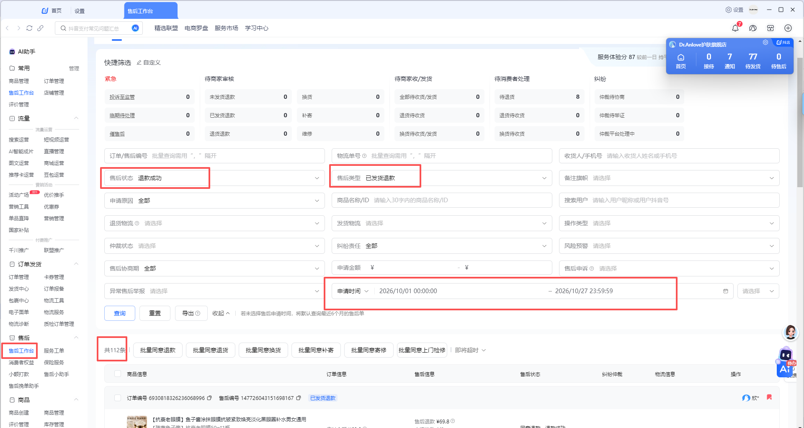

#### 钉钉填报表

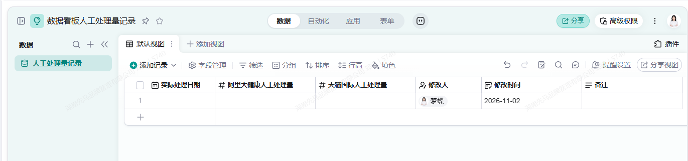

#### 当前汇总原型

以下为合成数据原型截图，固定演示日期不代表真实统计日期或已接入系统。

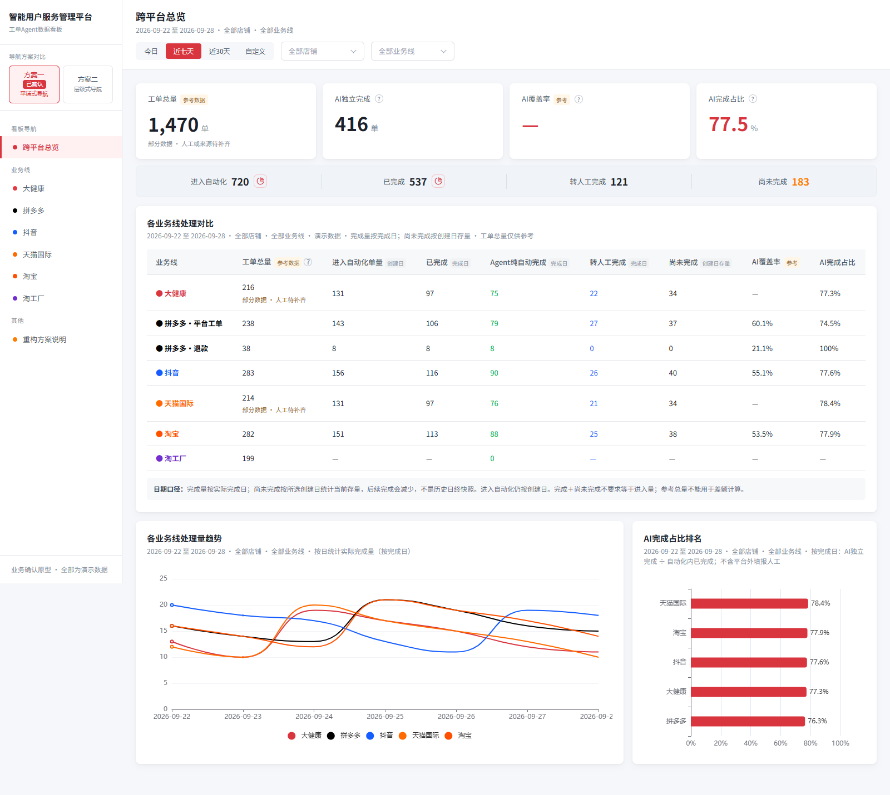

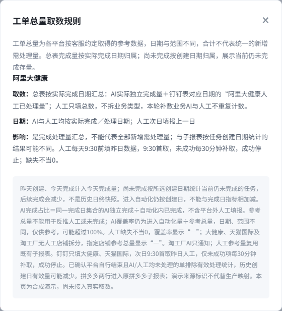

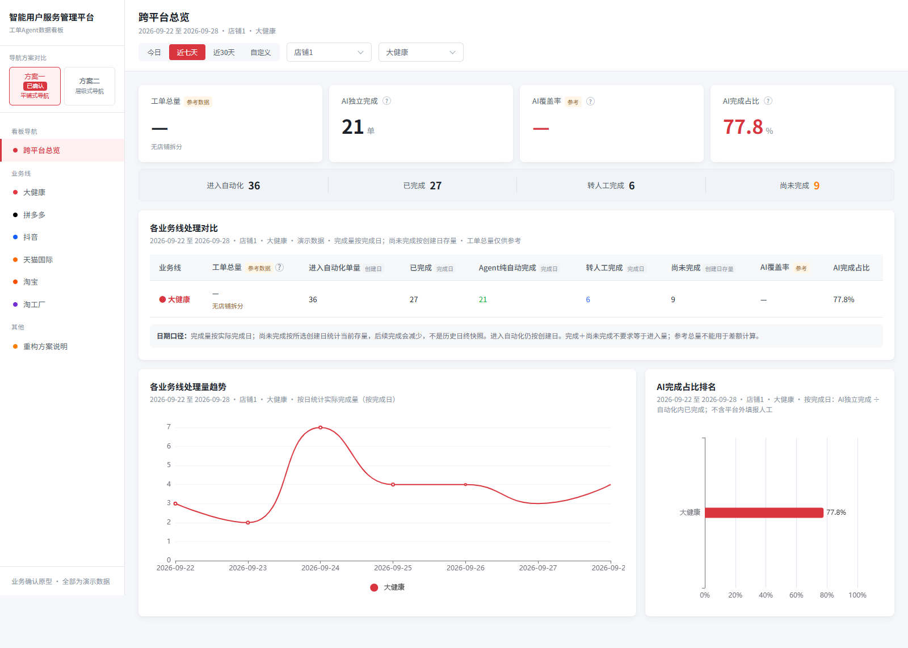

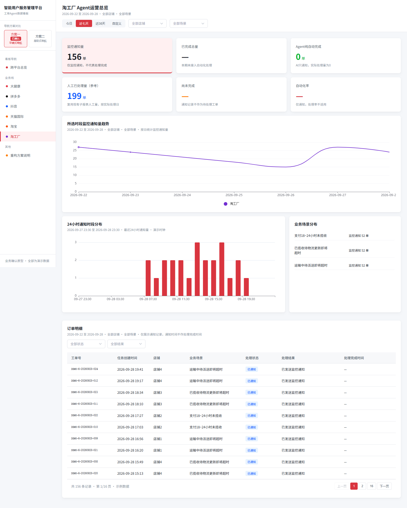

## 8. 状态、边界与异常

| 业务状态/数据状态 | 看板处理 | 数字影响 |
|---|---|---|
| 自动独立结束 | 计入总览完成日A/C及趋势 | 不计M |
| 转人工且最终人工结束 | 计入总览完成日M/C及趋势 | 不计A |
| 仅转人工、人工接单、人工处理中 | 不计C/A/M | 在对应创建日子报表保持U |
| 任务未完成 | 不计完成日C；若创建日在查询范围，计当前U | 后续完成后从U减少，进入完成日C |
| 钉钉空白/读取失败 | 参考量显示缺失 | 不当0，不计算完整AI覆盖率 |
| 钉钉填0 | 参考量正常计算 | 0为有效数据 |
| 查询失败 | 保留上次有效结果，标记失败范围 | 不显示为0 |
| 业务已结束但完成时间/主体未知 | 标记数据不完整 | 不强推AI/人工，不伪装为尚未完成 |
| 平台自行结束且AI/人工均未处理 | 排除有效处理集合；源记录保留 | T、A、M、C、U等均不计，参考平台申请量规则不变 |
| 平台来源缺失 | 显示“来源待补齐” | 不用其他平台或合成数据补齐 |
| 淘工厂仅通知 | 只计通知量 | 处理指标显示“—”，AI实际处理为0 |

## 9. 数据对象与字段契约

| 对象 | 字段名 | 业务含义 | 类型 | 必填 | 校验/枚举 | 来源/状态 |
|---|---|---|---|---|---|---|
| 自动化任务 | `platform` / `business_line` | 平台与业务线标识 | string | 是 | 两者区分；拼多多工单/退款可分行 | 各平台任务源，待映射 |
| 自动化任务 | `source_type` | 业务来源命名空间 | enum/string | 拼多多必需 | 工单/售后退款来源，非场景分类，不按关键词猜测 | 平台工单/售后来源，待映射 |
| 自动化任务 | `store_id` | 店铺唯一标识 | string | 条件 | 不用展示别名代替 | 现有配置 |
| 自动化任务 | `task_key` | 平台＋来源命名空间＋店铺＋业务任务唯一键 | string | 是 | 重试/状态更新不新增 | 现有任务/售后系统 |
| 自动化任务 | `created_at` | 首次任务创建时间 | datetime | 是 | 北京时间解释，不能被重试时间覆盖 | 子报表沿用 |
| 自动化任务 | `actual_completed_at` | 实际业务结束时间 | datetime | 完成任务必填 | 不用转交、同步、轮询时间代替 | 开发映射待核验 |
| 自动化任务 | `completion_mode` | 最终完成主体 | enum | 完成任务必填 | `pure_auto` / `manual_assisted`，互斥 | 处理日志/人工闭环待映射 |
| 自动化任务 | `task_status` | 当前业务状态 | enum | 是 | 能判断完成/未完成 | 各平台状态映射待核验 |
| 自动化任务 | `eligible` | 是否属于当前有效处理集合 | bool | 是 | 非范围、直接跳过及已确认无人处理的平台自行结束为false | 业务范围及结束证据 |
| 自动化任务 | `end_origin` / `ai_handled` / `human_handled` | 外部结束原因及实际处理证据 | enum/bool | 条件 | 只有可信平台结束且双方明确未处理才可排除；缺失不是false | 本线状态及动作/人工日志映射 |
| 自动化任务 | `exclusion_reason` / `ended_at` | 排除原因及业务结束时刻 | enum/datetime | 条件 | 建议platform_ended_without_handling；不同于实际AI/人工完成 | 本线状态证据 |
| 自动化任务 | `scene_type` | 场景类型 | enum | 条件 | 按配置判断，不按名称关键词 | 场景配置待核验 |
| 参考数据 | `reference_platform` | 参考量所属平台/业务 | string | 是 | 拼多多工单、拼多多退款分别标识 | 平台后台/钉钉/淘工厂现有子报表 |
| 参考数据 | `reference_date` | 参考数据归属日期 | date | 是 | 按R-04各平台日期 | 各平台来源 |
| 参考数据 | `reference_value` | 平台参考工单/处理量 | integer | 是 | 非负整数；缺失为null | 各平台来源 |
| 钉钉记录 | `actual_process_date` | 客服人工数据归属日 | date | 是 | 昨日日期；按日期＋平台唯一取值 | 钉钉表 |
| 钉钉记录 | `djk_manual_count` | 阿里大健康人工量 | integer/null | 是 | 非负整数；空为未成功 | 钉钉表 |
| 钉钉记录 | `tmall_manual_count` | 天猫国际人工量 | integer/null | 是 | 非负整数；空为未成功 | 钉钉表 |
| 钉钉记录 | `modified_by` / `modified_at` | 修改审计信息 | string/datetime | 自动 | 表格自动记录 | 钉钉表 |
| 钉钉记录 | `remark` | 客服备注 | string/null | 否 | 可空，不参与日期或数量计算 | 钉钉表 |
| 钉钉同步 | `sync_status` / `failure_reason` / `synced_at` | 系统读取状态 | enum/string/datetime | 系统 | `pending/success/failed/invalid` | 系统内部，不新增客服字段 |
| 汇总响应 | `source_status` / `data_as_of` | 数据完整性与本次统计截至时刻 | enum/datetime | 是 | 建议complete/partial/missing/unsupported/error；保留缺失日期及平台 | 各来源同步状态 |

### 9.1 各业务线必须交付的源字段映射

以下为复用核验与新增字段对接清单；已有字段按各分册现有接口直接复用，只对新增参考总量及确有影响的字段补适配。业务筛选、日期及公式已确定，真实接口、物理字段和权限由各线开发登记并附对账样本，不以截图中的演示数值作为接口输入。

| 平台/来源 | 参考数据的读取与日期 | 自动化数据必须提供 | 核验重点/责任 |
|---|---|---|---|
| 拼多多·平台工单 | 工单管理创建时间、工单数量；完整分页 | 工单来源、店铺、唯一工单号、首次创建、真实终态、结束时间、最终主体、场景 | 来源内去重；不取有效完结率；拼多多开发 |
| 拼多多·退款 | 售后工作台商家同意退款，申请时间 | 退款来源、店铺＋售后号、首次任务创建、实际完成、主体、接管证据 | 同编号不同来源计两单；退款参考与自动化范围分开；拼多多开发 |
| 大健康 | 钉钉实际处理日H＋本线完成日A | 现有任务源及场景配置、真实结束与主体；钉钉六字段目标ID/类型 | 人工无店铺拆分、不混入M；本线开发＋钉钉对接 |
| 天猫国际 | 钉钉实际处理日H＋本线完成日A | 本期既有业务线任务源、真实结束与主体；钉钉字段ID/类型 | 只取本期既有天猫国际，不因同平台名合并其他组织的新项目；本线开发＋钉钉对接 |
| 淘工厂 | 已有子报表人工量接口，实际处理日期 | 人工日量/唯一键或日合计、覆盖日期、状态；通知唯一键/通知时间/店铺/场景独立提供 | 不读取金山，不新增钉钉字段；核验既有人工数据能否按实际处理日返回；淘工厂开发 |
| 淘宝 | 五类、全部状态、申请时间，完整分页 | 店铺＋业务来源＋售后/任务唯一键、任务创建、实际结束、主体/接管证据 | 参考含关闭撤销；无人处理的平台自行结束只从自动化有效集合排除；淘宝开发 |
| 抖音 | 退款成功＋指定三类，申请时间 | 店铺＋售后/任务唯一键、创建、真实结束、主体、场景 | 自动化可有未发货退款；参考不包含该类，不缩减Agent原范围；抖音开发 |

每一涉及本次变更的数据项登记复用入口或新增映射，至少包括：源系统/入口、真实源对象和字段、状态/主体映射、唯一键、日期字段、筛选与权限、更新方式、空值/失败行为、脱敏对账样例和责任角色。字段未核验时标待映射，不能由汇总开发按文字名称猜测。

### 9.2 状态归一与字段缺失

| 源业务事实 | 标准化归属 | 计数 |
|---|---|---|
| Agent独立执行并确认父任务真实结束 | pure_auto | 按真实完成日A/C；不是阶段提交成功 |
| 已接管、最终人工实际处理并关闭 | manual_assisted | 按真实人工完成日M/C；退款/拒绝/人工撤销保留原结果 |
| 等待、处理中、待人工、待验证、暂停或未闭环异常 | unfinished | 创建日U；无实际完成时间 |
| 业务已结束、时间或主体缺失 | incomplete | 不伪装U，不猜A/M；受影响完成统计和比率不可完整展示 |
| 平台自行结束且两方明确未处理 | platform_ended_without_handling | 有效T/A/M/C/U均排除，保留源证据 |
| 只有platform_closed标签、处理事实未核实 | incomplete | 不据标签直接排除；开发核验源证据 |

拼多多退款旧状态`auto_succeeded`、`manual_closed`和淘宝`auto_approved`/`auto_rejected`等，仅在符合真实结束与主体证据时映射A/M；`manual_pending`、`pending_verification`不能提前完成。各业务线原始枚举不同，必须提交本线完整映射，不把原型success/manual当真实生产字段。

上述名称为逻辑字段契约和建议枚举，不指定物理表、接口路径或现有技术字段名。开发须完成逐字段映射；不能把演示字段当成已经存在的接口。

## 10. AI 能力边界

本期为统计和数据同步功能，不新增AI能力，AI专项契约不适用。看板只读取已有Agent处理结果，不触发退款、换货、通知或业务重试；客服人工量由客服填写，不能由AI猜测。

## 11. 依赖、联动与历史兼容

| 维度 | 本次处理 | 不确认的影响 |
|---|---|---|
| 业务线子报表 | 继续按创建日T/A/M/U；总览另按完成日C/A/M | 开发把总览和子报表当同一集合，导致数字对不上 |
| 拼多多详情 | 继续原详情页；汇总两行通过来源字段区分 | 不能分别核对工单与退款 |
| 平台后台权限 | 复用客服/服务账号现有权限 | 不能读取全分页、筛选或来源字段时，参考量缺失 |
| 钉钉表权限/API | 读取“数据看板人工处理量记录” | 无权限或字段类型不支持时人工参考量缺失 |
| 淘工厂现有子报表 | 复用已有人工量，核验按实际处理日的查询字段、唯一键及更新时点 | 若只提供创建日结果而无实际处理日字段，不得直接换标签复用，须由本线开发补齐适配 |
| 历史记录 | 不用旧总量差值反推新字段 | 旧日期数据只能按可核验字段回填，不能伪造完成日 |
| 权限与隐私 | 只展示内部授权范围和必要业务标识 | 不扩大平台后台权限，不在PRD复制客户订单敏感值 |

## 12. 数据取值、统计、埋点与经营结果

### 12.1 字段计算汇总

| 数据项 | 业务含义 | 取数方式 | 统计/取值规则 | 公式 |
|---|---|---|---|---|
| 进入自动化单量 | 创建日进入Agent范围的任务数 | 聚合统计 | 有效、去重、排除跳过 | `T=COUNT(S_t)` |
| 已完成 | 所选完成日内自动化任务已结束数量 | 聚合统计 | 按实际完成时间，A/M互斥 | `C=COUNT(S_c)=A+M` |
| AI独立完成 | 所选完成日内Agent独立结束数量 | 聚合统计 | `completion_mode=pure_auto` | `A` |
| 转人工完成 | 所选完成日内最终人工结束数量 | 聚合统计 | `completion_mode=manual_assisted` | `M` |
| 尚未完成 | 所选创建日任务中当前未结束存量 | 聚合统计 | 查询时最新状态，非历史日终快照 | `U=COUNT(S_t中当前状态确认为未完成的任务)` |
| 工单总量参考 | 客服指定平台量/处理量 | 平台取数/钉钉读取 | 按R-04，不与T/C/U混合 | 各平台规则 |
| AI覆盖率 | 自动化进入量在参考量中的比例 | 计算指标 | 参考指标，允许因口径差异超过100% | `T/参考工单总量` |
| AI完成占比 | 自动化内完成任务中AI占比 | 计算指标 | 完成日集合，不含平台外人工 | `A/C` |
| 完成量趋势 | 各完成日的自动化处理产出 | 聚合统计 | 按跨度日/周/月分桶 | `A+M` |

### 12.2 埋点与经营结果

本期不新增用户行为埋点。业务价值验证采用脱敏对账：同一日期、平台、店铺、来源分别核对参考量、A、M、C、U和缺失状态；不得用登录次数替代有效统计。

## 13. 非功能、安全与技术待确认

| 维度 | 产品约束 | 技术待确认 | 不确认的影响 |
|---|---|---|---|
| 平台取数 | 取全分页总条数/完整筛选结果 | 各平台接口、权限、分页与历史范围 | 参考总量可能为当页数或不完整 |
| 钉钉同步 | 9:30首取、失败项每30分钟、成功停止、幂等 | API权限、字段类型、定时任务、超时和重试 | 无法区分缺失、读取失败和0 |
| 淘工厂人工量复用 | 使用现有子报表已具备的人工量，按实际处理日期汇总 | 已有接口、日期、去重、更新及失败补偿 | 来源不可用时标缺失，不回退到金山表或通知差额 |
| 数据一致性 | 响应标注`data_as_of`和来源状态 | 全平台统一截点能力 | 各卡片可能混用不同时间的数据 |
| 历史回填 | 不用差值猜测完成归属 | 完成事件和主体历史字段 | 历史AI/M/C无法准确回填 |
| 权限审计 | 复用现有授权，记录钉钉读取状态 | 服务账号、权限范围、审计留存 | 可能越权或无法追溯 |

## 14. 验收标准

| 编号 | 关联 | 操作/前置 | 可观察预期 | 类型 |
|---|---|---|---|---|
| AC-01 | R-01 | 构造1号创建、2号完成任务，分别查1号和2号总览 | 2号计完成；1号子报表仍含该任务且状态已完成 | 正常 |
| AC-02 | R-01 | 构造1号创建且当前未完成任务 | 查1号总览计尚未完成；后续完成后该存量减少 | 边界 |
| AC-03 | R-02/03 | 任务自动完成4、人工完成3、未完成3 | 总览完成7、AI4、人工3；AI完成占比57.1% | 正常 |
| AC-04 | R-02 | 同一任务重复扫描、重试、状态更新 | 只计1；跨平台/不同售后单不误合并 | 去重 |
| AC-05 | R-03 | 参考工单总量与T/C/U日期范围不同 | 不用参考量相减推算人工或未完成；AI覆盖率标参考 | 口径边界 |
| AC-06 | R-04 | 分别读取各平台指定筛选 | 日期、范围、去重与本表一致；缺权限标缺失 | 数据 |
| AC-07 | R-05 | 查看总览全部业务线 | 拼多多显示平台工单、退款两行，合计不重复；点击进入原详情 | 交互 |
| AC-08 | R-06 | 9:30前填1号大健康/天猫国际量 | 系统读取1号；数据归属1号而不是录入日2号 | 正常 |
| AC-09 | R-06 | 留空一个平台、另一个填0 | 空平台缺失并继续补取；0平台成功且显示0 | 边界 |
| AC-10 | R-06 | 读取失败后修正，等待下一次补取 | 仅失败项重试；成功后停止；重复读取不累加 | 异常 |
| AC-11 | R-07 | 选择大健康具体店铺 | 自动化任务按店铺筛选；钉钉参考量显示无店铺拆分，不伪造拆分 | 边界 |
| AC-12 | R-07 | 淘工厂查询 | AI实际处理为0；通知量不进入完成、未完成、趋势、排名 | 业务边界 |
| AC-13 | R-08 | 点击工单总量表头“？” | 弹窗展示当前所选平台来源、日期、影响；页面只保留一个入口；本文附原始取数截图及当前原型截图 | 交互/文档 |
| AC-14 | R-01/03 | 选择31、32、180、181天 | 总览完成趋势分别按日、周、周、月；桶内合计可对账 | 趋势 |
| AC-15 | R-03 | 完成量为0或参考量缺失 | 占比显示“—”，缺失不显示0或伪造百分比 | 异常 |
| AC-16 | R-07 | 查询无数据、真实0、读取失败 | 三种状态分别显示0、0、失败/缺失，不混淆 | 异常 |
| AC-17 | R-03 | 工单行完成4、退款行完成2，AI分别3/1 | 顶部拼多多完成合计6、AI4，完成占比66.7%；不取75%与50%的平均数，不重复加拼多多总行 | 聚合 |
| AC-18 | R-06 | 同日期重复两行、负数、小数、读取超时分别发生 | 对应日期/平台不记成功、不入统计，修正后继续补取；已成功平台不重记 | 异常 |
| AC-19 | R-02/03 | 已结束任务没有真实完成时间或最终主体 | 完成日统计明确数据不完整，不归入U补等式，不用更新时间代替完成时间 | 数据缺失 |
| AC-20 | R-07 | 账号仅有部分店铺权限，源人工量只有全平台合计 | 不展示越权平台合计；人工参考量显示不支持/缺失，自动化量仅统计授权店铺 | 权限 |
| AC-21 | R-03 | 调整店铺/业务线、日期后查看分类浮层 | 进入自动化浮层按S_t，已完成浮层按S_c；合计对应卡片，场景类型存在但为0仍可见 | 联动 |
| AC-22 | CHG-06/R-07 | 连续切换日期/平台，旧响应晚到，再模拟读取失败 | 仅最后有效请求更新；失败保留原结果并标注原查询范围，不能配新标签伪装新数据 | 异常 |
| AC-23 | CHG-03/R-02 | 同店铺工单与退款编号相同 | 两来源分别计数，顶部合计2；来源缺失标待映射，不默认归工单 | 正常/联动 |
| AC-24 | CHG-08 | 1号创建、2号平台自行关闭，有可信证据AI/人工都没处理 | 核心处理统计均不计，查1号T/U减少；参考平台申请量仍按原规则；原始证据保留 | 边界/异常 |
| AC-25 | CHG-08/R-02 | 只有关闭标签，或已有真实AI/人工处理证据 | 未核实标不完整；已有完成主体证据按A/M，不误作无人处理排除 | 边界/异常 |
| AC-26 | CHG-05/R-06 | H成功20后，同日A因源数据迟到从5补为7 | H不重取；参考量从25更新为27，不重复累加20 | 正常/联动 |
| AC-27 | CHG-05/R-07A | 同日H全缺但A已知；跨日部分H成功 | 前者参考量—；后者全部可核验A＋成功H并标部分；覆盖率均— | 边界/异常 |
| AC-28 | CHG-01/R-03A | 范围首尾非周/月边界，含无业务或缺来源日期 | 自然周/月只取交集；真零桶0，缺失桶不补0；可核验桶与对应完成集合对账 | 边界/异常 |
| AC-29 | CHG-03/R-04 | 淘工厂现有人工量接口返回按实际处理日的日总数 | 总表直接复用一次；详情显示人工已处理参考量，通知与人工分开；钉钉仍六字段，无金山读取 | 正常/联动 |

## 15. 待确认与开发交接

| 编号 | 类型 | 问题/事项 | 当前建议 | 不确认的影响 | 责任角色 | 状态 |
|---|---|---|---|---|---|---|
| TBD-01 | 技术待确认 | 各平台实际完成事件、最终完成主体、创建时间和状态字段映射 | 已有字段登记复用接口和样本，仅对本次受影响缺口补映射后联调 | 无法准确区分A/M/C/U | 各平台开发/数据对接 | 待技术确认 |
| TBD-02 | 技术待确认 | 钉钉在线表格读取权限、字段类型、定时任务与幂等重试 | 以用户提供表格为唯一目标，按R-06核验 | 人工参考量显示缺失 | 跨平台开发/数据对接 | 待技术确认 |
| TBD-03 | 技术待确认 | 淘工厂现有子报表人工量接口与归属日期 | 明确现有人工量字段、实际处理日期、去重/汇总方式、权限、更新时间和失败状态 | 淘工厂参考量不可追溯 | 淘工厂开发/数据对接 | 待技术确认 |
| TBD-04 | 技术待确认 | 拼多多平台工单/退款来源字段在自动化任务中的映射 | 使用来源类型或业务任务ID，禁止按名称猜测 | 两行无法对账 | 拼多多开发 | 待技术确认 |
| TBD-05 | 技术待确认 | 历史任务是否具备真实完成时间和完成主体 | 可核验才回填，不用差值猜测 | 历史完成日指标不完整 | 各平台开发/测试 | 待技术确认 |

### 开发交付边界

- **实施原则**：已有指标直接复用各分册子报表数据；新增参考工单总量及其覆盖率、参考合计、完整性联动才新增计算。已确认总览完成日查询与异常修正仅补受影响项，不要求重建子报表。
- **本次必须实现或核验复用**：总览完成日/创建日双口径字段、AI完成占比、完成日趋势、拼多多两行、工单总量规则弹窗、钉钉读取状态、淘工厂已有人工量复用、平台自行结束排除、参考量缺失标识、权限范围和失败保留上次结果。
- **明确沿用现有**：子报表创建日T/A/M/U、任务级去重、场景类型显示、筛选自动查询、最近24小时独立、明细实际完成时间。
- **技术方案待设计**：平台接口、数据适配层、钉钉读取方式、淘工厂现有人工量读取方式、缓存、调度、审计和历史回填。
- **禁止自由扩展**：不得将平台外人工量写入子报表M，不得把通知计为处理完成，不得以参考总量差值补齐未知数据，不得恢复小红书/天猫超市本期业务。

业务规则已确认，无待客服重新确定的正常统计公式。各平台真实源字段、接口、权限、更新时点及历史覆盖属于技术核验，不写成已接通。跨平台总览开发分册和淘工厂分册已同步本版；其他业务线分册明确分开子报表创建日契约和总览完成日对接契约。旧V1.0保留作为历史版本，不再作为本期总览口径。
