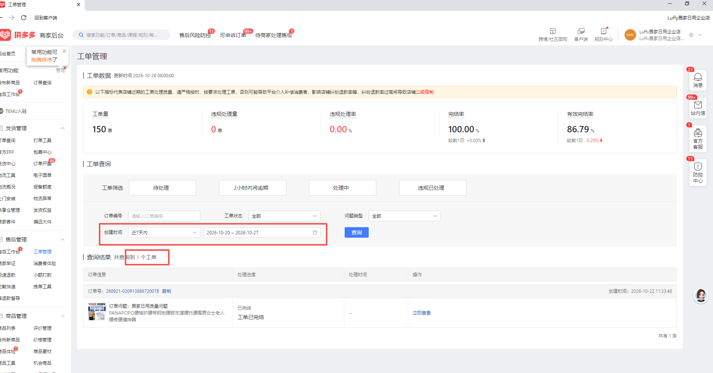
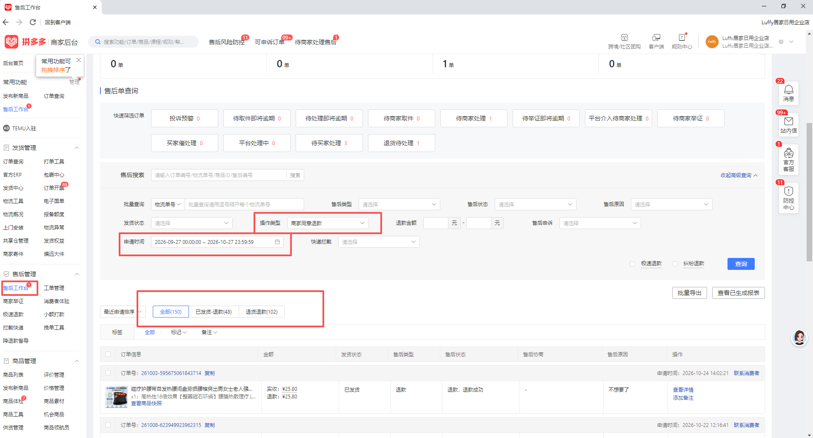
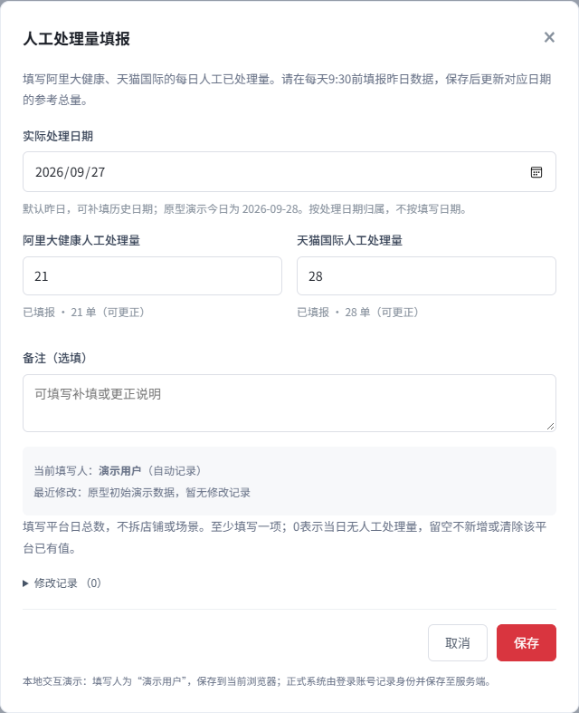
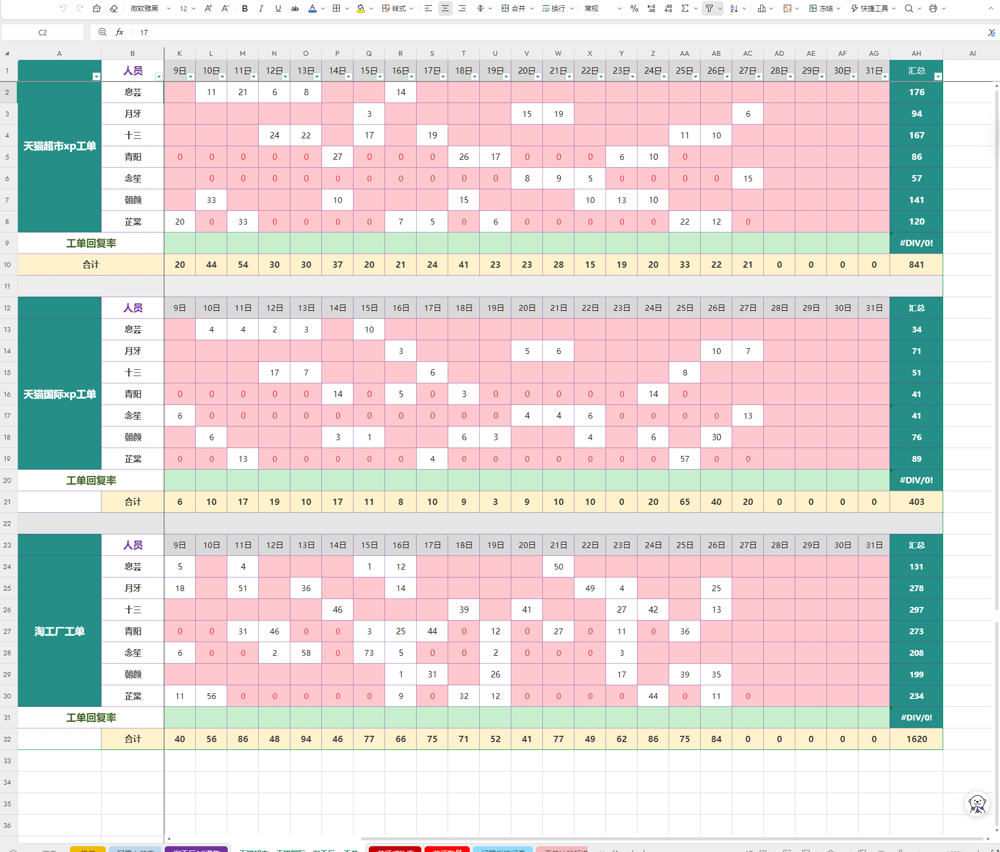
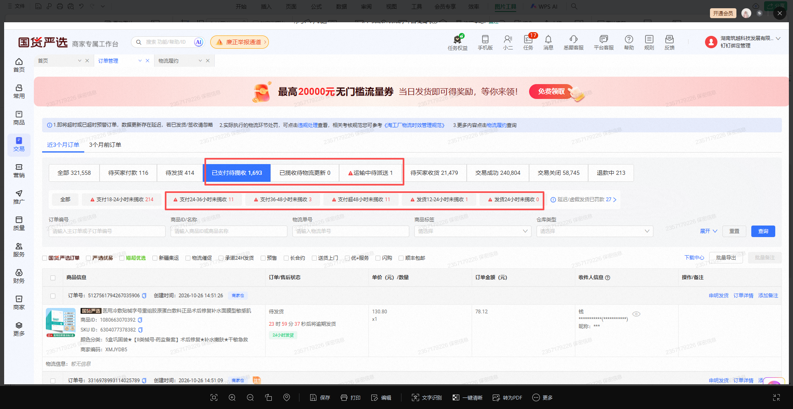
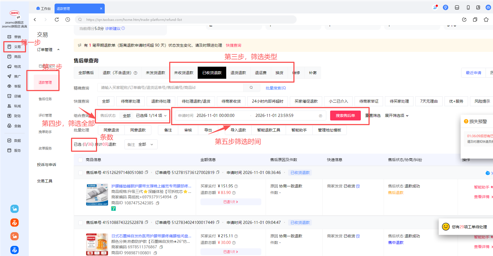
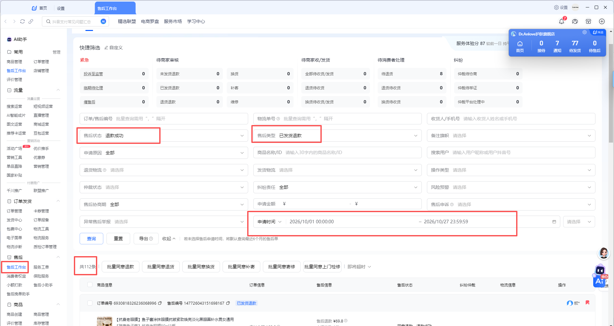

# 各平台取数规则及影响 · 业务确认版

更新日期：2026-11-03。

请业务核对各平台的取数范围、日期和数据影响。小红书本期不做。大健康、天猫国际改为看板页面填报；正式保存接口仍待开发验证。

## 取数一览

| 平台／业务 | 总数怎么取 | 日期依据 |
|---|---|---|
| 拼多多 · 平台工单 | 工单管理的工单数量 | 工单创建时间 |
| 拼多多 · 退货退款 | “商家同意退款”筛选数量 | 售后申请时间 |
| 阿里大健康 | 总览完成日AI实际独立完成量＋页面已保存人工处理量 | AI与人工均按实际完成/处理日；人工次日填报上一日 |
| 天猫国际 | 总览完成日AI实际独立完成量＋页面已保存人工处理量 | AI与人工均按实际完成/处理日；人工次日填报上一日 |
| 淘工厂 | 现有子报表人工已处理量；AI为0 | 人工实际处理日期 |
| 淘宝 | 五类售后＋全部状态的去重总条数 | 售后申请时间 |
| 抖音 | 退款成功＋三类售后筛选数量 | 售后申请时间 |

## 拼多多 · 平台工单

- 日期：工单创建时间。
- 怎么取：拼多多后台 → 工单管理，按创建时间筛选，取工单总数量；不取有效完结率。
- 代表什么：所选创建时段内的工单量，包含尚未处理的工单。
- 主要影响：不是当天实际完成量；不能用总量减AI量，直接当作人工完成量。

## 拼多多 · 退货退款

- 日期：售后申请时间。
- 怎么取：拼多多后台 → 售后工作台，操作类型选“商家同意退款”，按申请时间筛选后取数量。
- 统计范围：只取客服约定的上述范围，不扩大到全部退款申请。
- 主要影响：这个筛选不区分AI或人工处理，不能把全部数量算成人工完成。

## 总览与子报表日期分工

- 总览已完成、AI独立完成、转人工完成和完成量趋势按实际完成日期统计；1号创建、2号完成，计入2号总览完成量。
- 总览尚未完成按所选任务创建日期统计查询时仍未完成的当前存量；后续完成后该存量减少，不保留历史日终快照。
- 进入自动化单量和子报表自动化率仍按任务创建日期；因此总览与子报表同一天的数字可能不同，不能强行相等。
- 大健康、天猫国际总览参考量＝同一完成/处理日期的AI实际独立完成量＋页面已保存人工处理量；页面人工量不写入子报表的自动化内人工完成。

## 阿里大健康

- 日期：总览AI和人工均按实际完成/处理日期；子报表AI仍按任务创建日期。
- 怎么取：总览所选完成日AI实际独立完成量＋页面对应日期的“阿里大健康人工处理量”。
- 人工范围：只填一个人工总数，不拆业务类型；本轮补数业务按AI或人工单独处理、不重复计数。
- 主要影响：这是完成处理量参考，不是全部需处理量；与子报表创建日结果可能不同。人工数据次日提供，缺失不当0。
- 填报取数：点击总览“人工处理量填报”，每天9:30前填昨日数据，保存即生效；支持补填、更正，记录填写人与修改时间。

## 天猫国际

- 日期：总览AI和人工均按实际完成/处理日期；子报表AI仍按任务创建日期。
- 怎么取：总览所选完成日AI实际独立完成量＋页面对应日期的“天猫国际人工处理量”。
- 人工范围：只取天猫国际总数，不混入其他业务；本轮补数业务按AI或人工单独处理、不重复计数。
- 主要影响：这是完成处理量参考，不包含未处理单；与子报表创建日结果可能不同。人工数据次日提供，缺失不当0。
- 填报取数：点击总览“人工处理量填报”，每天9:30前填昨日数据，保存即生效；支持补填、更正，记录填写人与修改时间。

## 淘工厂

- 日期：人工实际处理日期。
- 怎么取：直接复用现有子报表的人工已处理量，按实际处理日期查询。系统不再读取金山表，不纳入本次填报弹窗。AI只监控、通知，处理量计0。
- 业务范围：已支付待揽收、已揽收待更新物流、运输中待派送；排除“支付18—24小时未揽收”和“延迟／虚假发货”。
- 已支付待揽收五分类：支付24-36小时未揽收；支付36-48小时未揽收；支付超48小时未揽收；发货12-24小时未揽收；发货24小时未揽收。
- 主要影响：物流更新或揽收后会移出异常列表，后台数是当前存量，不能累加为每日新增或把减少量当作人工完成；现有人工接口未提供分类时不估算；实际处理日、去重及店铺/场景维度由开发核验。

## 淘宝

- 日期：售后申请时间。
- 怎么取：淘宝／千牛 → 交易 → 退款管理，按相同申请时段分别查询五类售后，状态选“全部”，合并去重。
- 五类售后：未收货退款、已收货退款、退货退款、退运费、换货。全部状态包括处理中、已结束及关闭／撤销等，不另行排除。
- 计数规则：按店铺＋售后单号去重；不同售后单不因属于同一订单而合并。取全部分页总条数，不取勾选数或当前页数；截图36仅为示例。
- 主要影响：这是指定五类新申请的售后单量，不是人工完成量。与AI数据比较前需匹配售后单、日期及统计范围。

## 抖音

- 日期：售后申请时间。
- 怎么取：抖音后台 → 售后工作台，售后状态选“退款成功”，类型取“已发货退款、退货退款、换货”，按申请时间筛选后取条数。
- 统计范围：按客服给定组合，不增加未发货退款等其他类型。
- 主要影响：只含退款成功的数据，不包含全部待处理售后，也不是按完成日统计；不能直接减AI量得到人工完成量。

## 页面人工填报及取数

在原跨平台总览点击“人工处理量填报”，只填写大健康、天猫国际，不再从钉钉或金山表读取。

| 字段 | 规则 |
|---|---|
| 实际处理日期 | 默认昨日，可补填以前日期；不允许今日或未来日期，不按录入日期统计 |
| 阿里大健康人工处理量 | 当日人工总量，非负整数，不拆业务类型 |
| 天猫国际人工处理量 | 当日人工总量，非负整数，不混入其他业务 |
| 填写/修改人、时间 | 系统按登录账号和保存时间自动记录 |
| 备注 | 选填，可说明补填或更正 |

- 每天9:30前填完昨日数据；保存成功立即生效，不等待定时取数。
- 至少填一个平台；没有处理量填0，0有效；空白不当0、不清除原值。
- 同日期、同平台只保留一个有效数量；允许补填、更正，覆盖原值而非重复相加，保留修改记录。
- 本期不单独配置填写权限；沿用系统登录和数据可见范围，记录真实填写人。
- 未保存或填写失败仍缺失；保存失败保留输入，可重试。多人同时更正有冲突时先核对最新值。
- 总量仍为同处理日AI独立完成＋人工有效值；补填更正会更新参考总量、合计及覆盖率，不改变自动化内已完成、转人工或未完成。
- 今日人工量仍待次日填写，因此今日整体数据可能不全；填报日期不是数据归属日期。仅有平台总数，不按店铺/场景分摊。

例：2号填1号人工20，计入1号；以后改25，1号使用25，不是20＋25。AI迟到补齐仍与最新有效人工量重新相加。淘工厂继续复用现有子报表人工量，不在这里填。

## 使用这些规则的整体影响

各平台数据可能对不上，主要有以下情况：

- **统计日期不同：** 总览完成量按实际完成/处理日，子报表按任务创建日，淘宝/抖音按售后申请日；同一天可能不是同一批单。
- **人工数据晚一天：** 大健康、天猫国际次日填报；未填或未保存成功会缺数，不能当0。
- **各平台范围不同：** 有的统计新申请，有的统计已处理量，合计只能按各自口径参考。
- **不能直接相减：** 不能直接用总量减AI量算人工完成，或减已完成量算未完成；页面AI覆盖率仅按进入自动化量÷参考总量展示，不代表统一的真实业务覆盖率。

## 平台自行结束的处理

已进入自动化后，平台自行退款或关闭，且有证据确认AI、人工均未实际处理的单，排除有效处理总量、完成量和未完成量；对应历史创建日有效总量也会减少。原始记录保留核查。已有AI/人工实际完成证据的仍按原归属；只有关闭标签但事实不明时不擅自排除。各平台参考申请量仍按客服原筛选，不因此删掉关闭/撤销单。

## 资料来源

- 客服《取数逻辑（给IT）》、后续确认及本文完整原始截图；截图中的历史数值不作为本次看板数据。
- [客服取数Excel](assets/取数逻辑（给IT）.xlsx)
- 总览完成量按实际完成日；子报表继续沿用任务创建日口径。
