# 客服Agent看板｜跨平台总览（汇总报表）PRD V1.1

## 0. 文档信息

| 项目 | 内容 |
|---|---|
| 所属项目/模块 | 客服 Agent 看板：跨平台总览及各业务线提供汇总数据的契约 |
| 目标版本 | V1.1，汇总口径与取数规则更新 |
| 需求类型 | 调整 / 优化 |
| 文档版本与状态 | V1.1 / 2026-11-03修订，业务规则及当前填报原型已确认，待技术评审与生产字段核验 |
| 当前有效PRD | 本版为当前总览PRD；子报表创建日、交互及明细规则见各平台开发分册，淘工厂仅通知规则以本版为准 |
| 对应方案/原型 | [当前业务确认原型](../#prototype)；交付版见 `客服Agent看板_业务确认原型.html` |
| 当前实现证据 | HTML合成原型及页面填报交互已核验；真实平台接口、人工填报服务端保存/登录审计及淘工厂既有人工量接口尚未联调核验 |
| 开发阅读 | 本文即跨平台总览（汇总报表）的完整PRD；汇总开发只需阅读本文件，各平台开发阅读对应平台分册。不另设跨平台总览分册 |

### 当前版本

| 版本 | 日期 | 状态 | 内容摘要 |
|---|---|---|---|
| V1.1 | 2026-11-03 | 当前版本 | 总览完成日统计、参考工单总量、各平台取数规则及拼多多拆行；人工量在页面弹窗填报，支持补填、更正、填写人和按实际处理日期归档的修改记录 |

## 1. 本期需求与 AI 能力概览及 CHG 索引

| CHG编号 | 功能模块 | 本期功能点 | 变更类型 | AI 能力变化 | 预期价值 |
|---|---|---|---|---|---|
| CHG-01 | 总览字段 | 完成量与完成趋势按实际完成日期，尚未完成按创建日当前存量 | 调整 | — | 直接回答每日实际处理产出，避免把创建日与完成日混为一谈 |
| CHG-02 | 总览指标 | 增加 AI 完成占比，保留参考工单总量和 AI 覆盖率参考标识 | 调整 | — | 明确可比指标与参考指标的边界 |
| CHG-03 | 平台取数 | 写入各平台参考工单总量来源、筛选、日期、去重和影响 | 调整 | — | 开发可按平台规则对接，业务可追溯数字来源 |
| CHG-04 | 拼多多汇总 | 汇总表拆分“平台工单”和“退款”两行，分别展示 | 优化 | — | 客服可分开查看工单与退款工作量 |
| CHG-05 | 页面人工填报 | 总览新增日人工量填报弹窗，支持补填、更正、填写人及修改记录 | 调整 | — | 客服直接填写，保存后更新参考指标 |
| CHG-06 | 规则说明 | 工单总量仅保留表头一个说明入口，集中展示规则与数据影响 | 优化 | — | 减少页面重复说明，降低误读 |
| CHG-07 | 子报表边界 | 明确总览与子报表日期、指标和平台外人工的关系 | 调整 | — | 防止跨模块自行改公式或重复计数 |
| CHG-08 | 有效统计范围 | 平台自行结束且AI/人工均未处理的任务，排除有效处理统计 | 调整 | — | 不把平台动作记成AI或人工产出 |

本期不新增模型、Agent动作或业务执行能力，AI能力变化为“—”。

## 2. 背景、目标与成功标准

### 2.1 当前问题和基线

客服希望同时看到平台参考工单总量、AI处理量和人工处理量。当前可取得的数据来自不同来源：子报表按任务创建日期统计自动化任务，人工数据按实际处理日期登记，部分平台后台只提供申请量或当前存量。若直接相加或相减，数字可能不属于同一批工单。

### 2.2 本次目标与非目标

- **目标**：总览按完成日期展示自动化处理产出；保留创建日口径的进入自动化量与当前未完成存量；把各平台客服取数规则、页面填报和数据影响写成可开发、可验收契约。
- **目标**：拼多多平台工单与退款在汇总表分行；大健康、天猫国际人工数据按填报实际处理日期归属。
- **非目标**：不把参考工单总量当作统一新增需处理量；不由参考总量反推平台外人工完成、自动化内人工完成或尚未完成；不修改各业务线Agent执行SOP。

### 2.3 成功标准与统计口径

- 总览已完成、AI独立完成、转人工完成和处理趋势按实际完成日期；1号创建、2号完成，计入2号总览完成量。
- 总览尚未完成按所选创建日期统计查询时仍未完成的任务；1号创建且当前仍未完成，计入1号尚未完成。后续完成后该存量减少，不保留历史日终快照。
- 总览不再要求“进入自动化量＝本期已完成＋本期尚未完成”；该等式只保留在子报表的同一创建日任务集合内。
- 总览“AI完成占比”＝完成日集合内AI独立完成÷自动化内已完成；分母为0显示“—”。
- 参考工单总量缺失、不支持店铺拆分或页面人工未填齐时，不以0代替，显示缺失状态。

## 3. 当前能力与差异基线

| 编号 | 当前能力/规则 | 产品状态 | 当前实现 | 本次处理 |
|---|---|---|---|---|
| BASE-01 | 子报表按任务创建日期筛选，读取查询时最新状态 | 已确认 | 当前平台分册及原型已有 | 沿用子报表；总览完成字段另按完成日 |
| BASE-02 | Agent纯自动完成与转人工最终人工完成互斥 | 已确认 | 原型演示 | 沿用，平台外人工填报不加入转人工完成量 |
| BASE-03 | 工单总量按各平台客服规则取得 | 已确认 | 原型为合成数据 | 本版补齐平台来源、日期、去重和影响 |
| BASE-04 | 大健康、天猫国际通过总览弹窗填报每日人工量 | 已确认 | 页面填报原型已核验，服务端未接通 | 支持补填、更正、身份记录及修改审计 |
| BASE-05 | 淘工厂当前仅通知，不执行Agent处理 | 已确认 | 原型已区分通知与处理 | AI完成为0，通知不进处理指标 |
| BASE-06 | 小红书、天猫超市本期不纳入 | 已确认 | 原型已排除 | 不生成本期汇总数据 |
| BASE-07 | 淘工厂线上子报表已有人工量 | 用户2026-11-03确认 | 本次未核验生产接口 | 参考总量直接复用该人工量，不读取外部人工表、不纳入本次填报弹窗 |

### 3.1 本次开发改动边界：已有指标复用，仅扩展受影响项

各分册对应的子报表是已有数据的提供方。本次不要求各业务线重新采集、重建或重新计算整套子报表指标；分册保留完整口径供独立查阅，不表示这些功能都要重新开发。

| 数据/功能 | 本次处理 |
|---|---|
| 已有进入自动化量、完成归属、未完成、场景、分类、明细与24小时数据 | 直接复用对应分册的现有接口/任务记录；子报表创建日口径与原有展示继续沿用，不因新增参考总量改变 |
| 总览已确认的完成日AI独立完成量、转人工完成量、已完成量、完成日趋势及AI完成占比 | 优先复用已有真实完成时间、主体及完成记录，在汇总查询按完成日取数；不能直接拿子报表创建日聚合值改标签。现有接口不能返回时只补所需查询/映射，不重算整套子报表 |
| 新增工单总量（参考） | 按R-04各平台规则获取；大健康/天猫国际读取页面填报人工处理量，并与同日已有AI独立完成量相加；淘工厂复用现有人工量 |
| 依赖新增总量的AI覆盖率、跨平台参考合计和缺失状态 | 按新参考量重新计算和联动；原有AI独立完成量、转人工完成量、已完成量/尚未完成量不由参考量差值倒推 |
| 来源冲突、平台自行结束排除等已确认修正 | 仅在现有结果确实受影响时修正对应记录与关联指标，不扩成所有业务线全面重算 |

第9节是接口核验清单，已存在且符合口径的字段只需登记复用位置及样本，不要求重复建设。发现真实缺口仅列受影响字段、最小补充和责任方；若需改变已确认业务含义，先提交产品确认。

### 3.2 当前对接要点

| 编号 | 对接事项 | 当前规则 | 本次处理 | 影响 |
|---|---|---|---|---|
| DIFF-01 | 总览与子报表日期不同 | 总览完成量按完成日，尚未完成按创建日当前存量 | 分别按对应日期取数；子报表继续按创建日 | 总览不能套用进入自动化单量＝已完成量＋尚未完成量等式 |
| DIFF-02 | 总览与子报表比例不同 | 总览展示完成日AI完成占比 | 子报表继续展示创建日自动化率 | 两者不能互换 |
| DIFF-03 | 人工量需要补填、更正及追溯 | 页面填报，不单独设填写权限 | 保存即更新参考量，按日期/平台唯一更正并留填写人与修改记录 | 服务端保存、认证及审计待技术实现 |
| DIFF-04 | 拼多多工单、退款分行 | 工单与退款分别展示 | 汇总表展示两行，点击仍进入拼多多详情 | 两来源分别去重与对账 |
| DIFF-05 | 淘工厂人工量已有子报表数据源 | 本期AI只通知；用户确认复用现有子报表人工量 | 参考总量读取本线既有人工量；通知仍不计处理 | 不纳入填报弹窗；人工量不混入自动化内转人工完成量 |

## 4. 本期范围边界

### 4.1 明确不做

| 不做事项 | 原因/依据 |
|---|---|
| 小红书、天猫超市进入本期汇总 | 用户已确认本期不做/不纳入 |
| 用参考工单总量减AI量推算人工完成或尚未完成 | 各平台来源、日期、范围不一致 |
| 用页面人工量补写子报表转人工完成量（自动化内人工完成） | 页面填报记录的是平台外客服人工已处理参考量 |
| 淘工厂通知计入AI完成、处理趋势、自动化率或排名 | 当前仅通知、未处理 |
| 通过场景名称或订单数量猜测业务类型/拼多多来源 | 生产必须使用已确认业务配置和来源字段 |
| 新增独立汇总页面、审批、导出、消息通知、单独填报权限配置 | 沿用原跨平台总览；用户确认不单独配置填报权限 |
| 外部人工表读取、定时补取、将淘工厂加入填报弹窗 | 大健康/国际使用页面填报；淘工厂直接复用现有子报表人工量 |

### 4.2 限制事项

| 限制事项 | 适用范围 | 限制说明 |
|---|---|---|
| 参考工单总量 | 全平台 | 仅供客服参考，不代表统一新增需处理量 |
| 大健康、天猫国际人工量 | 页面填报记录 | 只有平台日总量，无店铺/人员/业务类型拆分；选具体店铺时显示“—” |
| 人工数据时效 | 大健康、天猫国际 | 当天数据次日9:30前填写并保存；未保存前显示缺失，不当0 |
| 淘工厂后台量 | 淘工厂 | 异常列表随揽收/物流更新移出，是当前存量，不能累计为每日新增 |
| 淘工厂人工维度 | 现有子报表人工量 | 核验实际处理日、店铺/场景能力；原型仅演示平台日量，不能据此断言生产无该维度 |
| 真实数据接入 | 全平台 | 原型数据为合成演示；平台接口、页面保存服务/认证身份、淘工厂现有人工量接口和字段映射待技术核验 |

## 5. 用户、角色与完整流程

### 5.1 角色和权限前提

| 角色 | 使用入口 | 可见/可执行范围 | 限制 |
|---|---|---|---|
| 客服/运营（当前登录用户） | 原跨平台总览及人工处理量填报弹窗 | 既有授权数据查看；填报/补填/更正大健康和天猫国际日人工量，查看修改记录 | 本期无独立填写权限配置或审批；记录登录身份；不扩大既有平台/店铺可见边界，不改变平台原业务订单 |
| 跨平台总览开发 | 看板服务 | 汇总指标及填报保存/回显/审计 | 不自行改变各平台统计口径，不用客户端姓名替代认证身份 |
| 各平台开发/数据对接 | 各自现有子报表及数据源 | 提供已确认指标和本次受影响字段 | 已有指标复用，不重建全线指标 |
| 测试 | 看板及相应授权数据 | 核对字段、公式、保存、更正、异常及范围隔离 | 合成原型通过不代替生产对账与认证测试 |

### 5.2 主流程

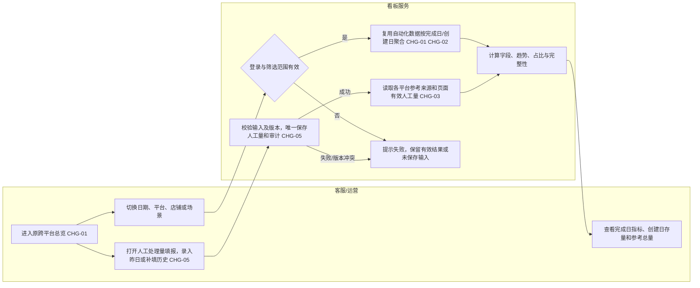

### 5.3 分支、异常和再次使用

1. 条件切换自动查询；日期自定义必须选择完整起止范围后查询。请求失败保留上次有效结果，并明确失败范围，不显示为0。
2. 人工填报按“实际处理日期＋平台”唯一保存；一次提交至少提供一个平台，空白不新增或清除另一平台。允许补填及更正，记录填写人和修改前后值；保存失败或并发冲突保留输入，不覆盖有效数据。
3. 同一任务重复扫描、重试或状态更新不重复计数；平台参考来源按各自唯一键去重。
4. 参考总量不完整时仍可展示已提供部分，但标记“部分数据/待补齐”；完全缺失显示“—”。0是有效数据。

## 6. 页面与交互变化

| 页面/区域 | 控件/内容 | 触发条件 | 系统反馈 | 关联变更 |
|---|---|---|---|---|
| 日期与筛选 | 今日、近七天、近30天、自定义；默认今日（北京时间当天），近N天含当天；条件靠左 | 切换日期、店铺、业务线 | 自动查询；自定义完整选择后应用，非法输入保留上次有效结果；无查询/重置按钮 | CHG-01 |
| 人工处理量填报 | 顶部查询栏最右侧按钮及弹窗 | 点击按钮，默认昨日，支持历史日期 | 回显两平台数量、备注、填写人/时间及修改记录；保存成功立即更新对应参考指标；不单独配置填写权限 | CHG-05 |
| 总览KPI | 工单总量（参考）、AI独立完成、AI覆盖率（参考）、AI完成占比；下方依次为进入自动化、已完成、转人工完成、尚未完成 | 进入总览或条件变化 | 自动刷新；缺失显示“—”或“部分数据” | CHG-01/02 |
| 汇总表 | 拼多多平台工单、拼多多退款分别成行 | 选择全部业务线 | 各行分别展示参考量与处理指标；点击业务线仍进入原拼多多详情 | CHG-04 |
| 汇总表表头 | 工单总量后保留一个“？”入口 | 点击入口 | 弹窗展示当前所选平台来源、日期、范围和影响；原始截图附于本文，不新增产品弹窗图片功能 | CHG-03/06 |
| 完成字段 | 已完成、Agent纯自动完成、转人工完成 | 总览查询 | 按实际完成日期；显示“完成日”提示 | CHG-01 |
| 尚未完成 | 当前未完成存量 | 总览查询 | 按创建日期；显示“创建日存量”提示 | CHG-01 |
| 趋势 | 各业务线处理量趋势 | 总览查询 | 按实际完成日期分桶，31天内按日、32—180天按周、181天及以上按月 | CHG-01 |
| 排名 | AI完成占比排名 | 总览查询 | AI完成÷自动化内已完成；不含平台外人工填报 | CHG-02 |
| 子报表 | 原有自动化率、进入自动化量和详情 | 从总览进入业务线详情 | 保留日期和店铺，场景/明细状态恢复全部；继续按任务创建日期，保留原进入自动化单量、AI独立完成量、转人工完成量、尚未完成量契约 | CHG-07 |
| 业务场景 | 总量/已完成卡片的拆分图标 | 存在对应配置场景 | 只显示实际存在的类型；前三类都不存在时不显示拆分 | 沿用子报表规则 |

### 用户可见文案

| 场景 | 文案 |
|---|---|
| 总表说明 | 完成量按实际完成日；尚未完成按所选创建日统计当前存量。进入自动化仍按创建日。完成＋尚未完成不要求等于进入量。 |
| 工单总量 | 参考数据 |
| 缺失人工 | 部分数据 · 人工待补齐；完全缺失为— / 人工待补齐 |
| 无店铺拆分 | — / 无店铺拆分 |
| AI完成占比 | 按实际完成日期：AI独立完成 ÷ 自动化内已完成；不含平台外人工量。 |
| AI覆盖率 | 进入自动化单量 ÷ 参考工单总量，仅供参考。 |

## 7. 功能与业务规则

### R-01 总览与子报表日期契约

- **关联变更**：CHG-01、CHG-07。
- **总览完成集合**：按实际完成时间落在查询日期范围内的有效任务；包括此前创建、在所选时段完成的任务。
- **总览尚未完成集合**：按首次任务创建时间落在查询范围内的有效任务，读取查询时最新状态，筛出当前未完成任务。
- **子报表集合**：仍按首次任务创建时间筛选同一批有效任务，再读取当前最新状态，维持进入自动化单量＝已完成量＋尚未完成量。
- **示例**：1号创建、2号完成，进入2号总览完成量；查询1号子报表时仍属于1号创建集合，状态为已完成；1号创建且当前未完成计入1号尚未完成。
- 日期均按北京时间Asia/Shanghai，范围为开始日00:00:00至结束日次日00:00:00，左闭右开；今日只统计截至查询时刻已发生的数据。总表完成日与创建日集合不相加、不相减。

### R-02 自动化内完成归属、去重与状态

- 统计对象是已进入对应Agent范围的有效唯一工单/售后任务，不是扫描次数、订单商品件数或平台外人工量。
- 按平台＋业务来源命名空间＋店铺＋业务任务唯一键去重；拼多多来源必须明确为平台工单或售后退款，缺失时返回来源待映射，不默认归工单、不静默少算；同订单不同售后单分别计数；拼多多平台工单与售后退款编号即使相同也分别计数，跨平台不因裸编号相同而合并。
- **AI独立完成**：Agent独立处理并在实际业务终态完成，未由人工最终完成。
- **自动化内人工完成**：已转人工、最终由人工处理并结束；仅转交、接单、处理中或通知不计转人工完成量。
- **自动化内已完成**：已完成量＝AI独立完成量＋转人工完成量，两类互斥；按实际业务结束时刻归属总览完成日期。
- **进入自动化**：子报表创建日集合中的有效唯一任务数。
- **尚未完成**：子报表集合中业务状态确认为尚未结束的任务数；尚未完成量＝进入自动化单量－子报表已完成量仅在子报表创建日集合且状态/完成归属完整时成立。已结束但时间/主体缺失的记录不计尚未完成量；受影响的完成指标、拆分和比例显示数据不完整。
- 直接跳过、撤销且不进入处理范围的任务不计入进入自动化单量、AI独立完成量、转人工完成量、尚未完成量或总览完成量。
- **平台自行结束排除（CHG-08）**：任务已进入自动化后，有可信平台自行退款/关闭/终止证据，且明确AI、人工均未实际处理的，标记平台自行结束且双方均未处理，排除进入自动化单量、AI独立完成量、转人工完成量、已完成量、尚未完成量、类型拆分、处理趋势、排名、最近24小时处理量及核心处理明细。原始记录保留在源系统用于核查，不新增第三类已完成。
- 排除按查询时最新可信状态生效，因此对应首次创建日的有效进入量、完成/未完成进度可能减少；同批有效任务的子报表进入自动化单量＝子报表已完成量＋尚未完成量仍成立。此规则只调整自动化有效集合，不改变淘宝等平台参考总量的客服筛选（例如“全部状态”仍包含关闭/撤销）。
- 平台关闭状态本身不等于“无人处理”：若已有真实AI/人工完成证据，仍按实际业务终态归属AI独立完成量、转人工完成量；未核实处理主体时标数据不完整，不默认排除，也不算AI或人工完成。
- 原始结果未知后经人工核验并关单的有效任务归转人工完成量；退款拒绝、人工撤销等真实终态按最终完成主体归属，不能统一改写为退款成功。进入范围后真实完成的跨日任务不因当前已结束而被误作“跳过”。
- 已结束但实际结束时刻/完成主体缺失或冲突时，不能归入尚未完成量凑等式，也不能用其他指标差值推算。对应完成日指标/比率标为不可完整统计；保留可核验数据并返回缺失状态，待源字段补齐。

### R-03 总览字段计算规则

先区分两批任务：完成量按“实际完成日期”筛选，进入自动化量和尚未完成量按“首次任务创建日期”筛选。下面所有数量都先按本章去重规则去重，再统计。

| 字段 | 如何得出 |
|---|---|
| 工单总量（参考） | 按R-04各平台客服确定的规则取得，不能视为统一的新增需处理总量，也不能用它反推人工完成或尚未完成 |
| 进入自动化单量 | 首次任务创建日期在所选时段内，符合处理范围的有效任务数量；沿用子报表数据 |
| 已完成 | 实际完成日期在所选时段内的有效自动化任务数量；已完成量＝AI独立完成量＋转人工完成量 |
| Agent纯自动完成 | 实际完成日期在所选时段内，由AI独立处理并完成、最终未由人工完成的有效任务数量 |
| 转人工完成 | 实际完成日期在所选时段内，已转人工且最终由人工处理结束的有效任务数量；不包含页面另行填报的平台外人工处理量 |
| 尚未完成 | 首次任务创建日期在所选时段内，查询时业务状态仍确认为未结束的有效任务数量；展示当前存量，不是历史日终快照 |
| AI覆盖率（参考） | 进入自动化单量÷工单总量（参考）×100%；参考总量缺失、不完整、不支持当前维度或为0时显示“—”；计算结果超过100%也照实展示 |
| AI完成占比 | AI独立完成量÷已完成量×100%；分子、分母均按相同实际完成日期统计，仅限自动化范围；已完成量为0显示“—” |
| 子报表自动化率 | 所选创建日期这一批任务中，截至查询时已由AI独立完成的数量÷该批进入自动化单量×100%；分母为0显示“—”。它与总览按完成日期计算的AI完成占比不同，不能互换 |
| 完成量趋势 | 按实际完成日期汇总每段时间的AI独立完成量＋转人工完成量；查询跨度31天内按日、32—180天按周、181天及以上按月 |
| 最近24小时 | 在独立的滚动24小时窗口内，按实际完成时间统计有效完成任务；不受顶部日期、店铺、场景筛选影响。淘工厂单独按通知时间统计通知量 |

完成日查询应直接查找实际在所选时段完成的全部有效任务，包括此前创建的单；不能先按创建日期缩小范围后再查完成。子报表的“已完成”则来自所选创建日期的同一批任务，两者同一天的数字可能不同。

总览表格、顶部卡片和图表使用相同筛选范围及数据截至时间。先汇总数量，再计算比例，不直接平均各业务线百分比；比例保留1位小数，排名使用未舍入的AI完成占比。没有已完成任务或数据不完整的业务线不参加排名。

人工填报补齐、更正只更新对应参考工单总量、参考合计、参考覆盖率和完整性，不改写自动化内的AI独立完成、转人工完成、已完成、尚未完成或AI完成占比。

业务类型拆分继续使用现有点击图标浮层：进入自动化卡按创建日期对应任务拆分，以进入自动化单量为占比分母；已完成卡按实际完成日期对应任务拆分，以已完成量为分母。分类依据场景类型配置；类型存在但当期为0仍展示0，退货退款、仅退款、换货三类都不存在时隐藏拆分入口。不按数量猜类型，也不用差额制造“其他工单”。

### R-03A 趋势分桶与缺失数据

- 查询天数包含首尾：1—31天按日，32—180天按自然周（周一至周日），181天及以上按自然月。
- 首尾桶只取与查询范围的交集，不扩展查询范围。横轴正序、跨年显示年份；悬停显示实际起止日期和数量。
- 来源完整且确实无记录的桶补0；来源缺失/失败/完成字段不完整的桶标缺失或部分数据，不补0；有数据缺失时不能把桶和排名作为完整结果。
- 完成趋势各桶计同完成日集合的AI独立完成量＋转人工完成量，与已完成合计对账。来源、状态与截至时刻相同才校验；只调整粒度不改变数量。
- 比例按未舍入值排序；相同占比沿用业务线既有顺序，显示保留1位小数。无完成分母或来源不完整的线不参加排名。

### R-04 各平台参考工单总量取数规则

| 平台/业务 | 来源与筛选 | 日期 | 去重/合计 | 主要影响 |
|---|---|---|---|---|
| 拼多多·平台工单 | 后台→工单管理，按工单创建时间筛选，取工单数量；不取有效完结率 | 工单创建时间 | 来源内按工单唯一标识；与退款行分开 | 包含尚未处理工单，不是当天完成量 |
| 拼多多·退款 | 售后工作台，操作类型为“商家同意退款”，按申请时间取数量 | 售后申请时间 | 来源内按店铺＋售后编号；与平台工单分别计数 | 不区分AI/人工，不得直接当人工完成 |
| 阿里大健康 | 总览完成日内AI实际独立完成量＋页面保存对应日期人工已处理量 | AI和人工均按实际完成/处理日期；人工次日填报前一日 | AI任务去重；按日期＋平台取最新有效值 | 是处理量参考，不是全部新增需处理量；与子报表创建日结果可能不同 |
| 天猫国际 | 总览完成日内AI实际独立完成量＋页面保存对应日期人工已处理量 | AI和人工均按实际完成/处理日期；人工次日填报前一日 | AI任务去重；按日期＋平台取最新有效值 | 人工只有平台日总量，无店铺拆分；人工缺失不当0 |
| 淘工厂 | 淘工厂现有子报表人工已处理量，按实际处理日期直接复用；AI仅通知，AI处理量为0 | 人工实际处理日期 | 按现有人工量的去重/日合计契约汇总，不重复叠加人员小计和合计，不推算五分类 | 异常列表是当前存量；物流更新/揽收后移出，不能累计为每日新增 |
| 淘宝 | 退款管理分别查询未收货退款、已收货退款、退货退款、退运费、换货；状态全部，合并分页总条数 | 售后申请时间 | 按店铺＋售后单号去重；同订单不同售后单不合并 | 是售后申请参考量，不是人工完成量 |
| 抖音 | 售后工作台状态“退款成功”，类型为已发货退款、退货退款、换货 | 售后申请时间 | 按平台售后唯一键去重 | 不含未发货退款及全部待处理售后 |

淘工厂人工参考量范围：已支付待揽收、已揽收待更新物流、运输中待派送，排除支付18—24小时未揽收及延迟/虚假发货。已支付待揽收五分类为：支付24—36小时未揽收、支付36—48小时未揽收、支付超48小时未揽收、发货12—24小时未揽收、发货24小时未揽收。既有人工汇总未提供五分类数据，不估算各类数量；通知监控场景范围不必与人工参考量范围相同，不以通知量替代人工量。

淘宝统计“全部售后状态”，包含处理中、已结束、关闭/撤销等，不擅自排除；取完整分页总条数，不取勾选数或当前页条数。抖音退款成功三类型的参考量与自动化子报表范围不相同，不能据此倒推出未完成或人工数量。

### R-05 拼多多汇总拆行

- 汇总表展示“拼多多·平台工单”和“拼多多·退款”两行。
- 两行分别展示参考工单总量、进入自动化量、完成量、AI完成、转人工完成、尚未完成、AI覆盖率和AI完成占比。
- 顶部跨平台卡片按平台/业务来源合计，拼多多两行各计一次，不再叠加第三个拼多多合计行；同一订单同时有工单和售后单时，按两个业务任务分别计数，不按订单合并。
- 两行点击均进入原拼多多详情页；详情页不新增独立子报表，开发通过来源字段区分展示和对账。

### R-06 页面人工处理量填报与保存

对应CHG-05。原跨平台总览顶部查询栏最右侧放置“人工处理量填报”，打开弹窗填写阿里大健康、天猫国际每日人工已处理量。淘工厂继续复用现有子报表人工量，不纳入本次弹窗。

| 字段/内容 | 填写或系统规则 |
|---|---|
| 实际处理日期 | 默认北京时间昨日，可补填昨日及以前；不允许今日、未来或无效日期。按处理日归属，不按填写日 |
| 阿里大健康人工处理量 | 平台当日人工已处理总数，不拆业务类型、店铺、人员或场景 |
| 天猫国际人工处理量 | 平台当日人工已处理总数，不混入其他业务，不拆店铺或场景 |
| 备注 | 选填，可说明补填、更正或异常；纯文本展示，不参与计算 |
| 填写/修改人及时间 | 系统根据当前登录身份、服务端时间自动记录；不可手填姓名或修改审计值 |
| 修改记录 | 按实际处理日期归档；选择该日查看每次有效保存的操作人、真实操作时间、平台、修改前后数量与备注，倒序展示。跨日更正历史数据仍归入被修改的处理日，不归入操作当天；不是每天只保留一条 |

1. **填写时点与权限：** 客服每天北京时间9:30前填完昨天数据；9:30仅是业务填报要求，超时仍可补填，不触发定时读取。本期不新增独立填报权限、角色配置或审批；沿用当前系统登录和既有平台数据可见边界，不扩大原有平台/店铺权限。身份由服务端登录态确定，不能由前端上送姓名冒充。无相应平台可见权限时不返回该平台原值、历史或接受其写入；人工源仅有全平台日合计，只有部分店铺权限时不得借填报入口暴露或改写全平台合计。
2. **输入校验：** 两平台至少填写一个；数量须为非负整数且在系统可精确存储、计算的整数范围内，0有效。拒绝负数、小数、科学计数法和非数字。空白表示本次不提交该平台，既不创建0，也不清除或覆盖已有值；暂无值时仍缺失。不能通过全空保存或备注将已知量变成未知量，本期不提供删除/清空记录操作。
3. **回显与取消：** 默认昨日并回显已有值。切换日期加载该日值及修改记录；有未保存修改时，切换日期、取消、关闭或Escape均先确认是否放弃，未确认不切换/关闭，放弃不写入。保存不改变页面当前日期/店铺/平台筛选。
4. **唯一与更正：** 以“实际处理日期＋平台”为业务唯一键，首次填报新增，后续更正更新原有效数量，不能作为增量累加。两个填写框可分次补齐；同次提交提供的字段校验全部通过后原子保存，任一校验/写入失败不部分落数。重复提交相同请求只产生一次有效保存；与现有值、备注完全一致时提示“没有需要保存的变更”，不新增审计。使用提交幂等标识及日期记录版本或等效并发控制；他人已更正时拒绝静默覆盖，保留本次输入，重新打开核对最新值后再保存。
5. **审计：** 保存有效值同时记录创建人/创建时间、最近修改人/修改时间及每次修改前后值、备注和版本。创建信息不可因更正覆盖，修改记录不可由普通填报操作改写。实际处理日期与保存时间独立，2号录入1号的20，仍归属1号。
6. **保存联动：** 保存成功立即重新查询当前筛选结果，更新相应日期/平台参考量、参考合计、AI覆盖率及完整性。参考量仍为同处理日AI独立完成量＋最新有效页面填报人工处理量；页面填报人工处理量更正20→25只使参考量增加5，不能另加25。当前筛选不包含该日期时当前数值不变，后续查该日可见新值。既有AI独立完成量、转人工完成量、已完成量/尚未完成量、子报表和淘工厂人工量不受填报改写；AI独立完成量迟到补齐仍按已有同步方式更新AI独立完成量＋页面填报人工处理量，不冻结总量。
7. **失败与再次使用：** 保存中禁用重复提交；保存失败保留输入并提示失败，不改变报表有效数据/审计。服务端已保存但报表重新查询失败时提示“已保存，报表刷新失败”，保留原查询结果及其范围，允许重试查询；不得提示保存失败诱导重复填数。登录失效要求重新登录，不丢弃可恢复输入，不记录伪身份。缺失页面填报人工处理量仍显示待补齐，不当0；今日页面填报人工处理量要到次日填报保存后才可见，无法因此提供今日完整实时业务量。
8. **人工数据保存：** 页面支持补填、更正与审计，保存成功后直接生效，无需等待定时取数。已有线上人工数据如需迁入，须先核验，再按相同业务唯一键迁入并保留来源；未经核验的缺失日期不补0。

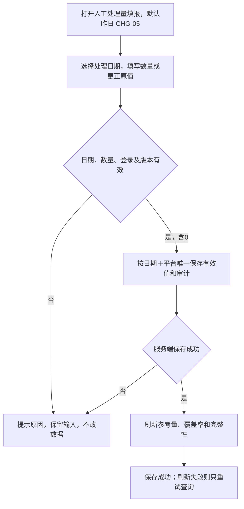

例：2号填1号大健康20、天猫国际留空，保存后1号大健康参考量＝1号AI独立完成量＋20，国际仍缺失；后续补1号国际0，0为有效值。再将大健康改为25，1号参考量改为AI独立完成量＋25并保留20→25的填写人和时间，不重复累加。

原型使用浏览器本地存储及“演示用户”，只验证交互。正式系统需服务端持久化、认证身份、原子写入、幂等、并发及审计；接口路径、物理表和存储实现由开发设计，不以原型本地存储代替生产后端。

### R-07 缺失、店铺和平台边界

- 参考量部分日期有效时展示数字并标“部分数据·人工待补齐”；完全无有效数据时显示“—”。
- 0是有效值，不能与缺失混淆。
- 大健康、天猫国际页面填报人工来源无店铺拆分；选择具体店铺时参考量显示“—/无店铺拆分”。淘工厂按既有人工量接口已核验的维度筛选，未核验或无店铺/场景拆分时显示“—/维度不支持”，不强分摊平台合计；通知任务仍按其店铺/场景筛选。
- 淘工厂通知记录不计入进入自动化单量、已完成量、AI独立完成量、转人工完成量、尚未完成量、趋势或AI完成占比；详情使用“监控通知量”和通知时间。
- 小红书、天猫超市不进入本期导航、筛选、汇总、图表和排名。
- 参考合计为各有效来源之和，任何所选业务线/日期缺失或不支持时整体标“部分数据”；没有有效来源则为“—”。AI覆盖率仅在全部所选来源完整且参考总量大于0时计算；不能剔除缺失平台后保留全部平台的分子计算。

### R-07A 参考量缺失与部分数据展示

| 来源及情形 | 参考工单总量 | 完整性/比例 |
|---|---|---|
| 大健康/天猫国际：所选范围页面填报人工处理量全部未取得，即使AI独立完成量已知 | —，标人工待补齐；AI独立完成量在AI独立完成卡正常展示 | 参考覆盖率— |
| 部分日期页面填报人工处理量已保存，其他日期缺失 | 所选范围全部可核验AI独立完成量＋已保存日期的页面填报人工处理量；不剔除缺人工日期的已知AI独立完成量 | 部分数据，保留缺失日期；覆盖率— |
| 页面填报人工处理量已保存且为0 | AI独立完成量＋0；0是有效人工值 | 其他来源完整时按规则计算 |
| 页面填报人工处理量完整但AI完成源失败/不完整 | 展示已核验的来源部分并标数据不完整；不能把未知AI独立完成量当0 | 覆盖率—；AI相关占比也不可用 |
| 淘工厂现有人工量部分日期可用 | 有效日期人工量求和，标部分数据；全部缺失则— | 不从通知量推算 |
| 指定店铺但人工源无相同维度 | —/无店铺拆分 | 覆盖率—；自动化任务仍按店铺筛选 |
| 跨平台部分来源缺失 | 已提供参考量相加并标部分数据；无有效来源则— | 必须保留缺失业务线及日期；覆盖率— |

人工源只有平台总数时，不向仅有部分店铺权限的账号展示越权平台合计。本次统计截至时间表示本次统计截点，另带各来源最近有效保存/源同步时刻与覆盖日期，不能用看板刷新时间冒充源数据更新时间。平台人工量、自动化完成源的最新数据可以有不同延迟，页面和接口需明确完整性。

### R-08 规则截图与来源

以下仅展示当前有效的平台取数筛选截图与已确认原型，截图中的数字不作为实时数据。大健康、天猫国际使用页面弹窗填报；淘工厂复用现有子报表人工量。

#### 拼多多

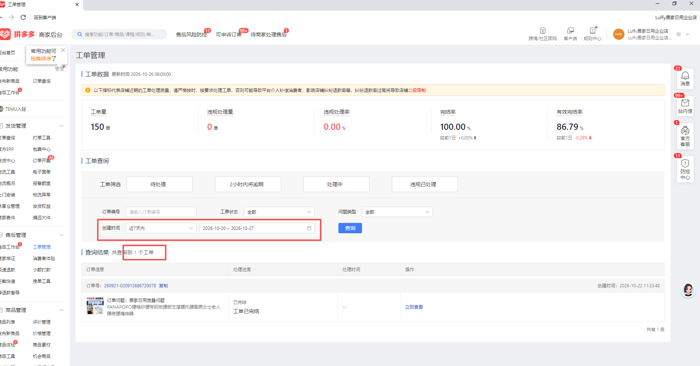

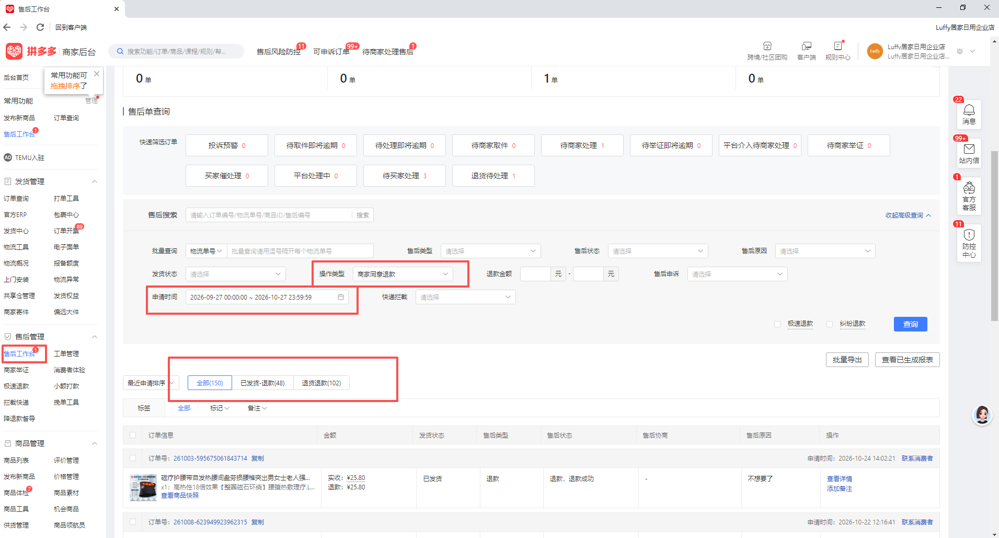

#### 淘工厂

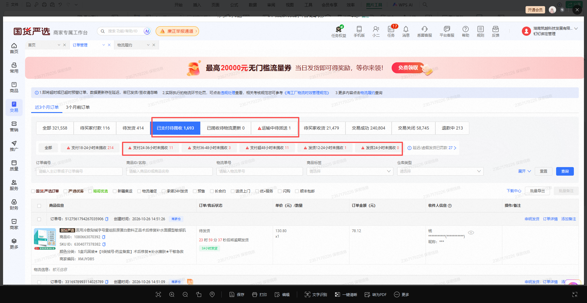

#### 淘宝与抖音

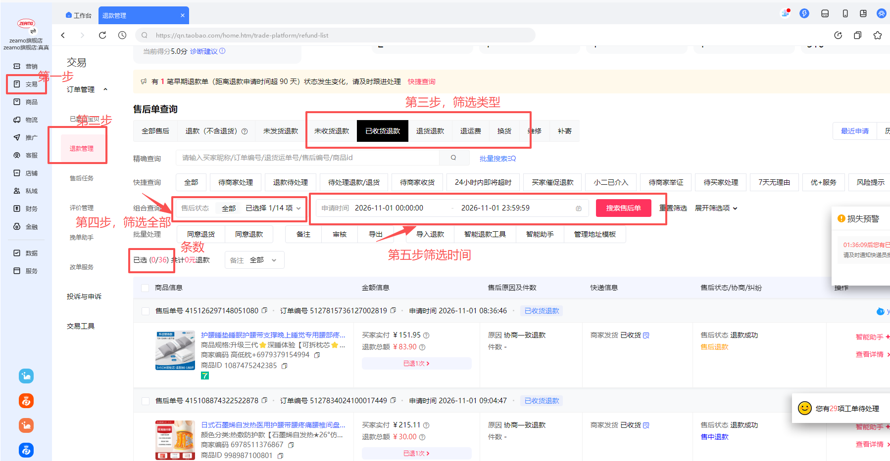

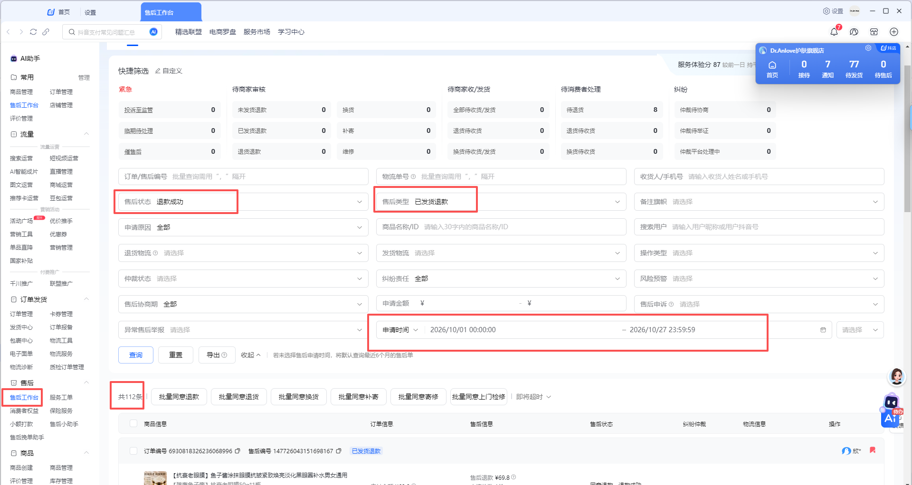

#### 当前汇总原型

以下为合成数据原型截图，固定演示日期不代表真实统计日期或已接入系统。

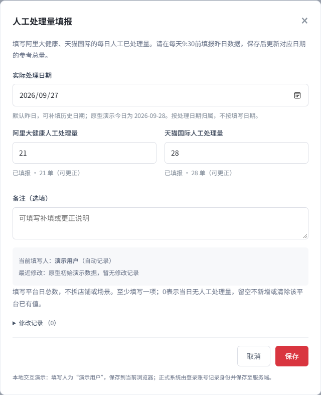

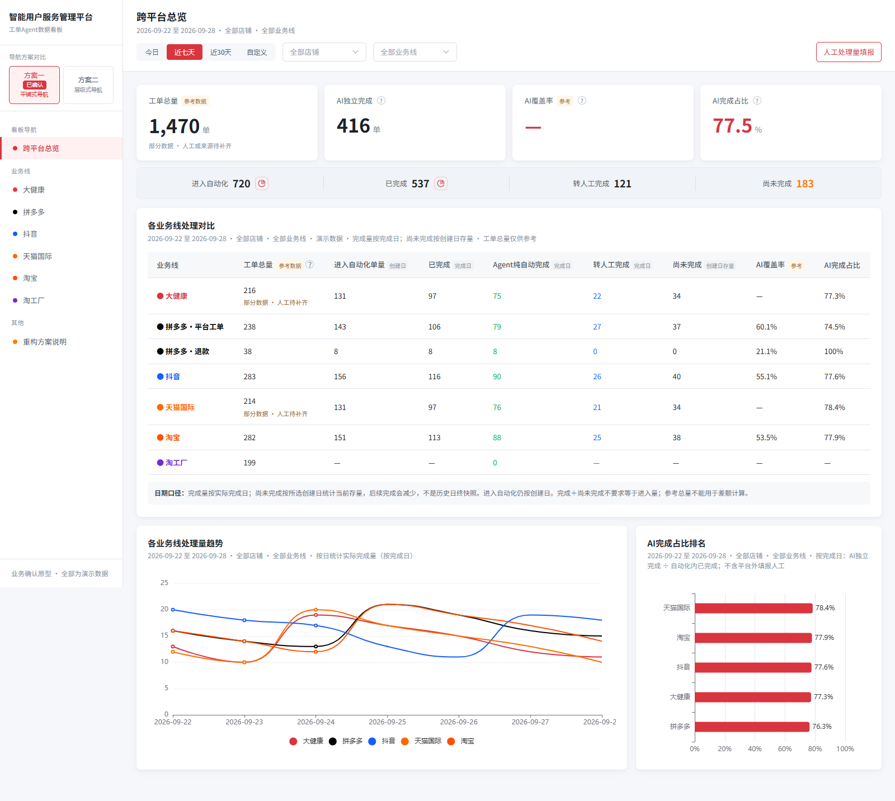

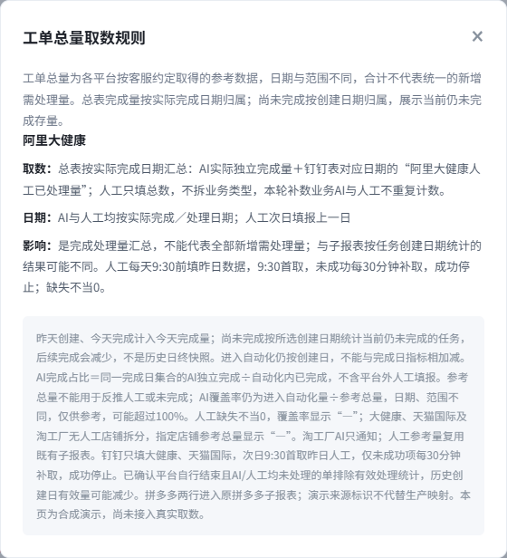

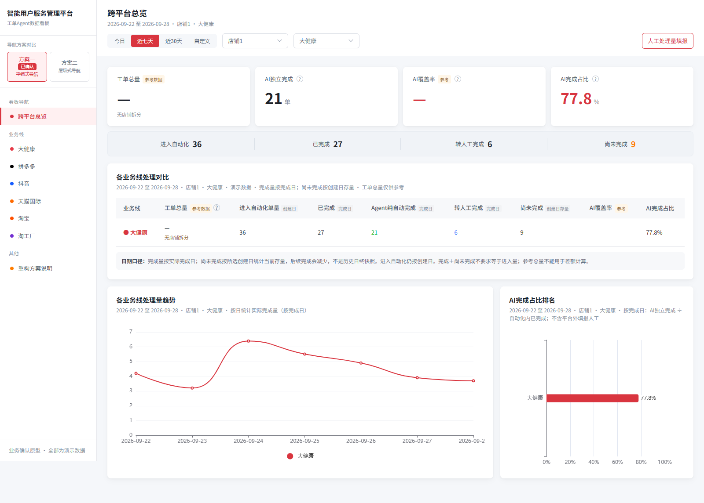

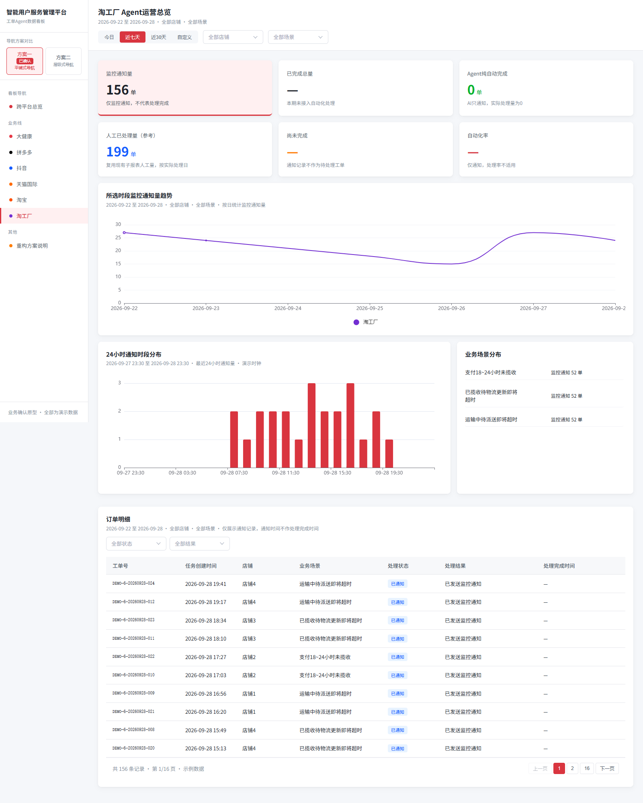

## 8. 状态、边界与异常

| 业务状态/数据状态 | 看板处理 | 数字影响 |
|---|---|---|
| 自动独立结束 | 计入总览完成日AI独立完成量、已完成量及趋势 | 不计转人工完成量 |
| 转人工且最终人工结束 | 计入总览完成日转人工完成量/已完成量及趋势 | 不计AI独立完成量 |
| 仅转人工、人工接单、人工处理中 | 不计已完成量/AI独立完成量、转人工完成量 | 在对应创建日子报表保持尚未完成量 |
| 任务未完成 | 不计完成日已完成量；若创建日在查询范围，计当前尚未完成量 | 后续完成后从尚未完成量减少，进入完成日已完成量 |
| 人工未填/保存未成功 | 参考量显示缺失 | 不当0，不计算完整AI覆盖率 |
| 人工保存0 | 参考量正常计算 | 0为有效数据 |
| 查询失败 | 保留上次有效结果，标记失败范围 | 不显示为0 |
| 业务已结束但完成时间/主体未知 | 标记数据不完整 | 不强推AI/人工，不伪装为尚未完成 |
| 平台自行结束且AI/人工均未处理 | 排除有效处理集合；源记录保留 | 进入自动化单量、AI独立完成量、转人工完成量、已完成量、尚未完成量等均不计，参考平台申请量规则不变 |
| 平台来源缺失 | 显示“来源待补齐” | 不用其他平台或合成数据补齐 |
| 淘工厂仅通知 | 只计通知量 | 处理指标显示“—”，AI实际处理为0 |

## 9. 数据内容与中文字段说明

下表采用业务可读的中文字段名，用于说明必须提供什么数据及其含义，不指定数据库或接口字段的英文命名。开发沿用现有可用字段，并登记中文含义与真实源字段的对应关系。

| 数据类别 | 中文字段名称 | 业务含义 | 数据类型 | 必填要求 | 校验规则 | 来源 |
|---|---|---|---|---|---|---|
| 自动化任务 | 平台、业务线 | 标识任务所属平台和业务线 | 文本 | 必填 | 两者需区分；拼多多工单、退款分别归类 | 各平台现有任务源 |
| 自动化任务 | 业务来源类型 | 区分平台工单、售后退款等来源 | 选项或文本 | 拼多多必填 | 不等同于场景分类，不按名称关键词猜测 | 平台工单或售后来源 |
| 自动化任务 | 店铺标识 | 店铺的唯一标识 | 文本 | 按来源要求 | 不能用展示别名代替 | 现有店铺配置 |
| 自动化任务 | 任务唯一标识 | 用于去重和关联任务 | 文本 | 必填 | 结合平台、业务来源、店铺、业务任务编号确定；重试及状态更新不新增任务 | 现有任务或售后系统 |
| 自动化任务 | 首次任务创建时间 | 任务第一次进入系统的时间 | 日期时间 | 必填 | 不被重试时间覆盖，按北京时间统计 | 沿用子报表 |
| 自动化任务 | 实际完成时间 | 整个业务任务真实结束的时间 | 日期时间 | 已完成任务必填 | 不能用转交、同步或轮询时间代替 | 本线业务终态证据 |
| 自动化任务 | 最终完成主体 | 最终由AI独立完成，还是转人工后由人工完成 | 选项 | 已完成任务必填 | 两类互斥，需有处理及闭环证据 | 处理日志或人工闭环 |
| 自动化任务 | 当前业务状态 | 判断任务当前已完成或尚未完成 | 选项 | 必填 | 按本线状态及真实结束规则判定 | 各平台业务状态 |
| 自动化任务 | 是否纳入有效统计 | 判断任务是否进入本次核心统计 | 是或否 | 必填 | 非范围、直接跳过、已确认双方未处理的平台自行结束任务排除 | 处理范围及结束证据 |
| 自动化任务 | 业务结束来源、AI是否实际处理、人工是否实际处理 | 识别平台自行结束和真实处理事实 | 选项、是或否 | 需要判断平台自行结束时必填 | 只有可信平台结束且双方明确未处理才排除；未知不能当作未处理 | 本线状态、操作或人工日志 |
| 自动化任务 | 排除原因、业务结束时间 | 记录为何排除及业务结束时刻 | 选项、日期时间 | 排除任务按需提供 | 明确“平台自行结束且双方均未处理”，不冒充AI或人工完成 | 本线状态证据 |
| 自动化任务 | 场景类型 | 用于业务类型拆分 | 选项 | 按本线配置 | 按配置判定，不按名称或数量猜测 | 场景配置 |
| 参考数据 | 参考量所属平台或业务 | 指明这份参考数量属于哪条业务 | 文本 | 必填 | 拼多多工单、拼多多退款分别标识 | 平台后台、页面填报、淘工厂现有子报表 |
| 参考数据 | 参考数据归属日期 | 指明数量属于哪一天 | 日期 | 必填 | 各平台按R-04规定的日期归属 | 各平台来源 |
| 参考数据 | 参考工单或处理量 | 客服指定范围的参考数量 | 非负整数或空值 | 有效来源必填 | 真实0为0，缺失为空值，不补0 | 各平台来源 |
| 人工填报 | 实际处理日期 | 人工数据实际归属日 | 日期 | 必填 | 默认昨日，可补填更早日期，不能由保存时间代替 | 页面填写，服务端校验 |
| 人工填报 | 阿里大健康人工处理量、天猫国际人工处理量 | 两平台每日人工已处理数量 | 非负整数或空值 | 两项至少填写一项 | 0有效；空白表示本次未提交该平台，不清除原值；不按店铺分摊 | 页面填写 |
| 人工填报 | 备注 | 说明补填、更正或异常 | 文本 | 选填 | 纯文本，可空，不参与计数 | 页面填写 |
| 人工填报 | 首次保存人、首次保存时间 | 首次记录由谁、何时保存 | 人员标识、日期时间 | 系统自动记录 | 使用服务端登录身份及时间；后续更正不覆盖首次信息 | 系统 |
| 人工填报 | 最近修改人、最近修改时间 | 最近一次有效修改由谁、何时完成 | 人员标识、日期时间 | 系统自动记录 | 不能由客服手填，不作为实际处理日期 | 系统 |
| 人工保存 | 本次提交唯一标识、记录版本 | 防止重复提交和多人互相覆盖 | 文本、整数 | 保存时必需 | 相同提交仅保存一次；版本过期则保留输入并提示核对 | 具体实现由开发设计 |
| 修改记录 | 实际处理日期、平台、修改前数量、修改后数量、操作人、实际操作时间、备注、记录版本 | 保存每次有效操作的完整记录 | 日期、文本、整数、日期时间 | 系统自动记录 | 按实际处理日期归档；每次有效修改追加记录；修改前无值时记“未填”；旧记录不可改写 | 与有效数据一并保存 |
| 保存反馈 | 保存结果、原因说明、最新记录版本、保存时间 | 告知本次提交是否成功 | 选项、文本、整数、日期时间 | 系统返回 | 区分已保存、无变更、校验不通过、版本冲突、保存失败、登录失效；保存与刷新失败分开 | 服务端响应 |
| 汇总结果 | 来源数据状态、本次统计截至时间 | 说明数据完整程度与统计截点 | 选项、日期时间 | 必填 | 区分完整、部分、缺失、不支持当前维度、读取失败；保留缺失日期和平台 | 各来源状态 |

### 9.1 各业务线必须交付的源字段映射

以下为复用核验与新增字段对接清单；已有字段按各分册现有接口直接复用，只对新增参考总量及确有影响的字段补适配。业务筛选、日期及公式已确定，真实接口、物理字段和权限由各线开发登记并附对账样本，不以截图中的演示数值作为接口输入。

| 平台/来源 | 参考数据的读取与日期 | 自动化数据必须提供 | 核验重点/责任 |
|---|---|---|---|
| 拼多多·平台工单 | 工单管理创建时间、工单数量；完整分页 | 工单来源、店铺、唯一工单号、首次创建、真实终态、结束时间、最终主体、场景 | 来源内去重；不取有效完结率；拼多多开发 |
| 拼多多·退款 | 售后工作台商家同意退款，申请时间 | 退款来源、店铺＋售后号、首次任务创建、实际完成、主体、接管证据 | 同编号不同来源计两单；退款参考与自动化范围分开；拼多多开发 |
| 大健康 | 页面填报的对应实际处理日人工处理量＋本线完成日AI独立完成量 | 现有任务源、场景、真实结束与主体；填报日量查询与保存契约 | 人工无店铺拆分、不混入转人工完成量；本线开发＋汇总填报服务开发 |
| 天猫国际 | 页面填报的对应实际处理日人工处理量＋本线完成日AI独立完成量 | 本期既有任务源、真实结束与主体；填报日量查询与保存契约 | 不并入其他组织新项目；本线开发＋汇总填报服务开发 |
| 淘工厂 | 已有子报表人工量接口，实际处理日期 | 人工日量/唯一键或日合计、覆盖日期、状态；通知唯一键/通知时间/店铺/场景独立提供 | 不读取外部人工表，不纳入填报弹窗；核验既有人工数据能否按实际处理日返回；淘工厂开发 |
| 淘宝 | 五类、全部状态、申请时间，完整分页 | 店铺＋业务来源＋售后/任务唯一键、任务创建、实际结束、主体/接管证据 | 参考含关闭撤销；无人处理的平台自行结束只从自动化有效集合排除；淘宝开发 |
| 抖音 | 退款成功＋指定三类，申请时间 | 店铺＋售后/任务唯一键、创建、真实结束、主体、场景 | 自动化可有未发货退款；参考不包含该类，不缩减Agent原范围；抖音开发 |

每一涉及本次变更的数据项登记复用入口或新增映射，至少包括：源系统/入口、真实源对象和字段、状态/主体映射、唯一键、日期字段、筛选与权限、更新方式、空值/失败行为、脱敏对账样例和责任角色。字段未核验时标待映射，不能由汇总开发按文字名称猜测。

### 9.2 状态归一与字段缺失

| 源业务事实 | 标准化归属 | 计数 |
|---|---|---|
| Agent独立执行并确认父任务真实结束 | AI独立完成 | 按实际完成日期计入AI独立完成量和已完成量；不是阶段提交成功 |
| 已接管、最终人工实际处理并关闭 | 转人工后由人工完成 | 按实际人工完成日期计入转人工完成量和已完成量；退款、拒绝、人工撤销保留原结果 |
| 等待、处理中、待人工、待验证、暂停或未闭环异常 | 尚未完成 | 创建日尚未完成量；无实际完成时间 |
| 业务已结束、时间或主体缺失 | 数据不完整 | 不伪装尚未完成量，不猜AI独立完成量、转人工完成量；受影响完成统计和比率不可完整展示 |
| 平台自行结束且两方明确未处理 | 平台自行结束且双方均未处理 | 有效进入自动化单量、AI独立完成量、转人工完成量、已完成量、尚未完成量均排除，保留源证据 |
| 只有平台已关闭标签、处理事实未核实 | 数据不完整 | 不据标签直接排除；开发核验源证据 |

源系统中拼多多退款的“自动处理成功”“人工已结束”，以及淘宝的“自动同意退款”“自动拒绝退款”等状态，仅在符合真实结束与主体证据时映射AI独立完成量、转人工完成量；待人工处理、待核验不能提前完成。各业务线原始枚举不同，必须提交本线完整映射，不把原型成功/人工处理当真实生产字段。

上述名称为逻辑字段契约和建议枚举，不指定物理表、接口路径或现有技术字段名。开发须完成逐字段映射；不能把演示字段当成已经存在的接口。

## 10. AI 能力边界

本期为统计和人工日量填报功能，不新增AI能力，AI专项契约不适用。看板只读取已有Agent处理结果，不触发退款、换货、通知或业务重试；客服人工量由客服填写，不能由AI猜测。

## 11. 依赖、联动与历史兼容

| 维度 | 本次处理 | 不确认的影响 |
|---|---|---|
| 业务线子报表 | 继续按创建日进入自动化单量、AI独立完成量、转人工完成量、尚未完成量；总览另按完成日已完成量/AI独立完成量、转人工完成量 | 开发把总览和子报表当同一集合，导致数字对不上 |
| 拼多多详情 | 继续原详情页；汇总两行通过来源字段区分 | 不能分别核对工单与退款 |
| 平台后台权限 | 复用客服/服务账号现有权限 | 不能读取全分页、筛选或来源字段时，参考量缺失 |
| 页面填报持久化/认证 | 服务端保存、唯一更正、审计、并发版本及既有登录身份 | 无独立填写权限配置；服务未接通不能用浏览器本地数据代替生产 |
| 淘工厂现有子报表 | 复用已有人工量，核验按实际处理日的查询字段、唯一键及更新时点 | 若只提供创建日结果而无实际处理日字段，不得直接换标签复用，须由本线开发补齐适配 |
| 历史记录 | 不用旧总量差值反推新字段 | 旧日期数据只能按可核验字段回填，不能伪造完成日 |
| 权限与隐私 | 只展示内部授权范围和必要业务标识 | 不扩大平台后台权限，不在PRD复制客户订单敏感值 |

## 12. 数据取值、统计、埋点与经营结果

### 12.1 字段计算汇总

| 数据项 | 业务含义 | 取数方式 | 统计/取值规则 | 公式 |
|---|---|---|---|---|
| 进入自动化单量 | 创建日进入Agent范围的任务数 | 聚合统计 | 有效、去重、排除跳过 | 统计所选创建日期范围的有效唯一任务数 |
| 已完成 | 所选完成日内自动化任务已结束数量 | 聚合统计 | 按实际完成时间，AI独立完成与转人工完成互斥 | 已完成量＝AI独立完成量＋转人工完成量 |
| AI独立完成 | 所选完成日内Agent独立结束数量 | 聚合统计 | 实际完成日期在所选时段，由AI独立处理并结束 | 统计符合条件的有效任务数量 |
| 转人工完成 | 所选完成日内最终人工结束数量 | 聚合统计 | 实际完成日期在所选时段，已转人工且最终人工处理结束 | 统计符合条件的有效任务数量 |
| 尚未完成 | 所选创建日任务中当前未结束存量 | 聚合统计 | 查询时最新状态，非历史日终快照 | 统计所选创建日期任务中当前仍未结束的数量 |
| 工单总量参考 | 客服指定平台量/处理量 | 平台取数/页面有效填报值 | 按R-04，不与进入自动化单量、已完成量、尚未完成量混合 | 各平台规则 |
| AI覆盖率 | 自动化进入量在参考量中的比例 | 计算指标 | 参考指标，允许因口径差异超过100% | 进入自动化单量÷参考工单总量×100% |
| AI完成占比 | 自动化内完成任务中AI占比 | 计算指标 | 完成日集合，不含平台外人工 | AI独立完成量÷已完成量×100% |
| 完成量趋势 | 各完成日的自动化处理产出 | 聚合统计 | 按跨度日/周/月分桶 | AI独立完成量＋转人工完成量 |

### 12.2 埋点与经营结果

本期不新增用户行为埋点。业务价值验证采用脱敏对账：同一日期、平台、店铺、来源分别核对参考量、AI独立完成量、转人工完成量、已完成量、尚未完成量和缺失状态；不得用登录次数替代有效统计。

## 13. 非功能、安全与技术待确认

| 维度 | 产品约束 | 技术待确认 | 不确认的影响 |
|---|---|---|---|
| 平台取数 | 取全分页总条数/完整筛选结果 | 各平台接口、权限、分页与历史范围 | 参考总量可能为当页数或不完整 |
| 页面填报保存 | 原子保存、幂等、更正覆盖、保留审计，成功立即刷新 | 保存接口/物理字段、事务、并发与认证身份接入 | 无法可靠回显、更正、区分缺失和0 |
| 淘工厂人工量复用 | 使用现有子报表已具备的人工量，按实际处理日期汇总 | 已有接口、日期、去重、更新及失败补偿 | 来源不可用时标缺失，不回退到外部人工表或通知差额 |
| 数据一致性 | 响应标注本次统计截至时间和来源状态 | 全平台统一截点能力 | 各卡片可能混用不同时间的数据 |
| 历史回填 | 不用差值猜测完成归属 | 完成事件和主体历史字段 | 历史AI/转人工完成量/已完成量无法准确回填 |
| 权限审计 | 不单独配置填写权限；沿用登录与可见边界，记录真实填写/修改人 | 现有身份映射、版本冲突反馈、审计存储与留存 | 可能冒名、覆盖或无法追溯 |

## 14. 验收标准

| 编号 | 关联 | 操作/前置 | 可观察预期 | 类型 |
|---|---|---|---|---|
| AC-01 | R-01 | 构造1号创建、2号完成任务，分别查1号和2号总览 | 2号计完成；1号子报表仍含该任务且状态已完成 | 正常 |
| AC-02 | R-01 | 构造1号创建且当前未完成任务 | 查1号总览计尚未完成；后续完成后该存量减少 | 边界 |
| AC-03 | R-02/03 | 任务自动完成4、人工完成3、未完成3 | 总览完成7、AI4、人工3；AI完成占比57.1% | 正常 |
| AC-04 | R-02 | 同一任务重复扫描、重试、状态更新 | 只计1；跨平台/不同售后单不误合并 | 去重 |
| AC-05 | R-03 | 参考工单总量与进入自动化单量、已完成量、尚未完成量日期范围不同 | 不用参考量相减推算人工或未完成；AI覆盖率标参考 | 口径边界 |
| AC-06 | R-04 | 分别读取各平台指定筛选 | 日期、范围、去重与本表一致；缺权限标缺失 | 数据 |
| AC-07 | R-05 | 查看总览全部业务线 | 拼多多显示平台工单、退款两行，合计不重复；点击进入原详情 | 交互 |
| AC-08 | R-06 | 在总览顶部查询栏最右侧点击“人工处理量填报”，2号填写1号大健康20并保存 | 默认昨日；1号参考量更新为1号AI独立完成量＋20，自动记录当前登录人和保存时间，当前筛选不包含1号则数字不变 | 正常 |
| AC-09 | R-06 | 一个平台留空、另一个填0后保存 | 留空平台不新增0/不清原值；0平台有效；仅按已保存数据改变参考完整性 | 边界 |
| AC-10 | R-06 | 3号将1号人工量20改25保存，选择1号查看记录，再重复提交相同请求 | 1号有效值为25不累加；修改记录归1号，操作时间为3号实际保存时刻，保留20→25和真实身份；多次有效修改分别留存，同请求仅一次 | 历史更正/幂等 |
| AC-11 | R-07 | 选择大健康具体店铺 | 自动化任务按店铺筛选；页面平台人工量显示无店铺拆分，不伪造拆分 | 边界 |
| AC-12 | R-07 | 淘工厂查询 | AI实际处理为0；通知量不进入完成、未完成、趋势、排名 | 业务边界 |
| AC-13 | R-08 | 点击工单总量表头“？” | 弹窗展示当前所选平台来源、日期、影响；页面只保留一个入口；本文附原始取数截图及当前原型截图 | 交互/文档 |
| AC-14 | R-01/03 | 选择31、32、180、181天 | 总览完成趋势分别按日、周、周、月；桶内合计可对账 | 趋势 |
| AC-15 | R-03 | 完成量为0或参考量缺失 | 占比显示“—”，缺失不显示0或伪造百分比 | 异常 |
| AC-16 | R-07 | 查询无数据、真实0、读取失败 | 三种状态分别显示0、0、失败/缺失，不混淆 | 异常 |
| AC-17 | R-03 | 工单行完成4、退款行完成2，AI分别3/1 | 顶部拼多多完成合计6、AI4，完成占比66.7%；不取75%与50%的平均数，不重复加拼多多总行 | 聚合 |
| AC-18 | R-06 | 分别提交全空、负数、小数、科学计数法、今日/未来日期，并模拟保存失败 | 校验失败不写入；保存失败保留输入及报表原值，不产生成功审计 | 异常 |
| AC-19 | R-02/03 | 已结束任务没有真实完成时间或最终主体 | 完成日统计明确数据不完整，不归入尚未完成量补等式，不用更新时间代替完成时间 | 数据缺失 |
| AC-20 | R-07 | 账号仅有部分店铺权限，源人工量只有全平台合计 | 不展示越权平台合计；人工参考量显示不支持/缺失，自动化量仅统计授权店铺 | 权限 |
| AC-21 | R-03 | 调整店铺/业务线、日期后查看分类浮层 | 进入自动化浮层按创建日期筛选有效任务，已完成浮层按实际完成日期筛选有效任务；合计对应卡片，场景类型存在但为0仍可见 | 联动 |
| AC-22 | CHG-06/R-07 | 连续切换日期/平台，旧响应晚到，再模拟读取失败 | 仅最后有效请求更新；失败保留原结果并标注原查询范围，不能配新标签伪装新数据 | 异常 |
| AC-23 | CHG-03/R-02 | 同店铺工单与退款编号相同 | 两来源分别计数，顶部合计2；来源缺失标待映射，不默认归工单 | 正常/联动 |
| AC-24 | CHG-08 | 1号创建、2号平台自行关闭，有可信证据AI/人工都没处理 | 核心处理统计均不计，查1号进入自动化单量、尚未完成量减少；参考平台申请量仍按原规则；原始证据保留 | 边界/异常 |
| AC-25 | CHG-08/R-02 | 只有关闭标签，或已有真实AI/人工处理证据 | 未核实标不完整；已有完成主体证据按AI独立完成量、转人工完成量，不误作无人处理排除 | 边界/异常 |
| AC-26 | CHG-05/R-06 | 页面填报人工处理量已保存20，同日AI独立完成量迟到从5补为7 | 参考量25→27；页面填报人工处理量仍20，不重复累加，也不冻结已保存日期的AI独立完成量 | 正常/联动 |
| AC-27 | CHG-05/R-07A | 同日页面填报人工处理量全缺但AI独立完成量已知；跨日部分页面填报人工处理量成功 | 前者参考量—；后者全部可核验AI独立完成量＋成功页面填报人工处理量并标部分；覆盖率均— | 边界/异常 |
| AC-28 | CHG-01/R-03A | 范围首尾非周/月边界，含无业务或缺来源日期 | 自然周/月只取交集；真零桶0，缺失桶不补0；可核验桶与对应完成集合对账 | 边界/异常 |
| AC-29 | CHG-03/R-04 | 淘工厂现有人工量接口返回按实际处理日的日总数 | 总表直接复用一次；通知与人工分开；填报弹窗不加淘工厂，无外部人工表读取 | 正常/联动 |
| AC-30 | CHG-05/R-06 | 两人同时打开同日数据，后提交者使用旧版本 | 拒绝覆盖已更新记录，保留输入；核对最新值后才可重提；非静默最后写入覆盖 | 并发 |
| AC-31 | CHG-05/R-06 | 输入未保存后切日期、取消或Escape；刷新后重新打开已保存日 | 未确认不离开，放弃不落数；已保存值和修改记录可回显；真实系统跨浏览器仍一致 | 取消/持久化 |
| AC-32 | CHG-05/R-06 | 服务端保存成功但报表重查失败；之后重试查询 | 提示已保存、刷新失败，保留原范围结果；重试查询显示新值，不能重复累加 | 异常 |
| AC-33 | CHG-05/R-06 | 普通既有登录账号打开弹窗，另模拟登录失效/无平台可见范围 | 不要求配置新填报角色；自动记录真实身份；失效不保存、越权平台原值和历史不可见不可写 | 身份/范围 |
| AC-34 | CHG-05/R-06 | 修改页面填报人工处理量、填写备注含HTML；查看自动化和淘工厂指标 | 仅相关参考量及派生项更新，既有AI独立完成量、转人工完成量、已完成量/尚未完成量及淘工厂量不变；备注作为文本，无脚本执行 | 联动/安全 |

## 15. 待确认与开发交接

| 编号 | 类型 | 问题/事项 | 当前建议 | 不确认的影响 | 责任角色 | 状态 |
|---|---|---|---|---|---|---|
| TBD-01 | 技术待确认 | 各平台实际完成事件、最终完成主体、创建时间和状态字段映射 | 已有字段登记复用接口和样本，仅对本次受影响缺口补映射后联调 | 无法准确区分AI独立完成量、转人工完成量、已完成量/尚未完成量 | 各平台开发/数据对接 | 待技术确认 |
| TBD-02 | 技术待确认 | 页面填报保存、当前登录身份和审计接口 | 按R-06实现持久化、原子更正、幂等、版本冲突及修改记录；本期不新增填写权限配置 | 填写不可可靠保存和追溯 | 汇总前后端开发 | 待技术确认 |
| TBD-03 | 技术待确认 | 淘工厂现有子报表人工量接口与归属日期 | 明确现有人工量字段、实际处理日期、去重/汇总方式、权限、更新时间和失败状态 | 淘工厂参考量不可追溯 | 淘工厂开发/数据对接 | 待技术确认 |
| TBD-04 | 技术待确认 | 拼多多平台工单/退款来源字段在自动化任务中的映射 | 使用来源类型或业务任务ID，禁止按名称猜测 | 两行无法对账 | 拼多多开发 | 待技术确认 |
| TBD-05 | 技术待确认 | 历史任务是否具备真实完成时间和完成主体 | 可核验才回填，不用差值猜测 | 历史完成日指标不完整 | 各平台开发/测试 | 待技术确认 |

### 开发交付边界

- **实施原则**：已有指标直接复用各分册子报表数据；新增参考工单总量及其覆盖率、参考合计、完整性联动才新增计算。已确认总览完成日查询与异常修正仅补受影响项，不要求重建子报表。
- **本次必须实现或核验复用**：总览完成日/创建日双口径字段、AI完成占比、完成日趋势、拼多多两行、工单总量规则弹窗、页面填报与修改记录、淘工厂已有人工量复用、平台自行结束排除、参考量缺失标识、权限范围和失败保留上次结果。
- **明确沿用现有**：子报表创建日进入自动化单量、AI独立完成量、转人工完成量、尚未完成量、任务级去重、场景类型显示、筛选自动查询、最近24小时独立、明细实际完成时间。
- **技术方案待设计**：平台接口、数据适配层、页面填报保存方式、淘工厂现有人工量读取方式、缓存、身份、并发、审计和历史回填。
- **禁止自由扩展**：不得将平台外人工量写入子报表转人工完成量，不得把通知计为处理完成，不得以参考总量差值补齐未知数据，不得恢复小红书/天猫超市本期业务。

业务规则已确认，无待客服重新确定的正常统计公式。各平台真实源字段、接口、权限、更新时点及历史覆盖属于技术核验，不写成已接通。本文为唯一汇总PRD；各平台分册明确分开子报表创建日契约和总览完成日对接契约。本期汇总开发以本文当前规则为准。
