# 《天猫物流监控 Agent V1.0 PRD》

## 0. 文档信息

| 项目 | 内容 |
| --- | --- |
| 所属项目/模块 | 客服自动化需求 / 天猫物流监控 Agent |
| 目标版本 | V1.0 |
| 需求类型 | 新增 |
| 文档版本与状态 | V1.6 / 业务规则已确认，可提交开发与技术评审 |
| 当前有效 PRD | 未找到，本文件为首版完整模块 PRD |
| 对应方案/原型 | [天猫物流监控 Agent 业务规则确认版 V1.0](./天猫物流监控Agent_业务规则确认版_V1.0.md) |
| 当前实现证据 | 未核验；不得据此认定已开发、已部署或已上线 |
| 截图附件 | [天猫物流监控 Agent PRD 截图](./天猫物流监控Agent_PRD_截图/) |

### 版本记录

| 版本 | 日期 | 状态 | 变更摘要 | 确认依据 |
| --- | --- | --- | --- | --- |
| V1.6 | 2026-11-12 | 业务规则已确认，可提交开发与技术评审 | 三个 TMS 新建物流工单场景增加千牛订单详情实时截图、附件上传与提交前核验；同步失败恢复、字段和验收，新增两张完整客服示例图 | 产品确认附件来源及更新方案 |
| V1.5 | 2026-11-10 | 业务规则已确认，可提交开发与技术评审 | 场景步骤逐项提供可点击客服原图链接，跨场景复用图片就地引用，保留完整截图预览 | 产品确认截图需在描述步骤处直接查看 |
| V1.4 | 2026-11-09 | 业务规则已确认，可提交开发与技术评审 | 明确“天猫”为业务称呼、报表统一归属淘宝；重写淘宝子报表与总报表淘宝行契约；补齐店铺/来源隔离、新异常周期、最近 24 小时和跨业务线验收 | 产品确认及开发交付检查 |
| V1.3 | 2026-11-09 | 业务规则及淘宝报表接入口径已确认，待技术评审 | 明确天猫物流 Agent 数据接入现有淘宝子报表及总报表淘宝行；补齐店铺与业务来源隔离、异常周期幂等、人工闭环流程、场景一消息、最近24小时及跨报表验收 | 产品补充确认及开发交付复核 |
| V1.2 | 2026-11-09 | 业务规则及报表接入口径已确认，待技术评审 | 修复场景一操作表；统一转人工任务闭环规则；报表范围明确为天猫子报表和总报表；业务规则改用中文字段名称表达 | 产品补充确认 |
| V1.1 | 2026-11-07 | 业务规则及报表接入口径已确认，待技术评审 | 增加天猫子报表的数据接入、状态映射、统计口径、总报表联动及验收；不修改原子报表文档、页面结构和样式 | 产品确认沿用现有报表样式及人工参考量口径 |
| V1.0 | 2026-11-07 | 业务规则已确认，待技术评审 | 首版 PRD；覆盖衡风 API 输入、四类场景自动处理、平台状态核验、两类钉钉通知、OMS 备注回传、失败重试和人工接管 | 业务规则确认版、客服操作截图及业务补充确认 |

## 1. 本期需求与 AI 能力概览及 CHG 索引

> 本节是本期唯一 CHG 变更索引。后续流程、规则、Agent 契约和验收均引用本节编号。

| CHG 编号 | 功能模块 | 本期功能点 | 变更类型 | AI 能力变化 | 预期价值 |
| --- | --- | --- | --- | --- | --- |
| CHG-01 | 任务接入 | 接收衡风 API 已筛选的订单号、物流单号、业务场景和可唯一映射店铺的信息 | 新增 | Agent 工具调用、工作流自动化 | 省去 Agent 重复筛选和时间计算，防止跨店铺操作 |
| CHG-02 | 等待揽收 | 自动向 24H支付揽收率监控群发送物流单号并催揽收 | 新增 | Agent 工具调用、工作流自动化 | 减少人工复制和群内催促 |
| CHG-03 | 揽收超时 | 超过 24 小时后自动查询 OMS、识别缺货或完成补发及备注同步 | 新增 | Agent 工具调用、工作流自动化、人工接管 | 缩短未发出包裹的处理周期 |
| CHG-04 | 运输停滞 | 48 小时以内自动创建客服物流催件工单 | 新增 | Agent 工具调用、工作流自动化 | 减少人工登记物流工单 |
| CHG-05 | 运输停滞 | 超过 48 小时自动登记丢件、OMS 补发并同步备注 | 新增 | Agent 工具调用、工作流自动化 | 加快丢件补发闭环 |
| CHG-06 | 派件异常 | 自动创建派件超时催件工单 | 新增 | Agent 工具调用、工作流自动化 | 缩短末端派件异常响应时间 |
| CHG-07 | 钉钉通知 | 按正常催揽收、缺货和失败场景发送到不同群并 @指定人员 | 新增 | Agent 工具调用、人工接管 | 让审单与异常接管进入对应群 |
| CHG-08 | 运行控制 | API 任务逐次核验平台状态、外部动作防重复、失败重试 1 次、部分成功续跑、复杂订单接管、批次隔离和暂停恢复 | 新增 | 工作流自动化、人工接管、AI 治理与安全 | 在不漏处理再次异常的前提下防止重复补发、重复建单和重复通知 |
| CHG-09 | 结果记录 | 记录任务、步骤、外部操作结果、失败原因和通知结果 | 新增 | 效果评估与反馈、AI 治理与安全 | 支持测试验收、问题追踪和后续运营评估 |
| CHG-10 | 报表数据接入 | 将天猫物流 Agent 任务统一归入淘宝业务线，接入现有淘宝子报表及总报表淘宝行；“天猫物流监控”仅作为任务来源标签 | 新增 | 效果评估与反馈 | 在不改页面样式、不影响淘宝原有业务前提下展示实际处理结果 |
| CHG-11 | TMS 工单附件 | 三类新建物流工单提交前，获取当前订单的千牛详情实时截图并上传核验 | 调整 | Agent 工具调用、工作流自动化 | 为物流工单提供与任务匹配的订单证据，避免空附件或错单提交 |

## 2. 背景、目标与成功标准

### 2.1 当前问题和基线

天猫物流异常处理当前需要客服在衡风数据、OMS、客服工单系统和钉钉之间复制订单信息并完成固定操作。现有材料未提供人工处理时长、日均任务量、错误率或返工率，因此不设未经验证的效率数值。

衡风 API 已负责异常数据筛选和场景判断。Agent 的职责是读取衡风 API 返回结果，执行已确认的系统操作，并记录执行结果；Agent 不重新计算 24 小时或 48 小时，也不重新判断异常属于哪个场景。

**报表归属口径：**业务中使用的“天猫”与现有看板中的“淘宝”为同一报表业务线；本 Agent 的报表平台标识统一为“淘宝”。“天猫物流监控”只是 Agent/流程称呼和内部数据来源标签，不代表独立平台、独立业务线或独立报表。来源标签仅用于与淘宝原退款、换货等任务隔离去重和对账。

### 2.2 本次目标

1. 自动处理四类天猫物流监控场景：物流等待揽收、包裹揽收超时超过 24 小时、运输停滞、派件异常。
2. 严格按照客服截图中的现有系统入口、选项和固定备注执行。
3. 将 OMS 卖家备注和补发订单红旗备注同步回传到天猫平台。
4. 每次 API 任务均先核验平台当前状态：状态已正常或已处理完成则跳过，仍需处理才执行对应操作。
5. 通过执行实例、并发锁、步骤级状态和外部结果核验避免重复补发、重复建单和重复通知。
6. 在缺货、复杂订单或重试后仍失败时，把任务交给人工处理并提供足够的失败上下文。
7. 将 Agent 任务结果作为淘宝业务线下的“天猫物流监控”独立业务来源，同步到淘宝子报表和总报表淘宝行，支持按统一口径查看自动完成、人工完成和尚未完成情况。

### 2.3 非目标

1. 不由 Agent 计算 24/48 小时时间阈值。
2. 不由 Agent 修改衡风 API 的筛选逻辑或场景分类。
3. 不新增 OMS、客服工单系统或钉钉的业务页面。
4. 不自动处理缺货本身；发现缺货后停止自动补发并通知人工。
5. 不覆盖其他电商平台、其他店铺流程或本 PRD 未列出的物流异常。
6. 不新建报表页面或业务线，不调整淘宝子报表和总报表的视觉样式、卡片数量、图表类型和既有筛选交互；仅在任务明细表补充“业务来源”数据列。
7. 不修改原子报表 PRD、开发分册或原型文件；本文件仅定义天猫物流 Agent 接入现有报表时的数据契约。
8. 不修改淘宝原有退款、换货等 Agent 数据和参考工单总量口径；不把天猫物流任务并入淘宝原有售后参考工单总量，也不影响淘工厂数据与规则。

### 2.4 成功标准

| 成功标准 | 可观察结果 | 验证方式 |
| --- | --- | --- |
| 场景路由准确 | 每个有效任务只进入 API 指定的一个场景流程 | 任务日志与衡风 API 输入对照 |
| 操作完整 | 对应场景要求的群消息、工单、补发、备注和同步步骤均有成功记录 | 系统结果截图与步骤日志 |
| 实时状态驱动 | API 任务到达后核验平台当前状态；已正常或已完成则跳过，仍异常则继续处理 | 重复输入与状态变化验收 |
| 无重复副作用 | 同一外部动作已有可查询成功结果时，不重复发群、建单、补发或写备注 | 外部结果与步骤日志对照 |
| 失败可接管 | 自动重试 1 次仍失败后，天猫物流监控群收到包含任务和失败步骤的消息并 @刘敏 | 钉钉消息与失败日志 |
| 过程可追踪 | 每个任务可查看接收、执行、重试、成功或人工接管状态 | 任务记录或日志查询 |
| 报表可核验 | 淘宝子报表和总报表淘宝行使用 Agent 真实状态、完成时间和完成主体展示处理结果；业务来源、店铺、重复执行和正常跳过均不误计核心指标 | 淘宝子报表、总报表与任务记录对账 |

## 3. 当前能力与差异基线

| 编号 | 当前能力/规则 | 产品状态 | 当前实现 | 本次处理 |
| --- | --- | --- | --- | --- |
| BASE-01 | 衡风 API 已完成异常筛选，确认返回订单号、物流单号和业务场景；店铺字段待技术对齐 | 业务筛选与三项主字段已确认 | API 契约未核验 | 沿用筛选结果，补充可唯一映射店铺的输入契约 |
| BASE-02 | 客服在 OMS 执行查询、补发、卖家备注和红旗备注 | 已确认操作 | 自动化实现未核验 | 由 Agent 按截图自动执行 |
| BASE-03 | 客服在客服工单系统登记催件或丢件 | 已确认操作 | 自动化实现未核验 | 由 Agent 按截图自动执行 |
| BASE-04 | 正常催揽收与异常接管使用不同钉钉群 | 已确认 | 机器人权限和群 ID 未核验 | 按 CHG-07 接入 |
| BASE-05 | OMS 卖家备注和红旗备注同步回传天猫平台 | 已确认 | 自动化实现未核验 | 按场景写入并核验同步结果 |
| BASE-06 | API 再次返回的任务以平台实时状态决定是否处理 | 已确认 | 自动化实现未核验 | 取消永久成功去重，改为逐次状态核验 |
| BASE-07 | 现有淘宝子报表已展示淘宝退款、换货等任务的6项指标、趋势、最近24小时、场景和明细；尚未接入天猫物流监控任务 | 已确认报表基线 | 当前淘宝开发分册与总报表 PRD 已登记；生产字段待技术核验 | 仅新增“天猫物流监控”业务来源并同步影响总报表淘宝行，不替换原有淘宝数据 |

### 3.1 已消除的材料差异

| 编号 | 原材料差异 | 当前有效规则 |
| --- | --- | --- |
| DIFF-01 | 早期材料将正常催揽收写为“天猫物流监控”群 | 正常催揽收发送“24H支付揽收率监控群” |
| DIFF-02 | 异常通知人员的历史记录不一致 | 缺货或重试后仍失败仅 @刘敏 |
| DIFF-03 | 旧文字材料与页面截图中的补发原因不一致 | 以页面实际选项“快递责任补发”为准 |
| DIFF-04 | 24 小时补发红旗备注存在不同写法 | 使用“超时未发出，已重新补发” |
| DIFF-05 | 原 Word 第三类场景的两个分支均写成“48 小时以内” | 分为“48 小时以内”和“超过 48 小时”，以衡风 API 返回场景为准 |
| DIFF-06 | 派件异常备注存在不同写法 | 使用“派件超时，麻烦尽快处理” |

## 4. 本期范围边界

### 4.1 明确不做

| 不做事项 | 原因 |
| --- | --- |
| Agent 自行判断时间阈值和异常类型 | 衡风 API 已完成筛选和分类 |
| 为缺货订单自动补货、换仓或继续补发 | 缺货需要人工处理 |
| 新建运营看板或后台配置页 | 本期仅交付自动执行闭环和必要日志 |
| 回溯处理上线前历史异常 | 未确认历史数据补跑范围 |
| 扩展到非天猫物流场景 | 超出本期业务范围 |
| 改造或重做淘宝子报表、总报表页面 | 本期只增量接入天猫物流监控数据并补充明细业务来源，不改变其他页面结构与样式 |
| 用历史通知量、后台存量或人工参考量反推 Agent 处理结果 | 不具备可核验的任务状态、完成时间和完成主体 |

### 4.2 限制事项

| 限制事项 | 适用范围 | 限制说明 |
| --- | --- | --- |
| 输入来源 | 全部任务 | 只接受衡风 API 返回的已筛选任务 |
| 场景判断 | 全部任务 | Agent 不修改衡风 API 已判定的业务场景，不跨场景猜测 |
| 复杂订单 | 多包裹、多物流单号、多商品、部分商品缺货或对象无法唯一对应 | 不自动拆分或猜测，直接转人工并通知天猫物流监控群 @刘敏 |
| 自动重试 | 全部外部操作 | 每个失败步骤最多自动重试 1 次；重试前必须核验该外部动作是否已成功 |
| 截图使用 | PRD 与开发交接 | 使用完整客服原始截图，仅限内部项目目录 |
| 外部系统权限 | OMS、工单、钉钉 | 必须使用公司授权账号和最小必要权限，凭据不得写入日志或 PRD |
| 报表展示 | 淘宝子报表及总报表淘宝行 | 复用现有组件，新增天猫物流监控业务来源，只调整数据源、状态映射、日期字段、场景映射和总报表聚合逻辑 |
| 淘宝原有数据 | 淘宝退款、换货等既有业务及参考工单总量 | 保持原数据、场景、公式和展示；天猫物流任务不得按裸订单号与原有业务合并，也不进入原售后参考总量 |
| 其他业务线 | 淘工厂及总报表其他行 | 不修改、不迁移、不复用其“只通知”或人工参考量规则 |

## 5. 用户、角色与完整流程

### 5.1 角色和系统职责

| 角色/系统 | 使用入口 | 职责 | 限制 |
| --- | --- | --- | --- |
| 衡风 API | API 接口 | 返回需要处理的订单号、物流单号、已判定场景和可唯一映射店铺的信息 | 不由 Agent 修改筛选结果；真实店铺字段待技术对齐 |
| 天猫物流监控 Agent | 自动任务 | 校验、核验平台状态、调用各系统、重试、记录结果和发起人工接管 | 不得无依据新增动作 |
| OMS | 订单管理 | 查询缺货、创建补发单、写卖家备注、补发订单插红旗并同步平台 | 只操作当前任务对应订单 |
| 客服工单系统（TMS） | 物流问题登记表 | 上传千牛当前订单详情截图后创建催件或丢件工单 | 选项和备注必须使用本 PRD 固定值 |
| 千牛 | 交易→已卖出宝贝→订单详情 | 按当前任务物流单号查询订单，核对后提供工单实时截图 | 只读取当前任务对应店铺与订单，不使用 PRD 示例图作为实际附件 |
| 钉钉机器人 | 指定群 | 发送催揽收、缺货和失败接管消息 | 必须发送到正确群并 @正确人员 |
| 人工接管人 | 天猫物流监控群 | 处理缺货或 Agent 重试后仍失败的任务 | 当前指定人员为刘敏 |
| 淘宝子报表与总报表淘宝行 | 既有报表页面 | 按“淘宝 / 天猫物流监控”业务来源读取 Agent 任务结果并聚合展示 | 不参与业务判断，不反向改变 Agent 状态，不影响淘工厂 |

### 5.2 主流程

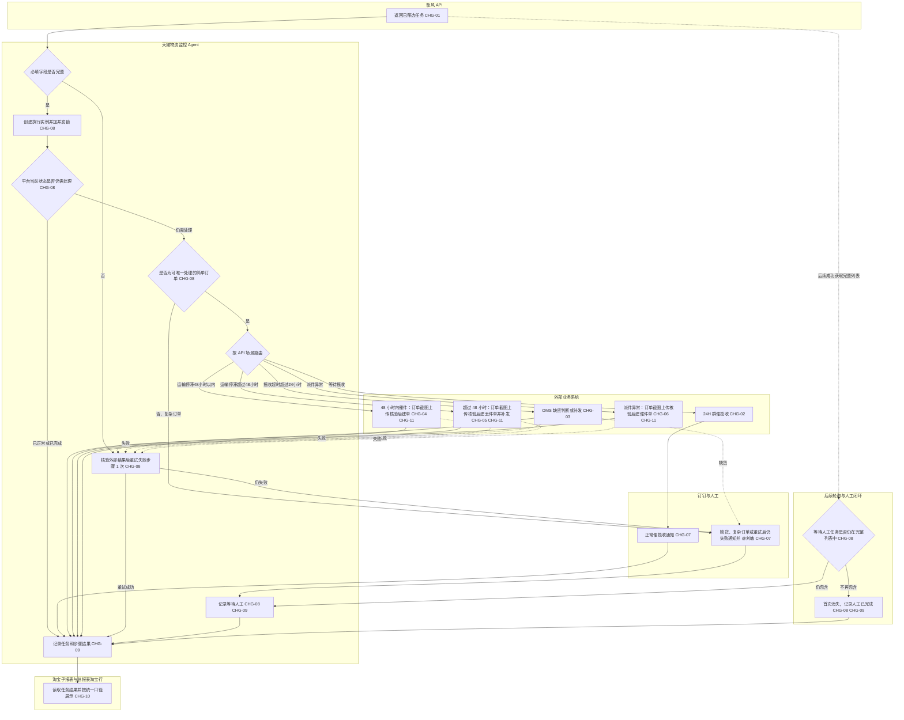

### 5.3 统一执行顺序

1. Agent 接收衡风 API 返回的任务。
2. 若无待处理任务，记录本次轮询为空并正常结束，不发送异常通知。
3. 校验订单号、物流单号、场景和可唯一映射店铺的信息；缺失任一必填字段时进入失败重试。
4. 将店铺映射为现有淘宝报表使用的稳定店铺标识，并将业务来源固定为“天猫物流监控”。为本次 API 任务创建执行实例；“淘宝平台 + 天猫物流监控业务来源 + 店铺标识 + 订单号 + 物流单号 + 场景”用于本次执行追踪、并发锁和同一批次内去重，不作为永久业务去重键。店铺无法唯一映射时停止外部写操作并按输入无效转人工。
5. 进入 API 指定场景对应的平台页面，核验当前状态：状态已正常或已处理完成时记为“状态正常跳过”并结束；状态仍需处理时继续。
6. 核验订单结构是否可唯一操作。一单多包裹、多物流单号、多商品、部分商品缺货或任一对象无法唯一对应时，不自动拆分或猜测，直接进入“等待人工”，通知天猫物流监控群并 @刘敏。
7. 按衡风 API 返回场景进入唯一分支，Agent 不重新计算时间和改变场景。
8. 执行任何写操作前先查询当前异常周期内的对应外部结果；当前周期已有相同成功结果则跳过该动作，未成功才执行。历史周期结果只用于辅助核验，不能直接阻止新周期必要操作；若无法判断历史结果是否仍满足本次异常，停止写操作并转人工。每完成一个外部动作立即记录步骤结果和可核验结果。
9. 某步骤失败时，先查询外部系统确认该动作是否已实际生效：已生效则记录成功并继续；未生效才重试该步骤 1 次。
10. 重试仍失败时保留此前已成功结果，不回滚、不重复执行成功步骤；向天猫物流监控群发送接管消息并 @刘敏。
11. 同批任务逐条隔离；单条任务失败、接管或通知待恢复不得阻塞其他任务。
12. 同一异常周期内不重复已成功的群消息、工单、补发或备注。进入“等待人工”的任务，若后续一次衡风 API 成功返回的完整任务列表中不再包含该异常，则视为人工处理已闭环：状态更新为“人工已完成”，实际完成时间取 Agent 首次确认该异常不再返回的时间。该任务仍属于 Agent 任务数据，不得从核心统计排除。若以后再次返回，则新建异常周期并重新核验平台当前状态。接口失败、超时、返回不完整或解析失败时不得据此更新为人工已完成。
13. 暂停后不接收新任务；执行中任务完成当前不可分割的外部操作后，在下一步骤前进入“已暂停”，恢复后从未完成步骤继续。

## 6. 场景步骤与客服截图

阅读方式：每一步的“截图”列可直接点击查看完整客服原图；同一场景下保留图片预览。跨场景复用的 OMS 操作也在当前步骤提供原图链接，无需回翻其他章节。

### 6.1 衡风 API 输入与场景边界 CHG-01

| 步骤 | Agent 操作 | 输入/判断 | 成功结果 | 失败处理 | 截图 |
| --- | --- | --- | --- | --- | --- |
| 1 | 接收待处理任务 | 订单号、物流单号、业务场景 | 创建待处理任务 | API 调用失败时重试 1 次 | [S01 查看原图](./天猫物流监控Agent_PRD_截图/S01_衡风API_等待揽收列表.png)、[S03 查看原图](./天猫物流监控Agent_PRD_截图/S03_衡风API_揽收超时列表.png)、[S08 查看原图](./天猫物流监控Agent_PRD_截图/S08_衡风API_运输停滞列表.png)、[S11 查看原图](./天猫物流监控Agent_PRD_截图/S11_衡风API_派件异常列表.png) |
| 2 | 校验必填字段 | 三个字段均不得为空 | 创建本次执行实例 | 缺失字段时重试 1 次，仍缺失则通知人工 | [S01 查看原图](./天猫物流监控Agent_PRD_截图/S01_衡风API_等待揽收列表.png)、[S03 查看原图](./天猫物流监控Agent_PRD_截图/S03_衡风API_揽收超时列表.png)、[S08 查看原图](./天猫物流监控Agent_PRD_截图/S08_衡风API_运输停滞列表.png)、[S11 查看原图](./天猫物流监控Agent_PRD_截图/S11_衡风API_派件异常列表.png) |
| 3 | 直接使用 API 场景并核验平台现状 | 不计算剩余时间或超时时长；在对应平台确认当前状态 | 已正常/已完成则跳过，仍需处理则进入对应场景 | 场景值无法识别或状态无法确认时转人工 | [S01 查看原图](./天猫物流监控Agent_PRD_截图/S01_衡风API_等待揽收列表.png)、[S03 查看原图](./天猫物流监控Agent_PRD_截图/S03_衡风API_揽收超时列表.png)、[S08 查看原图](./天猫物流监控Agent_PRD_截图/S08_衡风API_运输停滞列表.png)、[S11 查看原图](./天猫物流监控Agent_PRD_截图/S11_衡风API_派件异常列表.png) |
| 4 | 核验订单是否可唯一操作 | 订单、包裹、物流单号和商品必须能唯一对应 | 简单订单继续执行 | 多包裹、多物流单号、多商品、部分商品缺货或无法唯一判断时直接转人工 | [S04 查看原图](./天猫物流监控Agent_PRD_截图/S04_OMS_订单查询与缺货标识.png) |

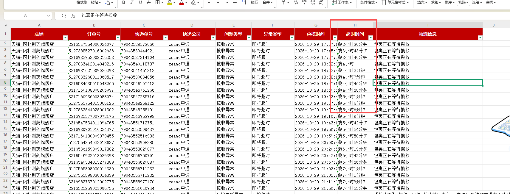

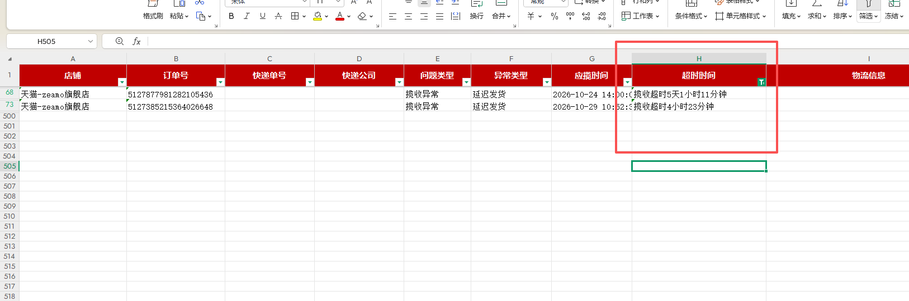

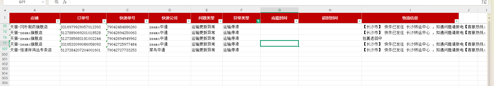

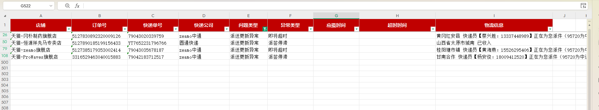

### 6.2 场景一 物流等待揽收 CHG-02

| 步骤 | 系统/页面 | Agent 操作 | 固定内容 | 成功判定 | 失败处理 | 截图 |
| --- | --- | --- | --- | --- | --- | --- |
| 1 | 衡风 API | 读取订单号对应物流单号 | 不修改物流单号 | 物流单号非空 | 字段缺失按统一失败规则 | [S01 查看原图](./天猫物流监控Agent_PRD_截图/S01_衡风API_等待揽收列表.png) |
| 2 | 钉钉 / 24H支付揽收率监控群 | 发送催揽收消息 | 发送物流单号原值，不加未经业务确认的固定前后缀 | 群内可查询到与 API 原值完全一致的物流单号，并返回消息标识或可查询记录 | 先查消息是否已发送，未发送才重试 | [S02 查看原图](./天猫物流监控Agent_PRD_截图/S02_钉钉_24H支付揽收率监控群催揽收.png)、[S14 查看原图](./天猫物流监控Agent_PRD_截图/S14_钉钉_24H支付揽收率监控群成员.png) |
| 3 | 同一群 | @指定 8 人 | 易嘉豪、陈娇群、崔志文、何紫辉、彭心雨、曾昶、张欣、刘敏 | 8 人均进入 @列表 | 重试后仍失败则转天猫物流监控群 @刘敏 | [S14 查看原图](./天猫物流监控Agent_PRD_截图/S14_钉钉_24H支付揽收率监控群成员.png) 仅证明目标群；8 人名单以本表文本规则及实际 userId 配置为准 |
| 4 | Agent | 记录本次任务成功 | 本次操作完成 | 状态变为“成功” | 再次收到 API 任务时重新核验平台状态 | — |

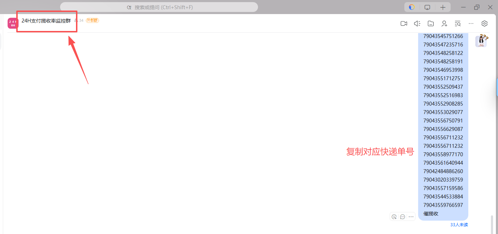

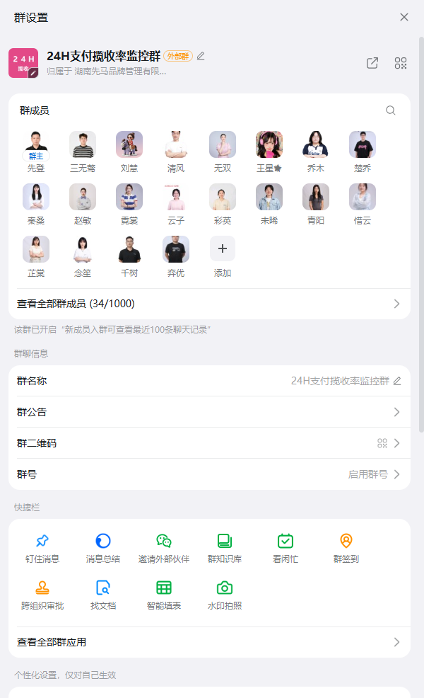

### 6.3 场景二 包裹揽收超时超过 24 小时 CHG-03

| 步骤 | 系统/页面 | Agent 操作 | 固定选项/文案 | 成功判定 | 失败或分支 | 截图 |
| --- | --- | --- | --- | --- | --- | --- |
| 1 | OMS / 订单管理 | 在“编号”输入订单号并搜索 | 使用 API 订单号 | 返回与订单号匹配的订单 | 查询失败按统一失败规则 | [S04 查看原图](./天猫物流监控Agent_PRD_截图/S04_OMS_订单查询与缺货标识.png) |
| 2 | OMS / 查询结果 | 定位当前订单并检查标记 | 识别截图中的“缺”标记 | 能明确判断是否缺货 | 无法判断时不得补发，转人工 | [S04 查看原图](./天猫物流监控Agent_PRD_截图/S04_OMS_订单查询与缺货标识.png) |
| 3A | 钉钉 / 天猫物流监控群 | 若显示缺货，停止自动补发并通知 | `【OMS缺货异常】订单号：{订单号}，OMS显示缺货，Agent已停止自动补发，请人工处理。`并 @刘敏 | 消息发送成功，任务进入 `WAITING_MANUAL` | 通知失败按统一失败规则 | [S13 查看原图](./天猫物流监控Agent_PRD_截图/S13_钉钉_天猫物流监控群.png) |
| 3B | OMS / 订单管理 | 若订单正常，选中对应订单并点击“补发” | 不得选中其他订单 | 打开补发弹窗 | 打开失败按统一失败规则 | [S04 查看原图](./天猫物流监控Agent_PRD_截图/S04_OMS_订单查询与缺货标识.png)、[S05 查看原图](./天猫物流监控Agent_PRD_截图/S05_OMS_补发原因与卖家备注.png) |
| 4 | OMS / 批量补发弹窗 | 选择补发原因 | `快递责任补发` | 选项显示为已选择 | 找不到选项时停止并通知人工 | [S05 查看原图](./天猫物流监控Agent_PRD_截图/S05_OMS_补发原因与卖家备注.png) |
| 5 | 同一弹窗 | 填写卖家备注 | `超时未发出重新补发` | 文案完整写入 | 写入失败按统一失败规则 | [S05 查看原图](./天猫物流监控Agent_PRD_截图/S05_OMS_补发原因与卖家备注.png) |
| 6 | 同一弹窗 | 点击“确定”创建补发单 | 原商品补发 | OMS 返回补发成功且产生对应补发订单 | 先查是否已产生补发订单，确认未产生才重试；禁止重复补发 | [S05 查看原图](./天猫物流监控Agent_PRD_截图/S05_OMS_补发原因与卖家备注.png) |
| 7 | OMS / 对应补发订单 | 进入系统生成的补发订单 | 必须与原订单存在补发关联 | 定位唯一补发订单 | 无法稳定定位时停止并通知人工 | [S06 查看原图](./天猫物流监控Agent_PRD_截图/S06_OMS_更多操作进入卖家备注.png) |
| 8 | OMS / 更多操作 | 依次点击“更多操作”→“卖家备注” | 不选择“电商备注”等相邻选项 | 打开批量编辑卖家备注弹窗 | 打开失败按统一失败规则 | [S06 查看原图](./天猫物流监控Agent_PRD_截图/S06_OMS_更多操作进入卖家备注.png) |
| 9 | OMS / 批量编辑卖家备注 | 选择红色备注旗并填写备注 | `超时未发出，已重新补发` | 红旗为红色，备注完整 | 任一项失败按统一失败规则 | [S07 查看原图](./天猫物流监控Agent_PRD_截图/S07_OMS_红旗备注同步平台.png) |
| 10 | 同一弹窗 | 勾选“同步至平台”，选择“叠加”，点击“确定” | 同步至平台=`是`；写入方式=`叠加` | 天猫平台侧可见完整备注；仅 OMS 保存成功不算完成 | 天猫侧不可见时只重试备注同步步骤，不重复创建补发单 | [S07 查看原图](./天猫物流监控Agent_PRD_截图/S07_OMS_红旗备注同步平台.png) |

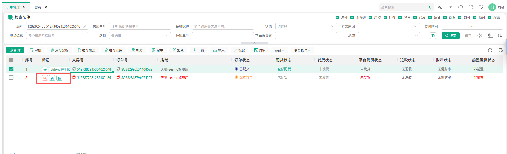

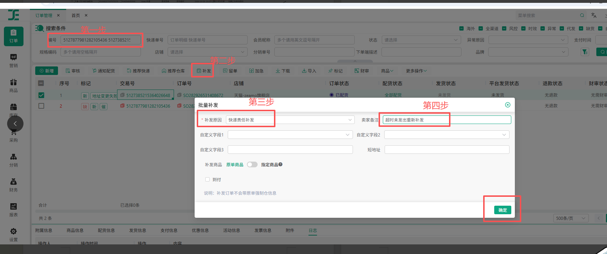

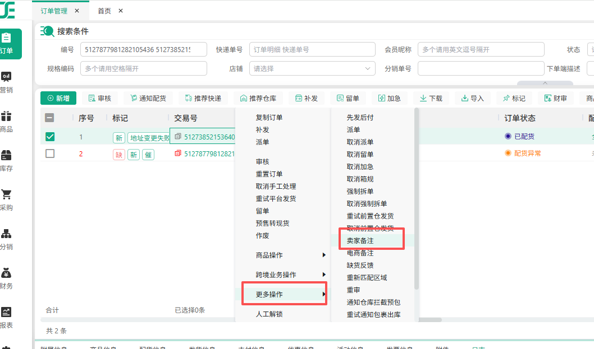

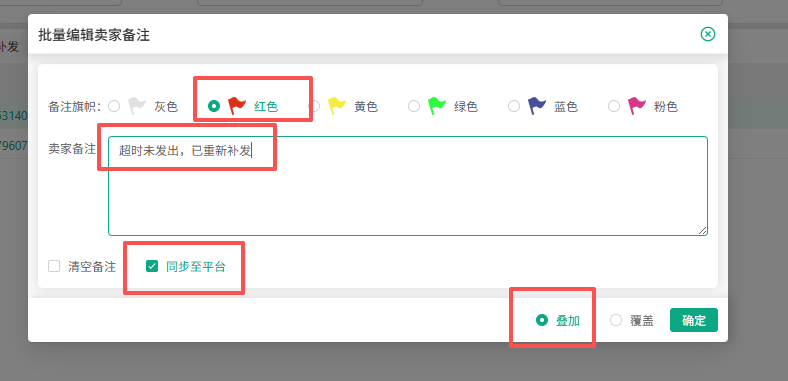

### 6.4 场景三 运输停滞 48 小时以内 CHG-04

| 步骤 | 系统/页面 | Agent 操作 | 固定选项/文案 | 成功判定 | 失败处理 | 截图 |
| --- | --- | --- | --- | --- | --- | --- |
| 1 | 客服工单系统 | 进入“物流问题登记表（客服）”并点击新建物流工单 | 不切换到快递回复或代发登记表 | 新建物流工单弹窗打开 | 按统一失败规则 | [S09 查看原图](./天猫物流监控Agent_PRD_截图/S09_客服工单_48小时内催件.png) |
| 2 | 新建物流工单 / 基础信息 | 输入 API 订单号，等待系统自动填充订单信息 | 订单号必须与任务一致 | 店铺、仓库、责任快递、金额、运单号等页面信息完成加载 | 自动填充失败时停止提交并通知人工 | [S09 查看原图](./天猫物流监控Agent_PRD_截图/S09_客服工单_48小时内催件.png) |
| 3 | 新建物流工单 / 物流问题 | 选择“催件” | `催件` | 单选项已选中 | 选择失败按统一失败规则 | [S09 查看原图](./天猫物流监控Agent_PRD_截图/S09_客服工单_48小时内催件.png) |
| 4 | 新建物流工单 / 处理信息 | 填写客服备注 | `物流停滞，麻烦尽快更新物流` | 文案完整写入 | 写入失败按统一失败规则 | [S09 查看原图](./天猫物流监控Agent_PRD_截图/S09_客服工单_48小时内催件.png) |
| 5 | 千牛订单详情→TMS / 附件 | 执行第 6.8 节：核对当前订单、实时截图并上传，确认附件成功后再继续 | 使用当前任务店铺、订单号及物流单号；不得上传示例图 | 附件与当前订单一致且上传成功 | 仅恢复失败步骤；仍失败转人工，不得无附件提交 | [S15 查看原图](./天猫物流监控Agent_PRD_截图/S15_千牛_物流单号搜索并进入订单详情.png)、[S16 查看原图](./天猫物流监控Agent_PRD_截图/S16_千牛_订单详情附件截图示例.png)；上传控件及结果待技术核验 |
| 6 | 新建物流工单 | 提交工单 | 不填写未经确认的快递回复结果 | 工单创建成功并可查询，且可查看匹配的订单详情附件 | 先查询是否已建单，未建才重试；禁止重复建单 | [S09 查看原图](./天猫物流监控Agent_PRD_截图/S09_客服工单_48小时内催件.png) |

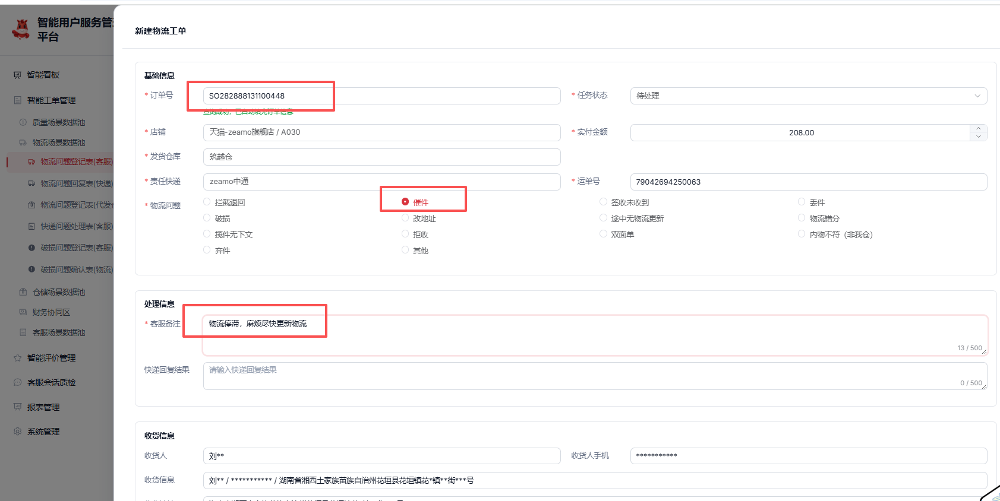

### 6.5 场景三 运输停滞超过 48 小时 CHG-05

| 步骤 | 系统/页面 | Agent 操作 | 固定选项/文案 | 成功判定 | 失败处理 | 截图 |
| --- | --- | --- | --- | --- | --- | --- |
| 1 | 客服工单系统 | 查询订单已有物流工单，再进入“物流问题登记表（客服）” | 使用 API 订单号 | 可识别已有催件/丢件工单 | 查询失败按统一失败规则 | [S10 查看原图](./天猫物流监控Agent_PRD_截图/S10_客服工单_超过48小时丢件.png) |
| 2 | 新建物流工单 / 物流问题 | 若仅有 48 小时内催件工单，保留原工单不修改并另建“丢件”；已有相同丢件工单则不重复创建 | `丢件` | 单选项已选中或查询到相同丢件工单 | 选择或结果核验失败按统一失败规则 | [S10 查看原图](./天猫物流监控Agent_PRD_截图/S10_客服工单_超过48小时丢件.png) |
| 3 | 新建物流工单 / 客服备注 | 填写客服备注 | `物流48小时未更新物流，我司记丢件，重新补发` | 文案完整写入，尚未提交 | 写入失败按统一失败规则 | [S10 查看原图](./天猫物流监控Agent_PRD_截图/S10_客服工单_超过48小时丢件.png) |
| 4 | 千牛订单详情→TMS / 附件 | 执行第 6.8 节：核对当前订单、实时截图并上传，确认附件成功后再继续 | 使用当前任务店铺、订单号及物流单号；不得上传示例图 | 附件与当前订单一致且上传成功 | 仅恢复失败步骤；仍失败转人工，不得无附件提交或继续 OMS 补发 | [S15 查看原图](./天猫物流监控Agent_PRD_截图/S15_千牛_物流单号搜索并进入订单详情.png)、[S16 查看原图](./天猫物流监控Agent_PRD_截图/S16_千牛_订单详情附件截图示例.png)；上传控件及结果待技术核验 |
| 5 | TMS / 新建物流工单 | 附件核验成功后提交丢件工单 | 保持第 3 步固定备注，原催件工单不修改 | 丢件工单可查询，且可查看匹配的订单详情附件 | 响应未知先查询，不重复建单；失败时停止后续补发 | [S10 查看原图](./天猫物流监控Agent_PRD_截图/S10_客服工单_超过48小时丢件.png)；附件结果待技术核验 |
| 6 | OMS / 订单管理 | 查询并选中原订单，点击“补发” | 使用 API 订单号 | 补发弹窗打开 | 按统一失败规则 | [S04 查看原图](./天猫物流监控Agent_PRD_截图/S04_OMS_订单查询与缺货标识.png)、[S05 查看原图](./天猫物流监控Agent_PRD_截图/S05_OMS_补发原因与卖家备注.png) |
| 7 | OMS / 补发弹窗 | 选择原因并填写卖家备注 | 原因=`快递责任补发`；卖家备注=`物流丢件` | 选项和文案完整 | 按统一失败规则 | [S05 查看原图](./天猫物流监控Agent_PRD_截图/S05_OMS_补发原因与卖家备注.png) |
| 8 | OMS / 补发弹窗 | 点击“确定”创建补发单 | 原商品补发 | 补发订单产生 | 先查补发结果，禁止重复补发 | [S05 查看原图](./天猫物流监控Agent_PRD_截图/S05_OMS_补发原因与卖家备注.png) |
| 9 | OMS / 对应补发订单 | “更多操作”→“卖家备注” | 定位与原订单关联的补发订单 | 备注弹窗打开 | 无法定位时转人工 | [S06 查看原图](./天猫物流监控Agent_PRD_截图/S06_OMS_更多操作进入卖家备注.png) |
| 10 | OMS / 卖家备注 | 选择红色备注旗并填写备注 | `物流丢件已重新补发` | 红旗和文案均保存 | 按统一失败规则 | [S07 查看原图](./天猫物流监控Agent_PRD_截图/S07_OMS_红旗备注同步平台.png) |
| 11 | 同一弹窗 | 勾选“同步至平台”，选择“叠加”，点击“确定” | 同步至平台=`是`；写入方式=`叠加` | 天猫平台侧可见完整备注；仅 OMS 保存成功不算完成 | 天猫侧不可见时只重试备注同步，不重复前序工单和补发 | [S07 查看原图](./天猫物流监控Agent_PRD_截图/S07_OMS_红旗备注同步平台.png) |

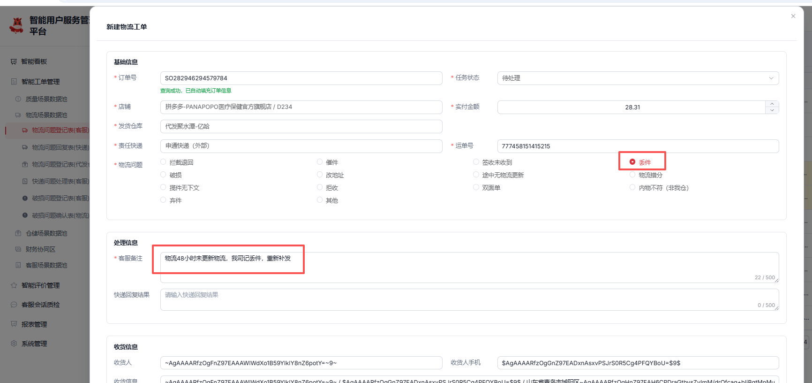

### 6.6 场景四 包裹到达买家当地后派件异常 CHG-06

| 步骤 | 系统/页面 | Agent 操作 | 固定选项/文案 | 成功判定 | 失败处理 | 截图 |
| --- | --- | --- | --- | --- | --- | --- |
| 1 | 客服工单系统 | 进入“物流问题登记表（客服）”并新建物流工单 | 使用 API 订单号 | 订单信息加载完成 | 加载失败按统一失败规则 | [S12 查看原图](./天猫物流监控Agent_PRD_截图/S12_客服工单_派件异常催件.png) |
| 2 | 新建物流工单 / 物流问题 | 选择“催件” | `催件` | 单选项已选中 | 选择失败按统一失败规则 | [S12 查看原图](./天猫物流监控Agent_PRD_截图/S12_客服工单_派件异常催件.png) |
| 3 | 新建物流工单 / 客服备注 | 填写备注 | `派件超时，麻烦尽快处理` | 文案完整写入 | 写入失败按统一失败规则 | [S12 查看原图](./天猫物流监控Agent_PRD_截图/S12_客服工单_派件异常催件.png) |
| 4 | 千牛订单详情→TMS / 附件 | 执行第 6.8 节：核对当前订单、实时截图并上传，确认附件成功后再继续 | 使用当前任务店铺、订单号及物流单号；不得上传示例图 | 附件与当前订单一致且上传成功 | 仅恢复失败步骤；仍失败转人工，不得无附件提交 | [S15 查看原图](./天猫物流监控Agent_PRD_截图/S15_千牛_物流单号搜索并进入订单详情.png)、[S16 查看原图](./天猫物流监控Agent_PRD_截图/S16_千牛_订单详情附件截图示例.png)；上传控件及结果待技术核验 |
| 5 | 新建物流工单 | 提交工单 | 不填写未经确认的快递回复结果 | 工单创建成功并可查询，且可查看匹配的订单详情附件 | 先查是否已建单，未建才重试 | [S12 查看原图](./天猫物流监控Agent_PRD_截图/S12_客服工单_派件异常催件.png) |

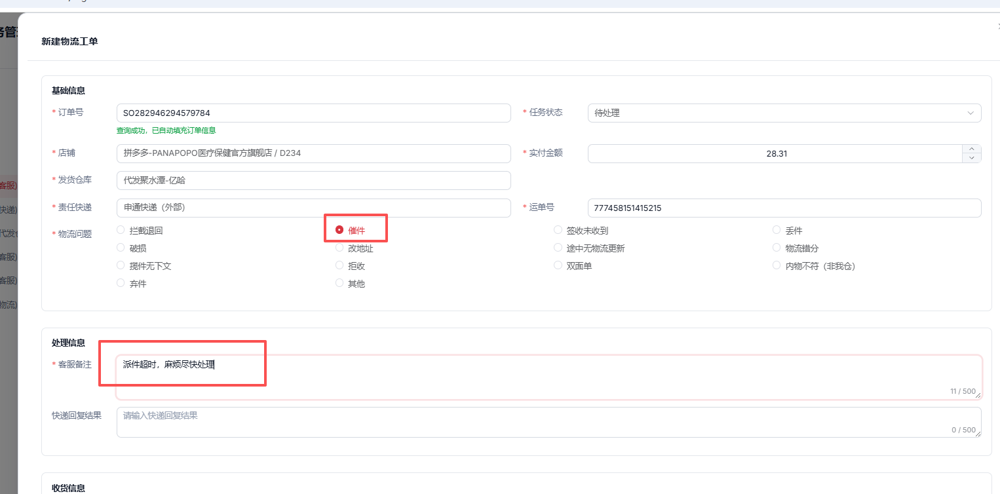

### 6.7 钉钉群映射 CHG-07

| 场景 | 目标群 | @人员 | 消息最小内容 |
| --- | --- | --- | --- |
| 正常催揽收 | 24H支付揽收率监控群 | 易嘉豪、陈娇群、崔志文、何紫辉、彭心雨、曾昶、张欣、刘敏 | 物流单号原值；不强制增加其他包装文案 |
| OMS 显示缺货 | 天猫物流监控 | 刘敏 | 订单号、缺货结论、已停止自动补发、人工处理说明 |
| 复杂订单无法唯一操作 | 天猫物流监控 | 刘敏 | 订单号、物流单号、复杂原因、Agent 未执行的操作、人工处理说明 |
| 任一步骤自动重试 1 次后仍失败 | 天猫物流监控 | 刘敏 | 订单号、物流单号、场景、失败步骤、失败原因、已成功步骤、人工接管说明 |

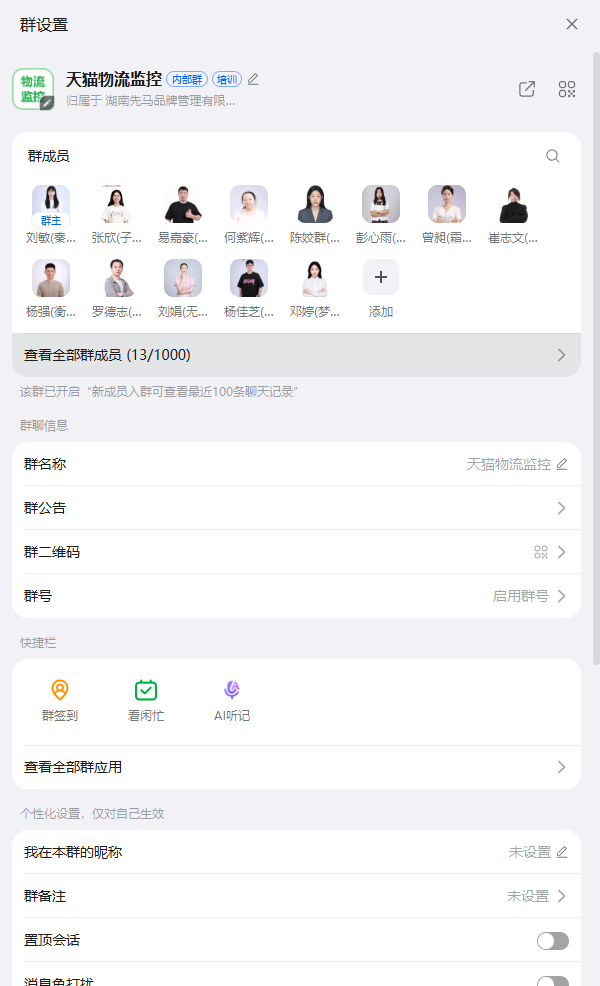

### 6.8 共用步骤：TMS 物流工单附件来源与上传 CHG-11

适用于第 6.4、6.5、6.6 节新建工单。只有需要新建时执行；当前异常周期已有相同成功工单且结果满足本次任务时，复用该结果，不补建工单、不重复上传。客服原图仅说明操作路径；工单附件必须由 Agent 在执行本次任务时实时获取。

| 步骤 | 入口与对象 | 字段来源及取值 | Agent 操作 | 成功核验 | 失败与恢复 | 对应截图 |
| --- | --- | --- | --- | --- | --- | --- |
| 1 | 当前任务对应店铺的千牛后台 | 店铺来自任务唯一映射结果；查询值为衡风 API 物流单号原值 | 进入“交易→已卖出宝贝”，输入物流单号并搜索 | 搜索结果中唯一对应任务订单，店铺及订单号与任务一致 | 搜索失败只重试查询 1 次；无匹配、多个无法唯一对应或身份不一致时禁止使用结果，仍无法核验则转人工 | [S15 查看原图](./天猫物流监控Agent_PRD_截图/S15_千牛_物流单号搜索并进入订单详情.png) |
| 2 | 搜索结果中的当前订单 | 订单号、物流单号均与本次任务一致 | 点击该订单“详情”，等待订单详情内容加载完成 | 详情页订单号与任务一致，物流信息中的运单号与任务一致 | 加载失败按统一规则只恢复本步骤；身份无法匹配时不截图上传、不猜测选择 | [S15 查看原图](./天猫物流监控Agent_PRD_截图/S15_千牛_物流单号搜索并进入订单详情.png)、[S16 查看原图](./天猫物流监控Agent_PRD_截图/S16_千牛_订单详情附件截图示例.png) |
| 3 | 已核验的千牛订单详情页 | 当前页面实时内容 | 截取订单详情，包含订单状态、订单信息、物流信息（含运单号）及商品信息；可用完整页面截图覆盖这些区域，不额外脱敏 | 图片可读取、信息清晰、必要区域无缺失，订单号及运单号可核对；记录截图时间与任务关联 | 截图不完整或失败仅重试截图 1 次；不得复用其他订单或 PRD 示例附件 | [S16 查看原图](./天猫物流监控Agent_PRD_截图/S16_千牛_订单详情附件截图示例.png) |
| 4 | TMS 当前任务的新建物流工单 / 附件 | 第 3 步生成且已核验的实时图片 | 上传图片，等待上传结束，核对附件预览或可查询结果后返回原场景提交步骤 | 上传已完成，附件可打开且内容对应当前任务；不是仅选择了文件或仍在上传 | 响应未知先查询当前附件；已成功则复用，不重复上传；确认未成功才重试 1 次；仍失败或无法确认则停止后续依赖步骤并通知人工 | 订单内容参照 [S16 查看原图](./天猫物流监控Agent_PRD_截图/S16_千牛_订单详情附件截图示例.png)；现有截图未展示 TMS 附件控件及成功结果，按 TBD-T03 联调核验 |

附件步骤失败统一发送至“天猫物流监控”群并仅 @刘敏，保留已成功步骤；不得无附件继续提交。超过 48 小时场景必须在含附件的丢件工单成功后才继续 OMS 补发。提交后应再次核验工单附件关联，不能只凭提交按钮响应判定成功。

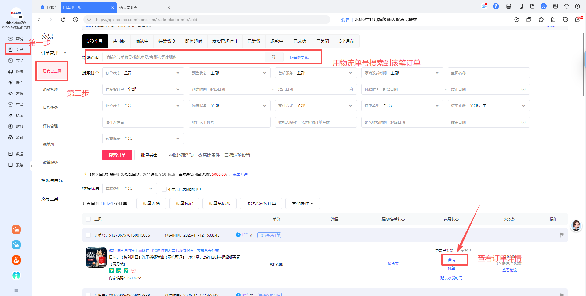

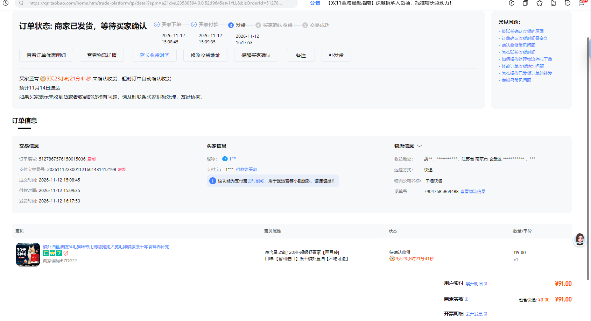

## 7. 功能与业务规则

### R-01 API 场景为唯一场景依据

- 关联变更：CHG-01
- Agent 只接受衡风 API 返回的场景，不计算 24/48 小时，不根据页面文本改判场景。
- 无待处理数据是正常空结果，不发送失败通知。
- API 调用失败、场景不可识别或必填字段缺失才进入失败流程。

### R-02 平台实时状态核验与执行实例

- 关联变更：CHG-08
- 每次 API 返回任务均触发一次平台状态核验，不因历史存在“成功”记录而永久跳过。
- 平台当前状态已正常或已处理完成时，本次记为“状态正常跳过”，不执行外部写操作；平台仍需处理时进入对应场景。
- 执行追踪与并发锁的基础身份必须同时包含“平台=淘宝、业务来源=天猫物流监控、店铺稳定标识、订单号、物流单号、场景”；不得仅按订单号或物流单号跨店铺、跨业务来源去重。
- 从同一基础身份的异常首次出现在 API 成功返回的完整列表中，到后续某次 API 成功返回的完整列表不再包含该异常，定义为一个“异常周期”。无论自动成功、状态正常跳过或等待人工，当该异常从完整列表消失时均关闭当前周期；仅“等待人工”需在此时转为“人工已完成”。
- 每个写操作仍须查询当前异常周期内的外部结果；已有相同成功结果时跳过该动作。异常消失后再次返回时建立新周期，历史周期结果只用于核验平台当前状态，不得永久阻止新周期的必要操作；无法判断历史结果是否仍满足当前异常时，停止写操作并转人工。

### R-03 步骤级重试

- 关联变更：CHG-08
- 任一步骤首次失败后，Agent 先查询外部系统结果。
- 若外部动作已生效，记录该步骤成功并继续，不再次执行。
- 若未生效，只重试当前失败步骤 1 次；总尝试次数最多 2 次。
- 部分成功时不得从头重跑整个场景。
- 同批任务逐条隔离，单条失败不阻塞其他任务。

### R-04 物流等待揽收通知

- 关联变更：CHG-02、CHG-07
- 目标群固定为“24H支付揽收率监控群”。
- 必须发送 API 中的物流单号原值并 @8 名指定人员，不强制添加未经确认的固定前后缀。
- 消息发送成功即完成本次 Agent 动作；后续以衡风 API 不再返回异常为业务结束依据。

### R-05 缺货与复杂订单人工接管

- 关联变更：CHG-03、CHG-07、CHG-08
- OMS 查询结果显示“缺”标记时，Agent 不得点击补发。
- Agent 向“天猫物流监控”群发送缺货通知并仅 @刘敏。
- 任务进入“等待人工”。
- 一单多包裹、多物流单号、多商品、部分商品缺货或对象无法唯一判断时，按同一人工接管规则处理。

### R-06 24 小时超时补发固定值

- 关联变更：CHG-03
- 补发原因固定为“快递责任补发”。
- 原订单补发弹窗卖家备注固定为“超时未发出重新补发”。
- 补发订单红旗备注固定为“超时未发出，已重新补发”。
- 红旗颜色为红色；必须勾选“同步至平台”，写入方式为“叠加”。
- 必须在天猫平台侧确认备注可见后才算同步成功；仅 OMS 保存成功不得将任务记为成功。

### R-07 48 小时以内催件固定值

- 关联变更：CHG-04
- 物流问题固定选择“催件”。
- 客服备注固定为“物流停滞，麻烦尽快更新物流”。

### R-08 超过 48 小时丢件与补发固定值

- 关联变更：CHG-05
- 物流问题固定选择“丢件”。
- 客服备注固定为“物流48小时未更新物流，我司记丢件，重新补发”。
- OMS 补发原因固定为“快递责任补发”。
- 原订单卖家备注固定为“物流丢件”。
- 补发订单红旗备注固定为“物流丢件已重新补发”。
- 红旗颜色为红色；必须勾选“同步至平台”，写入方式为“叠加”。
- 必须在天猫平台侧确认备注可见后才算同步成功；仅 OMS 保存成功不得将任务记为成功。
- 若同一异常先以“48 小时以内”创建过催件工单，后续 API 返回“超过 48 小时”且平台仍需处理，保留原催件工单不修改，另建丢件工单并继续补发。

### R-09 派件异常催件固定值

- 关联变更：CHG-06
- 物流问题固定选择“催件”。
- 客服备注固定为“派件超时，麻烦尽快处理”。

### R-10 失败通知与人工接管

- 关联变更：CHG-07、CHG-08
- 自动重试 1 次后仍失败，发送至“天猫物流监控”群并仅 @刘敏。
- 消息必须包含任务唯一信息、场景、失败步骤、失败原因和已成功步骤。
- 人工等待期间不重复发送接管通知；人工接管不能触发 Agent 从头重跑。
- 已经进入 Agent 处理范围、后续转人工的任务，仍属于 Agent 任务数据，不能从核心统计中排除。
- 任务进入“等待人工”后，若衡风 API 后续一次成功返回的完整任务列表中不再包含该异常，则视为人工处理已闭环，状态更新为“人工已完成”；接口失败、超时、返回不完整或解析失败不得触发该状态变化。
- 人工任务的实际完成时间取 Agent 首次确认衡风 API 不再返回该异常的时间；完成主体记为“人工”。
- 该任务计入“进入自动化单量”“人工完成”和“已完成总量”，不计入“Agent纯自动完成”和“尚未完成”。
- 淘宝业务线原“工单总量（参考）”仍按既有五类售后申请取数，不纳入天猫物流监控任务，不得与 Agent 转人工完成量混用或重复统计。
- 异常群通知查询后重试 1 次仍失败时，写入高优先级系统告警并进入“通知待恢复”，不得把任务误记为通知成功。

### R-11 工单附件为提交前置条件

- 关联变更：CHG-04、CHG-05、CHG-06、CHG-11
- 三个新建物流工单场景均执行第 6.8 节；附件为本次任务匹配订单的千牛详情实时截图，不是 OMS 截图、搜索列表图或客服示例图。
- 先核对店铺、订单号、物流单号，再截图上传，附件可查看且匹配后才提交；提交后再次核验附件关联。
- 未上传成功或匹配不明不得提交；工单含附件核验未成功不得继续超过 48 小时场景的补发。
- 失败按 R-03 恢复失败步骤，重试后仍失败按 R-10 转人工；已有相同成功工单按现有规则复用，不因本次新增附件要求重新建单。

## 8. 状态、边界与异常

### 8.1 状态模型

| 业务状态 | 建议枚举 | 进入条件 | 可执行操作 | 退出条件 |
| --- | --- | --- | --- | --- |
| 已接收 | `RECEIVED` | API 必填字段校验通过 | 加并发锁、核验平台状态 | 进入处理中、状态正常跳过或人工接管 |
| 状态正常跳过 | `STATUS_NORMAL_SKIPPED` | 平台当前状态已正常或已处理完成 | 记录核验结果，不执行外部写操作 | 本次执行终态；再次返回时重新核验 |
| 处理中 | `PROCESSING` | 平台仍需处理且订单可唯一操作 | 继续当前步骤 | 成功、重试、暂停或人工接管 |
| 重试中 | `RETRYING` | 首次失败且核验外部结果未成功 | 只重试失败步骤 | 成功或人工接管 |
| 成功 | `SUCCESS` | 所有必需步骤均成功；涉及备注时天猫侧已确认可见 | 记录本次完成 | 本次执行终态；再次返回时重新核验 |
| 等待人工 | `WAITING_MANUAL` | 缺货、复杂订单、状态无法确认或重试仍失败 | 人工处理；等待期间不重复通知 | 衡风 API 后续一次成功返回的完整任务列表中不再包含该异常时进入“人工已完成”；接口失败或结果不完整时保持原状态 |
| 人工已完成 | `MANUAL_COMPLETED` | 已进入等待人工，且 Agent 首次确认衡风 API 不再返回该异常 | 记录人工闭环；实际完成时间取本次确认时间；完成主体记为人工 | 本次异常周期终态；再次返回时新建异常周期并重新核验 |
| 通知待恢复 | `NOTIFICATION_PENDING` | 人工接管通知查询后重试 1 次仍失败 | 高优先级系统告警，等待通知能力恢复 | 通知成功并回到 `WAITING_MANUAL` |
| 已暂停 | `PAUSED` | 收到暂停指令且当前不可分割外部操作已结束 | 不接收新任务；保留步骤进度 | 恢复后从未完成步骤继续 |
| 输入无效 | `INVALID_INPUT` | 必填字段缺失或场景不可识别且重试仍失败 | 通知人工 | 人工处理 |

### 8.2 边界规则

| 边界场景 | 处理规则 | 验收关联 |
| --- | --- | --- |
| API 无待处理数据 | 正常结束，不创建任务、不发送通知 | AC-01 |
| 同一任务重复返回 | 每次先核验平台当前状态；已正常/已完成则跳过，仍异常则执行必要动作 | AC-10、AC-11 |
| 48 小时场景升级 | 保留原催件工单不变；新增丢件工单并继续补发 | AC-17 |
| 复杂订单 | 一单多包裹、多物流单号、多商品、部分商品缺货或对象无法唯一对应时直接转人工 | AC-18 |
| OMS 返回多条订单 | 只操作订单号和物流对象可唯一匹配的简单订单；无法唯一匹配则转人工 | AC-04、AC-18 |
| 补发按钮点击后响应未知 | 先查询是否已生成补发订单，不得直接再次点击 | AC-12 |
| 工单提交后响应未知 | 先按订单号和问题类型查询是否已建单，不得直接再次提交 | AC-13 |
| 备注同步失败 | 只重试备注同步，不得重复补发或重建工单 | AC-14 |
| 外部账号失效或出现验证码 | 停止自动操作，重试后仍失败则通知人工 | AC-15 |
| 批量任务中单条失败 | 失败任务独立接管，其余任务继续执行 | AC-19 |
| 执行中暂停 | 完成当前不可分割外部操作，在下一步骤前暂停；恢复后续跑 | AC-20 |

### 8.3 异常与恢复

| 异常 | 已产生的外部影响 | 自动处理 | 最终状态 | 通知 |
| --- | --- | --- | --- | --- |
| API 调用失败 | 无 | 重试调用 1 次 | 成功或等待人工 | 仍失败时 @刘敏 |
| 必填字段缺失 | 无 | 重试获取 1 次 | 成功或输入无效 | 仍缺失时 @刘敏 |
| OMS 查询失败 | 无 | 重试查询 1 次 | 成功或等待人工 | 仍失败时 @刘敏 |
| OMS 显示缺货 | 无补发 | 不重试补发 | 等待人工 | 立即 @刘敏 |
| 补发结果不确定 | 可能已产生补发单 | 先查询补发结果；未产生才重试 | 成功或等待人工 | 仍不确定时 @刘敏 |
| 订单详情查询、截图或附件上传失败 | 工单草稿可能存在，未提交或结果待核验 | 按第 6.8 节查询并恢复失败步骤，禁止无附件提交；保留已成功结果 | 成功或等待人工 | 仍失败时 @刘敏 |
| 工单结果不确定 | 可能已产生工单 | 先查询工单；未产生才重试 | 成功或等待人工 | 仍不确定时 @刘敏 |
| 备注或平台同步失败 | 前序补发或工单可能已成功 | 查询天猫侧可见性，只重试当前备注同步 | 成功或等待人工 | 天猫侧仍不可见时 @刘敏 |
| 钉钉业务消息失败 | 业务动作可能已成功 | 查询消息记录后重试发送 1 次 | 成功或等待人工 | 仍失败时进入接管通知流程 |
| 人工接管通知失败 | 人工尚未获知异常 | 查询消息记录后重试发送 1 次 | 通知待恢复 | 写入高优先级系统告警，通知恢复后补发 |

### 8.4 代表场景推演

**验收示例：超过 24 小时未揽收，补发已成功但备注同步首次失败。**

1. 衡风 API 返回订单号、物流单号和“揽收超时超过 24 小时”。
2. Agent 为本次 API 数据创建 1 个执行实例，并核验平台仍需处理。
3. OMS 查询结果无“缺”标记，Agent创建 1 个补发订单。
4. Agent进入该补发订单，红旗备注同步首次失败。
5. Agent先查询补发订单，确认补发已存在，因此禁止再次点击“补发”。
6. Agent只重试红旗备注和“同步至平台”步骤 1 次。
7. 若重试后天猫平台侧可见备注，任务状态为“成功”；若仍不可见，状态为“等待人工”，向天猫物流监控群发送 1 条消息并 @刘敏。
8. 该任务后续重复返回时，Agent 重新核验平台状态和已存在补发结果，不得产生第二张补发单。

## 9. 数据对象与字段契约

### 9.1 衡风 API 输入

| 中文字段（建议技术标识） | 业务含义 | 类型 | 必填 | 格式/枚举 | 校验 | 来源/状态 |
| --- | --- | --- | --- | --- | --- | --- |
| 订单号（`order_no`） | 需处理订单的原始编号 | 字符串 | 是 | 保留原始字符，不转数值 | 非空 | 衡风 API，已确认业务含义 |
| 物流单号（`logistics_no`） | 订单对应的物流单号原值 | 字符串 | 是 | 保留原始字符，不转数值 | 非空 | 衡风 API，已确认业务含义 |
| 已判定业务场景（`scene_code`） | 衡风 API 已筛选确认的处理场景 | 字符串/枚举 | 是 | 建议枚举见下表 | 必须命中有效场景 | 衡风 API，枚举值待技术对齐 |
| 店铺原始标识或名称（`source_store`） | 用于唯一映射到淘宝报表店铺 | 字符串 | 是 | 原始值 | 必须可唯一映射到店铺稳定标识；缺失或多义时禁止写操作并转人工 | 衡风 API 或可与订单唯一关联的稳定信息，具体字段待技术对齐 |

建议场景枚举仅作为接口对齐参考，不代表现有 API 已采用：

| 建议枚举 | 业务场景 |
| --- | --- |
| `WAITING_PICKUP` | 物流等待揽收 |
| `PICKUP_OVER_24H` | 包裹揽收超时超过 24 小时 |
| `TRANSPORT_STALLED_WITHIN_48H` | 运输停滞 48 小时以内 |
| `TRANSPORT_STALLED_OVER_48H` | 运输停滞超过 48 小时 |
| `DELIVERY_EXCEPTION` | 派件异常 |

### 9.2 Agent 任务与步骤记录

| 中文字段（建议技术标识） | 业务含义 | 类型 | 必填 | 规则 |
| --- | --- | --- | --- | --- |
| 平台标识（`platform_code`） | 报表业务线命名空间 | 字符串/枚举 | 是 | 本 Agent 固定为“淘宝”；不新增“天猫物流”业务线 |
| 业务来源（`business_source`） | 淘宝业务线下的任务来源 | 字符串/枚举 | 是 | 固定为“天猫物流监控”，与淘宝原退款、换货等来源隔离 |
| 店铺稳定标识（`store_id`） | 淘宝报表中唯一店铺标识 | 字符串 | 是 | 使用源系统稳定标识，不以展示名称代替；无法唯一映射时转人工 |
| 订单号（`order_no`） | 任务订单原值 | 字符串 | 是 | 与 API 原值一致 |
| 物流单号（`logistics_no`） | 任务物流单号原值 | 字符串 | 是 | 与 API 原值一致 |
| 业务场景（`scene_code`） | API 已判定的五类场景之一 | 字符串/枚举 | 是 | 使用第 9.1 节场景映射 |
| 单次执行实例标识（`execution_id`） | 单次 API 执行审计标识 | 字符串 | 是 | 每次 API 任务生成，不用于核心业务量去重 |
| 执行锁与批次内去重键（`task_key`） | 防止同批次并发重复执行 | 字符串 | 是 | 必须由平台、业务来源、店铺、订单号、物流单号、场景稳定生成；不作为永久业务去重依据 |
| API 批次标识（`batch_id`） | 批次隔离与追溯 | 字符串 | 是 | 生成方式待技术确认 |
| 异常周期标识（`anomaly_episode_id`） | 报表核心统计对象 | 字符串 | 是 | 基于平台、业务来源、店铺、订单号、物流单号、场景判定同一基础身份；连续出现时保持一致，从完整列表首次消失时关闭，再次出现时建立新周期 |
| `task_status` | 任务状态 | 枚举 | 是 | 使用第 8.1 节状态 |
| `platform_status_result` | 平台状态核验结果 | 枚举 | 是 | 建议值：`NEEDS_ACTION/NORMAL/COMPLETED/UNKNOWN`；真实映射待技术确认 |
| `manual_notified_at` | 最近一次人工接管通知时间 | 日期时间 | 否 | 用于等待人工期间防重复通知 |
| `attempt_count` | 当前步骤尝试次数 | 整数 | 是 | 首次执行为 1，自动重试后为 2，不得大于 2 |
| `current_step` | 当前或失败步骤 | 字符串 | 是 | 使用稳定步骤编号，例如 `S2-06_CREATE_RESEND` |
| `step_result` | 步骤结果 | 枚举 | 是 | `PENDING/SUCCESS/FAILED/SKIPPED`，建议值待技术确认 |
| `external_result_ref` | 外部操作结果引用 | 字符串 | 否 | 消息标识、工单标识、补发订单标识或可查询结果 |
| 订单详情截图记录 | 当前任务实时附件证据 | object | 新建工单时是 | 关联执行实例、店铺、订单号、物流单号、截图时间（datetime）及图片引用（string）；不把完整页面内容写入普通日志 |
| 工单附件结果 | 上传及工单关联的核验结果 | object | 新建工单时是 | 记录上传状态（enum：待上传/上传中/成功/失败/结果未知）、附件引用（string）、关联工单引用（string，提交前可为空）及核验时间（datetime）；成功以第 6.8 节核验为准，不以本地文件存在代替上传成功 |
| `error_message` | 失败原因 | 字符串 | 否 | 不记录账号凭据和完整敏感页面内容 |
| `created_at` | 任务接收时间 | 日期时间 | 是 | Agent 生成 |
| `updated_at` | 最近更新时间 | 日期时间 | 是 | 每次状态变化更新 |
| 实际完成时间（`completed_at`） | 任务真实闭环时间 | 日期时间 | 完成任务是 | Agent 纯自动完成取全部必要操作成功的时间；人工已完成取 Agent 首次确认 API 成功且完整返回的列表中不再包含该异常的时间；不得使用通知、转交、接口失败或普通更新时间代替 |
| `final_actor` | 最终完成主体 | 枚举 | 完成任务是 | 技术枚举为 `AGENT/MANUAL`，业务含义为 Agent/人工；人工已完成记为人工，等待人工期间不得提前填写 |
| `completion_result` | 最终处理结果 | 字符串/枚举 | 完成任务是 | Agent 纯自动完成记录实际操作结果；人工已完成记录“衡风 API 不再返回，人工闭环”，真实枚举待技术对齐 |
| `manual_takeover_reason` | 人工接管或未完成原因 | 字符串/枚举 | 接管任务是 | 缺货、复杂订单、状态无法确认、操作失败、通知失败等稳定原因 |
| `core_metric_included` | 是否纳入报表核心统计 | 布尔 | 是 | 有效唯一异常周期为是；任务进入等待人工或人工已完成后仍为是，不得因转人工排除；状态正常跳过、无法形成有效业务任务及明确排除项为否 |
| `metric_exclusion_reason` | 核心统计排除原因 | 字符串/枚举 | 排除时是 | 至少区分状态正常跳过、无效输入、重复数据和非本期范围 |

## 10. Agent 产品契约

### 10.1 Agent 职责、输入与输出

| 关联 CHG/R | Agent 负责 | Agent 不负责 | 输入/工具 | 输出 |
| --- | --- | --- | --- | --- |
| CHG-01 / R-01 | 接收、校验和路由 API 任务 | 重新筛选异常、计算时间阈值 | 衡风 API | 标准化任务 |
| CHG-02 至 CHG-06 | 按固定步骤操作 OMS、工单系统和钉钉 | 自行改写选项、文案或跨场景操作 | 已授权系统入口 | 群消息、工单、补发、备注及同步结果 |
| CHG-08 / R-02、R-03 | 平台状态核验、外部动作防重复、步骤级重试、部分成功续跑、批次隔离和暂停恢复 | 依据历史成功记录永久跳过，或对不确定结果盲目重复执行 | 任务记录、平台状态和外部结果查询 | 成功、状态正常跳过、暂停或人工接管 |
| CHG-11 / R-11 | 查询并核对千牛订单、实时截图、上传及核验工单附件 | 上传示例图、错单图片，或附件未成功即提交 | 授权千牛和 TMS 页面/工具 | 任务关联截图及工单附件结果 |
| CHG-09 | 记录步骤、结果和失败原因 | 记录账号密码、令牌等凭据 | 各步骤执行结果 | 可审计任务记录 |
| CHG-10 | 提供平台、业务来源、店铺、异常周期、任务状态、场景、创建时间、实际完成时间、最终主体和处理结果 | 在 Agent 内计算报表汇总值，或用报表结果反向改变业务状态 | Agent 任务与步骤记录 | 供淘宝子报表和总报表淘宝行读取的任务级结果 |

### 10.2 不确定性、失败与人工控制

| 场景 | Agent 自动处理 | 人工接管 | 最终记录 |
| --- | --- | --- | --- |
| OMS 是否缺货无法明确判断 | 不继续补发 | 天猫物流监控群 @刘敏 | 等待人工 + 页面/错误上下文 |
| 一单多包裹、多物流单号、多商品、部分商品缺货或无法唯一对应 | 不自动拆分或猜测 | 天猫物流监控群 @刘敏 | 等待人工 + 复杂订单原因 |
| 外部动作结果未知 | 先查询结果，再决定是否重试 | 查询后仍无法确定则 @刘敏 | 已成功步骤与不确定步骤分开记录 |
| 首次失败 | 只重试失败步骤 1 次 | 暂不接管 | 重试中 |
| 重试仍失败 | 停止后续依赖步骤 | 天猫物流监控群 @刘敏 | 等待人工 |
| 历史成功任务再次返回 | 重新核验平台状态；已正常则跳过，仍异常则执行必要动作 | 状态无法确认时 @刘敏 | 状态正常跳过、成功或等待人工 |
| 人工等待任务再次出现 | 已通知且仍在等待时不重复通知；继续记录本次核验 | 原接管人继续处理 | 等待人工 |
| 人工等待任务后续不再返回 | 仅以衡风 API 成功返回的完整任务列表为依据，记录首次确认时间 | 视为人工处理已闭环 | 人工已完成；实际完成时间取首次确认时间，完成主体记为人工 |
| 人工接管通知失败 | 重试 1 次并写高优先级系统告警 | 通知能力恢复后补发 | 通知待恢复 |

### 10.3 工具权限和审计约束

1. 千牛、OMS、客服工单和钉钉必须使用公司授权服务账号或授权机器人。
2. 权限范围仅覆盖本 PRD 所需订单查询、截图读取、附件上传、补发、备注、建单和发群能力。
3. 所有写操作必须记录执行实例、任务键、步骤、尝试次数、操作时间和可查询结果。
4. 日志不得记录密码、验证码、令牌、Cookie 或完整认证响应。
5. 页面结构变化、验证码、账号失效或权限不足均不得通过绕过安全机制处理，应进入人工接管。

## 11. 依赖、联动与历史兼容

| 维度 | 是否影响 | 本次处理 | 历史兼容 | 待技术确认 |
| --- | --- | --- | --- | --- |
| 衡风 API | 是 | 接收订单号、物流单号、已判定场景和可唯一映射店铺的信息 | 不回补历史任务 | 调用方式、鉴权、真实字段/枚举、店铺映射、错误码和完整列表标识 |
| OMS 权限 | 是 | 查询订单、补发、写卖家备注、插红旗、同步平台 | 不修改历史订单 | 服务账号、稳定定位方式、补发结果查询方式 |
| 千牛订单详情权限 | 是 | 读取对应店铺订单详情并实时截图 | 不修改订单，不复用历史示例图片 | 服务账号、店铺切换、详情读取和截图能力 |
| 客服工单权限 | 是 | 查询订单、上传并核验附件后新建催件/丢件工单 | 不修改历史成功工单，不因新增附件要求重建 | 服务账号、附件上传及回读、提交成功标识、重复工单查询方式 |
| 钉钉机器人 | 是 | 向两个指定群发送消息并 @指定人员 | 不补发历史消息 | 两个群 ID、人员 userId、消息回执和查询能力 |
| 任务记录 | 是 | 新增任务和步骤审计 | 无历史任务则从上线后开始 | 存储位置、保留周期和查询入口 |
| 淘宝子报表 | 是 | 将“天猫物流监控”作为独立业务来源增量接入，保留原退款、换货等数据和六项指标结构 | 历史数据仅在平台、来源、店铺、异常周期、状态、完成时间和主体可核验时回填 | 任务级读取方式、字段映射、刷新时点、失败补偿和权限范围 |
| 总报表淘宝行 | 是 | 聚合天猫物流监控的自动化任务数据，不新增业务线行；原工单总量（参考）不加入物流任务 | 不用旧通知量反推历史完成量；不影响淘工厂及其他业务线 | 淘宝行聚合、参考分母隔离、日期口径和报表缓存映射 |

## 12. 数据统计、埋点与经营结果

### 12.1 统计口径

| 数据项 | 业务含义 | 取数方式 | 统计规则 |
| --- | --- | --- | --- |
| 有效接收任务数 | API 返回且订单、物流、场景、店铺均可有效识别的执行实例 | 计数 | 按单次执行实例标识计数；空轮询不计入；同批次中平台、业务来源、店铺、订单、物流单号、场景均相同的输入只保留 1 个执行实例 |
| 成功任务数 | 全部必需步骤成功的任务 | 条件计数 | 任务状态为“成功” |
| 状态正常跳过任务数 | 平台已正常或已完成，无需写操作的执行实例 | 条件计数 | 任务状态为“状态正常跳过” |
| 自动处理成功率 | Agent 无人工接管完成或确认无需处理的比例 | 计算指标 | （成功任务数 + 状态正常跳过任务数）/ 有效接收任务数 |
| 人工接管任务数 | 缺货、复杂订单、状态无法确认或重试仍失败的任务 | 条件计数 | 按进入“等待人工”的单次执行实例标识计数 |
| 人工接管率 | 需要人工介入的任务比例 | 计算指标 | 人工接管任务数 / 有效接收任务数 |
| 重试任务数 | 至少有一步进入重试的任务 | 去重计数 | 同一任务多步骤重试仍只计 1 个任务 |
| 重复外部操作数 | 同一任务产生重复群消息、工单或补发单 | 异常计数 | 验收期目标为 0；按外部结果引用核验 |
| 场景处理时长 | 从接收任务到成功或人工接管的时长 | 时间差 | 最近更新时间减任务首次创建时间，按场景分别统计 |

### 12.2 报表核心指标摘要 CHG-10

| 指标 | 核心口径 |
| --- | --- |
| 进入自动化单量 | 按有效唯一异常周期标识统计；同批重复、执行重试和步骤重试不增量；进入等待人工的任务仍计入 |
| Agent 纯自动完成 | 任务状态为“成功”、最终完成主体为“Agent”且所有必需动作已完成；涉及备注时天猫平台侧已确认可见 |
| 人工完成 | 任务已进入等待人工，且 Agent 首次确认衡风 API 成功返回的完整列表中不再包含该异常；任务状态更新为“人工已完成”，最终完成主体记为“人工”，实际完成时间取首次确认时间 |
| 已完成总量 | Agent 纯自动完成量 + 人工完成量 |
| 尚未完成 | 已纳入核心统计且当前仍处于接收、处理、重试、待人工、通知待恢复、暂停或未闭环异常状态的任务 |
| 自动化率 | Agent 纯自动完成量 / 进入自动化单量；分母为 0 时显示“—” |

CHG-11 附件记录属于任务步骤证据，不新增任务、场景、报表字段或指标；附件失败沿用既有任务状态进入尚未完成，后续人工闭环仍按既有口径统计。淘宝子报表与总报表仅反映任务状态变化，样式和原有统计口径不变。

完整的淘宝子报表与总报表淘宝行的页面、日期、状态、场景和明细规则见第 13 章。

### 12.3 运营验证计划

1. 上线前使用授权测试数据完成全部正常、重复、部分成功和失败接管用例。
2. 试运行期按场景统计成功率、接管率、重试率、重复外部操作数和处理时长。
3. 人工效率基线和目标值待业务提供实际样本后补充，不在本 PRD 中编造。

## 13. 淘宝子报表与总报表淘宝行数据接入 CHG-10

### 13.1 接入定位与范围

1. 天猫物流 Agent 在报表中归属“淘宝”业务线，业务来源固定为“天猫物流监控”。接入对象为现有淘宝子报表和总报表淘宝行，不新增“天猫物流”业务线、导航或总报表行。
2. 本次是增量数据接入：保留淘宝原退款、换货等任务、场景、指标和参考数据，不覆盖、删除或按裸订单号与天猫物流任务合并。
3. 复用现有页面结构、六项指标卡、趋势图、最近 24 小时图、场景列表、筛选区和明细表样式；除明细表补充“业务来源”字段外，不新增页面组件或重做视觉样式。
4. 原淘宝子报表 PRD、开发分册和总报表 PRD 不修改；本章作为本 Agent 向既有报表提供数据的增量契约。
5. 本次只更新淘宝数据集及总报表淘宝行，淘工厂及总报表其他行的数据、口径和样式不变。

### 13.2 数据源、统计对象与命名空间

1. 报表核心数据来自第 9.2 节 Agent 任务级结果，不从钉钉通知记录、当前异常存量或参考工单量反推。
2. 核心统计对象为有效异常周期。异常周期的基础身份必须同时包含平台、业务来源、店铺稳定标识、订单号、物流单号和场景；单次执行仅用于审计。
3. 同一异常周期内的重复 API 输入、执行重试、步骤重试、状态更新和通知补发均不增加任务量。不同店铺或不同业务来源的任务，即使订单号、物流单号或场景文本相同，也分别统计。
4. 同一基础身份从 API 成功且完整返回的列表中首次消失时关闭当前异常周期；后续再出现时建立新周期并重新核验平台当前状态。旧周期成功结果不得永久阻止新周期处理。
5. 等待人工的任务首次从完整列表消失时，同步更新为“人工已完成”；接口失败、超时、解析失败或无法证明列表完整时不得关闭周期或计为人工完成。
6. 同一异常周期已产生有效完成结果时，后续执行中的“状态正常跳过”仅作为审计记录，不覆盖该周期已形成的统计结果。

### 13.3 状态与核心指标映射

| Agent 业务状态 | 是否进入核心任务量 | 淘宝子报表归类 | 完成时间/主体 | 说明 |
| --- | --- | --- | --- | --- |
| 成功（建议技术枚举：`SUCCESS`） | 是 | Agent 纯自动完成、已完成 | 必填实际完成时间，完成主体为 Agent | 涉及备注时，天猫平台可见才算成功 |
| 人工已完成（建议技术枚举：`MANUAL_COMPLETED`） | 是 | 人工完成、已完成 | 取首次确认 API 成功且完整返回列表中已消失的时间，完成主体为人工 | 不要求额外人工回传 |
| 已接收、处理中、重试中 | 是 | 尚未完成 | 完成时间和完成主体为空 | 按查询时最新状态展示 |
| 等待人工（建议技术枚举：`WAITING_MANUAL`） | 是 | 尚未完成 | 完成时间和完成主体为空 | 仍属于 Agent 核心任务；API 仍返回时不重复通知 |
| 通知待恢复、已暂停 | 是 | 尚未完成 | 完成时间和完成主体为空 | 通知失败或暂停不能冒充完成 |
| 状态正常跳过（建议技术枚举：`STATUS_NORMAL_SKIPPED`） | 否 | 仅审计明细 | 无完成主体 | 平台已正常，Agent 未实际处理 |
| 输入无效 | 仅在能唯一形成异常周期且“是否纳入报表核心统计”为是时纳入 | 纳入时计尚未完成，否则仅审计 | 无 | 必须记录排除或接管原因 |

### 13.4 淘宝子报表指标与日期口径

淘宝子报表依旧使用任务首次创建日期筛选同一批任务，并展示这些任务在查询时的最新状态。现有六项指标卡保持为：进入自动化单量、已完成总量、Agent 纯自动完成、人工完成、尚未完成、自动化率。

| 数据项 | 业务含义 | 统计规则 | 公式/日期字段 |
| --- | --- | --- | --- |
| 进入自动化单量 | 所选创建日期内淘宝各业务来源进入 Agent 范围的有效任务 | 在平台、业务来源和店铺命名空间内按对应业务唯一对象去重；天猫物流监控按异常周期去重，等待人工和人工已完成均包含 | 使用任务首次创建时间 |
| 已完成总量 | 所选创建日期任务中已闭环的数量 | Agent 纯自动完成与人工完成互斥计数 | Agent 纯自动完成量 + 人工完成量 |
| Agent 纯自动完成 | 所选创建日期任务中由 Agent 独立完成的数量 | 任务状态为成功且最终完成主体为 Agent | 创建日筛选，状态取查询时最新值 |
| 人工完成 | 所选创建日期任务中经人工接管后已闭环的数量 | 天猫物流任务仅在进入等待人工后，API 成功且完整返回的列表首次不再包含该异常时计入 | 创建日筛选，实际完成时间取首次确认时间 |
| 尚未完成 | 所选创建日期任务中查询时仍未闭环的数量 | 按第 13.3 节未完成状态统计 | 是当前状态，非历史日终快照 |
| 自动化率 | 所选创建日期任务中 Agent 独立完成的比例 | 分母为 0 或数据不完整时显示“—” | Agent 纯自动完成量 / 进入自动化单量 × 100% |

### 13.5 图表、场景和筛选

1. 业务量趋势按任务首次创建时间统计，继续复用现有日/周/月粒度。
2. 最近 24 小时是独立滚动窗口，不受顶部日期、店铺、场景和明细筛选条件影响；仍受当前账号数据权限和当前淘宝业务线约束。按实际完成时间划分 24 个小时桶，每个桶采用左闭右开区间，分别统计 Agent 纯自动完成和人工完成。
3. 淘宝原有退款、换货等场景全部保留。在“天猫物流监控”业务来源下追加五类场景：物流等待揽收、揽收超时超过 24 小时、运输停滞 48 小时以内、运输停滞超过 48 小时、派件异常；不替换、改名或删除原场景。
4. 场景键必须包含业务来源，避免不同来源的同名场景被合并。每个物流场景展示总量、Agent 完成、人工完成和待完成。
5. 日期、店铺和场景筛选继续复用现有控件。日期影响淘宝子报表创建日集合；店铺按稳定标识与账号权限过滤；场景按“业务来源 + 场景编码”过滤。

### 13.6 任务明细

明细表沿用现有表格样式、排序和交互。在既有任务字段基础上补充“业务来源”，用于区分淘宝原有任务与天猫物流监控任务；新增列复用现有表头、字体和间距样式。

| 明细字段 | 展示规则 |
| --- | --- |
| 业务来源 | 本 Agent 任务固定显示“天猫物流监控”；原任务显示其既有来源 |
| 任务/异常周期标识 | 展示可查询的任务标识，底层关联异常周期 |
| 订单号、物流单号 | 使用衡风 API 原始值，底层不转数值、不截断 |
| 店铺 | 店铺稳定标识映射为当前账号可见的店铺名称 |
| 场景 | 在业务来源命名空间下展示对应场景名称 |
| 当前状态 | 按第 13.3 节状态映射展示 |
| 处理结果 | 展示自动完成结果、人工完成结果或当前未完成原因 |
| 首次创建时间 | 使用任务首次创建时间 |
| 实际完成时间 | 仅完成任务展示；人工已完成取首次确认 API 成功且完整返回列表中已消失的时间 |
| 完成主体 | 仅展示 Agent 或人工；等待人工时不得显示人工完成 |
| 失败/人工接管原因 | 展示当前失败原因或人工接管原因 |

“状态正常跳过”和不纳入核心指标的无效任务允许在审计明细中查询，但必须标明“未纳入核心统计”及原因。

### 13.7 总报表淘宝行联动

1. 天猫物流监控的有效 Agent 任务只聚合到总报表“淘宝”行，不新增行、不写入淘工厂或其他业务线。
2. 淘宝行的进入自动化单量和尚未完成按任务首次创建时间归属；尚未完成为所选创建日任务的当前存量，非历史日终快照。
3. 已完成、Agent 纯自动完成和人工完成按实际完成时间归属；昨日创建、今日完成的任务计入今日完成量。
4. AI 完成占比使用同一完成日集合计算：Agent 纯自动完成量 / 已完成总量；分母为 0 或数据不完整时显示“—”。
5. 完成趋势按实际完成时间统计 Agent 纯自动完成和人工完成，继续使用现有总报表趋势组件。
6. 淘宝行原“工单总量（参考）”仍只按既有五类售后申请取数，天猫物流任务不进入该参考分母，也不与 Agent 人工完成量混用。
7. 由于淘宝行的自动化任务分子已增加物流任务，而原参考分母不含物流任务，淘宝行“AI 覆盖率”统一显示“—”，不得用口径不一致的分子分母计算比率。

### 13.8 刷新、异常与历史兼容

1. Agent 状态变化后，报表按现有刷新机制重新取数；具体刷新时点、接口、缓存和失败补偿方案待技术确认，不新增用户操作。
2. 数据读取失败时明确显示失败或数据缺失，不把缺失当作 0，也不使用上一次数据配合本次筛选标签展示。
3. 完成任务缺少实际完成时间或完成主体时标记数据不完整，不计入完成日趋势、最近 24 小时或 AI 完成占比。
4. 历史数据仅在平台、业务来源、店铺、异常周期、状态、完成时间和完成主体均可核验时回填；不能核验的旧通知记录不转换为 Agent 完成任务。
5. 报表数据异常不得反向触发补发、建单、通知、任务重跑或人工完成；业务状态只以 Agent、衡风 API 和外部系统可核验结果为准。

## 14. 非功能、安全与技术待确认

| 维度 | 产品约束 | 技术待确认 | 不确认的影响 |
| --- | --- | --- | --- |
| 防重复 | 历史成功记录不能替代实时状态核验；每个写操作执行前必须查询外部结果 | 平台状态查询、外部结果查询与并发锁方案 | 可能漏处理再次异常，或重复补发、建单、发群 |
| 并发 | 同一任务键同时只能有一个执行实例 | 队列和并发控制方案 | 可能出现竞争和重复副作用 |
| 超时与重试 | 每步骤只自动重试 1 次，重试前必须核验外部结果 | 各系统合理超时值和可查询接口 | 可能错误重试或过早接管 |
| 权限 | 使用最小必要权限，不绕过验证码或风控 | 服务账号与授权方式 | 无法稳定自动执行 |
| 审计 | 写操作必须可追溯，凭据不得入日志 | 日志存储、脱敏和保留周期 | 难以验收和追责 |
| 外部页面变化 | 找不到固定入口、控件或选项时停止执行 | 页面自动化或正式接口方案 | 页面更新可能导致流程中断 |
| 批次隔离 | 单条任务失败、接管或通知待恢复不得阻塞同批其他任务 | 队列隔离、失败捕获和批次汇总方案 | 单点失败可能扩大为整批停滞 |
| 停机与回退 | 暂停后不接收新任务；执行中任务完成当前不可分割操作后在下一步骤前暂停，不删除已产生结果 | 暂停开关、不可分割操作边界和恢复机制 | 故障时无法及时止损或出现半步骤状态 |
| 通知兜底 | 接管通知重试仍失败必须触发独立高优先级系统告警 | 告警通道、恢复补发和去重方案 | 人工可能无法获知待接管任务 |
| 报表一致性 | 同一查询条件下，指标、趋势、场景和明细必须来自同一任务级事实；报表不得反向改变业务状态 | 统一查询截点、刷新机制、旧响应隔离和失败保留策略 | 页面区域可能互相矛盾或展示错配数据 |
| 报表权限 | 沿用现有报表登录与店铺可见范围，不扩大订单和店铺数据权限 | `store_id` 与现有权限体系的映射 | 可能出现越权展示或跨店铺误合并 |

## 15. 验收标准

| 编号 | 关联 CHG/R | 前置条件 | 操作步骤 | 可观察预期结果 | 类型 | 证据 |
| --- | --- | --- | --- | --- | --- | --- |
| AC-01 | CHG-01/R-01 | 衡风 API 返回空任务集 | 触发一次 Agent 处理 | 不创建任务、不发群，记录空轮询并正常结束 | 边界 | 运行日志 |
| AC-02 | CHG-02/R-04 | API 返回等待揽收任务 | 执行场景一 | 24H支付揽收率监控群收到与 API 完全一致的物流单号原值，不增加未确认固定文案，且 @8 名指定人员 | 正常 | 群消息截图、任务日志 |
| AC-03 | CHG-03/R-05 | OMS 精确匹配订单且显示“缺” | 执行场景二 | 不创建补发单；天猫物流监控群收到缺货消息并仅 @刘敏 | 分支 | OMS 截图、群消息、任务日志 |
| AC-04 | CHG-03/R-06 | OMS 为可唯一处理的简单订单且无缺货 | 执行补发至备注同步 | 只产生 1 张补发单；原因、卖家备注、红旗颜色、红旗备注、“同步至平台”和“叠加”均符合固定值，且天猫平台侧可见完整备注 | 正常 | OMS 与天猫结果截图、任务日志 |
| AC-05 | CHG-04、CHG-11/R-07 | API 返回运输停滞 48 小时以内 | 创建物流工单 | 产生 1 张“催件”工单，客服备注为“物流停滞，麻烦尽快更新物流”；工单均含本次任务匹配的千牛订单详情实时截图，附件上传与提交后关联均可核验 | 正常 | 工单截图、任务日志 |
| AC-06 | CHG-05、CHG-11/R-08 | API 返回运输停滞超过 48 小时，且平台仍需处理 | 创建丢件工单并完成 OMS 补发 | 产生 1 张“丢件”工单和 1 张补发单，全部固定选项与备注正确，且天猫平台侧可见完整备注；工单均含本次任务匹配的千牛订单详情实时截图，附件上传与提交后关联均可核验 | 正常 | 工单、OMS、天猫结果截图与任务日志 |
| AC-07 | CHG-06、CHG-11/R-09 | API 返回派件异常 | 创建物流工单 | 产生 1 张“催件”工单，客服备注为“派件超时，麻烦尽快处理”；工单均含本次任务匹配的千牛订单详情实时截图，附件上传与提交后关联均可核验 | 正常 | 工单截图、任务日志 |
| AC-08 | CHG-07/R-10 | 任一步骤连续两次失败 | 执行失败流程 | 天猫物流监控群收到失败消息并仅 @刘敏，消息包含任务、场景、失败步骤、原因和已成功步骤 | 异常 | 群消息、失败日志 |
| AC-09 | CHG-08/R-03 | 前序补发成功，备注同步首次失败 | 触发自动重试 | 只重试备注同步；补发单数量保持 1；成功后任务状态为“成功” | 部分成功 | OMS 记录、步骤日志 |
| AC-10 | CHG-08/R-02 | 历史存在成功记录，API 再次返回相同任务，平台当前状态已正常 | 执行平台状态核验 | 本次状态为“状态正常跳过”，不增加群消息、工单、补发单或备注 | 状态核验 | 平台状态截图、任务日志、外部记录 |
| AC-11 | CHG-08/R-02 | 历史存在成功记录，API 再次返回相同任务，平台当前状态仍需处理 | 执行对应场景 | Agent 不因历史成功跳过；先核验已有外部结果，只执行当前必要且未成功的动作 | 再次异常 | 平台状态截图、任务日志、外部记录 |
| AC-12 | CHG-03/R-03 | 点击补发后客户端超时但 OMS 已生成补发单 | 进入重试判断 | Agent 查询到补发单后继续后续步骤，不再点击补发 | 异常恢复 | OMS 订单数、步骤日志 |
| AC-13 | CHG-04/R-03 | 提交工单后客户端超时但工单已创建 | 进入重试判断 | Agent 查询到工单后记录成功，不创建第二张工单 | 异常恢复 | 工单数、步骤日志 |
| AC-14 | CHG-03、CHG-05/R-03、R-06、R-08 | OMS 显示保存成功，但天猫平台侧备注不可见 | 核验并重试失败步骤 | 任务不得记为成功；仅备注同步步骤执行第 2 次，工单和补发单数量不增加；天猫侧可见后才记为“成功” | 异常恢复 | OMS 与天猫结果截图、步骤日志 |
| AC-15 | CHG-08/R-10 | 外部账号失效或出现验证码 | 执行任务 | Agent 不绕过验证；重试后仍失败则停止并通知天猫物流监控群 @刘敏 | 安全 | 页面截图、群消息、失败日志 |
| AC-16 | CHG-09 | 任一任务完成或接管 | 查询任务记录 | 可查看任务键、场景、每步状态、尝试次数、外部结果引用、失败原因和时间 | 审计 | 任务记录 |
| AC-17 | CHG-05、CHG-08/R-08 | 同一异常此前已创建 48 小时内催件工单，后续 API 返回超过 48 小时且平台仍需处理 | 执行超过 48 小时流程 | 原催件工单内容和状态不被修改；新增 1 张丢件工单并继续补发；不重复创建相同丢件工单 | 场景升级 | 工单记录、OMS 记录、任务日志 |
| AC-18 | CHG-03、CHG-08/R-05 | API 任务对应一单多包裹、多物流单号、多商品、部分商品缺货或无法唯一匹配 | 执行任务核验 | Agent 不补发、不拆单、不猜测；进入“等待人工”，天猫物流监控群收到 1 条通知并仅 @刘敏 | 人工接管 | 页面截图、群消息、任务日志 |
| AC-19 | CHG-08/R-03 | 同一 API 批次包含多条任务，其中一条执行失败 | 执行整批任务 | 失败任务独立重试或接管，其余任务继续并分别产生结果；批次不因单条失败中断 | 批次隔离 | 批次日志、各任务结果 |
| AC-20 | CHG-08 | 执行中收到暂停指令 | 在一个外部写操作执行期间触发暂停 | 当前不可分割操作完成后，下一步骤前进入“已暂停”；不接收新任务；恢复后不重复已成功步骤 | 暂停恢复 | 状态日志、外部结果 |
| AC-21 | CHG-07、CHG-08/R-10 | 人工接管通知首次发送和重试均失败 | 执行通知兜底 | 任务进入“通知待恢复”，生成高优先级系统告警；不得记录为已通知，恢复后只补发 1 次 | 通知异常 | 告警记录、消息记录、任务日志 |
| AC-22 | CHG-08/R-02、R-10 | 任务处于“等待人工”，且后续一次衡风 API 成功获取的完整列表不再包含该异常 | 执行下一轮任务获取 | 状态更新为“人工已完成”；实际完成时间取 Agent 首次确认 API 不再返回该异常的时间，最终完成主体记为人工；关闭本轮异常周期；以后若再次返回则新建异常周期并重新核验平台状态 | 周期闭环 | API 批次记录、任务状态日志 |
| AC-23 | CHG-10 | 同一创建日期内，天猫物流监控来源存在成功、人工已完成、等待人工和状态正常跳过各 1 条 | 查询淘宝子报表并按“天猫物流监控”来源对账 | 该来源进入自动化为 3、已完成为 2、Agent 纯自动完成为 1、人工完成为 1、尚未完成为 1；正常跳过只在审计明细出现 | 报表正常 | 子报表截图、任务级对账数据 |
| AC-24 | CHG-10 | 同一异常周期产生重复 API 输入、一次步骤重试和多次状态更新 | 查询核心指标与明细 | 按异常周期标识只计 1 个任务；执行和步骤记录仍可审计 | 去重 | 指标截图、任务及步骤记录 |
| AC-25 | CHG-10 | 任务已进入等待人工，且衡风 API 后续成功完整返回时仍包含该异常 | 查询淘宝子报表 | 任务仍计入进入自动化单量和尚未完成，不计入人工完成、Agent 纯自动完成和已完成总量；完成时间和完成主体为空 | 状态边界 | 子报表明细、API 批次记录、任务记录 |
| AC-26 | CHG-10 | 上述等待人工任务在 API 后续一次成功且完整返回的列表中首次消失 | Agent 更新状态后重新查询淘宝子报表和总报表淘宝行 | 状态变为“人工已完成”；实际完成时间取首次确认时间，完成主体为人工；计入进入自动化、人工完成和已完成，不计入 Agent 纯自动完成和尚未完成 | 人工闭环 | 淘宝子报表、总报表淘宝行、API 批次记录、状态日志 |
| AC-27 | CHG-10 | 昨日创建的任务今日由 Agent 完成 | 分别查询淘宝子报表和今日总报表淘宝行 | 淘宝子报表归入昨日创建日集合；总报表淘宝行的完成量及完成趋势归入今日完成日集合 | 日期口径 | 两页面截图、任务时间字段 |
| AC-28 | CHG-10 | 存在成功任务但缺少实际完成时间或最终完成主体 | 查询最近 24 小时、完成趋势和 AI 完成占比 | 页面明确标记数据不完整；该记录不进入完成日图表和比率，不用最近更新时间代替 | 数据异常 | 页面提示、任务记录 |
| AC-29 | CHG-10 | 淘宝子报表已有退款、换货等原场景，并接入 5 类物流场景 | 查看场景列表并分别切换原场景和物流场景 | 原场景及其数据全部保留；5 类物流场景仅作为“天猫物流监控”来源增量追加；同名场景不跨来源合并 | 场景联动 | 场景列表、筛选结果、明细 |
| AC-30 | CHG-10 | 淘宝行原工单总量（参考）可读取，且天猫物流 Agent 任务同时存在 | 查询淘宝子报表和总报表淘宝行 | 原工单总量仍只按既有五类售后申请取数，不增加物流任务；不与 Agent 人工完成混用；淘宝行 AI 覆盖率显示“—”，AI 完成占比仍按 Agent 纯自动完成/已完成总量计算 | 口径边界 | 页面截图、计算对账 |
| AC-31 | CHG-10 | 报表数据读取失败或旧查询响应晚于新查询 | 连续切换日期/店铺/场景并模拟失败 | 页面结构和样式不变；只展示最后一次有效查询结果，失败明确提示，不把缺失当0，不用旧数据配新筛选标签 | 异常/兼容 | 页面录屏、请求与响应记录 |
| AC-32 | CHG-10 | 接入 Agent 数据前后使用相同浏览器尺寸打开淘宝子报表 | 对比页面布局与交互 | 导航、筛选区、六项卡片、图表类型、场景列表和视觉样式保持不变；明细表仅补充“业务来源”数据列并复用原样式 | 视觉回归 | 接入前后页面截图 |
| AC-33 | CHG-08、CHG-10/R-02 | 两个店铺存在相同订单号、物流单号和场景 | 同批执行并查询淘宝子报表 | 生成两个独立异常周期和执行锁，分别处理、分别计数，不互相跳过或覆盖 | 店铺隔离 | 任务记录、报表明细、外部结果 |
| AC-34 | CHG-08、CHG-10/R-02 | 淘宝原退款任务与天猫物流任务存在相同裸订单号 | 查询任务、场景和报表指标 | 两个任务按业务来源分别记录和统计，不因裸订单号相同合并 | 来源隔离 | 任务记录、报表明细 |
| AC-35 | CHG-08/R-02 | 某异常周期已关闭，同一基础身份后续再次出现 | 触发新一轮处理 | 创建新异常周期并核验平台当前状态；旧周期成功结果不会永久阻止新周期；无法判断历史结果是否仍有效时停止写操作并转人工 | 新周期 | 周期记录、平台状态截图、任务日志 |
| AC-36 | CHG-10 | 最近 24 小时内存在已完成任务 | 分别改变顶部日期、店铺、场景和明细筛选 | 最近 24 小时图数据不随上述筛选变化，仍只受当前账号权限和淘宝业务线约束；24 个小时桶按实际完成时间左闭右开归属 | 独立时间窗口 | 页面录屏、任务完成时间 |
| AC-37 | CHG-10 | 淘宝和淘工厂均有可对账数据 | 接入天猫物流 Agent 数据后查询总报表 | 仅淘宝行按本 PRD 增量变化；淘工厂行的数据、口径和排名输入与接入前一致 | 跨业务线回归 | 总报表前后对账、查询记录 |
| AC-38 | CHG-11/R-11 | 三个工单场景分别有可唯一匹配的订单 | 按第 6.8 节搜索、核对、截图、上传后提交 | 每个任务只建 1 张所需工单，详情截图覆盖四类必要区域，订单号与运单号匹配，工单内可查看对应附件；不使用 PRD 示例图 | 正常 | 千牛截图、工单附件、步骤记录 |
| AC-39 | CHG-11/R-11 | 搜索无匹配、身份不一致或截图缺失必要区域 | 执行附件获取及允许的恢复 | 不上传不匹配图片、不提交工单；重试仍无法核验则等待人工并仅 @刘敏；超过 48 小时场景不继续补发 | 边界/异常 | 查询结果、截图、群消息与日志 |
| AC-40 | CHG-11/R-03、R-11 | 上传首次失败，或上传响应未知 | 查询附件后恢复失败步骤 | 已成功则复用附件；确认未成功才重试 1 次；仍失败或未知则转人工，禁止无附件提交和后续补发，不重复已成功上传 | 异常恢复 | 附件查询结果、尝试次数、工单及补发数量 |
| AC-41 | CHG-11/R-03、R-11 | 已有当前周期相同成功工单，或提交后响应丢失但含附件工单已存在 | 执行重复任务或恢复 | 查询确认既有结果满足任务后复用，不重新截图上传、不重建工单；超过 48 小时场景仅续跑未成功的后续动作 | 防重复 | 工单及附件数量、步骤记录 |

## 16. 待确认与开发交接

### 16.1 技术待确认

| 编号 | 类型 | 事项 | 产品约束 | 不确认的影响 | 责任角色 | 状态 |
| --- | --- | --- | --- | --- | --- | --- |
| TBD-T01 | 技术待确认 | 衡风 API 调用方式、鉴权、真实字段名、场景枚举、店铺字段/唯一映射信息、完整列表标识、空结果和错误码 | 必须提供订单号、物流单号、已判定场景和可唯一映射店铺的信息；只有成功且完整返回才能用于周期闭环 | 无法完成接口联调、店铺隔离或人工闭环 | 开发/衡风接口方 | 待确认 |
| TBD-T02 | 技术待确认 | OMS 使用正式接口还是页面自动化 | 必须支持精确查询、订单结构核验、补发、备注、红旗和同步平台，且可核验结果 | 影响稳定性、复杂订单拦截与防重复实现 | 开发/OMS 系统方 | 待确认 |
| TBD-T03 | 技术待确认 | 客服工单系统使用正式接口还是页面自动化 | 必须支持创建前查询、附件上传及回读、提交后工单与附件关联核验；需核验千牛详情读取与截图能力、TMS 上传入口、允许格式及大小限制、上传中/失败/成功状态和结果查询方式，未证实前不编造控件或参数 | 影响附件闭环及重复工单防护 | 开发/工单系统方/千牛对接方 | 待确认 |
| TBD-T04 | 技术待确认 | 两个钉钉群 ID、8 名催揽收人员及刘敏的 userId、机器人权限 | 群名称和人员业务规则不得改变 | 无法正确发群和 @人员 | 开发/钉钉管理员 | 待确认 |
| TBD-T05 | 技术待确认 | 原订单与生成补发订单的稳定关联字段 | 必须唯一定位对应补发订单 | 可能误操作其他订单 | 开发/OMS 系统方 | 待确认 |
| TBD-T06 | 技术待确认 | 任务日志存储、查询入口、保留周期、批次隔离、并发锁、暂停和恢复机制 | 必须满足实时状态驱动、防重复、审计和故障止损 | 无法完成验收和上线运维 | 开发/运维/产品 | 待确认 |
| TBD-T07 | 数据待补证 | 人工基线时长、日均量、错误率和上线目标 | 不阻塞功能开发；上线前补运营验证计划 | 无法量化效率收益 | 业务/产品 | 待补证 |
| TBD-T08 | 技术待确认 | 各场景平台“正常、已完成、仍需处理”的可查询字段或页面状态映射 | 每次 API 任务必须先核验平台现状，无法确认时转人工 | 无法实现“状态正常跳过”或可能误跳过 | 开发/业务系统方 | 待确认 |
| TBD-T09 | 技术待确认 | 天猫平台备注可见性的查询入口、关联字段和成功回执 | 天猫侧确认可见才算同步成功 | 无法闭环备注同步验收 | 开发/天猫平台对接方 | 待确认 |
| TBD-T10 | 技术待确认 | 独立高优先级系统告警通道及通知恢复补发机制 | 接管通知失败不得静默丢失或重复轰炸 | 人工可能无法获知异常任务 | 开发/运维 | 待确认 |
| TBD-T11 | 技术待确认 | Agent 任务级结果接入淘宝子报表和总报表淘宝行的读取方式、字段映射、刷新时点、缓存和失败补偿 | 必须提供第 9.2 节及第 13 章所需字段；作为“天猫物流监控”来源增量接入，不覆盖淘宝原数据 | 报表无法稳定展示真实处理结果，或发生来源串数 | Agent 开发/报表开发/数据对接 | 待确认 |
| TBD-T12 | 技术待确认 | 如何识别等待人工任务从衡风 API 成功返回的完整列表中首次消失，并记录首次确认时间 | 只有 API 成功返回且能确认列表完整时才允许更新为“人工已完成”；接口失败、超时、返回不完整或解析失败不得误判为人工完成 | 可能把接口异常误计为人工完成，导致完成量和完成时间失真 | Agent 开发/衡风接口方/报表开发 | 待确认 |
| TBD-T13 | 技术待确认 | 平台=淘宝、业务来源=天猫物流监控、店铺映射、5 类增量场景及总报表淘宝行聚合的技术映射 | 保留淘宝原来源和原场景；按平台+来源+店铺+场景命名空间隔离；只更新淘宝行，不影响淘工厂 | 可能跨店铺/跨来源误并、原场景被替换或误写其他业务线 | 报表开发/数据对接 | 待确认 |

### 16.2 开发交付边界

- 本次必须实现：CHG-01 至 CHG-11 的业务闭环、平台状态核验、店铺与业务来源隔离、异常周期管理、外部动作防重复、步骤级重试、人工闭环、复杂订单接管、批次隔离、暂停恢复、审计记录，以及淘宝子报表和总报表淘宝行的增量数据接入。
- 明确沿用：衡风 API 的场景筛选结果、OMS 现有选项、客服工单现有选项、两个现有钉钉群，以及淘宝子报表和总报表的现有导航、筛选区、六项指标卡、图表、场景列表、明细表样式、淘宝原业务数据和参考工单口径。
- 技术方案待设计：接口或页面自动化方式、服务账号、平台状态映射、店铺唯一映射、异常周期生成与关闭、天猫备注可见性核验、千牛订单详情读取与截图、TMS 附件上传与结果回读、并发控制、批次隔离、告警通道、结果查询、日志保留、报表任务级数据读取、API 完整列表识别、首次确认时间记录和刷新失败补偿。
- 禁止自由扩展：不得新增业务场景、为场景一增加未确认包装文案、改变通知群或人员、增加重试次数、自动处理缺货、跨订单/跨店铺操作、绕过系统安全机制、覆盖淘宝原数据或原场景、写入淘工厂数据、重做报表样式、将物流任务并入原参考工单总量，或用通知/存量/差额推算任务结果。
- 开发状态：本 PRD 已输出且业务规则已确认，不代表已授权上线、已完成开发、已验证、已部署或已上线。

