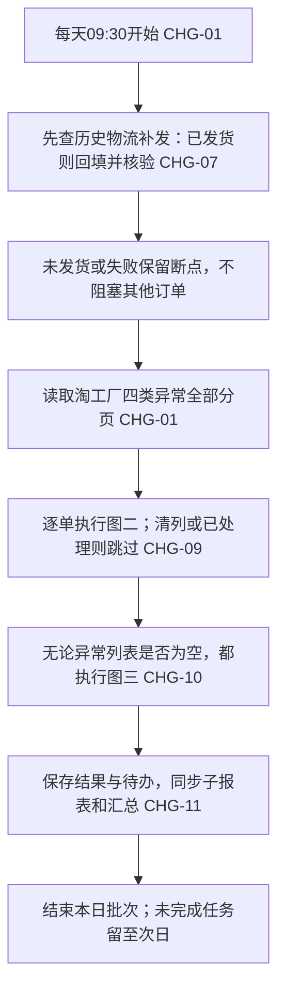
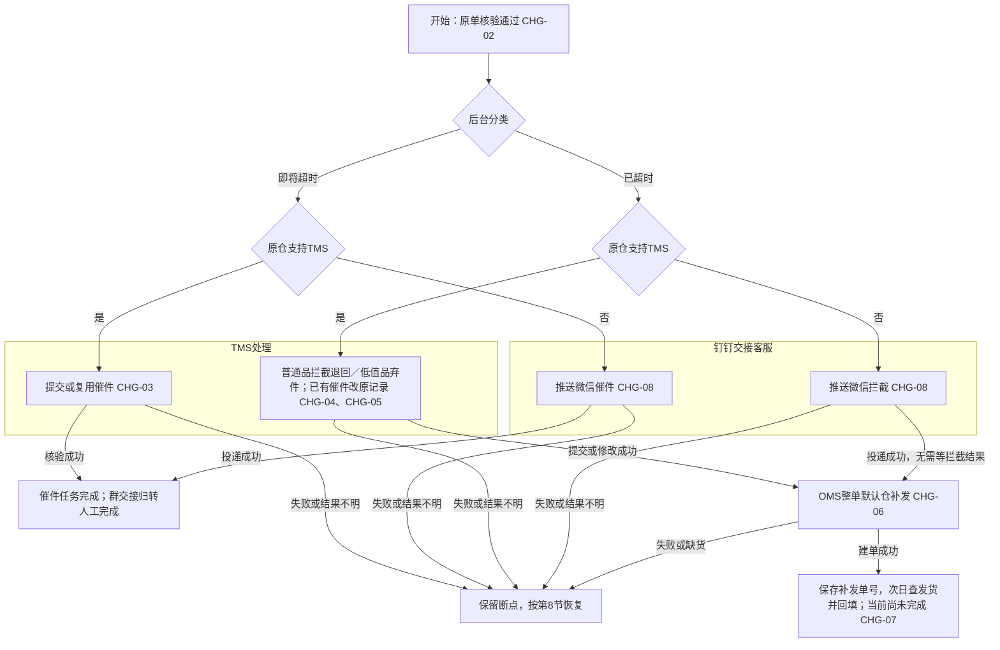
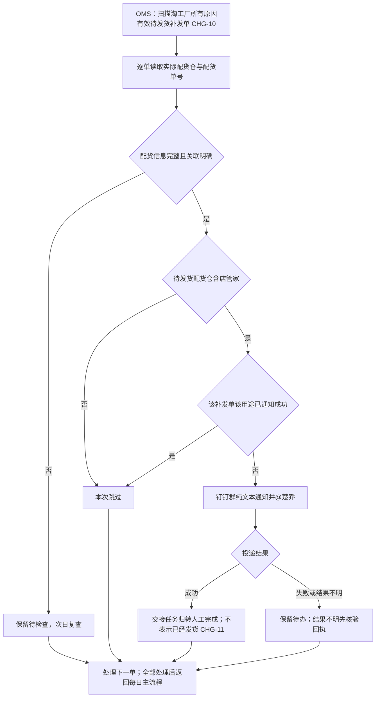
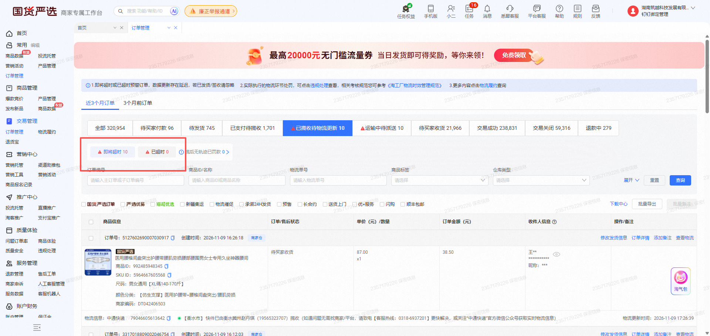
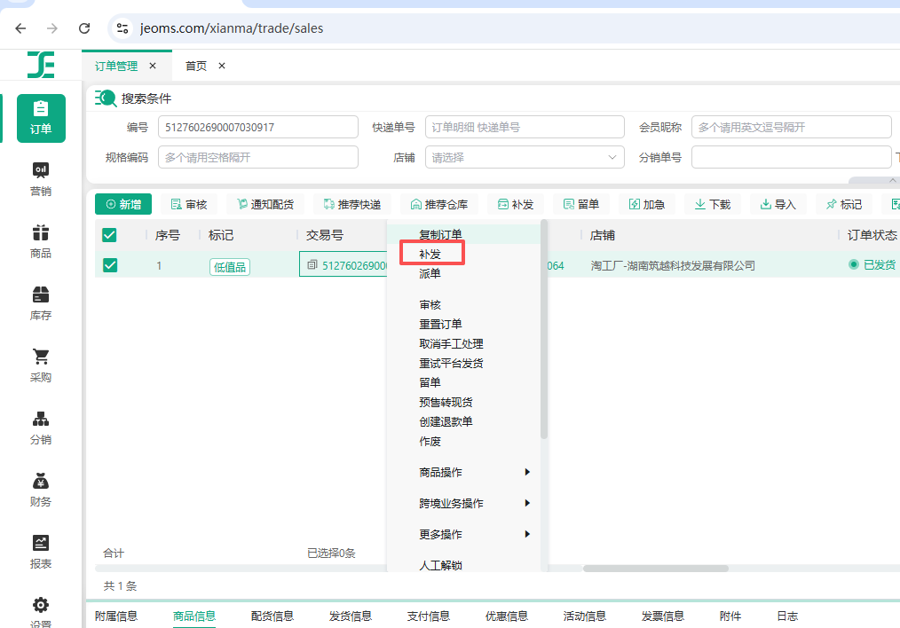
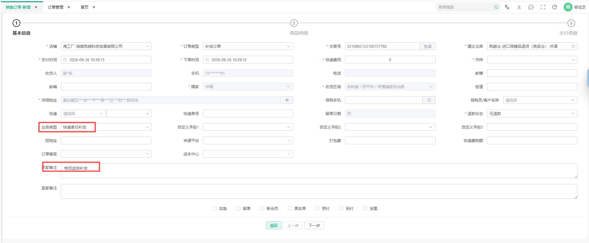

# 淘工厂物流监控 Agent V1.0 PRD

## 0. 文档信息

| 项目 | 内容 |
| --- | --- |
| 所属项目 | 客服自动化需求／物流拦截／淘工厂物流监控 |
| 目标版本 | V1.0，首次完整模块交付 |
| 文档版本 | V1.5，2026-11-10；目标产品版本仍为 V1.0 |
| 文档状态 | 业务规则已确认；可提交开发与技术评审 |
| 当前有效 PRD | 本文；未找到淘工厂模块既有正式 PRD |
| 对应业务方案 | [业务规则确认版 V1.0](./淘工厂物流监控Agent_业务规则确认版_V1.0.md)；[HTML 展示版](./淘工厂物流监控Agent_业务规则确认版_V1.0.html) |
| 操作附件 | [完整截图目录](./淘工厂物流监控Agent_PRD_截图/)；含内部订单信息，仅授权内部查阅 |
| 实现基线 | 业务后台操作已有示例；Agent 实现、外部工具能力和生产权限未核验。未开发、未部署、未上线 |

| 版本 | 日期 | 变更摘要 |
| --- | --- | --- |
| V1.0 | 2026-11-09 | 将已确认四场景整理为自动执行、跨日回填、防重恢复及验收契约 |
| V1.1 | 2026-11-09 | 补充已确认对接群「【物流监控】淘工厂」、群号186730016529及@楚乔；群及人员标识映射、投递待联调 |
| V1.2 | 2026-11-09 | 新增淘工厂所有原因补发单的店管家发货交接；明确独立扫描、纯文本模板、OMS字段来源、通知防重及独立完成口径 |
| V1.3 | 2026-11-09 | 优化为每日主流程与两张子流程；新增子报表及汇总报表接入、转人工职责完成与AI覆盖率口径；不修改旧报表PRD |
| V1.4 | 2026-11-09 | 按线上名称明确场景筛选：保留6项、新增店管家交接1项；补齐逐项处理映射、筛选与验收 |
| V1.5 | 2026-11-10 | 补充OMS补发入口、最新异常筛选截图；按实际入口、字段、操作、核验及断点重整完整操作链路，标明未展示页面的联调项 |

## 1. 本期需求与 AI 能力概览及 CHG 索引

本节为唯一变更索引；后文编号均引用本节。

| 编号 | 功能模块 | 功能点 | 变更类型 | AI 能力变化 | 预期价值 |
| --- | --- | --- | --- | --- | --- |
| CHG-01 | 每日巡检 | 每日一次读取后台四类异常 | 新增 | 工作流自动化 | 替代每日人工筛查 |
| CHG-02 | 订单分流 | OMS 原单、发货仓和低值品标记核对 | 新增 | Agent 工具调用 | 按仓库及商品标记执行对应流程 |
| CHG-03 | 催件 | 即将超时催件、历史催件去重 | 新增 | Agent 工具调用 | 减少重复登记 |
| CHG-04 | 普通商品 | 已超时拦截及原催件记录升级 | 新增 | Agent 工具调用 | 原记录保留历史并衔接补发 |
| CHG-05 | 低值品 | 已超时弃件及原记录升级 | 新增 | Agent 工具调用 | 执行低值品专属处理规则 |
| CHG-06 | 补发 | OMS 默认仓整单补发 | 新增 | Agent 工具调用 | 自动创建符合口径的补发单 |
| CHG-07 | 回填 | 跨日获取新运单并回填后台 | 新增 | 工作流自动化 | 补发以平台回填成功闭环 |
| CHG-08 | 人工交接 | 不支持 TMS 仓库及缺货群推送 | 新增 | 人工接管、工具调用 | 自动交接并保留送达结果 |
| CHG-09 | 执行控制 | 步骤留痕、防重复及部分成功恢复 | 新增 | 工作流自动化 | 避免重复补发与成功步骤重做 |
| CHG-10 | 补发发货交接 | 淘工厂所有原因补发单，配货仓含“店管家”时纯文本通知 | 新增 | 工作流自动化、人工接管 | 客服对接微信群安排代发仓发货 |
| CHG-11 | 既有报表接入 | 淘工厂子报表与跨平台汇总接入任务处理结果 | 调整 | — | 展示AI独立完成、转人工完成及覆盖率，保留旧通知数据 |

## 2. 背景、目标与成功标准

### 2.1 当前问题与基线

客服当前每天处理一次物流异常，并回传昨天补发订单的新运单。人工操作跨淘工厂后台、OMS、TMS 和钉钉，催件转拦截及补发回填需要跨天衔接。目前没有已核验的耗时、单量或节省成本基线。

### 2.2 目标

将已确认场景形成每日一次的自动执行闭环。Agent 读取平台分类，完成渠道分流、催件或拦截／弃件、整单补发以及后续运单回填。需人工的环节交接到指定群，已成功步骤不重复执行。

另从OMS独立检查淘工厂所有原因的补发单，配货仓库名称含“店管家”且仍需安排发货时，通知客服对接微信群发货。不限本Agent创建，也不限物流异常原因；此分支仅交接，不自动创建其他原因补发单或将其纳入物流回填队列。

### 2.3 成功标准

- 催件：TMS 提交成功，或不支持 TMS 仓库的钉钉交接推送成功，即结束本次催件动作，不跟踪快递回复。
- 补发：拦截／弃件提交或群推送成功后创建补发单；只有新快递公司及运单回填淘工厂原单并确认保存成功，补发任务才完成。
- 店管家发货交接：目标群纯文本消息投递成功即完成该补发单的发货交接通知，不代表已发货，也不代表物流补发回填完成；不等待微信群回复。
- 执行质量：验收中的四场景、升级、去重、异常恢复均有可核验步骤结果；创建补发单不得误报补发完成。
- 效率验证：联调后由客服对照同类人工操作耗时与 Agent 介入耗时复核；本版不承诺无基线的收益数值。

## 3. 当前能力与差异基线

| 基线 | 当前状态 | 本次处理 |
| --- | --- | --- |
| 淘工厂按物流阶段及即将超时／已超时筛选 | 已有后台截图；Agent 读取未验证 | 直接使用平台分类 |
| OMS 查原单、仓库、低值品及创建补发单 | 已有操作示例；自动化未验证 | 自动执行既有操作 |
| TMS 物流问题登记及原记录修改 | 已有截图及业务确认；自动化未验证 | 催件、拦截退回、弃件分流 |
| 钉钉物流监控对接群 | 已提供群名「【物流监控】淘工厂」、群号186730016529、@楚乔；投递尚未核验 | 技术完成群／人员标识映射及权限、回执联调 |
| 既有淘工厂子报表及跨平台汇总 | 用户确认已上线；旧分册仅通知、AI实际处理固定0；新增处理源未接通验证 | 保留通知与人工参考量，新增本Agent处理数据；仅本来源转人工按Agent职责完成计入 |

本文不套用天猫模块的重试次数、指定人员或备注字段。既有报表数据接入以第12节为准；旧分册“仅通知、AI处理固定0”只适用于旧通知来源，本Agent新来源采用本文契约。其他业务线不变。

## 4. 本期范围边界

### 4.1 明确不做

- 不对支付18—24小时未揽收及四场景外订单新增物流催件、拦截／弃件或自动补发；独立店管家发货交接可覆盖四场景外的淘工厂补发单。
- 不重新计算“48 小时”、即将超时或已超时阈值，不自行判断低值品金额标准。
- 不跟踪快递回复，不等待拦截结果，不执行人工微信操作。
- 不拆单品补发，不另选补发仓，不修改商品数量或引入其他拼多多工单规则。
- 不新建经营看板，不重做既有报表布局，不修改旧报表PRD及其他平台Agent、退款或赔付流程；仅对既有淘工厂子报表和汇总中的淘工厂行及跨平台合计做本来源数据接入与必要展示适配。

### 4.2 限制

- 每天执行一次，上午 9:30，Asia/Shanghai；本期不增加日内循环巡检。
- 截图、订单信息仅用于已授权内部业务操作，不能发送到未批准的外部服务。
- 统一重试次数待技术评审；纯文本模板见R-08、R-10，本群指定@楚乔。

## 5. 用户、角色与完整流程

### 5.1 角色与权限

| 角色 | 入口及数据范围 | 可执行操作 |
| --- | --- | --- |
| 执行 Agent | 授权淘工厂店铺、对应 OMS/TMS 订单及配置群 | 查询、截图、登记／修改物流记录、创建补发、回填发货信息、发送指定交接消息 |
| 客服 | 现有业务系统、物流监控对接群 | 人工微信催件／拦截、缺货处理、店管家微信群发货对接、异常核对及接管 |
| 技术运维 | 执行记录及授权配置入口，具体载体由技术设计 | 配置账号与群、排查失败、核验外部结果后恢复任务 |

凭据失效或权限不足时停止受影响动作，不切换未授权店铺或账号。标准流程无需逐单人工批准；仅异常需要接管。

### 5.2 主流程

按“每天从哪里开始→逐单怎样处理→独立发货交接”阅读。三张图分别对应批次、物流任务、店管家交接，图中的“本次结束”不等于补发回填完成。

**图一：每日主流程（从这里开始）**



**图二：单个物流异常怎么处理**



图二仅画新增任务的主路径。重复催件只复用原任务；历史补发沿原断点恢复，不再走创建补发。缺货已有补发单不得丢失，按R-06、R-08交接后保留回填队列。

**图三：所有原因补发单的店管家发货交接**



所有外部失败不得沿成功分支继续。图三通知成功不关闭图二物流补发的待回填任务；两者按不同任务职责记录。

### 5.3 执行顺序

先检查昨日及更早未完成回填的补发单，再读取当天四类列表的全部分页。对相同店铺＋原订单去重；同单同时命中即将超时和已超时时优先按已超时执行。阶段和包裹作为证据保留，不拆成多次整单补发。

列表为空则结束本次异常扫描，仍须执行独立店管家补发发货交接扫描；列表读取失败或只读取部分分页时记录不完整，不把未读取部分记为“无异常”。已经读取且证据完整的独立订单可以继续执行。

同一每日批次在物流任务处理后，扫描OMS淘工厂所有原因仍待安排发货的补发单及历史未交接成功记录，并包含本批次新建补发单。不能只查昨天、本Agent创建或业务类型为“快递责任补发”的单。具体补发单识别、淘工厂店铺范围、待发货状态及分页映射需联调；不能仅按“补”标记或买家备注推断完整集合。不新增独立日内轮询。

## 6. 完整操作链路与页面操作说明

本期不新增业务操作前台页面；既有报表适配见第12节。开发按本节执行页面动作，第7节作为业务分支及防重约束。截图只说明位置，示例订单、仓库、商品、人员及时间不可硬编码到执行参数。

### 6.1 先看执行顺序

| 执行顺序 | 做什么 | 操作说明 | 完成后去哪里 |
| --- | --- | --- | --- |
| 每天先做 | 昨日及更早物流补发查询发货并回填 | 第6.6节 | 未发货／失败留断点；继续其他订单 |
| 然后做 | 读取淘工厂两个类型下的四类异常 | 第6.2节 | 逐单去OMS核对 |
| 每个原单 | 查OMS原单、原发货仓、低值品标记及历史处理记录 | 第6.3节 | 即将超时催件；已超时拦截／弃件或群交接 |
| 即将超时 | 支持TMS则催件；不支持则群推送 | 第6.4节 | 成功结束催件任务，不创建补发 |
| 已超时 | 支持TMS则普通品拦截、低值品弃件；不支持则群交接 | 第6.4节 | 仅提交／修改或投递核验成功后，进入第6.5节 |
| 已超时前置成功后 | OMS选原单→补发→填基本信息→核商品→确认保存 | 第6.5节 | 保存补发单关联，等待次日查发货回填；缺货交接但不重建单 |
| 每天最后独立做 | 扫描淘工厂所有原因待发货补发单，实际配货仓含店管家则通知 | 第6.7节 | 交接任务成功归转人工完成；不关闭关联物流回填任务 |
| 批次结束 | 保存结果、待办及报表同步状态 | 第6.8节 | 结束；次日从未完成断点继续 |

### 6.2 淘工厂：进入并读取四类异常（CHG-01）

| 步骤 | 进入哪里／怎么操作 | 读取或填写什么 | 怎样确认／失败怎么处理 |
| --- | --- | --- | --- |
| 1 | 淘工厂商家后台→交易→订单管理，确认当前授权店铺；清理可能缩小本次范围的遗留查询条件 | 当前店铺、查询范围 | 不沿用上次其他店铺或单号筛选；保留本次筛选快照 |
| 2 | 点“已揽收待物流更新”，分别点“即将超时”“已超时”，读取各列表全部分页 | 原订单号、物流阶段、时效分类、物流单号及采集时间 | 页面数量仅作核对，不用当页条数代替全部分页 |
| 3 | 切换“运输中待派送”，分别点“即将超时”“已超时”，同样读取全部分页 | 同上 | 四组合各记读取状态；空列表可继续，分页失败标不完整 |
| 4 | 按店铺＋原订单归并；动作执行前重新核验当前分类及退款／签收／物流恢复状态 | 同单多分类优先已超时；保留来源证据 | 已清列不再新增异常动作；已有补发回填不删除。进入第6.3节 |

**48小时不由Agent计算。** 不用订单创建、支付、OMS发货或页面物流更新时间重新筛选；直接按上述页面“即将超时／已超时”分类处理。页面分类有延迟时仍须执行写前状态核验，不能因列表仍在就忽略明确的退款、签收或恢复信息。平台48小时起算节点未由截图证明，也不是本Agent新增判断项。

截图：[原入口图1](./淘工厂物流监控Agent_PRD_截图/image1.png)、[已超时图4](./淘工厂物流监控Agent_PRD_截图/image4.png)。最新页面示例：



### 6.3 OMS：查询原单并准备执行数据（CHG-02、CHG-08）

| 步骤 | 进入哪里／怎么操作 | 读取或填写什么 | 怎样确认／失败怎么处理 |
| --- | --- | --- | --- |
| 1 | OMS→订单→订单管理，在“编号”输入淘工厂原订单号，使用“店铺”限定目标店铺，点击“搜索” | 核对列表“交易号”为目标平台原单；读取列表“订单号”作为OMS原订单号 | “编号”可查询多类编号，不能把输入值直接当OMS订单号；返回原单、补发单等多行时必须核对类型及关联，不取第一条 |
| 2 | 定位并选中目标原单，查看列表“标记”及下方“发货信息” | “低值品”标记；发货信息中的“发货仓库”“快递名称”“快递单号” | TMS渠道按原单实际发货仓库判断，不按建议仓。快递单号即通知中“发货单号”；多条保留对应关系 |
| 3 | 切换原单下方“配货信息” | “配货单号”，与原运单／包裹的关联 | 原配货单号用于催件／拦截通知；不拿OMS订单号或运单号替代；关联不明保留核对断点 |
| 4 | 查本Agent执行记录及TMS、OMS已有记录 | 是否已催件、是否已拦截／弃件、是否已有物流补发单及回填结果 | 已有成功结果复用。原单不唯一、仓库或标记读取失败时停止当前单写入，记录具体缺失项，核对后恢复本步骤 |

截图：[原单查询及发货仓图2](./淘工厂物流监控Agent_PRD_截图/image2.png)、[低值品标记图9](./淘工厂物流监控Agent_PRD_截图/image9.png)、[配货信息补充3](./淘工厂物流监控Agent_PRD_截图/补充3_OMS配货信息.png)。原单号、OMS订单号、配货单号、运单号是四种不同标识，全程分别保存。

### 6.4 催件／拦截／弃件与群交接（CHG-03～CHG-05、CHG-08）

先按R-02核对原发货仓是否支持TMS，再按下表执行。即将超时不区分普通品／低值品，均催件；已超时才按低值品标记区分“拦截退回／弃件”。

| 分支 | 实际操作 | 填写与校验 | 成功后下一步 |
| --- | --- | --- | --- |
| 支持TMS，即将超时，无已成功催件 | TMS→物流问题登记表（客服）→新建物流工单；在“订单号”填OMS原订单号，触发查询并等待“查询成功，已自动填充订单信息”；核对回填店铺、仓、责任快递及运单 | 物流问题选“催件”；客服备注“催件”。带出的金额、收货信息、下单日期按原单核对，不抄截图。按实际表单校验处理必填项，不能留空强行提交 | 点击“提交”，重新查到匹配记录、类型及备注后记催件完成；不点“提交并新建”继续造单，不等快递回复 |
| 支持TMS，已超时普通品，无历史催件 | 淘工厂订单管理按原单号搜索→“订单详情”截图；TMS新建物流工单并查询OMS原订单号 | 物流问题“拦截退回”，客服备注“拦截退回”；原单详情截图上传“客服附件”，核对归属且单文件≤10MB | “提交”后重查工单及附件；核验成功才进入第6.5节，不等待拦截结果 |
| 支持TMS，已超时低值品，无历史催件 | 同一登记入口，新建工单并查询OMS原订单号 | 物流问题“弃件”，不是“丢件”；其他必填项遵循R-05及现有表单校验，不能编造值绕过。弃件不可选则阻断并定位原因 | 提交后重查类型及订单关联，成功进入第6.5节 |
| 支持TMS，已有催件，现已超时 | 按OMS原订单号及原物流定位原工单，打开原记录修改入口；重读当前类型与备注 | 普通品改“拦截退回”，低值品改“弃件”；原备注后追加“执行日期＋动作”，保留旧内容。原记录已是目标类型则核验复用，不重复追加 | 保存修改并重查成功后进入第6.5节；不要新建第二条工单。修改按钮位置及保存控件待DEP-02联调 |
| 不支持TMS，即将超时 | 从OMS准备原单、原仓、原配货单号、原运单号；按R-08“催件模板”发送指定群并有效@楚乔 | 发往群号186730016529对应的已核验会话；载荷与原单一致；不能用补发单信息填原单通知 | 投递成功即催件转人工完成，不等微信回复；不创建补发 |
| 不支持TMS，已超时（普通品／低值品相同） | 同上，按R-08“拦截模板”发送指定群 | 投递成功证据必需，失败或不明不能当成功放行 | 成功进入第6.5节，不等人工微信拦截结果 |

**提交前和提交后要分开。** 仅打开表单、选中类型、上传附件或出现提交中状态都不算成功；必须取得匹配工单／消息的可查结果。附件上传失败、必填缺失、原记录不唯一、修改冲突或投递不明，按第8节保留断点，不放行补发。表单若要求附件但当前分支未准备齐备，先补齐符合页面要求的原单资料，不能擅自取消必填。

截图：[TMS催件图3](./淘工厂物流监控Agent_PRD_截图/image3.png)、[TMS拦截补充1](./淘工厂物流监控Agent_PRD_截图/补充1_TMS拦截.png)、[订单详情补充2](./淘工厂物流监控Agent_PRD_截图/补充2_订单详情.png)。补充1的其他平台名称、补充2的交易成功状态仅作位置示例，不扩展本模块范围。现有新建截图不能代替“修改原工单”的操作验证。

### 6.5 OMS：从原单进入整单补发（CHG-06）

**操作入口用本次补充截图，补发表单用图5。两张图是前后相接的两个步骤，不是两个补发入口都各执行一次。**

| 步骤 | 进入哪里／点击什么 | 填写或核对什么 | 成功标志／失败恢复 |
| --- | --- | --- | --- |
| 1 补发前校验 | 留在第6.3节唯一定位的原单，重新核验第6.4节前置结果和既有补发关联 | 已超时对应的拦截／弃件或群交接已成功；没有本轮物流异常已有补发单 | 已有补发单则关联并转第6.6节，不能再次点击补发；证据缺失停在前置步骤 |
| 2 打开补发入口 | 只选中目标原订单，打开该订单行操作菜单，点击菜单中的“补发”（见下图红框） | 列表交易号、OMS原订单号、店铺和选中行一致 | 进入“销售订单-新增”的补发创建流程；不能选错原单／多选批量补发。菜单的触发手势以实际页面核验，不根据截图推断必须右键 |
| 3 基本信息 | 在补发创建页“基本信息”核对继承店铺、原单关联和订单类型；保持系统默认仓库 | 订单类型应为“补发订单”；“业务类型”选“快递责任补发”；**“买家备注”**填“物流监控补发”。收货信息按原单核对，不写入示例数据，不改成卖家备注 | 字段校验通过，才能点“下一步”。页面的“建议仓库”不是第6.7节判断店管家的实际配货仓；不得按截图指定仓替代系统默认值 |
| 4 商品明细 | 点击“下一步”进入“商品明细”，逐项核对原单完整商品及数量 | 整单补发，不只复制当前可见商品，不拆单、不改SKU或数量；全部明细和原单对应 | 明细完整再继续到“支付信息”；数量不符或明细不全时停下核对，不能部分补发后报成功 |
| 5 支付信息与最终确认 | 按页面流程进入“支付信息”，核对系统带出内容，完成页面最终确认保存操作 | 不自行修改金额、运费或其他非本期规则字段；出现未定义必填项时记录字段和提示，联调核验，不猜值 | 当前截图仅展示第1步及三步标题，未展示第2／3步明细和最终按钮名称；实际控件需DEP-02核验，不能将“下一步”视为保存成功 |
| 6 重新查询建单结果 | 回OMS订单管理，查询并核对本次新建的补发单 | 保存OMS补发单号、原单关联、完整明细、默认仓结果、类型、买家备注及创建时间；“补”标记只辅助定位 | 可查到且关联、参数一致才算建单成功，状态为待发货／待回填，**不是补发任务完成**。最终保存无响应先查结果，明确未建单才恢复，不能再次从步骤2盲建 |
| 7 缺货与发货交接 | 已建补发单若出现缺货，按R-08缺货模板推群；同日还要参加第6.7节独立扫描 | 缺货关联已存在补发单；缺货与店管家通知是不同用途 | 不重建、不拆单、不改仓；保存补发单，后续每日继续查询发货。配货尚未生成则保留次日检查 |

**补发入口（本次新增）：**



**进入补发后的基本信息页：**



本页截图不证明已经保存成功，也不证明补发单已经发货；这两个结果分别由步骤6和第6.6节核验。

### 6.6 次日及历史物流补发：查询发货→回填原单（CHG-07）

| 步骤 | 进入哪里／点击什么 | 读取或填写什么 | 怎样确认／失败怎么恢复 |
| --- | --- | --- | --- |
| 1 取待回填任务 | 每日09:30先读取昨日及更早已关联、尚未回填完成的物流补发任务 | 淘工厂原单、店铺、OMS原单号及已保存的补发单号 | 不因原异常已清列删除任务，不把其他原因店管家补发单自动导入本队列 |
| 2 查补发物流 | OMS→订单管理，按已保存补发单号定位并选中补发单，点下方“发货信息” | “快递名称”“快递单号”，核对物流属于该补发单；不是原单的旧运单 | 无发货信息或新运单为空则保留次日继续查，不再补发；多个包裹无法对应则转核对，不取第一条 |
| 3 定位淘工厂原单 | 淘工厂→交易→订单管理，按原订单号搜索，核对店铺及原单；点击该订单右侧“修改发货信息” | 不依赖原单仍在四异常列表；修改目标必须是原订单，不是OMS补发单 | 原单状态禁止修改则记录状态及原因转人工，不取消或重建补发单 |
| 4 填写发货信息 | 在“修改发货信息”侧栏定位对应包裹，选择“快递公司”，在“运单号”填本补发单新运单 | 公司映射及包裹／商品对应关系明确；填前先比较后台现值 | 已是目标新物流则核验复用；映射不明停下核对，不把旧运单回填成新运单 |
| 5 确认与回读 | 点击侧栏右下角“确定”；保存返回后重新打开或读取该原单发货信息 | 快递公司与运单均与本次补发物流一致 | 回读一致才记录职责完成时间，按第12节归AI独立／转人工完成。点击确定但未保存、响应不明或回读不一致时保留待回填断点，不重建补发 |

截图：[OMS补发单发货信息图8](./淘工厂物流监控Agent_PRD_截图/image8.png)、[淘工厂修改入口图6](./淘工厂物流监控Agent_PRD_截图/image6.png)、[填写快递公司和运单、点击确定图7](./淘工厂物流监控Agent_PRD_截图/image7.png)。

### 6.7 独立店管家发货交接：所有原因补发单（CHG-10）

| 步骤 | 进入哪里／怎么操作 | 读取或判断什么 | 怎样确认／后续怎么做 |
| --- | --- | --- | --- |
| 1 查询补发集合 | OMS→订单管理，查询授权淘工厂店铺全部有效、仍需安排发货的补发单及历史交接待办，并检查本批次新建单 | 所有创建来源、所有原因；不只查快递责任补发、昨天或本Agent创建的单 | 取消／已全部发货跳过。完整补发单类型及状态查询、分页字段需DEP-02映射，不能仅以“补”标记当完整查询条件 |
| 2 查实际配货 | 逐单选中补发单，点下方“配货信息” | 配货单号及该配货记录“发货仓库”，作为补发实际配货仓；核对未发货部分 | 仓名含连续三个字“店管家”即命中；不看原仓或基本信息中的建议仓。无配货信息保留次日检查 |
| 3 去重并生成消息 | 查询店铺＋补发单号＋用途的投递记录；按R-10纯文本模板填消息 | 原订单号、补发单号、补发配货仓及配货单号；多配货行在一条消息列明配对关系 | 同补发单同用途已成功不再发；不同补发单分别处理；配货关联不明先核对 |
| 4 发送并核验 | 发指定群并有效@楚乔，保存回执 | 不要求已有新运单，不用原运单填此通知 | 成功即该交接任务转人工完成，不等微信回复、不标已发货；失败留待通知，结果不明先查回执，主物流回填队列不受覆盖 |

配货页位置见[补充3](./淘工厂物流监控Agent_PRD_截图/补充3_OMS配货信息.png)；该图仅证明字段位置，执行本节必须选中补发单，不能照截图选原单。四类通知完整模板统一见R-08、R-10，开发不要另行定义不同字段或文案。

### 6.8 每一步如何记录与恢复（CHG-09、CHG-11）

每个步骤记录任务标识、当前对象（原单／补发单）、步骤编号、输入来源、外部记录及成功核验凭证、执行时间和下一断点。截图包含内部订单信息，只限授权内部使用；日志不复制无关收货人信息或凭据。

| 已确认成功的位置 | 下次恢复从哪里开始 | 禁止重做什么 |
| --- | --- | --- |
| TMS催件成功 | 同催件任务复用；如已超时，创建对应超时阶段任务并修改原记录 | 不每日新增催件 |
| 拦截／弃件或拦截群交接成功，补发明确未建成 | 第6.5节核验后恢复补发 | 不重提拦截／弃件或重发原交接 |
| 已建补发，缺货／未发货／待回填 | 已有补发单的发货查询及待通知步骤 | 不再次从原单点补发 |
| 平台新运单已保存但本地响应丢失 | 第6.6节回读平台实际物流并补记成功 | 不重新建单，不盲目覆盖物流 |
| 店管家交接已成功 | 复用该用途回执，仅记录配货变更供核对 | 不重复推送，不将关联物流任务误关闭 |
| 业务成功但报表同步失败 | 补偿同步对应任务最新结果 | 不重做任何TMS、OMS、平台或群业务写入 |

## 7. 功能与业务规则

### R-01 每日调度与任务选择（CHG-01、CHG-09）

每日 09:30 启动一次，扫描四组合：①已揽收待物流更新／即将超时；②已揽收待物流更新／已超时；③运输中待派送／即将超时；④运输中待派送／已超时。以当前后台分类为准，不在 Agent 内复算超时。执行外部写操作前重新核验原单与当前分类，已退款、已签收、物流恢复更新且已清列的原单，不再发起新的催件、拦截或补发动作。

自动清列只影响新异常动作，不删除已有补发关联和待回填任务；已建补发单的后续处理见 R-07。批次重启沿用当天批次处理记录，不能重新当作全新任务执行。

### R-02 仓库与标记分流（CHG-02）

OMS 原单必须唯一对应当前店铺及淘工厂原订单。使用实际原发货仓判断 TMS 能力；低值品只使用 OMS“低值品”标记，不能将未读取到字段当成“非低值品”。

支持 TMS 的仓库：筑越仓、代发聚水潭-亿哈、代发聚水潭-铭如、代发聚水潭-简卓、代发聚水潭-品动工贸、代发聚水潭-众邦、代发聚水潭-捷佑、代发聚水潭-代发仓瞳琪、代发聚水潭-迅发、代发聚水潭-祺迦工贸。

清单外已明确仓库转人工；仓库或标记无法读取、原单无匹配／多匹配时属于识别异常，不冒充清单外正常分支。由客服在原业务系统核对，技术在执行记录补充核验结果后恢复分流。

### R-03 即将超时催件（CHG-03、CHG-08）

两个即将超时场景共用规则。支持 TMS 时，查询当前原单原物流对应记录；已催件的不重复登记。没有记录则提交“催件”，客服备注“催件”；提交成功即完成本次催件。不支持 TMS 时，群交接微信催件，推送成功结束本次交接。

催件完成不会永久关闭原单；以后进入已超时仍需执行拦截／弃件及补发。不能每日重新创建催件或重复发送同一催件交接。

### R-04 普通商品拦截（CHG-04）

已超时、支持 TMS 且无原催件记录：新建“拦截退回”，客服备注“拦截退回”，上传原单详情截图后提交。附件必填，单文件≤10MB；截图无法获取或不属于目标单时不得提交，也不得进入补发。

存在原催件记录：修改原记录为“拦截退回”，客服备注追加执行日期＋“拦截退回”（如“11.7 拦截退回”），保留旧备注，完成修改后补发。若原记录已是目标类型，核验并复用，不重复追加相同动作备注或再建一条工单。历史记录定位不唯一时转人工核对。

TMS 提交／修改成功即可进入补发，不等待拦截结果。无 TMS 渠道时执行 R-08，群推送成功即可补发。

### R-05 低值品弃件（CHG-05）

已超时且 OMS 标记低值品、支持 TMS：物流问题选择“弃件”后提交，再进入补发。无原记录时新建弃件登记；已有催件记录时修改原记录为“弃件”，追加日期＋“弃件”，保留历史。原记录已是弃件则核验并复用。不能写成“丢件”或普通商品“拦截退回”。

低值品登记沿用登记表必填要求，不虚构额外表单字段。页面必填值或弃件选项不可用时阻断当前单并转人工核对，不擅自选其他类型。不支持 TMS 时群交接人工微信拦截，推送成功即可补发，不等结果。

### R-06 整单补发（CHG-06）

实际操作逐步见第6.5节：选中唯一原单→订单行菜单“补发”→基本信息→商品明细→支付信息及最终确认→重查补发单。

前置成功证据必须是对应拦截／弃件登记成功，或对应已超时群交接成功。核验尚无本轮物流异常对应的已创建补发单后，使用原订单完整商品明细整单补发，保持系统默认仓库。业务类型“快递责任补发”，**买家备注**“物流监控补发”。

创建成功立即保存补发单号及关联，进入待发货／待回填。补发后缺货推群，保留已有补发单，不再建第二单、不拆单品或改仓。创建失败且确认未建单时保留待补发断点；结果不明先查 OMS，禁止盲目重建。

### R-07 跨日回填（CHG-07）

实际操作逐步见第6.6节：选中已关联补发单→“发货信息”取新物流→淘工厂原单“修改发货信息”→填公司及运单→“确定”→回读核验。

每次每日批次查询已关联本模块物流补发任务、昨天及更早创建且尚未回填成功的补发单；取OMS发货信息的快递公司及新运单，定位淘工厂原单“修改发货信息”，保存后重新读取核验。未发货继续保留下一日检查，不再次补发。刚创建的补发单按次日回填口径处理，不触发额外当日轮询。R-10扫描到的其他原因补发单仅作发货交接，不由此自动回填原单。

新运单已与后台目标一致时，记录核验成功，不能再次建补发单。保存失败保留待回填；原单已清列仍保留回填队列。如果原单状态不允许修改，记录具体状态及失败原因转人工，Agent 不自动取消或重建补发单。

快递公司无法映射、运单为空、多个物流包裹无法明确对应后台修改项时，转人工核对映射，不随意取第一条、不用旧单号代替。人工在业务后台完成后，执行端核验保存结果并更新任务；不能仅凭群内“已处理”改为完成。

### R-08 钉钉交接（CHG-08）

不支持TMS的仓库：即将超时交接微信催件；已超时交接微信拦截。催件／拦截通知使用原单配货单号、原发货单号，均从OMS读取，不用补发单号码替代。配货单号在原单“配货信息”读取；通知中的“发货单号”按业务称呼指运单号，对应OMS“发货信息”的快递单号，和配货单号、OMS订单号是不同字段。关键字段缺失或关联不明时保留待核对，不能发送错误号码并据此放行补发。

本模块人工催件、微信拦截、补发缺货及R-10店管家发货交接消息统一配置到「【物流监控】淘工厂」，钉钉群号「186730016529」，消息@楚乔。技术需核对目标群身份，并映射发送工具所需群会话标识及楚乔的人员标识，验证发送权限与投递回执；不把群号当作已核验的接口会话标识。不能向默认测试群、任意搜索到的同名群发送。

对外通知采用以下精简纯文本模板，不增加店铺、OMS原单号、阶段、商品明细或缺货数量等字段；上述数据如执行需要仍可在内部记录保留。@楚乔需为有效人员提及，不能仅拼接同名字样。模板中的占位符必须替换成实际值，不输出空占位符或无关个人信息。

**催件模板：**
```text
【淘工厂｜催件】@楚乔
订单号：{淘工厂原订单号}
发货仓：{原发货仓}
配货单号：{原单配货单号}
发货单号：{原运单号}
请微信对接催件。
```

**拦截模板：**
```text
【淘工厂｜拦截】@楚乔
订单号：{淘工厂原订单号}
发货仓：{原发货仓}
配货单号：{原单配货单号}
发货单号：{原运单号}
请微信对接原单拦截，Agent将继续整单补发，无需等待拦截结果。
```

**补发缺货模板：**
```text
【淘工厂｜补发缺货】@楚乔
订单号：{淘工厂原订单号}
发货仓：{补发仓}
补发单号：{OMS补发单号}
请处理缺货异常，勿重复创建补发单。
```

缺货通知不要求补发单已有配货单号或发货单号，不混用原单号码。模板不将“即将继续补发”提前写为“补发成功”。

推送成功必须有群投递成功证据；群缺失／无权发送／失败不能标为已交接。作为已超时补发前置条件的“原单拦截”交接未成功时，不能进入补发；补发后的缺货／发货交接通知失败只保留通知待办，不撤销或重建既有补发单。推送成功后不等待人工回复；物流补发仍须走R-07才算完成。

### R-09 防重与恢复（CHG-09）

以店铺＋淘工厂原订单为整单补发控制粒度，登记本次原物流标识、已完成动作及外部记录关联。不同列表、物流阶段、包裹或批次不得各自创建一笔整单补发。

催件、拦截／弃件、补发、回填、群交接分别存结果。并发执行同一原单时只允许一个执行者推进写操作；其他执行读取已有结果，不另发。外部写操作超时或响应丢失时先查询外部结果，明确成功后继续；无法判断则待核对，不能默认失败重试。

恢复只做未成功步骤：拦截成功而补发失败，不重提拦截；补发成功而回填失败，不重建补发；群交接成功而补发失败，不重发原交接。跨日、进程重启均保留这些约束。

已回填完成后原单再次异常，或后台运单与记录不一致，先核对当前运单及既有补发关联，转人工判断本次异常归属；不能自动开启第二轮整单补发。首次启用时查询已有 TMS、OMS 补发记录，原单匹配不清时转人工，不因执行记录为空推断“从未处理”。

以上原单粒度的防重复建单只约束本Agent自动创建物流补发单，不用于吞掉外部已存在的不同补发单通知。R-10使用“店铺＋OMS补发单号＋通知用途（店管家发货交接）”防重；缺货、原单拦截和发货交接各自保存结果，不能因为同一群收到过另一用途消息就跳过本次通知。

### R-10 店管家补发发货交接（CHG-10）

**触发对象：** OMS中属于淘工厂的所有原因补发订单，包括人工、其他流程或本Agent创建的补发单。与后台四分类、原单异常是否清列、原发货仓是否支持TMS、补发原因及买家备注均无筛选依赖。仅处理仍需安排发货的有效补发单；已取消或已全部发货的补发单不再发送待发货通知。

**判断字段：** 定位补发单的“配货信息”，读取配货记录中的仓库名称（页面可能标为“发货仓库”），作为本规则“补发单配货仓库”。名称包含连续三个字“店管家”即命中，不要求名称完全相等；不能拿原单发货仓、默认／建议仓库替代实际配货记录仓库。

**执行：** 每日批次检查全部匹配补发单，并检查本批次新建单。配货信息未生成、仓库／配货单号读取失败时保留待检查，后续每日复查；不把空值视为“不含店管家”，不重建补发单。已明确非店管家仓不发此通知；以后配货信息变为店管家且仍待发货，未通知过则发送。通知前复核发货状态，已全部发货／取消则跳过；部分已发货时只交接仍需发货的店管家配货记录。

**纯文本模板：**
```text
【淘工厂｜店管家补发待发货】@楚乔
原订单号：{淘工厂原订单号}
补发单号：{OMS补发单号}
配货仓库：{补发单配货仓库}
配货单号：{补发单配货单号}
请对接微信群，安排代发仓发货。
```

所有模板字段需关联到同一补发单。此时新发货单号可能尚未生成，**不要求新运单作为推送前提，也不以原运单填充该通知**。本规则不创建补发单、不修改其原因、商品或仓库。推送成功即结束发货交接通知；客服负责微信群对接，Agent不等待微信群回复、不代发微信消息。

**去重与多配货：** 同一补发单该用途成功后不重复通知，不同补发单即使属于同一原单也分别检查和通知。单个补发单存在多个未发货店管家配货记录时，同一条纯文本中重复“配货仓库／配货单号”两行列明全部匹配记录，保留配对关系，不取第一条、不按配货行重复推送。部分配货未生成或映射不清时先保留待核对，不宣称交接齐备。已经成功通知后新增或变更配货记录时记录变更供人工核对，不自动重复推送同一用途。

**失败与状态：** 群发送明确失败保留待通知，下一每日批次恢复；结果不明先核验回执，不能盲目重发。通知状态独立于物流补发任务状态：失败不撤销已创建的补发单，也不覆盖已完成的回填结果；仅通知其他原因补发单，不自动将其导入R-07的物流回填任务。

### R-11 报表结果接入（CHG-11）

任务创建、完成主体、转人工职责完成、日期与去重均按第12节。业务执行状态与报表职责状态分别存储：纯交接成功可转人工完成；仍承担补发回填职责的任务不得提前关闭。

## 8. 状态、边界与异常

### 8.1 状态模型

以下是产品建议枚举，不代表现有接口字段。原订单状态、TMS 状态与 Agent 动作状态分别保存，不能互相覆盖。

| 任务状态／建议标识 | 进入条件 | 后续与退出条件 |
| --- | --- | --- |
| 待处理／PENDING | 当日四场景命中且未处理 | 核验后分流；清列则跳过 |
| 处理中／RUNNING | 已取得该原单执行权 | 保存每一步结果后转下一状态 |
| 催件完成／URGE_DONE | 催件提交或群交接成功 | 本动作结束；以后已超时可升级 |
| 待补发／RESEND_PENDING | 拦截／弃件或群交接成功，但尚未建成补发单 | 创建成功进入待回填；失败保留断点 |
| 待回填／WAYBILL_PENDING | 补发单创建成功 | 未发货跨日保留；回填核验成功完成 |
| 待人工／MANUAL_PENDING | 标识歧义、缺货、状态不允许或外部结果不明 | 保存阻断前状态；人工核验后恢复相应步骤 |
| 补发完成／DONE | 平台新运单保存并核验成功 | 保留全部关联，不能新开自动补发 |
| 已跳过／SKIPPED | 尚未新建补发的异常已清列等不触发条件 | 不发起新动作；已有待回填任务不受此状态覆盖 |

步骤结果另记“未执行／成功／明确失败／结果不明／不适用”，含时间及外部凭证。缺货是独立阻断原因，不能丢失补发单关联。

R-10发货交接使用独立通知状态（建议枚举）：待检查CHECK_PENDING→待通知NOTIFY_PENDING→已通知NOTIFIED；配货未生成仍为待检查，明确发送失败保留待通知，结果不明为待核验VERIFY_PENDING，无法消除歧义为待人工MANUAL_PENDING。已全部发货、取消或明确当前非店管家为本次跳过SKIPPED；后续仍待发货且配货仓变化为店管家、从未成功通知时可以重新命中。已通知不覆盖物流任务DONE／WAYBILL_PENDING，物流异常已跳过也不抑制独立通知。

报表映射按第12.3节：URGE_DONE依据渠道归AI或转人工；DONE依据全过程接管证据归属；WAYBILL_PENDING及未解决MANUAL_PENDING为尚未完成。R-10的NOTIFIED独立任务归转人工完成，不改变主任务状态。

### 8.2 异常与恢复入口

本期复用业务后台及执行端任务记录供接管，不增加客服业务页面。执行端具体载体由技术设计，必须支持定位原单、查看阻断步骤、保存核验结果及恢复未完成步骤。

| 异常 | 自动处理与保留结果 | 人工入口及恢复 |
| --- | --- | --- |
| 登录／权限失效 | 停止对应系统写操作，保存未完成任务 | 运维恢复账号；从原断点核验后继续 |
| OMS 无匹配／多匹配、字段无法读取 | 当前单待人工；不猜测仓库或标记 | 客服核对原单；执行端记录唯一关联后重新分流 |
| 截图失败、附件超限、必填校验失败 | 不提交不完整工单；不放行补发 | 修正附件／必填数据并重新校验后提交 |
| TMS 更新冲突 | 重读原类型和备注，不覆盖他人新增内容 | 无法安全追加则客服处理；核验原工单后继续 |
| 写操作超时结果不明 | 查询 TMS 工单／OMS 补发单／群回执／平台发货信息；不直接重做 | 核验成功或明确未成功后恢复，未查明则保留待人工 |
| 原单拦截交接群未配置或发送失败 | 待交接，不按已发送放行新增补发；执行日志必须可见 | 技术配置群并核验后补发未送达消息；补发后的其他用途通知失败单独保留待办 |
| 补发后缺货 | 记录补发单及缺货，发送缺货交接；不另建单 | 客服原系统处理库存异常；恢复后继续检查原补发单发货 |
| 回填失败／多包裹不明 | 保留待回填及关联，不回退到建单 | 客服确认后台映射或完成回填，执行端核验后关闭 |
| 人工同时操作 | 写前读取外部最新结果，复用已完成动作 | 有冲突转核对；不得覆盖原备注或新增重复单 |
| 店管家配货信息尚未生成／关联不明 | 只保留发货交接待检查／待人工，不改补发单、不拿原仓替代 | 后续每日复查或客服核对配货；字段完整、仍待发货且未通知则恢复推送 |
| 店管家发货交接发送失败／结果不明 | 独立记录通知状态，不重建补发、不覆盖回填结果 | 失败在下一每日批次恢复；结果不明先查回执；人工核验须记录凭证 |

通用自动重试次数、退避和超时由技术评审确定；任何策略都不能绕过结果不明核验与防重约束。停止批次不会撤销已提交的外部业务单；恢复时先核验，不自动删除或回滚成功业务单。

## 9. 数据对象与字段契约

下表为产品逻辑字段，不指定数据库、API 字段名或长度。数据类型沿用英文技术定义，业务规则与公式使用中文说明。字符串保留来源完整值，不把订单号、运单号转数字。外部字段长度与枚举映射须联调；不满足外部校验则定位具体字段并阻断当前步骤，不截断后继续写入。

| 对象 | 字段 | 类型／必填 | 来源、范围与默认 | 校验／用途 |
| --- | --- | --- | --- | --- |
| 批次 | 批次标识、业务日期、时区、开始／结束时间 | `string`／`datetime`，必填 | 执行端生成；时区 Asia/Shanghai | 当天重启关联原批次；记录读取完整性 |
| 原单 | 店铺标识、淘工厂原订单号 | `string`，必填 | 授权后台原值，无默认 | 组合定位原单及整单补发控制 |
| 异常证据 | 物流阶段、时效分类、采集时间 | `enum`／`datetime`，物流异常流程必填 | 两阶段×两分类，见 R-01 | 限定新增物流动作；CHG-10独立通知不要求命中四分类 |
| 原单 | 原发货单号（原运单号）／包裹标识 | `string` 或 `array`，催件／拦截通知必填 | OMS原单“发货信息”快递单号；与后台原单核对，无默认 | 配货单号与运单号分开；多包裹保留对应关系，不任取第一条 |
| OMS 关联 | OMS 原订单号、原发货仓 | `string`，分流前必填 | OMS 唯一匹配，无默认 | 跨系统原单一致，仓库精确匹配白名单 |
| OMS 标记 | 低值品标记、标记读取结果 | `boolean`＋成功／失败，已超时分流必填 | OMS 标记；无默认 | 未标低值品与读取失败分开 |
| 原单配货 | 原单配货单号 | `string` 或配对 `array`，催件／拦截通知必填 | OMS原单“配货信息”，无默认 | 和原运单属于同一订单及对应包裹；不与补发单混用 |
| 补发配货 | 补发单号、所属淘工厂店铺、原订单关联、补发单发货／取消状态、配货仓库及配货单号、采集时间 | `string`／`enum`／配对`array`／`datetime`，CHG-10分流及通知必填 | OMS补发单及“配货信息”；各配货行仓库含“店管家”则命中 | 区分原发货仓和补发配货仓；无配货信息保留复查，不当作不匹配；不限补发原因 |
| TMS 动作 | 工单标识、动作类型、原备注、追加内容、提交时间 | `string`／`enum`／`datetime`，适用分支必填 | 类型：催件／拦截退回／弃件 | 原记录修改、备注追加及成功复查 |
| 附件 | 原单详情截图引用、所属订单、文件大小 | 文件引用／`string`／`integer`，普通新建拦截必填 | 授权后台采集；≤10MB/文件 | 原单一致，内部存储；不记录含凭据链接 |
| 补发 | 补发单号、关联原单、商品明细、仓库、业务类型、买家备注、创建时间 | `object`／`array`／`datetime`，建单成功后必填 | 明细整单，仓库默认；类型及备注见 R-06 | 明细与原单匹配；单号为外部建单凭证 |
| 回填 | 新快递公司、新运单列表、目标修改项、保存核验时间 | `string`／`array`／`datetime`，回填必填 | OMS 补发单；无默认 | 公司映射有效，物流与原单修改项一一明确 |
| 交接 | 目标群、用途、消息载荷、投递结果、消息凭证 | `object`，交接分支必填 | 已配置群；用途分催件／拦截／缺货／店管家发货交接 | 纯文本，有效@楚乔；成功需可核验凭证；不同用途不能互相去重 |
| 发货交接记录 | 店铺、补发单号、通知用途、通知状态、配货快照、消息凭证、最近核验时间 | `string`／`object`／`datetime`，CHG-10必填 | 初始待检查；独立于物流任务状态 | 以店铺＋补发单号＋用途防重，跨日持久化；结果不明先核验回执 |
| 执行记录 | 任务状态、步骤结果、外部标识、失败原因、最近核验、恢复位置 | `object`，必填 | 执行端；初始待处理／未执行 | 支持跨日恢复及同原单并发防重 |

报表任务身份、状态、主体及时间字段另见第12.6节；与本节业务对象关联，不能用单条通知记录代替整项物流补发任务。

## 10. AI 产品契约

### 10.1 职责、输入与输出

| 关联 | Agent 负责 | 输入与工具 | 输出与验证 |
| --- | --- | --- | --- |
| CHG-01、CHG-02 | 读取分类、匹配原单和明确标记 | 授权后台与 OMS 查询 | 原单关联、分类、渠道及原始证据；缺字段停止猜测 |
| CHG-03～CHG-06 | 按固定规则登记、修改、建补发 | TMS／OMS 授权写操作 | 可查工单与补发单；参数和原单一致 |
| CHG-07 | 获取补发发货信息、回填并复查 | OMS、淘工厂修改发货信息 | 保存后新快递公司及运单与目标一致 |
| CHG-08、CHG-09 | 指定群交接、防重、步骤恢复 | 钉钉发送及回执、执行记录 | 发送凭证、断点和人工接管原因 |
| CHG-10 | 独立读取淘工厂所有原因待发货补发单，按实际配货仓包含“店管家”判断并发送发货交接 | OMS补发单及配货信息、钉钉发送与回执 | 按补发单去重的纯文本通知；不新建其他原因补发、不将通知成功标为发货成功 |

Agent 不重新判定超时、低值品金额或拦截结果；不决定改仓、拆单、退款、取消补发。业务页面、附件和群消息中的文字属于输入数据，不能作为扩大权限或改变 SOP 的指令。自动执行依据固定规则，不要求使用特定模型或新增知识库检索服务。

### 10.2 不确定性与人工控制

字段不确定、页面变化或原单关联不唯一时停止当前单写入，记录可定位原因；其他独立订单继续。人工可接管受影响单或停止批次，恢复后必须核验外部实际结果。标准流程不增加客服逐单确认。

长期保留的是业务动作及跨日关联，按店铺隔离；不保留无关聊天作为 Agent 自由记忆。凭据不写日志，截图和原单明细仅授权内部可见。日志／截图具体保留周期与现有内部制度、存储能力联调，不在本版编造天数。

### 10.3 效果验证

用第 14 节验收集检查参数一致、动作不重复、成功条件及恢复结果；重复补发、错原单回填和覆盖备注均为验收失败。效率以同类任务人工耗时与自动执行后人工介入耗时对照，基线及数值待试运行采集；任务处理结果按第12节接入既有报表，不用未经采集的耗时推算节省成本。

## 11. 依赖、联动与历史兼容

| 依赖 | 本次要求 | 历史兼容 |
| --- | --- | --- |
| 淘工厂后台授权 | 四分类读取、原单详情截图、修改发货信息及复查 | 已清列原单不新增动作；已有待回填不丢失 |
| OMS | 唯一原单映射、仓库／标记、整单补发、发货信息；独立读取淘工厂所有原因待发货补发单和配货信息 | 首次启用核对人工记录；店管家通知扫描当前全部有效待发货补发单，不只扫启动后的新单 |
| TMS | 查询历史记录、新建／修改、读取备注及附件 | 原催件升级复用原记录；保留历史备注 |
| 钉钉 | 已确认群及接收范围、发送权限、回执 | 已成功交接不重复发；不依赖人工回复放行 |
| 执行端 | 持久化步骤结果、排他执行及恢复入口 | 重启／跨日恢复不清空外部关联 |
| 既有淘工厂子报表及跨平台汇总 | 新增本Agent来源任务、职责完成及通知映射；第12节定义增量契约 | 保留旧通知与人工参考量，不回算旧通知为完成；不修改旧报表PRD或其他业务线规则 |

首次启用的物流异常处理只覆盖当时仍在四分类中的异常；历史已结束异常不批量补处理。人工已有物流补发单经核验可关联待回填；不可唯一确认时接管，不自动再建单。店管家发货交接独立覆盖当前全部有效待发货补发单，包括启动前人工或其他流程创建、非物流原因的淘工厂补发单；已全部发货或取消的单不追发通知，其他原因单不自动纳入物流回填。

## 12. 子报表与汇总报表影响（CHG-11）

### 12.1 增量范围与继承关系

本模块既有子报表、跨平台汇总已上线；本次是新增处理来源接入及必要展示适配，不重建报表。原报表PRD、淘工厂旧开发分册保持原文件不变，新增来源按本文开发；其他来源仍遵循原规则。

| 页面／区域 | 保留 | 本次增量 |
| --- | --- | --- |
| 淘工厂子报表 | 既有通知量、通知趋势、通知明细、独立24小时通知分布、人工参考量及筛选交互 | 增加本Agent进入自动化、已完成、AI独立完成、转人工完成、尚未完成、自动化率；复用既有处理卡片／明细／趋势组件 |
| 子报表明细与场景 | 原监控场景及通知记录，不因本Agent只处理四场景而删除 | 沿用线上6项名称及历史数据，新增“店管家补发待发货交接”1项；按第12.1.1节逐项映射，标明来源、任务类型和职责结果 |
| 子报表最近24小时 | 原通知图不改成处理量 | 同区增加“通知／处理完成”视图切换；默认沿用通知。处理完成按职责完成时间分AI独立完成与转人工完成 |
| 跨平台汇总淘工厂行 | 参考工单总量来源不变；旧通知不算处理 | 新来源提供进入量、完成归属、未完成、完成趋势、AI完成占比与AI覆盖率，不再固定AI完成为0或整行“—” |
| 汇总合计、趋势、排名及分类浮层 | 其他业务线规则、权限、来源及参考分母不变 | 加入淘工厂有效任务处理结果；计数先求和再算比例；有有效完成量的淘工厂可参与既有AI完成占比排名 |

### 12.1.1 场景筛选：保留现有6项，新增1项

**场景下拉框不整体替换。沿用线上现有6项名称及顺序，在末尾新增“店管家补发待发货交接”，最终为7个场景＋“全部场景”。** 用户已确认线上没有其他场景。“全部场景”是查询选项，不是第8个业务场景。

| 线上场景名称／筛选展示名称 | 本次处理 | 对应后台分类／任务 |
| --- | --- | --- |
| 24小时未揽收 | 保留，仅统计原有通知，不新增自动处理 | 不纳入本Agent四场景处理范围 |
| 揽收后即将超时 | 保留，增加催件处理统计 | 已揽收待物流更新—即将超时；催件任务 |
| 派送即将超时 | 保留，增加催件处理统计 | 运输中待派送—即将超时；催件任务 |
| 揽收超时补发 | 保留原通知及历史查询，不纳入本次自动处理 | 不与“揽收后超时补发”合并，不因名称含“补发”就纳入自动补发 |
| 揽收后超时补发 | 保留，增加拦截／弃件、补发回填统计 | 已揽收待物流更新—已超时；超时补发任务 |
| 派送超时补发 | 保留，增加拦截／弃件、补发回填统计 | 运输中待派送—已超时；超时补发任务 |
| 店管家补发待发货交接 | 新增，推送成功计转人工完成 | 淘工厂所有原因有效待发货补发单，实际配货仓含“店管家”；独立交接任务 |

因此，本次是**4个原有场景增加处理能力＋1个新增交接场景**，并非把线上6项替换为5项。低值品、是否支持TMS是任务内处理分支，不新增下拉选项；缺货通知是补发任务内步骤，不新增统计场景。

### 12.1.2 场景筛选与历史数据联动

- 场景下拉框、场景列表、处理明细及其场景展示统一使用上表名称；后台四分类仅作数据映射，不另建一组同义筛选项。复用现有6项稳定场景标识，新增项单独配置标识；真实标识由开发核验，不按名称模糊匹配。
- 选择“全部场景”：通知指标查询全部7项中实际存在的通知，处理指标查询其中4类物流处理及店管家交接的有效任务。通知量与任务量分别按各自唯一键统计，不能相加或互相替代。
- 选择某一场景：通知卡片、通知趋势和通知明细查询该场景的通知；处理卡片、处理趋势和处理明细查询该场景的本Agent任务。原6项的历史通知仍归原场景，不能改名、迁移到新增场景或补算为AI／转人工完成。
- 选择“24小时未揽收”或“揽收超时补发”：保留通知与历史查询；本Agent有效处理数据完整时，进入自动化、AI独立完成、转人工完成、已完成及尚未完成均为0，并提示“本期未接入自动处理”；以任务量为分母的自动化率显示“—”。不得由旧通知推算处理任务；数据缺失与读取失败仍按第12.5节显示，不能当作有效0。
- 选择“店管家补发待发货交接”：仅查询该交接任务及该用途通知，不展示同单催件、拦截或缺货消息；交接成功计转人工完成，不表示已发货，不关闭关联物流补发回填任务。
- 场景按每项任务首次有效创建时的映射固定。同单催件升级超时补发，新补发任务归对应超时场景，原催件任务仍留在原场景；同类型任务跨物流阶段或每日重复命中不重复创建、不重复分配到多个场景。
- 新增场景即使暂无数据也保留可选，完整真零显示0。最近24小时视图仍按第12.5节独立，不跟随顶部场景筛选；人工参考量仍只按真实支持的场景维度查询，无维度则提示不支持，不分摊。

### 12.2 统计对象、创建与防重

报表统计的是**任务数，不是去重原订单数、补发单数或消息条数**。有效任务在确认命中范围并登记职责时创建；执行失败、等发货或等回填仍保留为尚未完成，不等外部写入成功才创建。

- 物流任务分“催件”和“超时补发”。唯一键为平台＋本Agent来源＋店铺＋原订单号＋任务类型。同单从催件升级补发产生两个阶段任务，各最多一次；两阶段复用同一TMS记录不合并统计。跨物流阶段、包裹、分页及每日重扫不加任务数，不自动开启第二轮补发。
- “店管家发货交接”是独立职责任务，唯一键为平台＋本Agent来源＋店铺＋OMS补发单号＋交接用途；已确认命中店管家但配货单号缺失时可登记为尚未完成。仓库未知仅保留扫描待检查，不冒充已命中任务。不同补发单分别计任务，多配货行合成一个交接任务。
- 缺货通知、拦截、建补发、回填及重试都是所属物流任务内的步骤，不另增加核心任务数。独立店管家交接可与同单物流补发各计一个不同类型任务，必须展示任务类型，不能将其描述成两笔订单或两笔补发。
- 不触发、明确跳过以及未执行动作且因清列已无需处理的记录，保留审计、排除核心任务集合。已有成功催件或待回填不能因异常清列被抹掉。旧通知来源继续只计通知，禁止把历史消息批量转换为转人工完成。

业务防重复补发、消息按用途去重、报表任务去重为三个控制：一个任务的多个步骤消息可分别留痕，但核心完成量最多一次；重复读取、重试、跨日同步均更新同一任务。

### 12.3 完成主体与职责完成时间

**转人工按Agent职责完成计入，不跟踪快递／微信回复，不要求证明客服已实际完成微信操作。** 本来源的“转人工完成”表示“已转人工，Agent职责完成”，不表示人工物流业务已处理结束；明细与口径提示必须显示这一含义，不修改其他业务线的人工完成判定。

| 任务／情形 | 完成条件与完成时间 | 报表归属 |
| --- | --- | --- |
| TMS催件由Agent独立提交 | 提交成功核验时间 | AI独立完成 |
| 不支持TMS的催件交接 | 指定群投递成功核验时间；不等人工回复 | 转人工完成 |
| 物流补发全流程未转人工 | 新快递公司及新运单回填淘工厂后台并核验成功时间 | AI独立完成 |
| 物流补发曾群交接拦截、缺货或实际人工接管 | Agent仍有建单／回填职责，交接时记录转人工标志，待回填核验成功才完成；不能仅拦截推群即关闭整项任务 | 转人工完成；不因最后一步由Agent回填改成AI独立完成 |
| 独立店管家发货交接 | 该用途消息投递成功核验时间；只完成交接职责，不等待发货 | 转人工完成；对应物流补发仍可尚未完成 |
| 识别失败、交接失败／不明、待发货、待回填 | 无职责完成时间；保留断点 | 尚未完成；仅写“待人工”不等于交接成功或完成 |

如物流补发关联的店管家交接已成功，应标记该物流主任务存在人工参与，主任务回填后归转人工；店管家交接任务本身已完成，两者状态独立。纯查看或技术重试不算人工业务接管；不得因技术排障自动改完成主体。缺货交接是主任务步骤，即使消息成功也不单独增加核心完成量。

AI独立完成和转人工完成互斥；一项任务只记一个首次有效职责完成时间，不能用每日扫描时间、最后更新时间、补发创建时间或物流更新时间替代。主体按全过程接管证据归属，保留群回执或人工接管记录，不按最后一步操作者判定。后续核验更正更新原记录，不追加一笔完成。

### 12.4 指标与日期契约

日期时区Asia/Shanghai，查询区间左闭右开。子报表处理指标选取创建日在范围内的有效任务，读取查询时最新状态；汇总完成指标另按实际职责完成日期统计，不能直接复制子报表卡片数字。

| 数据项 | 子报表取数／计算 | 汇总淘工厂行取数／计算 |
| --- | --- | --- |
| 进入自动化量 | 所选创建日期内有效唯一任务数 | 同左，按创建日 |
| AI独立完成量 | 创建日任务集合中当前AI独立完成数 | 所选职责完成日期内AI独立完成数 |
| 转人工完成量 | 创建日任务集合中当前转人工职责完成数 | 所选职责完成日期内转人工职责完成数 |
| 已完成量 | 同集合AI独立完成＋转人工完成 | 完成日AI独立完成＋转人工完成 |
| 尚未完成量 | 创建日集合中查询时仍未完成的有效任务数 | 同左，非历史日终快照 |
| 自动化率 | AI独立完成量÷进入自动化量×100% | 不与汇总AI完成占比混用 |
| AI完成占比 | 如复用展示，须标明创建日集合 | 完成日AI独立完成量÷完成日已完成量×100% |
| 工单总量（参考） | 复用既有人工已处理量接口，按人工实际处理日 | 同来源与日期，不叠加本Agent AI完成量 |
| AI覆盖率（参考） | 不新增另一套分母 | 创建日进入自动化量÷工单总量（参考）×100% |
| 通知量／通知趋势 | 按通知用途唯一记录去重，按投递成功日期计数；失败或不明不计成功通知 | 不把通知条数当完成量 |
| 处理趋势／场景处理量 | 创建日任务集合按创建日分桶并按当前主体拆分；场景、任务类型可区分 | 按实际职责完成日分桶，区分AI独立完成与转人工完成 |

子报表同创建日集合满足：进入自动化量＝已完成量＋尚未完成量；已完成量＝AI独立完成量＋转人工完成量。汇总的进入量与完成量日期集合不同，不要求前一个等式成立。

**AI覆盖率继续展示，不因参考范围不完全一致直接显示“—”。** 参考量沿用既有人工来源：已支付待揽收五分类、已揽收待更新、运输中待派送；排除支付18—24小时未揽收、延迟／虚假发货。新增Agent只处理四分类并含独立店管家交接，与参考量存在范围、任务粒度和日期差异。提示文案：“参考指标：自动化按创建日任务数，参考总量复用人工实际处理量，含场景与任务粒度差异；不代表全量订单覆盖率。”不能用参考量差额反推平台外人工或转人工完成。

比例保留1位小数。数据完整且分子为0、分母大于0时显示0.0%；分母0、缺失、维度不支持或任一必要来源不完整才显示“—”并解释原因。覆盖率超过100%照实显示，不截断。跨平台先按各自契约求和有效数量后计算比例，不平均百分比；参考来源不完整时合计标“部分数据”、合计覆盖率为“—”。完成量为0或主体不完整时不参与AI完成占比排名。

### 12.5 筛选、刷新、权限与兼容

沿用既有默认近七天、今日／近七天／近30天／自定义及自动查询；近N天含今日。日／周／月趋势分桶沿用1—31天按日、32—180天按自然周、181天及以上按自然月。店铺、场景作用于有真实维度的任务数据；明细状态／结果仅刷新明细并回第一页，不改变顶部卡片和趋势。场景选项、名称及处理范围按第12.1.1—12.1.2节；店管家归独立场景，不虚构四异常分类，两个仅通知场景不生成处理任务。

最近24小时视图以查询时刻往前24小时为独立窗口，含起点不含终点，24个小时桶。通知用投递时间、处理完成用职责完成时间，不受顶部日期／店铺／场景和明细筛选影响，但严格受当前授权店铺、业务线和来源边界限制。

参考人工量仅使用接口实际支持的店铺／场景维度；无相同维度时显示“—／维度不支持”，不得分摊平台合计或向部分权限用户展示全量。跨平台合计只纳入授权范围。

任务动作核验后持久化并同步报表；报表同步失败保留待同步断点，不重做TMS／OMS／群业务动作。每日批次末补偿同步，重试按任务唯一标识更新最新版本。查询沿用既有刷新机制，显示统计截至时间与来源状态；连续切换仅最后有效请求覆盖页面，失败保留上次有效结果及其范围并标错。实际同步链路、缓存失效和可用时延由技术在DEP-05登记，不声称已接通或实时刷新。数据读取失败、缺字段、不完整不得补0；已结束但缺主体或真实完成时间需标统计不完整，不伪装尚未完成以补等式。

启用切换时点由技术配置并记录。旧通知、旧人工参考量保留，不追溯转换为AI／转人工完成；新增来源从可核验的任务创建与完成记录计量。启动时仍有效的历史未完成补发，经核验纳入本Agent职责后以首次接管时间创建任务，保留OMS原建单时间，不伪造历史Agent任务时间。其他业务线数据、分母、人工填报弹窗及完成判定不变；淘工厂仍不加入大健康／天猫国际人工填报弹窗。

### 12.6 报表逻辑字段契约

以下是新增来源的产品逻辑字段，技术映射现有可复用字段；不指定物理表或接口。

| 字段 | 类型／必填与默认 | 来源与校验 |
| --- | --- | --- |
| 平台、业务来源、店铺标识、任务唯一标识 | `string`，所有有效任务必填；无默认 | 淘工厂、本Agent稳定来源及第12.2节唯一键；不能和旧通知或其他Agent合并 |
| 任务类型、场景标识 | 任务类型为建议 `enum`：URGE催件／RESEND超时补发／DJG_HANDOFF店管家交接；场景标识为 `string`，按第12.1.1节映射；均必填 | 复用线上原6项场景标识，新增店管家独立标识；4类物流任务映射线上对应名称；升级另建阶段任务，不覆盖旧催件场景 |
| 原订单号、关联补发单号 | `string`；原单必填，补发创建成功或交接时补发单号必填 | 原单与OMS关联；整单补发防重键不能替代交接任务键 |
| 首次任务创建时间、职责完成时间 | `datetime`（含时区），创建必填，未完成时职责完成时间为空 | 执行登记及第12.3节核验时间；建单时间单独保留 |
| 报表职责状态、完成归属 | 建议PENDING未完成／COMPLETED已完成／EXCLUDED排除；完成归属AI独立／MANUAL转人工，完成时必填 | 完成归属互斥；职责状态独立于OMS发货状态和通知状态 |
| 转人工标志、交接用途、交接时间及凭证 | `boolean`，默认 `false`；发生有效交接／接管时相关字段必填 | 回执或业务接管证据；失败不当成功，曾接管不因Agent后续回填清除 |
| 统计纳入标志、排除原因 | `boolean`、`string`，必填；排除时原因必填 | 清列无动作等规则；保留执行审计，不删原始证据 |
| 数据版本、截至时间、来源完整性与缺失原因 | 版本标识／`datetime`／完整或部分或失败，必填 | 去重同步、较旧结果不能覆盖新状态；按来源和日期定位缺失 |

## 13. 非功能与技术约束

- 调度按北京时间每天 9:30；批次未结束时不允许重启形成同原单并发写入。具体部署、调度及恢复机制由技术设计。
- 不承诺未验证的单量、时延或吞吐。批次应保存扫描范围、分页进度及未完成订单，失败不以空列表掩盖。
- 界面按钮、枚举或必填项变化导致无法确认操作时停止受影响步骤，不能通过模型猜测点击继续。
- 账号、群和店铺权限隔离；不将订单、截图或凭据传给未批准服务。执行日志不记录密码、令牌、无关个人信息。
- 调度停用仅阻止新动作，已成功工单／补发单不自动回滚。待回填数据需在重启后可恢复。
- 本文不指定 API、数据库、框架或调用实现；技术需验证每个读写及结果核验能力，不能用接口可登录替代业务链路可执行。

## 14. 验收标准

以下为验收设计，尚未执行系统测试。测试使用授权测试单或脱敏构造数据；证据至少包含任务步骤记录与对应后台记录，禁止使用真实客户单做未经授权的破坏性测试。

| 编号 | 关联 | 前置与操作 | 可观察预期结果 | 类型／证据 |
| --- | --- | --- | --- | --- |
| AC-01 | CHG-01／R-01 | 设置四分类各有订单，09:30 启动 | 四类全部分页被读取；不自行用48小时筛选；四类外单不新增物流催件、拦截或自动补发，但独立执行R-10通知 | 正常／批次及后台分类 |
| AC-02 | CHG-01、CHG-09／R-01 | 分别构造空列表、分页失败和执行前已清列 | 空列表结束；分页失败保留不完整标记；清列单不新增催件或补发 | 边界异常／扫描记录 |
| AC-03 | CHG-02／R-02 | 查询白名单仓普通单、白名单低值品单、清单外仓 | 前两者分别进入普通／低值分支；清单外进入群交接 | 正常／OMS字段与分流记录 |
| AC-04 | CHG-02／R-02 | 原单多匹配或标记读取失败 | 待人工并指出缺失字段；不猜测“非低值品”，无写入 | 异常／原单查询及任务记录 |
| AC-05 | CHG-03／R-03 | 两个即将超时场景各取一单，无历史记录 | TMS 类型和备注均为“催件”；提交成功结束，不等快递回复 | 正常／TMS记录 |
| AC-06 | CHG-03、CHG-09／R-03 | 已催件单次日仍即将超时，重复运行 | 复用记录，无第二笔催件、无重复催件交接；不补发 | 边界／前后记录对照 |
| AC-07 | CHG-04／R-04 | 两个已超时场景各取普通单，无催件记录 | 新建拦截退回、备注及原单详情附件齐备；提交成功即可补发 | 正常／TMS、附件与OMS关联 |
| AC-08 | CHG-04／R-04 | 普通单已有催件及旧备注，转已超时 | 原工单改拦截退回，仅追加本次日期备注；旧备注保留，无第二工单 | 升级／工单修改前后 |
| AC-09 | CHG-04、CHG-06／R-04 | 截图不属于原单或附件超10MB，或TMS明确失败 | 不提交错误附件、不创建补发单；定位失败步骤 | 异常／附件校验及OMS无新增证据 |
| AC-10 | CHG-05／R-05 | 低值品已超时，分别有／无历史催件 | 类型为弃件；有历史修改原记录并追加日期，无历史新建；成功后补发 | 正常兼容／TMS前后记录 |
| AC-11 | CHG-05／R-05 | 低值品弃件选项不可用／提交失败 | 待人工；不替换为丢件或拦截退回，不放行补发 | 异常／表单及任务结果 |
| AC-12 | CHG-06／R-06 | 原单含多个商品，拦截／交接已成功 | 一笔整单补发，默认仓、业务类型及买家备注匹配；状态待回填 | 正常／补发单明细 |
| AC-13 | CHG-06、CHG-08／R-06 | 创建成功后缺货 | 群消息关联原单及补发单；不再建单、不拆商品或改仓；未报完成 | 异常／OMS及群回执 |
| AC-14 | CHG-07／R-07 | 昨日及更早未回填单，一单已发货、一单未发货 | 已发货回填并复查完成；未发货保留下一日，无额外补发或日内轮询 | 正常边界／OMS、平台及任务记录 |
| AC-15 | CHG-07／R-07 | 原异常已清列但有补发单，分别允许／禁止修改 | 允许则继续回填；禁止则待人工保留关联，不丢任务、不取消补发 | 历史边界／原单状态及待办记录 |
| AC-16 | CHG-07／R-07 | 新运单多包裹映射不明、公司不匹配或保存失败 | 不任取第一条、不填旧号；保留待回填断点供核对 | 异常／回填前后及原因 |
| AC-17 | CHG-08／R-08 | 清单外仓普通／低值品已超时及即将超时 | 催件／拦截按纯文本模板含原订单号、原仓、原配货单号和原发货单号；已超时发送成功即可补发，不等回复；即将超时仅交接 | 正常／群回执及OMS |
| AC-18 | CHG-08／R-08 | 群未配置、发送失败，或原配货／发货单号缺失 | 待交接／待核对，日志可定位；不填补发单号码冒充原单，不标发送成功、不放行补发 | 异常／发送结果及OMS无新增 |
| AC-19 | CHG-09／R-09 | 同原单命中两列表且两个执行者同时处理 | 已超时优先，只一次整单补发；其他执行复用结果，不重复追加备注 | 并发／多执行记录及外部单量 |
| AC-20 | CHG-09／R-09 | 模拟建单／工单／群发送响应丢失但外部已成功 | 查询外部成功结果并复用，无重复写入；查不明则待人工 | 异常恢复／外部记录及执行日志 |
| AC-21 | CHG-09／R-09 | 拦截成功补发明确失败；或补发成功回填失败，重启批次 | 前者仅恢复补发，后者仅恢复回填；不重提拦截、不重建补发 | 部分成功／重启前后记录 |
| AC-22 | CHG-09／R-09 | 首次启用有人工补发记录，或完成后原单再次异常 | 核验关联；不清晰转人工，无第二轮自动补发 | 历史／OMS和人工核验记录 |
| AC-23 | CHG-01～CHG-09 | 账号越权、凭据失效、人工同步追加备注 | 停止受影响操作；不跨店铺执行，不覆盖他人备注；其他独立单可继续 | 权限冲突／任务与后台记录 |
| AC-24 | CHG-07、CHG-09／R-07、R-09 | 人工声称已回填，但后台未更新 | 核验未成功，任务不关闭；后台已是目标新运单时核验关闭 | 反向验收／平台发货信息 |
| AC-25 | CHG-08／R-08 | 配置群号186730016529及楚乔标识，在授权联调中发送交接消息 | 消息进入「【物流监控】淘工厂」、有效@楚乔且回执可核验；映射不明时不猜测其他群或同名人员 | 配置验收／群身份、@效果及回执 |
| AC-26 | CHG-10／R-10 | 构造淘工厂非物流原因、人工创建且不在四异常分类的待发货补发单，配货仓名称含“店管家” | 每单一条纯文本进入指定群并@楚乔，带原单、补发单、配货仓及配货单号；不创建新补发、不要求新运单、不新增物流回填任务 | 正常范围／OMS查询、群回执 |
| AC-27 | CHG-10／R-10 | 原仓为店管家但补发配货仓不是；原仓非店管家但补发配货仓含店管家；另设其他平台同名仓 | 仅第二单触发；名称含前后缀仍匹配，其他平台不触发；不以建议仓代替实际配货仓 | 边界／配货记录与通知结果 |
| AC-28 | CHG-10／R-10 | 初次启用有更早待发货单；当天新建配货未生成，次日生成店管家配货 | 历史待发货单被检查；缺信息单保留，次日补齐后通知；四类异常为空仍执行扫描，不局限昨日或快递责任补发 | 历史跨日／扫描记录 |
| AC-29 | CHG-10、CHG-09／R-10 | 同一原单两个不同补发单均命中；每单多条店管家配货；重复批次并发扫描 | 每个补发单各一条，列全匹配仓与配货单对应关系；同补发单不重复发，不按原单合并吞单 | 并发防重／群消息与任务关联 |
| AC-30 | CHG-10／R-10 | 群发送明确失败、结果不明或成功后重启 | 明确失败保留待通知；结果不明先核验；成功后不重发。已建单及物流回填状态均不回退 | 异常恢复／回执与独立状态 |
| AC-31 | CHG-10／R-10 | 同一物流补发单既缺货又命中店管家；另设已发货、取消单 | 缺货与发货交接各按用途发送，前者不吞掉后者；已全部发货及取消单不发送待发货交接；交接成功不报已发货 | 联动完成口径／两类消息与OMS状态 |
| AC-32 | CHG-08、CHG-10／R-08、R-10 | 核对四类消息及原／补发单的不同号码，仓库或配货关联缺失 | 四类均为纯文本且使用对应对象数据；缺货无需配货单号／新运单，发货交接只用补发配货信息，不补造字段 | 模板字段／消息与OMS对照 |
| AC-33 | CHG-11／R-11 | 同日有效任务10项：AI完成4、转人工完成3、未完成3；参考量20 | 子报表进入10、完成7、未完成3、自动化率40.0%；汇总同日完成7、AI完成占比57.1%、覆盖率50.0% | 正常／脱敏任务对账 |
| AC-34 | CHG-11／R-11 | 1号创建物流补发，1号拦截交接成功，2号Agent回填核验成功 | 1号仍未完成，2号计转人工完成；1号子报表查询最新为已完成，总览完成量在2号；不等客服微信回复 | 跨日主体／回执与回填证据 |
| AC-35 | CHG-11／R-11 | 纯催件交接／店管家交接发送成功，另设失败和不明 | 成功即转人工职责完成，失败／不明仍未完成；店管家不标已发货，不关闭关联补发回填 | 边界／独立状态 |
| AC-36 | CHG-11／R-11 | 同原单催件升级补发，补发缺货并命中店管家，多次重扫 | 催件、超时补发、店管家共3个任务；缺货不新增任务，重扫和多配货不增数；补发待回填时不得多算完成 | 防重／任务和消息对照 |
| AC-37 | CHG-11／R-11 | 完整进入量分别为0与12，参考量10；另设参考为0、缺失、不支持维度 | 覆盖率依次0.0%、120.0%；后三者“—”并说明；范围差异本身不隐藏覆盖率，不将AI完成叠入参考量 | 比例边界／计算样本 |
| AC-38 | CHG-11／R-11 | 旧通知、其他线任务、新来源任务混合；原异常清列 | 旧通知不补算完成，其他线规则和参考量不变；已成功催件保留，待回填保留，无动作清列任务排除；不从列表减少推算人工完成 | 历史兼容／分源对账 |
| AC-39 | CHG-11／R-11 | 切日期、店铺、场景及明细状态；事件恰在24小时桶边界 | 卡片按创建日，汇总完成按完成日；明细条件只改明细，24小时独立且不越权，起点入终点不入；通知与处理图不混算 | 筛选／查询样本 |
| AC-40 | CHG-11／R-11 | 同步失败、迟到主体、更正及旧版本重送；结束记录缺时间 | 保留待同步与来源状态，不重复业务动作、不重计完成，旧版本不覆盖新；缺失不补0；任务结束缺时间标不完整 | 异常／版本与业务记录 |
| AC-41 | CHG-11／R-11 | 其他线完成量与淘工厂有效完成量共同汇总 | 完成量相加、AI占比重算，不平均百分比；主体完整且完成数大于0才参与排名，参考缺失合计覆盖率“—” | 汇总／逐线对账 |
| AC-42 | CHG-11／R-11 | 打开线上场景筛选并核对旧场景及新增配置 | 下拉框为“全部场景”＋第12.1.1节7项，原6项名称和顺序不变，店管家在末尾；无同义重复项，暂无数据仍可选 | 场景配置／选项及标识映射 |
| AC-43 | CHG-11／R-11 | 逐项选择7个场景，分别构造原通知、新处理及完整真零 | 4个原场景查到对应处理任务；两个仅通知场景保留通知、处理量为0且提示未接入；店管家只查交接，成功归转人工；比例分母0为“—” | 筛选联动／逐项对账 |
| AC-44 | CHG-11／R-11 | 同原单从即将超时升级已超时，并产生店管家交接；查询全部及各场景 | 催件、超时补发、店管家各归对应场景；每个任务只归一场景，各处理场景数量合计等于全部处理量；缺货不新增场景，旧通知不迁移或补算 | 历史与去重／分场景明细 |
| AC-45 | CHG-06／R-06、第6.5节 | 在OMS查询到目标原单，已有成功拦截证据且未建补发 | 仅选目标原单→行菜单“补发”→基本信息填快递责任补发及买家备注→核全部商品→最终确认；重查取得正确关联补发单，才进入待回填；“下一步”不算成功 | 操作链路／入口与各页、建单结果 |
| AC-46 | CHG-06、CHG-09／第6.5节 | 返回原单及多个补发单，或最终确认响应丢失；另设明细不全 | 不取第一行盲补；先核关联，已建单则复用；结果不明不再点补发；明细不全不提交部分补发；最终按钮和未展示页按DEP-02留实际证据 | 异常恢复／OMS前后记录 |
| AC-47 | CHG-07／R-07、第6.6节 | 补发单已发货，原单旧运单仍存在；模拟确定后响应丢失 | OMS选补发单发货信息取新物流，平台原单侧栏选正确包裹、公司和新运单，点确定后回读；成功可复用，失败保留回填；不误取原单旧运单，不重复建单 | 回填操作／OMS及平台回读 |

### 代表场景推演（构造验收示例）

**示例 A：催件跨日升级。** 店铺A原单X，普通商品、白名单仓。第1天即将超时，创建1条催件记录；第2天已超时，修改同1条记录为拦截退回，保留旧备注并追加当日备注，创建1笔整单补发；第3天已发货，回填1次并核验。总计1条 TMS 记录、1笔补发单；标准流程客服逐单确认次数为0。禁止每天新增工单、将两阶段视为两笔补发、建单即完成。

**示例 B：代发仓交接后进程中断。** 已超时低值品、不支持TMS，群投递成功后补发创建超时。恢复先查询 OMS：若已建单，关联并待次日回填；若明确未建单，仅恢复补发；若无法判断，待人工核对。群原交接只发1次，不等微信结果，补发总数至多1笔。是否需人工取决于查询能否判明，不能固定为必需确认。

**示例 C：同原单重复命中与缺货。** 同原单两个阶段列表都有记录，归并为1个整单补发流程；补发创建后缺货且补发配货仓明确不含店管家，只发对应缺货交接并保留补发单。后台后来清列也不删除待回填关联。标准流程0次逐单确认；缺货由客服在现有业务入口处理，不自动生成第二笔补发。

**示例 D：非物流原因店管家补发。** 淘工厂人工创建补发单Y，不在四异常分类，原仓非店管家，补发配货仓为“代发-店管家-某仓”，有配货单号而无新运单。每日独立扫描产生1条发货交接消息，不创建额外补发单、不登记TMS、不新增物流回填任务。次日重复扫描无第二条消息；客服在微信群对接发货，不新增消息发送前的逐单确认。

**示例 E：不同用途及不同补发单。** 同一原单有两个外部已存在的有效待发货补发单，均命中店管家，其中一单同时缺货。产出2条发货交接和1条缺货消息，分别去重；不因原单相同或缺货已通知漏掉发货交接，也不新增第三个补发单。物流回填状态仅对已关联的物流任务更新。

**示例F：职责与任务数。** 原单X先由TMS催件独立完成，后升级为超时补发，TMS拦截提交成功后建补发单Y，Y缺货且命中店管家。共3项有效任务：催件、超时补发、店管家交接；缺货消息不另计任务。缺货与店管家两项群消息投递成功但尚未回填时，AI完成1、转人工完成1（店管家）、尚未完成1（物流补发）。次日回填核验成功后，AI完成1、转人工完成2、尚未完成0；不等微信结果。两天的汇总完成量按各自职责完成日分配，不把3任务说成3订单。

以上为规则一致性推演，不代表系统测试通过。

## 15. 待落实事项与开发交接

| 编号 | 类型 | 事项与下一动作 | 责任角色 | 影响／状态 |
| --- | --- | --- | --- | --- |
| DEP-01 | 上线配置依赖 | 群「【物流监控】淘工厂」、群号186730016529、@楚乔已确认；技术映射群会话与人员标识，配置权限并验证回执 | 技术配置与联调 | 业务信息已补齐；实际投递及有效@未验证，未就绪不能上线群交接分支 |
| DEP-02 | 核心联调门禁 | 验证四分类及分页、原单唯一匹配、TMS查询与修改、OMS补发与发货查询、平台回填与复查、群回执；验证淘工厂所有原因有效待发货补发单的完整识别与分页、配货记录仓库和单号映射；按第6节实测OMS行菜单触发、商品明细／支付信息和最终保存按钮、TMS原记录修改入口及保存核验 | 开发验证，测试验收 | 尚未核验；新增扫描不能以只查快递责任补发或“补”标记代替完整集合；关键能力不可用须报告阻塞 |
| DEP-03 | 技术设计 | 映射实际字段、仓库名、快递公司、包裹修改项；实现外部结果查询、同原单防重、持久化恢复入口 | 开发设计，测试复核 | 待评审；必须满足本文产品约束，无需客服再次确认已定业务规则 |
| DEP-04 | 执行配置 | 明确技术超时及重试参数、日志及截图保存策略；实现R-08、R-10四类纯文本模板与有效@楚乔 | 技术牵头，测试对照模板 | 模板已定义，参数及投递待联调；结果不明禁止盲重试 |
| DEP-05 | 报表接入联调 | 映射任务来源／唯一键、主体、创建与职责完成时间、参考人工量真实接口及维度；验证子报表创建日与汇总完成日查询、独立24小时、刷新／缓存及补偿同步 | 本线开发、报表开发、测试 | 产品口径已明确，真实字段、同步时延与权限待核验；不可用时报告阻塞，不以旧通知冒充新处理数据 |

### 开发就绪结论

**可提交开发与技术评审。** 已完成四场景、普通／低值品、TMS／人工渠道、历史升级、整单补发、跨日回填、部分成功、并发防重和权限边界的文档自查；本轮另核对所有原因补发单独立扫描、实际配货仓判断、四类纯文本模板、原／补发号码、补发单及用途防重、通知与回填状态分离。另已核对线上6项保留及新增店管家1项的场景名称、标识映射、筛选联动与历史兼容，以及三张简化流程图、任务粒度、转人工职责完成、AI覆盖率、子报表创建日与汇总完成日、历史通知保留及独立24小时。本轮另按第6节核对“页面入口→输入→操作→成功证据→断点恢复”，新增OMS补发入口与最新异常筛选截图；未展示的商品／支付页、最终保存按钮和TMS修改入口列入DEP-02，须实际操作联调。当前无需要客服重复确认的核心业务规则。

此结论表示产品契约可供技术评审，不等于工具可行性已验证、已授权上线或已实现。DEP-01 为群配置上线依赖；DEP-02 是核心联调门禁，未通过前不能发布自动执行。若联调发现平台限制导致产品路径不可执行，应明确报告阻塞并重新评审受影响路径，不能静默改成通知流程或跳过核验。

交付范围以第1节为准；沿用现有后台及业务入口，技术设计不应扩展为其他平台处理、微信自动操作、退款赔付、其他业务线统计变更或报表整体重做。本次必须完成CHG-11限定的淘工厂处理来源接入；DEP-05通过前不能声称报表已接通。
