# 喜佑天猫国际退款 Agent 产品需求文档（PRD）V1.0

> 文档状态：开发交付版（V1.0 首版）  
> 业务规则与本期产品方案：已确认  
> 编制日期：2026-10-22  
> 平台与看板名称：天猫国际／喜佑-天猫国际  
> 本期场景：已发货退款、退货退款（审核申请、寄回后退款）  
> 首批店铺：semal海外旗舰店、Cuixo海外旗舰店、LUMO海外旗舰店  
> 启用方式：三店同时启用真实自动处理；本文件不代表已经开发、部署或上线。

## 0. 文档说明

本文将喜佑退款业务、自动化执行、独立看板、人工接管和验收要求合并为一份完整模块PRD。章节组织沿用既有淘宝退款PRD，业务规则独立，不继承总部的金额、城市、件数、OMS/TMS或退款拒绝规则。

### 0.1 交付基线

| 项目 | 当前基线与本期处理 |
|---|---|
| 业务 | 两类售后、三家店共用规则；本期固化为确定性自动化 |
| 看板 | 接入现有用户服务平台，新增“喜佑-天猫国际”子看板；数据、店铺、任务与运行配置隔离 |
| UI基准 | [新版看板Demo](../../../Agent看板报表需求/02_产品输出/dashboard-demo/index.html)的子看板详情页 `view-detail`；只作为布局与交互基准，不代表现有系统已具备相应能力 |
| 本期看板原型 | [喜佑-天猫国际看板原型 V1.0](喜佑-天猫国际_看板原型_V1.0.html)，可离线打开，使用合成演示数据；用于评审，未接入生产平台，尚不代表交互已验收或冻结 |
| 当前实现 | 本次未核验喜佑生产实现；接口、代码复用、账号权限与部署由研发评审确认 |
| 截图 | 操作原图已获用户使用授权，按原图插入；截图示例不作为自动处理阈值或真实验收成功证据 |
| 技术约定 | 下文状态和字段为产品契约建议命名；允许映射现有技术命名，但不得改变业务语义 |

### 0.2 版本记录

| 版本 | 日期 | 状态 | 内容 |
|---|---|---|---|
| V1.0 | 2026-10-22 | 首次交付开发 | 喜佑天猫国际退款Agent与独立看板首版需求；包含已确认业务规则、操作截图、数据与状态、异常恢复及43条开发自测用例；看板不含运行设置和查看详情，趋势与时段图支持悬浮数据；删除依赖与待提供项章节 |


## 1. 产品概述

### 1.1 一句话定位

喜佑天猫国际退款Agent每30分钟扫描三家店的已发货退款与退货退款，按固定规则同意退款、提交平台拦截或同意退货；异常与规则外任务转人工，并在独立“喜佑-天猫国际”看板展示执行结果。

### 1.2 背景与价值

客服当前需在千牛售后工作台与天猫国际后台之间核对金额、物流、原因、时效并完成操作。本期将重复操作固化为可复查、可暂停、可追溯的流程。价值以Agent纯自动完成量、人工完成量、自动化率、退款金额及异常记录衡量；没有可靠历史基线，不编造节省工时或收益目标。

### 1.3 用户与角色

| 角色 | 本期职责 |
|---|---|
| 客服 | 接收群通知、接管任务、核查既有动作、记录人工处理结果 |
| 客服负责人 | 确认值班、资金核对及异常处置安排，确认恢复运行 |
| 产品／运营 | 查看三店业务结果与异常、组织业务验收 |
| 系统管理员 | 配置店铺与账号、授权、启停及故障恢复，保留审计记录 |
| 开发人员 | 接入平台、实现任务与看板，负责联调、全部测试、自测回归及结果留证，验证防重与真实动作结果 |

### 1.4 本期需求与AI能力概览及CHG索引

| CHG | 模块 | 功能点 | 类型 | AI能力变化 | 价值 |
|---|---|---|---|---|---|
| CHG-01 | 调度 | 三店范围识别、每30分钟扫描与复查 | 新增 | 工作流自动化 | 减少逐单巡查 |
| CHG-02 | 已发货退款 | 未签收直退、平台拦截及结果复查 | 新增 | Agent工具调用 | 固定跨系统路径 |
| CHG-03 | 已签收退款 | 小额部分协商退款、红旗与追加备注 | 新增 | Agent工具调用 | 限制资金动作边界 |
| CHG-04 | 退货退款 | 同意退货申请与固定退货说明 | 新增 | 工作流自动化 | 减少申请审核操作 |
| CHG-05 | 退货退款 | 最新轨迹匹配、72小时等待与退款 | 新增 | 工作流自动化 | 统一物流判断 |
| CHG-06 | 人工兜底 | 临期、异常接管及一次群通知 | 新增 | 人工接管 | 保留人工处置入口 |
| CHG-07 | 执行保障 | 幂等、结果核查、暂停及审计 | 新增 | AI治理与安全 | 防止重复资金动作 |
| CHG-08 | 独立看板 | 新版子看板布局、筛选、指标与明细 | 新增 | — | 独立观察喜佑结果 |

本表为唯一CHG索引，后续章节引用上述编号；功能清单仅展开实现职责。

## 2. 目标与非目标

### 2.1 本期目标

1. 三家已确认店铺同时启用两类售后的真实自动处理，支持按店铺、场景独立暂停与恢复。
2. 全天每30分钟扫描；等待中的退货物流每30分钟复查；拦截成功未退款按专门30分钟节点复查一次。
3. 已确认规则精确执行；条件缺失、冲突、不可识别或结果未知时不猜测、不重放。
4. 转人工先保留任务与原因，再发一次群通知；成功仅在看板留记录。
5. 独立看板完整展示进入自动化后的任务、阶段进度和最终结果，能够复查原始操作证据。

### 2.2 非目标与范围边界

- 未发货退款完全排除，不操作、不转人工、不承担异常兜底，不纳入本看板核心任务统计。
- 不处理换货、补寄、维修；不新增自动拒绝、平台申诉或自主协商。
- 不接入总部OMS/TMS拦截工单，不沿用总部500元、长沙、件数等限制。
- 不新增仓库验货、签收或入库作为物流退款前置条件。
- 不新增自动催办、无人响应升级通知，也不因无人响应重新交回Agent执行。
- 不在本期重构其他平台看板，不修改本次提供的公共Demo文件。
- 不指定模型、数据库结构、API路径或部署框架，不以UI演示证明技术已接通。

## 3. 核心业务规则

### 3.1 通用原则与优先级

1. 先识别平台、店铺与售后类型；不在范围内直接排除。
2. 先核实平台当前结果：已经退款的售后不再提交退款或拦截，但应核查原Agent任务的必需后置动作；已签收分支的红旗备注未完成时不直接结案，恢复时先读后核查，无法确认则交人工补完。已撤销、完结或人工处理结束的任务不再提交业务动作。已有未明动作先只读核查，禁止再次提交。
3. 本期未完成且当前平台处理剩余时间≤2小时，优先转人工；不继续等待、不自动拒绝。已发起动作保留原台账。
4. 其余按对应场景金额、原因、物流与时效规则判断。退款金额指本次申请金额；审核退货申请用申请退货商品金额，不是整单实付。
5. 本文“元”的50元与1000元门槛均为人民币（CNY／RMB）。金额使用精确金额比较，不能按显示四舍五入值判断。金额非正数、缺失、非人民币、币种无法确认或字段冲突均转人工；不自行换汇，不将外币数值直接与人民币门槛比较。
6. 规则不明确、必要字段缺失、状态冲突或结果未知均停止自动操作并转人工。字段必需性随当前分支确定，不为不需要的物流读取强加依赖。
7. 直接退款只在平台明确退款成功后记退款完成；拦截提交成功不等于退款成功；同意退货成功不等于退款完成。

### 3.2 店铺白名单

| 店铺 | 已发货退款 | 退货退款 | 首批方式 |
|---|---|---|---|
| semal海外旗舰店 | 启用 | 启用 | 三店同时真实处理 |
| Cuixo海外旗舰店 | 启用 | 启用 | 同上 |
| LUMO海外旗舰店 | 启用 | 启用 | 同上 |

必须可靠唯一识别店铺与订单。平台店铺标识、登录态及名称映射由技术侧受控配置并校验；不能凭相似店名串店。账号密码不写入PRD、任务或日志。

### 3.3 已发货退款（CHG-02、CHG-03）

实际物流已签收优先进入已签收分支，不受买家“已收货／未收货”自述影响。

| 场景与条件 | 动作 | 不满足或异常 |
|---|---|---|
| 未签收，本次金额≥1000元 | 转人工 | 不先创建拦截 |
| 未签收，金额<1000元，明确已退回或已拒收 | 直接同意退款 | 不再拦截 |
| 未签收，金额<1000元，非明确退回／拒收 | 进入天猫国际后台，按同一订单创建拦截 | 订单匹配不唯一则转人工 |
| 拦截明确提交成功 | 立即查询平台退款结果 | Agent不另点退款 |
| 正常查询仍未退款 | 从拦截成功提交时间起，30分钟后只读复查一次 | 复查仍未退款则转人工 |
| 拦截失败、一直处理中、提交结果不明确或退款查询失败 | 转人工 | 不将异常读取当成正常未退款，不重复拦截 |
| 物流已签收 | 仅“部分退款＋本次金额<50元＋原因准确为与商家协商一致退款”自动退款 | 全额、50元整及以上、其他原因均转人工 |

已签收小额退款成功后，在主订单插红旗，并在已有备注末尾追加【智能体已退+退款金额】，金额为本次实际退款金额；没有备注直接填写。不覆盖、不删除、不前置原备注。不能仅根据金额小于订单金额自行猜测“部分退款”，需平台可可靠识别的退款范围信息。

### 3.4 审核退货申请（CHG-04）

| 判断项 | 自动放行条件 |
|---|---|
| 原因 | 准确等于“其他原因”或“与商家协商一致退款” |
| 金额 | 申请退货商品金额严格<1000元 |
| 结果 | 仅同意退货并提交固定说明，进入等待买家寄回阶段，不点击直接退款 |

其他原因、1000元整及以上、字段缺失或无法确认均转人工。提交说明固定为：

> 亲亲，您的退货申请已通过，请尽快按照退货地址寄回。退货须知：①退回产品需为未拆封使用产品；②产品瓶身溯源查伪码未破损/刮开；③拒收快递到付

此话术是买家提醒，不表示需等待仓库验货。

### 3.5 买家寄回后退款（CHG-05）

| 顺序 | 条件 | 处理 |
|---|---|---|
| 1 | 本次退款金额≥1000元 | 转人工 |
| 2 | 金额<1000元，最新一条退货轨迹包含“浙江”或“金华”任一关键词 | 自动同意退款；即使72小时未更新也优先退款 |
| 3 | 最新轨迹不匹配或正常查询无记录，时效≥72小时 | 转人工，不退款 |
| 4 | 最新轨迹不匹配或正常查询无记录，时效<72小时 | 等待，每30分钟复查 |
| 异常 | 查询失败、金额或必要起算时间缺失、时间冲突、无法确定最新轨迹 | 转人工，不以空值模拟无轨迹 |

只检查最新一条轨迹正文，不匹配历史任意轨迹、目的地或签收地址。途经当地即可；不要求仓库到货、签收、入库或验货。同一最新时间存在相互冲突且无法确定顺序的记录，按信息冲突转人工。

无任何物流记录时，从买家填写退货单号时间起算；已有记录时，从最新物流更新时间起算，每次更新重新计算。最新轨迹不匹配时72小时整转人工；最新轨迹匹配时不要求取得无关的72小时起算字段。平台临期和金额边界仍优先。

## 4. 核心流程

### 4.1 主流程

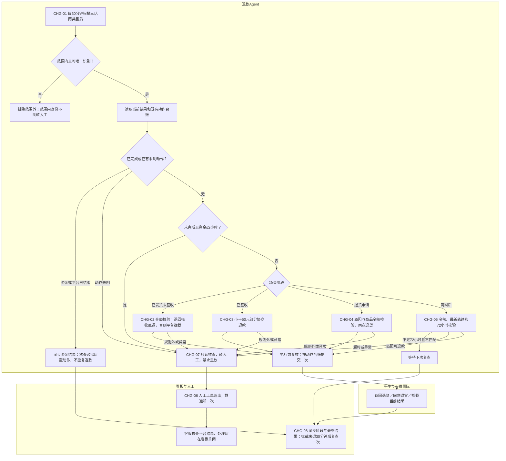

节点简写不替代第3章判断表。拦截查询失败立即转人工；正常未退款才等待复查；退款成功后已签收分支继续红旗备注动作。

### 4.2 操作步骤与系统截图

以下图片用于入口、按钮和字段位置说明，保留原图；不同截图可能来自不同售后，不构成同一订单的完整成功证据。示例中的金额、原因及旧文字不得覆盖第3章。

#### 步骤1 进入售后工作台（CHG-01）

千牛工作台→售后→售后工作台；识别当前店铺与两类售后，排除未发货退款。按当前实际状态进入审核申请或寄回后处理，不能只依赖历史截图的页签名称。

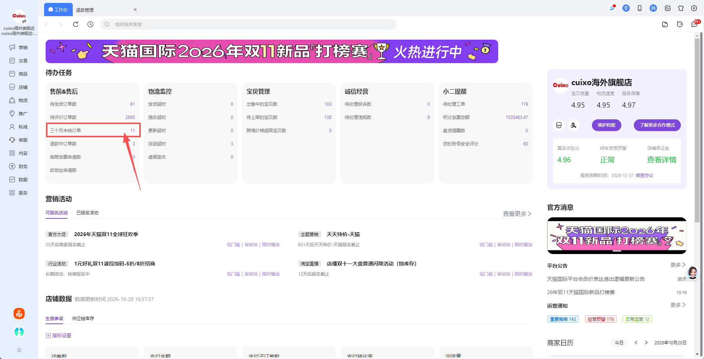

#### 步骤2 核验已发货物流与退款信息（CHG-02、CHG-03）

打开详情，读取售后号、订单号、本次金额、退款范围、申请原因、发货物流与平台剩余时间。明确退回／拒收且金额合规直接退款；已签收走小额部分协商分支。

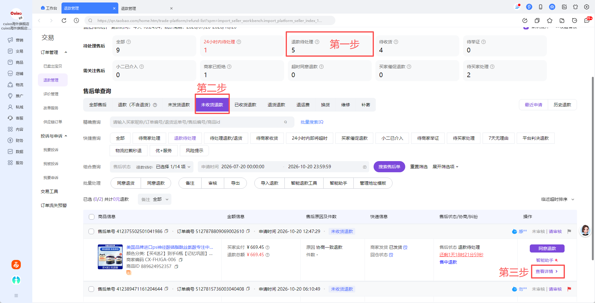

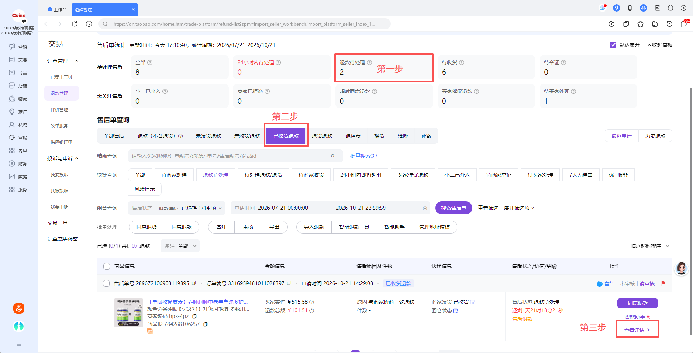

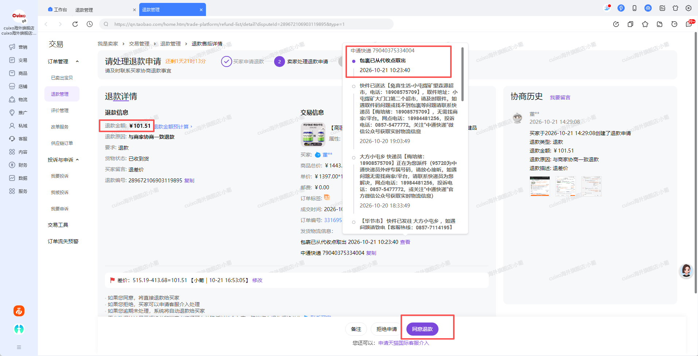

#### 步骤3 平台创建拦截与查询结果（CHG-02）

进入已授权天猫国际后台→订单管理→以同一订单号查询→核对店铺与订单→创建拦截→确认提交结果。无需在PRD展示登录密码。

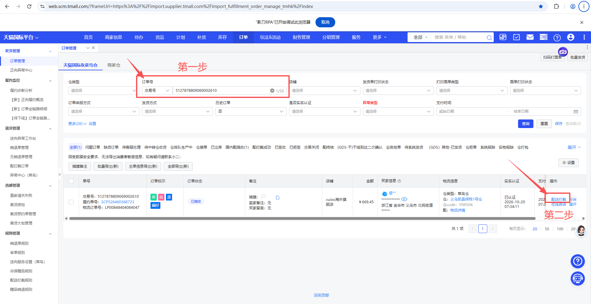

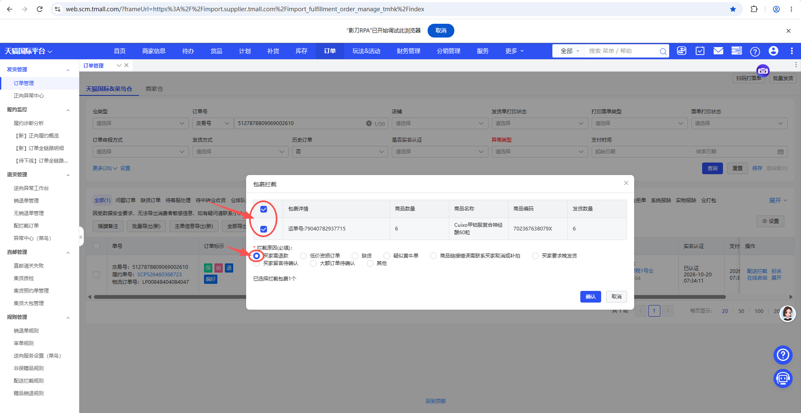

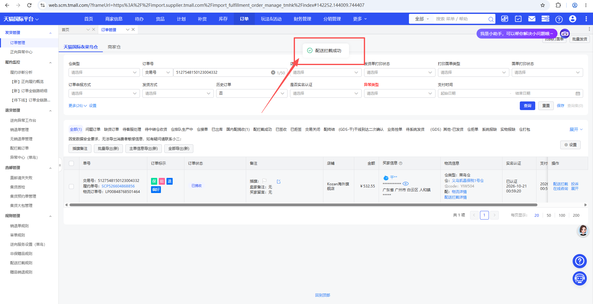

拦截成功后立即查退款，正常未退款时30分钟后只读复查一次；仍未退款转人工。图示拦截结果不能替代退款成功回执。

#### 步骤4 已签收部分退款、红旗与追加备注（CHG-03）

核验“部分退款、本次金额<50元、与商家协商一致退款”，提交后核实平台退款成功，再操作主订单备注。图中示例金额不得直接作为50元分支的放行样本。

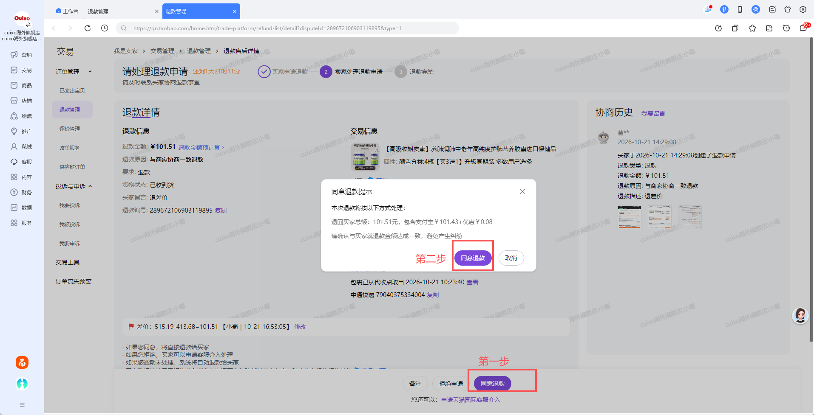

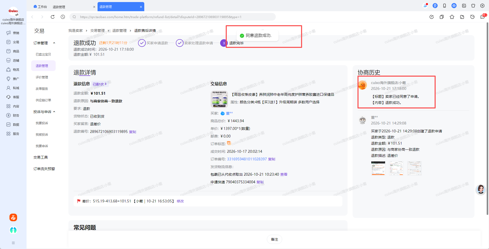

在下图主订单备注弹窗选择自定义红旗，保留原备注，在末尾追加【智能体已退+退款金额】，点击确定并重新读取确认。图中的旧备注不作为模板。


退款已成功但插旗／备注失败时，保留退款成功事实，任务显示待人工补完，不重复退款。

#### 步骤5 审核退货申请（CHG-04）

进入待审核退货申请，查看准确原因及申请退货商品金额；符合第3.4节时点击同意退货，在确认弹窗提交固定退货说明，重新读取状态确认进入待买家寄回。

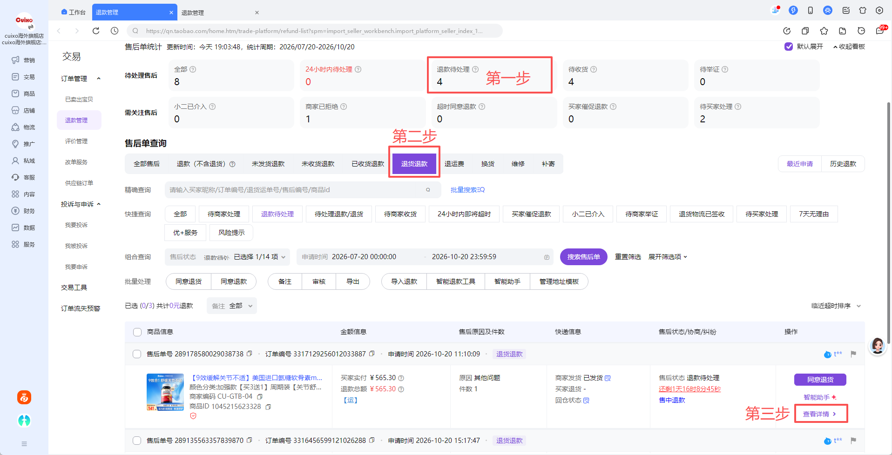

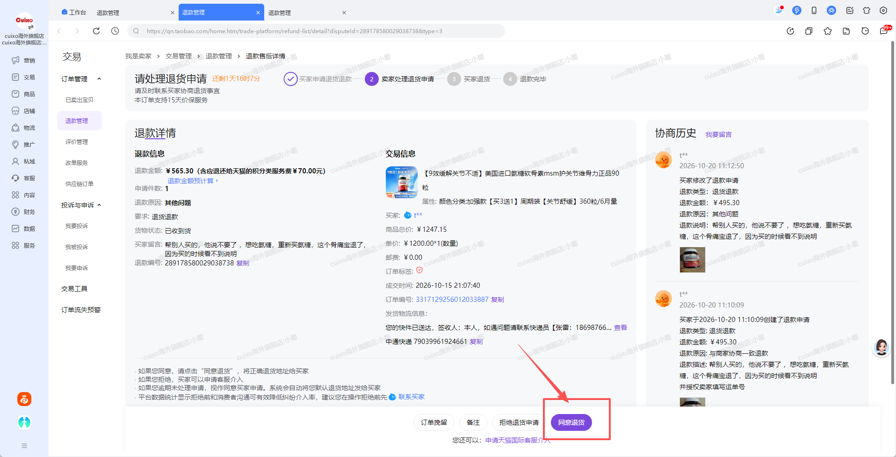

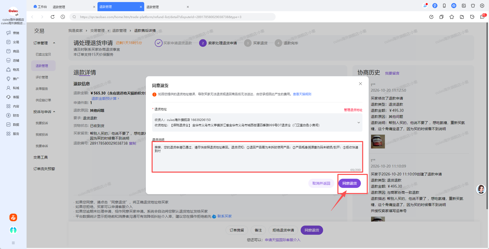

#### 步骤6 寄回后物流判断与退款（CHG-05）

进入待收货任务，核对买家退货物流单号，打开物流轨迹，取最新记录正文与时间；按第3.5节执行，不采用客服旧示例中“结构化目的地或签收地址”的描述。

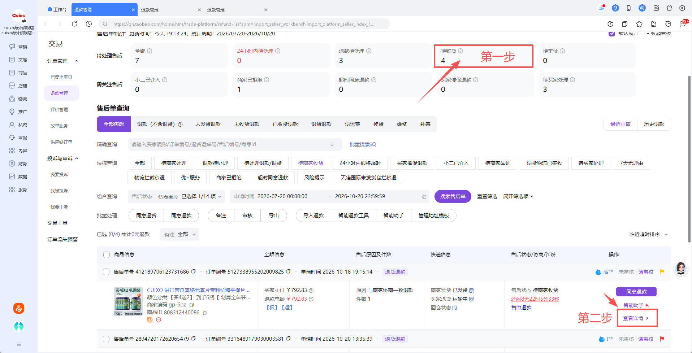

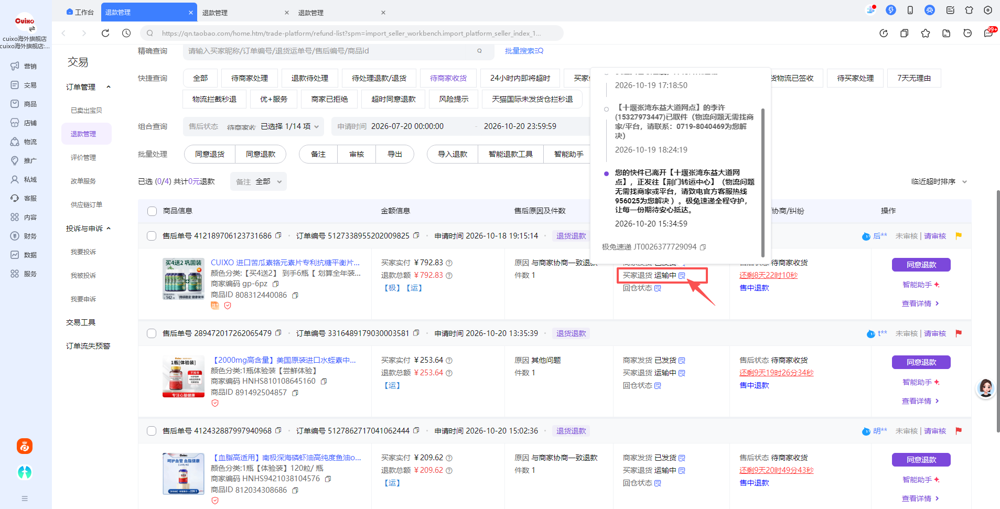

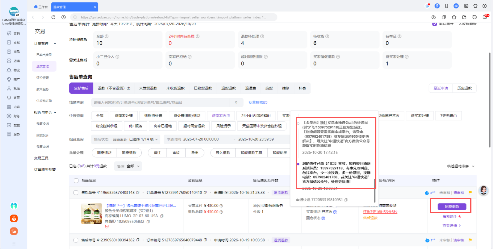

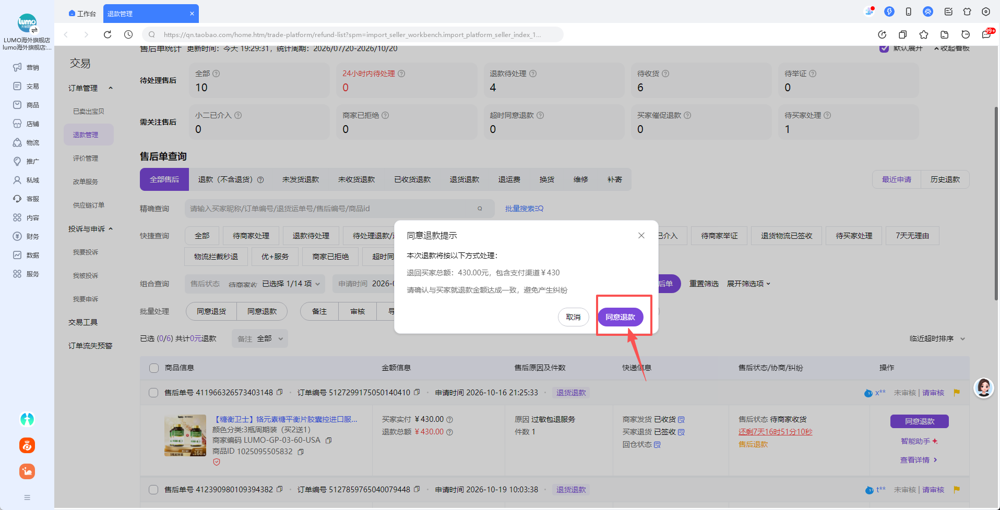

点击后必须重新核实平台退款成功；操作图只说明按钮位置，不证明本期真实退款验收通过。

## 5. 功能清单

| 优先级 | 模块 | 本期要求 | 引用 |
|---|---|---|---|
| P0 | 店铺与调度 | 白名单、两场景、全天扫描、跨周期防重、阶段续查 | CHG-01 |
| P0 | 未签收退款 | 退回拒收直退、平台拦截、退款结果复查 | CHG-02 |
| P0 | 已签收退款 | 小额部分协商校验、退款、红旗与追加备注 | CHG-03 |
| P0 | 退货审核 | 原因、商品金额、同意退货与固定说明 | CHG-04 |
| P0 | 寄回退款 | 最新轨迹、时间起点、等待与退款 | CHG-05 |
| P0 | 人工闭环 | 临期判断、原因码、一次群通知、人工关闭 | CHG-06 |
| P0 | 执行保障 | 动作台账、锁、只读恢复、启停、证据审计 | CHG-07 |
| P0 | 独立子看板 | 筛选、六指标、趋势、时段、场景、订单明细 | CHG-08 |

## 6. 独立看板要求（CHG-08）

### 6.1 名称与UI

本看板最终接入现有用户服务平台，作为“喜佑-天猫国际”子看板，不单独建设一套平台。业务入口及显示名称均为“喜佑-天猫国际”，不混入总部淘宝列表。沿用指定Demo子看板的白底卡片、浅灰页面背景、山茶红主色 `#D9353F`、8px圆角、指标层级、图表排列、表格与分页样式。顶部依次为标题、日期与店铺／场景筛选、刷新区域；主区依次为六指标、业务量趋势、双列24小时分布与场景分布、订单明细。

只复用UI和交互模式，不复制Demo随机数据、固定演示日期、平台配置或技术实现。若公共组件存在，研发优先复用；不要求为本期重建公共框架。

### 6.2 筛选与交互

- 日期预设、起止日期输入和范围日历沿用Demo交互，实际“今日”按北京时间，不固定在演示日期。开始晚于结束或日期无效时提示并保留上一有效结果。
- 店铺：默认全部三店，可单选；场景：默认全部，可选已发货退款、退货退款；退货退款的审核／寄回阶段在明细中区分，不增加第三个独立业务总量。
- 日期按任务首次创建时间归属，包含开始日00:00:00至结束日次日00:00:00之前的任务；结果取当前最新状态。日期、店铺和场景对指标、趋势、场景和明细联动。
- 最近24小时处理分布独立于日期筛选，按查询时刻向前24小时、北京时间小时分桶；仍跟随店铺与场景筛选，明确显示范围。
- 明细保留处理状态与处理结果筛选、分页；条件变化返回第一页。顶层统计不因明细分页变化，明细专属筛选不反向改变顶部指标。
- 刷新同步筛选范围内最新数据，显示最后更新时间；数据加载、空结果、无权限和接口失败必须可区分。请求失败不得把指标显示成0；可保留上次值并明确“更新失败”。
- 不增加“换货”“其他工单”虚假分类；业务类型拆分弹层仅显示本期实际支持的两类，数据支持但当期无记录显示0，维度缺失不补0。

### 6.3 任务粒度与六项指标

唯一业务任务为“业务线＋店铺唯一标识＋售后编号”。同一退货退款的审核与寄回阶段沿用一个父任务，保留阶段执行记录，不因为审核成功增加一条退款完成。再次扫描、重复通知、重启和阶段流转不新增总量。

| 指标 | 统计规则 |
|---|---|
| 进入自动化单量 | 所选创建日期、店铺、场景内的范围内去重任务数；含发现后直接转人工、等待、异常及已完成；未发货等范围外记录排除 |
| 已完成总量 | Agent纯自动完成＋人工完成；两类互斥。仅已转人工不计人工完成 |
| Agent纯自动完成 | 从发现至最终闭环无人工介入、所有必需动作完成的任务；直接退款及拦截路径均需平台明确退款成功；已签收路径还需红旗备注成功 |
| 人工完成 | 已由人工接管并完成、记录结果和实际完成时间的任务；即使之后由Agent辅助，也归人工完成，不回计纯自动 |
| 尚未完成 | 进入自动化单量－已完成总量，含审核已通过待寄回、物流等待、待人工、处理中、待验证与异常 |
| 自动化率 | Agent纯自动完成÷进入自动化单量×100%；分母0显示“—”，展示保留1位小数，不以人工完成提高自动化率 |

人工关闭、买家撤销或平台终止应保留实际结果；无人处理的被动撤销／关闭不算Agent纯自动完成，也不伪装成人工完成。其平台终态与任务业务结果独立记录，必要时由人工核实关闭并留原因。

### 6.4 图表

两张图均支持鼠标悬浮到对应日期／小时区域查看具体数据：趋势图显示日期（周／月时为实际起止区间）与进入自动化单量；时段分布图显示起止日期时间、Agent纯自动完成、人工完成及合计。零值明确显示0，跨日显示完整日期，移出图表后提示隐藏；切换筛选、刷新或空数据时清除旧提示，不改变统计口径。

| 区块 | 口径 |
|---|---|
| 所选时段业务量趋势 | 按首次创建日期统计去重进入自动化任务数；沿用Demo按日／周／月自动聚合方式，图上标明粒度；跨区间桶只纳入所选日期 |
| 最近24小时处理分布 | 按实际最终完成时间统计纯自动与人工完成任务，小时分桶；审核退货成功和拦截提交不算最终完成 |
| 业务场景分布 | 已发货退款、退货退款各自进入自动化数与占比；占比=本场景去重数÷筛选范围总去重数；无数据为空态，不伪造比例 |
| 业务类型拆分 | 与对应“进入自动化”或“已完成”指标同一分母、同一筛选，完成拆分只统计最终完成任务 |

趋势粒度采用指定Demo现有规则：所选范围含首尾日≤31天按日、32～180天按周、>180天按月。周按周一至周日、月按自然月；首尾不足完整周／月只统计筛选范围内日期，图上标明粒度。此为已读取Demo的当前交互基准，不另造分桶阈值。

### 6.5 订单明细

明细最少展示店铺、订单号、售后号、场景／阶段、本次申请金额、任务创建时间、当前处理状态、处理结果、实际完成时间和转人工原因。没有完成时间显示“—”，不以转人工或审核通过时间填充。不设置操作列、查看详情入口或任务详情抽屉。

规则版本、判断值、原动作回执、通知结果与证据仍作为执行记录保留，不在本看板增加详情界面。与任务无关的客户信息不另行采集。

本看板不提供人工接单、填写处理结果或关闭操作。人工仍按群反馈在现有业务系统核查和处理；完成结果回写方式作为技术联调项，不自行新增界面。只有取得可信的人工完成记录才计入人工完成，不能以群通知或接单代替。已人工接管任务不会因下轮扫描重新自动执行。

### 6.6 运行控制

本看板不提供运行设置、店铺／场景启停弹窗或配置入口。店铺／场景启停能力保留在既有管理侧，具体接入由技术评审确认，不在本期看板新增管理界面。登录健康与最近更新作为只读运行信息，不占六项业务指标。暂停后禁止新增不可逆提交，已提交未明动作仅核查，不重复执行。范围外系统OMS/TMS故障不得阻断本业务。

## 7. 核心功能详细需求

### 7.1 扫描与复查（CHG-01）

全天每30分钟扫描白名单店铺的两类未完结售后，覆盖审核申请和寄回阶段。无任务只记扫描日志，不创建空工单；店铺无法登录时记录运行异常，不构造虚假售后。按平台剩余时间由短到长处理，时间缺失且无法确认当前截止时转人工。

同一店铺、场景的上轮未结束时不得并发重复扫描。拦截复查以成功提交时间+30分钟为节点，不得因固定扫描时刻额外延长一个周期；需调度到期查询。停机跨过到期时间后，恢复时先核查现状与临期，不能重新起算等待时间。

### 7.2 字段读取与判定（CHG-02至CHG-05）

按分支读取最低必需字段；截图文字、页面提示与可用结构化字段相互冲突时不猜测。不得从聊天或历史备注自行放宽金额、原因、物流规则；识别到需解释的特殊约定时交人工。对应规则版本与判断快照保存在任务中。

退货审核通过后保留父任务并等待寄回；买家尚未填写物流单号，不伪造填写时间启动72小时计时。后续仍按真实平台状态与临期规则观察，必要信息无法取得且无法可靠判断时转人工。

### 7.3 不可逆动作（CHG-07）

每次同意退款、提交拦截、同意退货或修改红旗备注前，重新核对店铺、订单、售后、当前状态、金额、相关条件、场景开关、权限和剩余时间。数据已改变则重新判断，不使用旧快照提交。状态守卫按动作区分：退款与拦截要求售后仍可执行对应动作；退款后的红旗备注以已确认退款成功、主订单唯一、该后置动作尚未完成为前提，不再要求售后处于可退款状态。已退款进入临期也不重新发起资金动作，后置步骤无法安全完成时交人工。

动作先持久化准备记录，进入提交阶段后立即标记“已发起／结果待确认”，不能等成功页面出现后才建记录。每个动作有唯一业务键；至少由父任务、阶段、动作类型组成，同意退货与退款互不覆盖。平台退款结果关联售后，订单备注关联主订单，防止串写。

提交失败但可证明未发出请求时才允许重新准备；请求已发出或无法确认是否发出时禁止自动重试，只读核查并转人工。红旗备注也需先读后写，重查已存在相同动作记录时不重复追加，不以文本相似猜测另一个退款动作已完成。

### 7.4 部分成功与人工接管（CHG-03、CHG-06、CHG-07）

| 情况 | 必须保留的事实 | 后续 |
|---|---|---|
| 退款成功，红旗或备注失败 | 退款成功状态、实际金额与原动作记录 | 人工仅补旗／备注，不再退款 |
| 拦截成功，尚未退款 | 原拦截结果与时间 | 立即查＋30分钟到期查一次 |
| 拦截或退款结果未知 | 原提交记录与未知标记 | 只读核查，转人工，不重放 |
| 同意退货成功 | 阶段审核结果与固定说明 | 等待寄回，不当退款完成 |
| 群通知失败 | 已持久化人工工单与发送状态 | 看板显示通知失败，人工可检查；技术层防重复重试同一消息，不增加业务催办 |

### 7.5 AI产品契约

Agent负责读取、固定规则判断、授权范围内工具调用和结果核查；不自由决定退款金额、不生成新的退货话术、不自行改写原因或推断物流完成。输入为平台当前字段、规则版本、店铺配置与既有动作；输出为分支、动作、结果、原因码及可核查证据。

不确定或解析失败停止动作并转人工；资金动作以平台结果验收，不以模型回答“成功”验收。无跨店共享客户记忆或自行学习修改规则功能；不引入RAG、模型选型、成本阈值等未确认范围。识别与工具方案由研发确认，但不能降低确定性约束。

## 8. 数据规范

### 8.1 字段产品契约

字段名为建议映射，不是指定数据库表结构。金额为精确十进制、保留平台原始币种，时间保存可明确转换为北京时间的时间戳；缺失不得写0冒充有效业务值。

| 字段 | 类型／必填条件 | 来源与约束 |
|---|---|---|
| business_line | 固定标识／必填 | 喜佑天猫国际业务隔离键 |
| store_key、store_name | string／必填 | 已校验的唯一店铺配置与平台当前店铺 |
| aftersale_id、order_id | string／必填 | 平台售后与原订单，不能跨店混用 |
| scene | enum／必填 | shipped_refund、return_refund |
| stage | enum／必填 | shipped、return_review、waiting_buyer_return、return_tracking |
| refund_amount、currency | decimal、string／退款判断必填 | 本次申请退款金额与币种 |
| return_goods_amount | decimal／审核申请必填 | 申请退货商品金额，不能用整单金额替代 |
| refund_scope | enum／已签收必填 | partial、full、unknown；unknown不放行 |
| reason_raw | string／原因相关分支必填 | 平台准确原因名称，不模糊匹配 |
| shipping_status | enum及原值／已发货必填 | signed、returned、refused、unsigned、unknown；保留原状态用于核查 |
| platform_status、deadline_at | 原值、timestamp／可操作任务必填 | 当前售后状态与处理截止，需与平台剩余时间校核 |
| return_tracking_no、tracking_filled_at | string、timestamp／相应分支条件必填 | 买家寄回单号、真实填写时间 |
| latest_tracking_text、latest_tracking_at | string、timestamp／有轨迹时必填 | 最新一条轨迹，不用目的地替代 |
| tracking_query_status | enum／物流查询必填 | records、no_records、failed、conflict，失败不等于无记录 |
| intercept_submitted_at、intercept_result | timestamp、enum／拦截时必填 | 以明确平台结果填写 |
| next_check_at、check_count | timestamp、integer／等待任务必填 | 拦截成功后只安排一次到期复查；普通物流按周期 |
| refund_result、actual_refund_amount | enum、decimal／退款执行后必填 | 平台确认值；pending／succeeded／failed／unknown |
| flag_result、remark_result | enum／已签收退款必填 | 必需后置动作分别记录，不覆盖退款结果 |
| task_status、completion_mode | enum／必填 | 第9章；人工介入后不再归pure_auto |
| created_at、completed_at | timestamp／创建必填、完成条件必填 | 首次发现与实际最终闭环时间，不以重扫改写 |
| rule_version、decision_snapshot | string、object／判断时必填 | 规则版本和实际判断字段 |
| action_key、action_type、action_status | string、enum、enum／动作必填 | 动作唯一键及执行记录 |
| handoff_reason、handoff_status | enum／人工时必填 | 主要原因、辅助原因和接管状态 |
| notification_key、notification_status | string、enum／通知时必填 | 单任务一次业务通知的防重标识与结果 |
| evidence_refs、manual_outcome、operator | 引用、结果、角色／相应操作必填 | 平台结果、证据、人工处置人与记录 |

### 8.2 数据边界

业务任务与动作日志按业务线隔离，授权内可查三家店；其他总部业务不得出现在喜佑筛选与统计。历史总部任务不迁入喜佑，喜佑新增流程不得回写总部规则。凭据通过受控配置交接，不记录Cookie、Token或密码。原图使用授权不等于日志和群消息可无限传播个人信息；群消息仅带处理所需字段，截图按授权范围保留。

## 9. 状态与看板映射

主任务、阶段、资金动作、人工、通知分轴保存，不用单一“成功”覆盖全流程。

| 主任务建议状态 | 看板显示 | 进入与退出 |
|---|---|---|
| discovered | 待处理 | 首次发现，读取后进入判断 |
| processing | 处理中 | 读取、判定与执行中 |
| waiting_return | 待买家寄回 | 同意退货已确认，尚未进入物流判断 |
| waiting_tracking | 等待物流 | 不匹配且<72小时，下周期复查 |
| waiting_platform_refund | 等待平台退款 | 拦截提交成功，未到一次复查节点 |
| pending_verification | 待验证 | 已提交但结果未知，禁止重放；同时转人工 |
| pending_manual | 待人工处理 | 业务条件或临期转人工，人工关闭前持续显示 |
| interrupted | 异常中断 | 系统或必需后置动作失败，保留已成功部分并转人工 |
| paused | 已暂停 | 店铺／场景停用，恢复后先核对现状 |
| auto_completed | Agent纯自动完成 | 平台最终结果与全部必需动作确认，无人工介入 |
| manual_completed | 人工完成 | 人工核查、处置并记录完成结果 |
| platform_closed | 平台已关闭／待核实结案 | 平台撤销／终止，不自动算纯自动或人工完成 |

已完成任务不可由重复扫描退回待处理；资金成功不等于父任务已完成，已签收退款后需继续核查红旗备注，重启不能跳过后置动作；阶段成功不能覆盖父任务尚未完成状态。completion_mode建议为none／pure_auto／manual，人工标识一经发生保留。handoff_status为none／pending／accepted／closed；notification_status为not_sent／sending／sent／failed。动作状态为prepared／submitting／succeeded／failed／unknown，unknown不允许重放。

## 10. 转人工规则（CHG-06）

### 10.1 原因码

| 建议原因码 | 场景 | 处理 |
|---|---|---|
| AMOUNT_LIMIT | 当前分支金额超限 | 不提交动作 |
| SIGNED_NOT_ELIGIBLE | 已签收全额、金额≥50或原因不符 | 不自动退款 |
| RETURN_REASON_NOT_ALLOWED | 审核原因不符 | 不自动同意退货 |
| TRACKING_STALE_72H | 最新不匹配且≥72小时 | 停止等待 |
| DEADLINE_WITHIN_2H | 未完成且剩余≤2小时 | 优先接管，不自动拒绝 |
| INTERCEPT_FAILED | 无法提交、失败或一直处理中 | 不重复拦截 |
| INTERCEPT_NO_REFUND | 成功提交30分钟复查仍未退款 | 不继续无限等待 |
| ACTION_RESULT_UNKNOWN | 退款／拦截结果未明 | 核查既有动作，禁止重放 |
| REQUIRED_DATA_INVALID | 缺字段、冲突、查询失败或身份不唯一 | 不猜测 |
| POST_REFUND_MARK_FAILED | 退款成功但旗／备注失败 | 只补后置动作 |
| SYSTEM_EXCEPTION | 登录、页面或接口故障 | 保留上下文与证据 |

同任务可保存多个原因，通知以当前主要原因和已执行动作说明；主要原因优先保留结果未知、临期等影响接管的风险，不因多原因发多条业务通知。

### 10.2 钉钉通知

| 项目 | 配置 |
|---|---|
| 群名称 | 【喜佑】天猫退款Agent反馈群 |
| 群号 | `202400013224` |
| 每次逐一@ | 易紫云（菀初）、董昌平（星璇）、李姣玉（玖悦） |
| 成功 | 不发群通知，看板留记录 |
| 转人工／异常 | 人工工单先持久化，再发一次群通知 |
| 无人响应 | 看板持续待处理，不定时催办、不发升级通知 |

@使用受控用户标识映射并在联调验证，不根据姓名猜ID。同一父任务首次进入人工队列时形成一个通知事件，重复扫描、原因更新和无人响应不新增通知。发送失败可针对同一事件做技术防重重试，不是新增催办；发送结果未知先查投递结果，不能盲发第二条。最终失败在看板显著展示，由人工监控。

通知模板：

```text
【喜佑-天猫国际｜需人工处理】
店铺：{store_name}
订单号／售后号：{order_id}／{aftersale_id}
场景／阶段：{scene}／{stage}
本次申请金额：{refund_amount} {currency}
主要原因：{handoff_reason}
已执行动作与结果：{action_summary}
平台剩余处理时间：{remaining_time}
注意：请先核查既有退款／拦截结果，避免重复提交。
看板入口：{dashboard_link}
@三位指定人员
```

### 10.3 人工闭环

客服核查平台状态与既有台账，在现有业务系统处理后保留结论、是否退款、实际金额、完成时间与操作人；可信完成记录回写看板，不在本看板新增接单或关闭入口。无需通过群回复自动识别结案。不存在已确认的接单SLA，不在本期添加新时限；值班及资金核对安排作为上线准备，不用“发通知成功”替代人工完成。

## 11. 异常与恢复策略（CHG-07）

| 异常 | 自动化行为 | 恢复约束 |
|---|---|---|
| 登录失效、验证码、平台风控 | 停止受影响店铺新提交，显示运行异常 | 人工恢复登录，不绕过验证 |
| 页面结构或必要字段失效 | 停止对应流程，任务转人工 | 修复并验证定位后恢复 |
| 查询失败 | 与正常无物流区分，转人工 | 不猜测记录，不把失败计0 |
| 提交后断网／超时 | 记录unknown，仅查询原结果 | 不再次退款或拦截 |
| 重启或并发 | 恢复原任务与台账，先核查 | 唯一键＋执行锁禁止重复动作 |
| 已退款、售后撤销或关闭 | 同步真实状态并停止新动作 | 不覆盖已退款事实，不误计Agent成功 |
| 红旗或备注失败 | 保留资金成功，后置动作待人工 | 不重放退款，不覆盖原备注 |
| 通知失败 | 看板展示未送达，任务仍待人工 | 只重试原通知事件，避免重复 |
| 停机跨过30分钟／72小时节点 | 用原始时间重算，先看平台与临期 | 不重置计时，不补提交历史动作 |

暂停不等于撤销已发送平台请求。恢复必须核查未明动作、当前权限、规则版本与店铺身份，管理员执行且保留恢复记录；业务原因转人工的任务不自动释放回执行队列。

## 12. 权限与安全

| 操作 | 客服 | 客服负责人／产品运营 | 系统管理员 |
|---|---|---|---|
| 查授权看板、任务与证据 | 是 | 是 | 是 |
| 现有业务系统人工处理与完成记录 | 是，记录本人；本看板无操作入口 | 可核查 | 不代填业务结论 |
| 修改业务规则 | 否 | 重新确认业务方案 | 只发布确认版本 |
| 暂停店铺／场景 | 按现有应急权限配置 | 可提出暂停 | 执行并审计 |
| 恢复、白名单、账号、通知配置 | 否 | 业务确认 | 执行并审计 |
| 删除退款／拦截执行记录后重新运行 | 禁止 | 禁止 | 禁止，避免重复退款或重复拦截 |

最终角色映射与现有权限体系由技术评审落地。未授权访问返回无权限，不泄露其他业务线任务。三店真实动作启用前完成账号权限核验与业务负责人确认；具体上线时间和审批记录另行留存，不把本PRD完成当作平台资金操作已执行。

截图存储位置、访问控制、保留期限、到期删除与下载审计由现有制度和技术能力确认。已获PRD原图使用授权；不将密码、Token、Cookie写入任何交付文档或群消息。

## 13. 非功能性需求

### 13.1 可靠性

同一售后不得重复退款、重复拦截或因阶段切换重复计数；任务、动作与通知防重可在重启后继续生效。平台结果无法确认时不得显示纯自动完成。不能以一张示例截图替代真实动作回执。

### 13.2 可观测性

记录每轮扫描起止、店铺场景、发现数、排除数、判断结果、提交动作、结果核查与通知结果。日志关联父任务、动作键、规则版本、操作者和时间；可定位系统异常与业务转人工的区别。不得写入凭据。

### 13.3 调度与兼容

30分钟为业务调度周期，72小时与平台临期均采用实际时间戳比较；并发、超时、容量和接口限流策略由研发确认，不编造性能数值。未完成扫描不并发重复启动，同店跨周期任务由执行锁约束。优先保证结果未知动作核查与临期接管。

新版UI支持Demo已有桌面布局与窄屏重排模式；具体浏览器矩阵沿用现有项目支持范围，联调确认。无图表数据或图表加载失败时，明细与异常状态仍可辨识，不伪造展示。

## 14. 验收标准与开发自测

### 14.1 开发自测职责与前提

当前无独立测试人员，本章全部业务、边界、异常、权限、看板和上线前验证用例由开发人员自测执行，问题修复后由开发复测并保留结果与证据。产品／客服负责业务规则和业务结果确认，不设置独立测试岗位或测试交接环节。

除用例指定变化外，使用授权测试售后，店铺与场景启用，必要字段完整、无人工接管、剩余时间>2小时、无未明动作。每条记录输入快照、操作前后平台状态、动作提交次数和看板结果；真实资金动作仅在另行受控测试安排下执行。

### 14.2 业务正常与边界

| 编号／引用 | 前置与操作 | 可观察结果 |
|---|---|---|
| AC-01／01 | 三店分别有两类售后并扫描，另放未发货退款 | 三店两类进入任务；未发货不操作、不转人工、不计总量 |
| AC-02／02 | 未签收明确退回，999.99元，执行判断 | 直接退款一次，不建拦截；平台成功后记退款结果 |
| AC-03／02 | 未签收明确拒收，999.99元 | 同意退款一次，不要求额外拦截 |
| AC-04／02 | 未签收1000.00元 | 转人工，不提交退款或拦截 |
| AC-05／02 | 未签收未退回，拦截提交明确成功并立即退款 | 一次拦截、立即核实成功，Agent不点退款 |
| AC-06／02 | 拦截成功，立即未退款，30分钟后已退款 | 原时间到期只读复查一次，完成，无第二次拦截 |
| AC-07／02 | 拦截成功，30分钟复查仍未退款 | 转人工，不继续等待，不点击退款 |
| AC-08／02 | 拦截失败、处理中或结果不明 | 立即转人工，不进入正常未退款等待链 |
| AC-09／03 | 已签收部分退款49.99元，准确协商原因 | 退款一次，成功后红旗＋末尾追加实际金额 |
| AC-10／03 | 已签收50.00、99.99、100.00元各一单 | 全部转人工，不使用旧100元门槛 |
| AC-11／03 | 已签收49.99元但全额退款或其他原因 | 转人工；买家自述未收货不改变签收分支 |
| AC-12／03 | 原有备注，执行合规退款后备注 | 原内容原顺序保留，末尾追加；无备注时直接填写 |
| AC-13／04 | 两个准入原因分别搭配商品金额999.99元 | 同意退货并提交固定说明；父任务仍待寄回，不算退款完成 |
| AC-14／04 | 商品金额1000元或其他原因 | 转人工，不自动同意退货 |
| AC-15／04 | 整单实付≥1000元但申请商品999.99元 | 以申请商品金额判断，不套整单金额限制 |
| AC-16／05 | 寄回退款999.99元，最新轨迹仅包含浙江或仅金华 | 两者均可退款，途经也放行，无需验货 |
| AC-17／05 | 最新匹配，但72小时未更新 | 仍可退款；金额1000元或临期另按前置守卫转人工 |
| AC-18／05 | 历史匹配，最新不匹配，71小时59分 | 不退款，等待30分钟复查；不能用历史轨迹放行 |
| AC-19／05 | 最新不匹配，时效72小时整 | 转人工；起点为最新更新时间 |
| AC-20／05 | 正常无记录，填写单号时间距今72小时整 | 转人工；不足72小时等待 |
| AC-21／05 | 查询失败或必要起点缺失 | 转人工，不当正常无记录，不以当前时间重置 |
| AC-22／06 | 剩余2小时整且未完成，包括等待拦截／物流任务 | 优先转人工，不再等待、不自动拒绝 |
| AC-23／06 | 剩余2小时以上与已退款任务 | 前者继续场景判断；后者同步完成，不再因临期转人工 |

### 14.3 异常、防重与权限

| 编号／引用 | 前置与操作 | 可观察结果 |
|---|---|---|
| AC-24／07 | 提交退款后页面超时，再扫描与重启 | 原动作保持未明，只读核查，累计提交一次 |
| AC-25／07 | 同一售后并发发现与跨周期重复扫描 | 一个父任务、一个有效执行者，无重复资金动作 |
| AC-26／03、07 | 退款成功后备注失败或成功退款后重启、旗备注未确认 | 平台退款成功保留；恢复时先核查旗备注，无法确认或失败交人工补完，不提前计纯自动完成，不再次退款 |
| AC-27／06 | 转人工后再扫描、无人响应 | 群只通知一次，看板持续待处理，无催办／升级 |
| AC-28／06 | 同一通知发送超时或重试 | 先核实原事件，不能形成第二次业务通知或第二个人工工单 |
| AC-29／07 | 提交前金额、状态或场景开关变化 | 重新核验并停止不再合规动作，不使用旧快照 |
| AC-30／07 | 暂停存在已提交未明任务的店铺 | 不发起新提交；原动作仅核查，恢复不重放 |
| AC-31／07、08 | 非授权角色访问其他线或修改配置 | 拒绝访问／修改，保留审计，不泄露任务 |
| AC-32／07 | 同意退货后阶段变更并重扫 | 继续同一父任务，审核不重复提交，后续退款独立动作防重 |

### 14.4 看板与统计

| 编号／引用 | 前置与操作 | 可观察结果 |
|---|---|---|
| AC-33／08 | 打开独立业务入口 | 名称喜佑-天猫国际；布局对应指定Demo子看板，不显示总部任务 |
| AC-34／08 | 造5个去重任务：纯自动1、人工完成1、等待1、待人工1、审核通过待寄回1 | 进入5、已完成2、纯自动1、人工完成1、未完成3、自动化率20.0% |
| AC-35／08 | 对同一退货任务添加审核与退款阶段并重扫 | 总量不增；最终完成只计一次 |
| AC-36／08 | 切日期、店铺和场景，分页及状态筛选 | 顶层范围联动；明细筛选分页不改顶部口径；换条件回第一页 |
| AC-37／08 | 改历史日期筛选 | 24小时图日期不变但店铺／场景联动，其他图表随日期变 |
| AC-38／08 | 创建在区间内、完成在区间外 | 任务按创建归属保留，显示最新结果和真实完成时间 |
| AC-39／08 | 无任务、接口失败、无权限分别打开 | 区分空态／错误／无权限；失败不显示虚假0，零分母率为“—” |
| AC-40／08 | 仅两类场景、某类当期0条 | 仅展示支持分类与真实0；不补换货／其他，无维度不补0 |
| AC-41／08 | 未完结任务转人工，之后人工记录完成 | 通知时不增人工完成；人工关闭后增1，保留真实时间与结果 |
| AC-42／01、08 | 检查扫描、拦截到期与登录健康 | 显示真实时间及结果，不以固定周期额外延迟拦截复查，不依赖OMS/TMS |
| AC-43／02至05 | 已确认非人民币或币种缺失，金额数值看似小于门槛 | 转人工，不直接套用人民币阈值，不自动换汇 |

以上用例中的“／01”等为CHG-01简写，均指第1.4节已登记编号。

### 14.5 上线门槛

三店身份与权限核验、千牛与天猫国际真实页面联调、动作防重及只读恢复、已签收红旗备注、两阶段退货、30分钟复查和临期接管均需通过。群号、逐一@映射、一次通知防重、人工完成结果同步与隔离统计需验证。账号凭据、资金核对责任、应急值班、暂停恢复与证据保留安排需在上线前落实。未完成项只标待联调／待验证，不写已上线。

## 15. 上线与运营

### 15.1 首批方式

三家店同时启用已发货退款和退货退款真实自动处理，不新增影子模式为本期必经运行阶段。具体上线时间由业务与研发安排；技术验收不替代资金动作授权与上线确认。各店、各场景必须可独立暂停。

### 15.2 应急处置

发生误退款、重复提交、平台风控、定位失效、结果未知或证据不可追溯时，停止受影响范围新动作并保留既有记录。管理员与客服负责人核查后恢复，不允许通过清空台账规避防重。误退款按公司已有追偿、申诉或损失处置流程办理；责任角色与实际流程上线前落实，不在此编造。

### 15.3 运营口径

核心六指标按第6章统计，额外运行明细支持查看：

| 项目 | 取数规则 |
|---|---|
| 平台已确认退款金额 | 在筛选任务集合内，按唯一售后退款成功事实汇总实际金额；备注失败但已退款仍纳入金额事实，不等同纯自动完成量；币种分别汇总 |
| 转人工量 | 筛选集合中曾进入人工队列的去重任务，不按通知条数计数 |
| 拦截成功／未退款量 | 依据原拦截结果与当前退款结果统计，不以拦截成功冒充退款完成 |
| 阶段审核通过量 | 已确认同意退货的唯一父任务数；作为阶段信息，不加到最终完成量 |
| 异常与通知失败量 | 按当前任务／通知状态计数，重复原因不重复增加任务数 |
| 处理时长 | 已最终完成任务的completed_at－created_at；等待阶段不伪造完成时长 |

上述辅助项可在运行记录或既有统计入口查询，不新增一套与Demo冲突的顶部指标。平台显示退款成功只代表售后平台结果，不代表买家支付账户到账已核验。
