# 三库现状与统一数据源建设规划

> 文档日期：2026-10-10  
> 文档拆分：2026-10-10；字段与执行细则统一维护在[第一阶段开发交付说明](三库统一数据源建设_第一阶段开发交付说明.md)。  
> 文档性质：现状整合与目标架构规划，供产品、研发和业务评审使用。  
> 状态：核心业务边界已逐项确认，已据此收敛方案；真实接口、存储、权限映射和迁移可行性尚待研发核实。  
> 范围：素材库、提示词库、技能库，以及 AI 设计平台、XMAI Studio 和其他应用的接入。  
> 阅读说明：先看第一部分现状，再看第二部分建设规划。图中使用中文业务名称；架构图表示职责关系，不代表已经确定物理部署方式。

| 文档 | 内容定位 |
|---|---|
| 本文：整体方案规划 | 当前现状、建设目标、总体架构、职责边界、共性原则、四阶段路线与阶段完成条件 |
| [第一阶段开发交付说明](三库统一数据源建设_第一阶段开发交付说明.md) | 业务对象、字段与校验、具体业务待决事项、研发核查清单、业务输入输出和验收要求；产品业务规则已确认，可交研发评审；核查与联合评审未完成 |

字段长度、数量、必填、默认值等明细只在第一阶段文件维护，本文不重复保存。2026-10-10 已授权按两份Markdown分别同步HTML，阅读版不代替事实源。

## 第一部分：当前现状

### 1. 当前平台与三库的关系

目前共用一套账号体系；技能库的数据源在 XMAI Studio，素材库与提示词库的数据源在 AI 设计平台。三库已有业务能力，统一数据源及跨平台受控读写仍是本次建设目标。

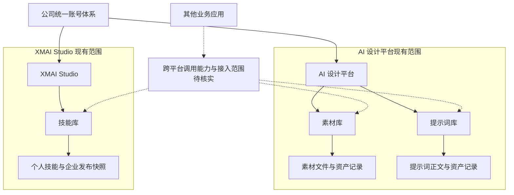

| 事项 | 当前事实 | 证据及边界 |
|---|---|---|
| 账号体系 | 两个平台共用一套账号 | 组织、角色和授权同步的实现细节仍需核实 |
| 素材库、提示词库 | 已上线 | 依据来源一；生产系统覆盖范围需核实 |
| 技能库 | 相关能力已上线，公开 GitHub 搜索安装及员工端状态同步已完成生产验证 | 依据来源二；具体版本和生产证据待补档 |
| 素材、提示词的权限及审计 | 已有正式业务规则 | 具体服务端实现及上线覆盖范围未逐项核实 |
| 审批系统 | 设计平台与 Studio 当前分别处理审批 | 保留各平台审批，不合并审批系统 |
| 跨平台接入 | 原素材、提示词规则已提出外部平台只读调用 | 不能据此认定跨平台服务已经可用；本次目标进一步扩展到受控读写 |
| 统一三库数据源 | 本次拟建设 | 不属于当前已上线能力 |

### 2. 三库既有业务流程

以下流程为既有业务基线。目标方案的新增资产通过新增窗口主动保存，不新增自动采集或自动入库；外部灵感同步、快捷入库等历史记录仅用于现状映射。

#### 2.1 素材与提示词：同一资产逐级共享

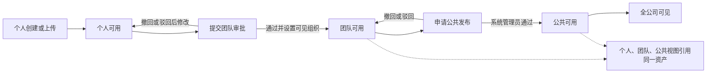

团队和公共审批不复制内容；公共申请期间，团队资源继续可用。公共发布后保留个人和团队来源记录。当前已确认的审批规则允许有相应角色、审批事项和组织范围的人审批本人提交的资源；多人并发审批仅首个成功事务生效。

| 资产类型 | 进入方式 | 专属规则 |
|---|---|---|
| 素材 | 主动上传；工作台本地图片按选择入库；生成结果或历史结果入库 | 图片、视频、音频；固定一级类目；个人分组不改变共享权限；图片自动命名规则已确认，服务上线范围待核实 |
| 提示词 | 个人新建；外部灵感收藏为个人副本 | 纯文本；按用途分类；不以历史工具或模型字段限制使用；公共内容与外部未验证内容保持独立标识 |
| 外部灵感 | 外部来源同步进入灵感广场 | 原文与个人收藏副本分离，副本保留来源关系；同一用户重复收藏同一来源不重复创建副本 |

#### 2.2 技能：个人对象与企业发布快照分离

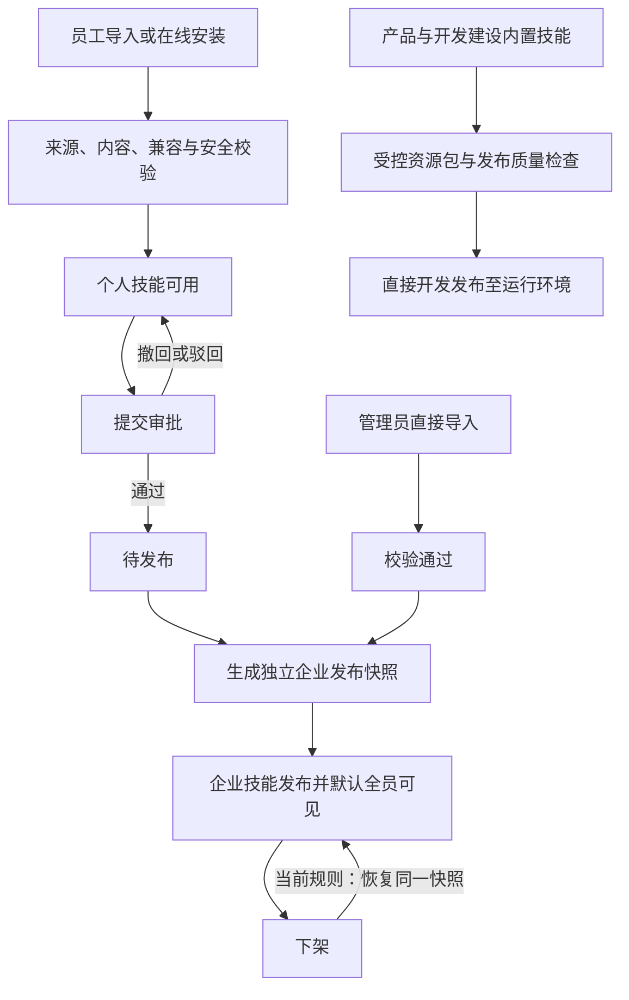

| 规则 | 当前口径 |
|---|---|
| 个人与企业关系 | 两个独立对象；删除个人副本不影响企业发布快照 |
| 企业可见性 | 默认全员可见，当前没有部门、岗位或人员级配置界面 |
| 审批与调用 | 个人技能审批中、被驳回或待发布时，本人仍可使用 |
| 删除 | 2026-09-28 旧资料禁企业彻底删除；Studio 后续项目记忆已确认新增删除功能，不能把旧禁删作为现行规则。员工个人删除遵循本文第11章规则，企业清理与留存见交付说明 |
| 企业版本 | 2026-09-28 旧资料记载固定初始版本、无完整更新／历史／回退；2026-10-10 页面可见不同版本文本，不足以证明完整版本能力。最新差异和建设要求见交付说明第4.4节 |
| 系统内置技能 | 直接开发发布，可有受控资源包版本；不等于员工端已有企业技能版本管理 |
| 使用统计 | 真实任务开始执行才计调用；同一任务重试不重复增加主调用 |
| 下架与撤权 | 阻止新调用；执行中失效按交付说明第6.4节停止后续受控步骤，已启动操作的中断能力由研发核查，保留已完成结果 |

### 3. 两套现状的关键差异与建设缺口

| 对比项 | 素材库、提示词库 | 技能库 | 对统一建设的影响 |
|---|---|---|---|
| 共享模型 | 同一资产的个人、团队、公共视图 | 个人资产与独立企业快照 | 保留对象关系，不能因统一而强行合并 |
| 审批路径 | 团队审批、公共审批 | 员工审批发布、管理员直发、系统内置发布 | 审批继续由各业务平台处理，本次不统一 |
| 权限范围 | 个人、组织可见、全公司 | 个人与默认全员可见的企业技能 | 共用权限计算，但不擅自改变现有共享政策 |
| 分类方式 | 素材类目、提示词用途 | 技能分类与标签 | 统一维护方式，保留不同分类词表 |
| 使用结果 | 文件引用、文本回填 | 技能装载与任务执行 | 共用访问入口，返回内容及校验要求不同 |
| 版本基础 | 汇总资料未证明已有完整内容版本能力 | 已有发布快照，暂无企业技能版本更新 | 版本管理是本次增量建设内容 |

本次需要补齐的是三库统一数据、受控读写接口、按条件查询，以及已有任务的内容稳定性。审批整合、通用业务规则引擎和统一运营后台不作为本次建设前提。当前没有足够数据量化重复维护成本与接入工时，后续应实测基线。

## 第二部分：统一数据源建设方案规划

### 4. 三库共用一套底层规则

素材、提示词、技能统一遵循个人与共享归属、受控读写、业务筛选、内容版本和历史引用规则。业务应用按自身能力接入相应资产类型；数据可读取不代表应用自动具备全部技能运行或文件处理能力。

| 共性规则 | 素材库 | 提示词库 | 技能库 |
|---|---|---|---|
| 保存与归属 | 主动保存文件，记录个人或共享归属 | 主动保存正文，记录个人或共享归属 | 主动保存技能包，记录个人或共享归属 |
| 跨平台访问 | 同一素材按权限获取 | 同一提示词按权限获取 | 同一技能按权限获取 |
| 业务筛选 | 用户、类目、标签等 | 用户、用途、标签等 | 用户、分类、标签等 |
| 已有引用 | 不受列表筛选变化影响 | 不受列表筛选变化影响 | 不受列表筛选变化影响 |
| 已发布内容修改 | 保存新的文件版本 | 保存新的正文版本 | 保存新的技能包版本 |
| 旧任务重跑 | 沿用当时关联的文件版本 | 沿用当时使用的实际正文 | 沿用当时关联的技能包版本 |
| 业务审批 | 留在业务端 | 留在业务端 | 留在业务端 |

例如，在一个应用保存个人资产后，另一个有相应入口的应用按“当前用户的个人资产”及业务条件查询，就能找到同一条内容，无需再次导入。

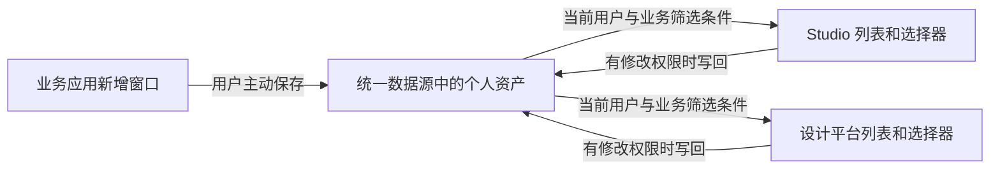

| 用户已确认的边界 | 方案含义 |
|---|---|
| 新应用要复用已有积累 | 新应用接入统一接口，不再独立收集和维护同一份资产 |
| 个人资产也需要统一 | 范围包括个人、团队、公共／企业资产；个人归属跟账号走 |
| 账号共用一套 | 复用已有身份；同一个人跨平台仍是同一个资产主体 |
| 业务平台可以增删改查 | 操作入口保留在应用，内容写入统一数据源 |
| 展示规则由业务制定 | 应用决定用户、分类、用途、标签等筛选条件 |
| 都通过新增窗口保存 | 不建设聊天内容、任务结果的自动入库 |
| 审批当前分开，本次不统一 | 现有审批继续在各业务端处理，不增加全局审批排队或统一路由 |
| 分类标签变化不影响已有引用 | 列表不展示不等于禁止已有任务继续使用 |
| 已发布内容不能直接覆盖 | 正式内容修改形成新版本，发布流程沿用相应业务端 |
| 三库旧任务重跑沿用当时内容或版本 | 任务保存使用时的内容，普通更新不替换历史任务输入 |

这里的统一数据源是支持业务在线读写的资产数据底座，不是用于汇总分析报表的数据仓库。它保存资产和必要管理信息，但不负责决定业务审批流程。

### 5. 收敛后的总体架构

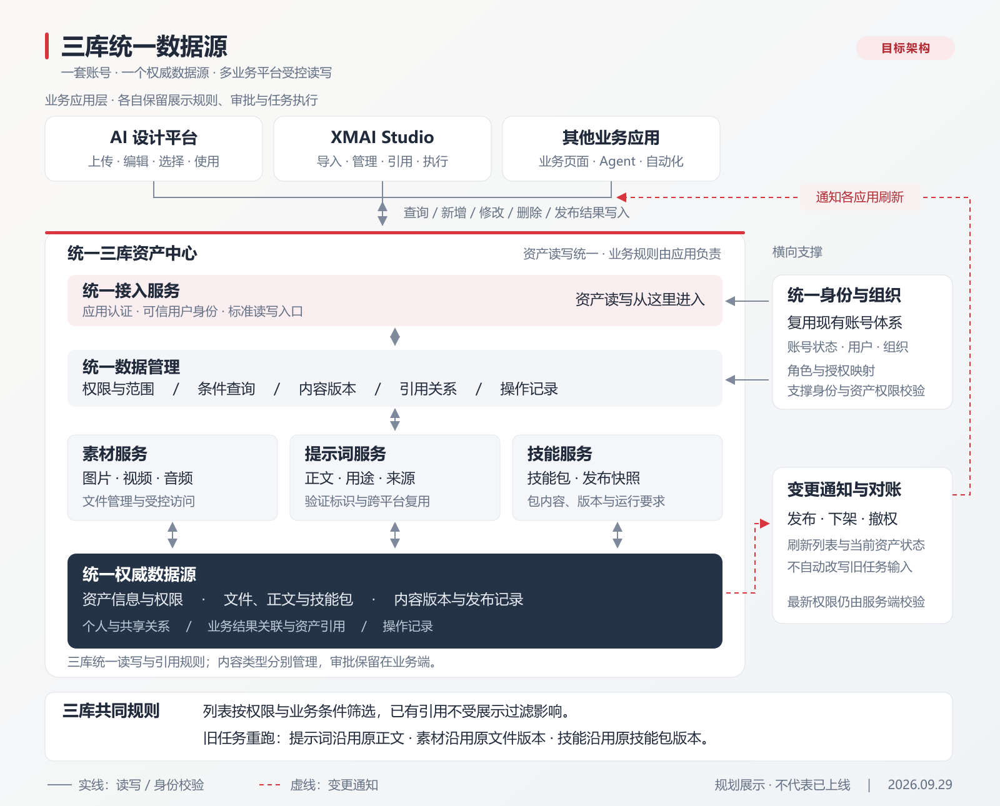

[可缩放矢量版](三库统一数据源_总体架构.svg)

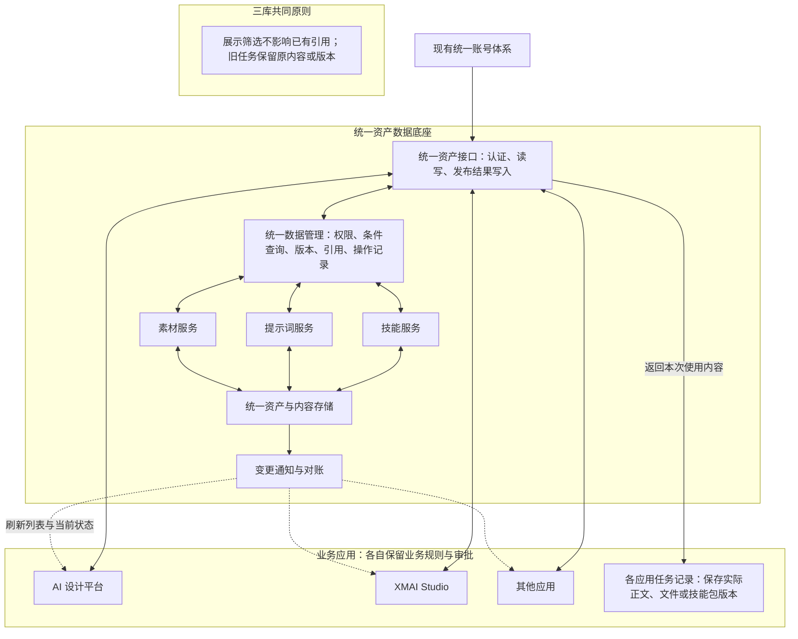

| 层级 | 职责 | 不承担的工作 |
|---|---|---|
| 业务应用 | 新增窗口、展示筛选、业务审批、任务执行；记录本次使用的资产内容 | 不独立维护同一资产的第二份正式数据 |
| 统一资产接口 | 校验身份与资产权限，按条件查询，受控写入，防止覆盖冲突，记录操作 | 不决定业务审批人、审批路线或应用业务范围 |
| 统一数据存储 | 保存个人及共享资产、归属、分类标签、内容版本、共享范围和必要关联信息 | 不执行审批流转，不承担任务编排和模型调用 |
| 应用任务记录 | 保存实际使用的提示词正文、素材文件版本、技能包版本及来源 | 不成为第二份资产库，不随原资产更新自动改写 |

数据库和文件存储可以分别承载文本与文件；统一指资产有唯一权威归属和写入入口，不要求全部放到一张表或一台服务器。图中的接口可由一个服务实现，本次不要求建设复杂规则中心或拆分微服务。

总体架构中的变更通知用于刷新列表和当前资产状态，不自动改写旧任务输入。各业务端继续处理审批，底座仅校验并保存获准的发布结果；通知的具体实现可复用现有能力，不要求新建消息平台。

### 6. 哪些信息放在统一数据源

| 信息 | 是否集中 | 说明 |
|---|---|---|
| 个人、团队、公共／企业资产内容 | 是 | 包括提示词正文、素材文件、技能资源包 |
| 资产编号、创建人、归属组织、来源平台 | 是 | 跨平台识别和权限判断；来源平台只用于追溯，不默认隔离 |
| 分类、用途、标签 | 是 | 提供查询依据；三库原有分类含义分别保留 |
| 我的分组与资产关联 | 是 | 按用户和所属应用隔离；其他应用按需接入，不强制跨平台共用，不作为资产权限依据 |
| 可见范围、维护权限、发布结果 | 是 | 让所有应用对同一资产获得一致的访问与写入判断 |
| 正式内容版本 | 是 | 三库已发布内容不直接覆盖，保留历史版本引用 |
| 审批流程、待办、审批中状态 | 保留在业务系统 | 本次不迁移、合并或新增中央审批流程 |
| 必要的审批来源与结果关联 | 按接入需要保存 | 能追溯授权变更来自哪次业务处理即可，不复制整套审批系统 |
| 应用展示筛选配置 | 保留在业务应用 | 业务端负责配置，查询时传入对应条件 |
| 任务实际使用的正文、文件或技能包版本及参数 | 保留在应用任务记录 | 供历史任务查看与重跑使用，不重新入资产库 |

素材、提示词仍保留同一资产的多视图关系；个人技能与企业技能仍是独立对象。统一存储不强行合并它们。

### 7. 列表筛选与已有引用分开处理

核心规则：列表展示取“用户有权访问的资产”与“应用筛选条件”的交集；已有任务使用资产不重新经过列表筛选。

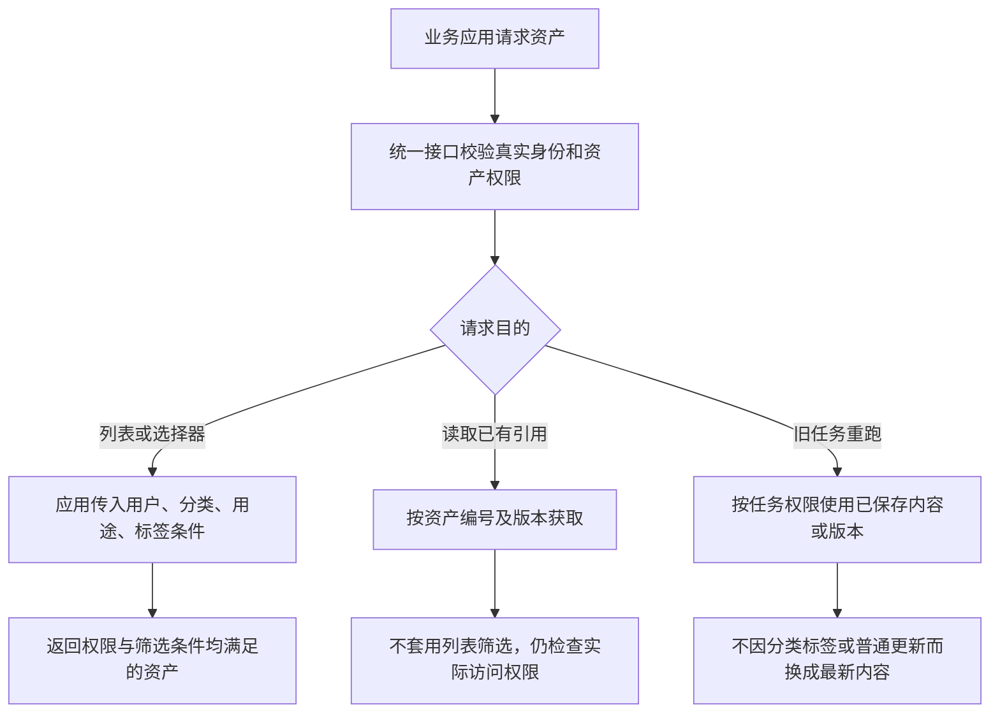

以下用提示词说明筛选行为，素材与技能遵循相同规则；标签名称不代表已存在的正式分类：

| 资产及应用 | 示例条件 | 展示结果 |
|---|---|---|
| 一条本人创建、带“Studio 专用”标签的提示词 | 资产本身仍属于当前用户 | 来源是设计平台也不影响归属 |
| Studio 查询 | 当前用户的全部个人提示词 | 能展示该提示词 |
| 设计平台查询 | 当前用户的个人提示词，排除“Studio 专用”标签 | 列表和选择器不展示 |
| 设计平台旧任务已使用该提示词 | 使用任务中保存的当时正文 | 不受上述排除条件影响 |

“Studio 专用”在此仅为展示标签，不是禁止其他应用读取的权限。添加标签不会自动改变应用行为，需要相应应用配置筛选规则。用户身份和可访问范围由服务端核实，不能通过修改查询条件读取他人的个人资产。

对于新建任务，列表筛选结果决定用户能从选择器找到什么；对于历史任务，保存的输入决定重跑使用什么。两个入口不能共用一段会把历史引用过滤掉的列表逻辑。

### 8. 三库通用的新增与跨平台读取时序

以下时序图按流程阶段拆分，素材、提示词、技能共用同一数据源逻辑，并非分别对应三个库。

#### 8.1 新增资产：校验并保存到统一数据源

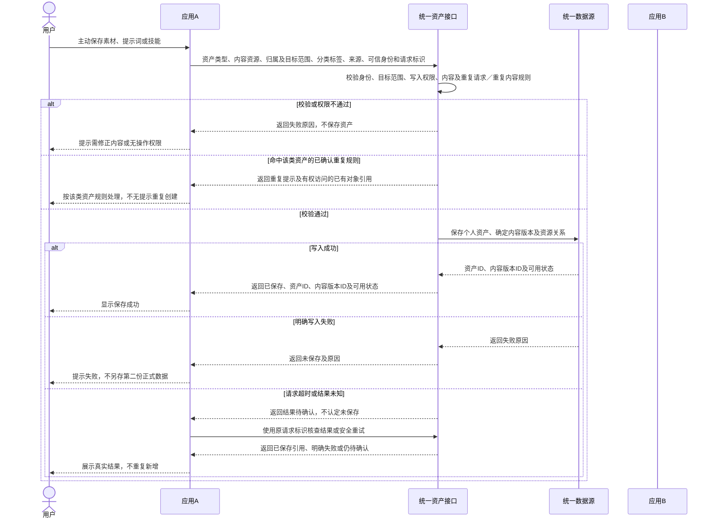

#### 8.2 跨平台查询：按权限返回资产列表

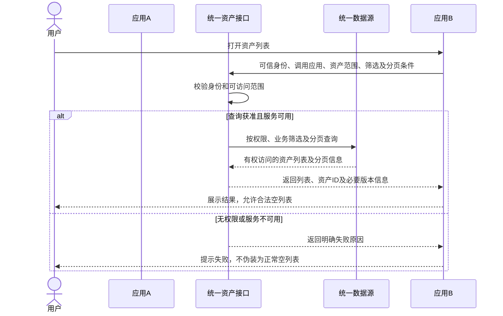

用户选择列表项后，还需按确定引用读取实际内容；列表信息不是执行内容：

#### 8.3 选择资产后读取：取得确定版本的实际内容

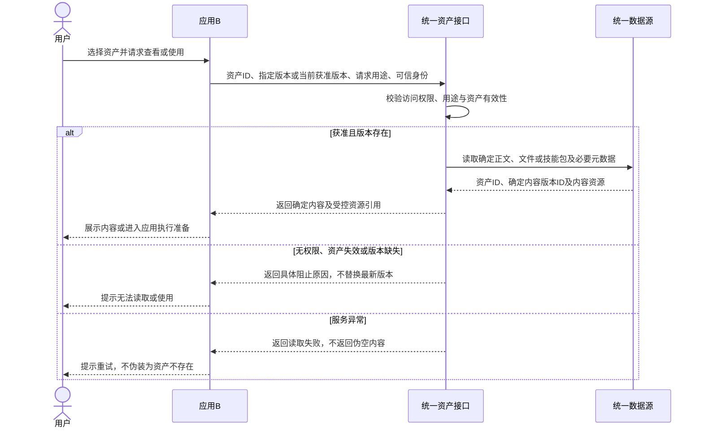

| 资产类型 | 按确定引用读取的业务输出 |
|---|---|
| 素材 | 资产ID、确定文件版本、受控文件引用及必要文件信息 |
| 提示词 | 资产ID、内容版本ID、完整正文及必要使用说明 |
| 技能 | 资产ID、内容版本ID、完整技能包引用及权限／依赖声明；声明不自动授予权限 |

同一条已存在的资产在另一平台使用时不再重新建库。明确的“复制为个人资产”仍可按现有规则创建独立副本并记录来源，不与普通跨平台读取混淆。

### 9. 三库通用的内容修改与旧任务重跑

以下时序图按流程阶段拆分，素材、提示词、技能共用同一数据源逻辑，并非分别对应三个库。

#### 9.1 首次执行：保存实际输入与确定内容后执行

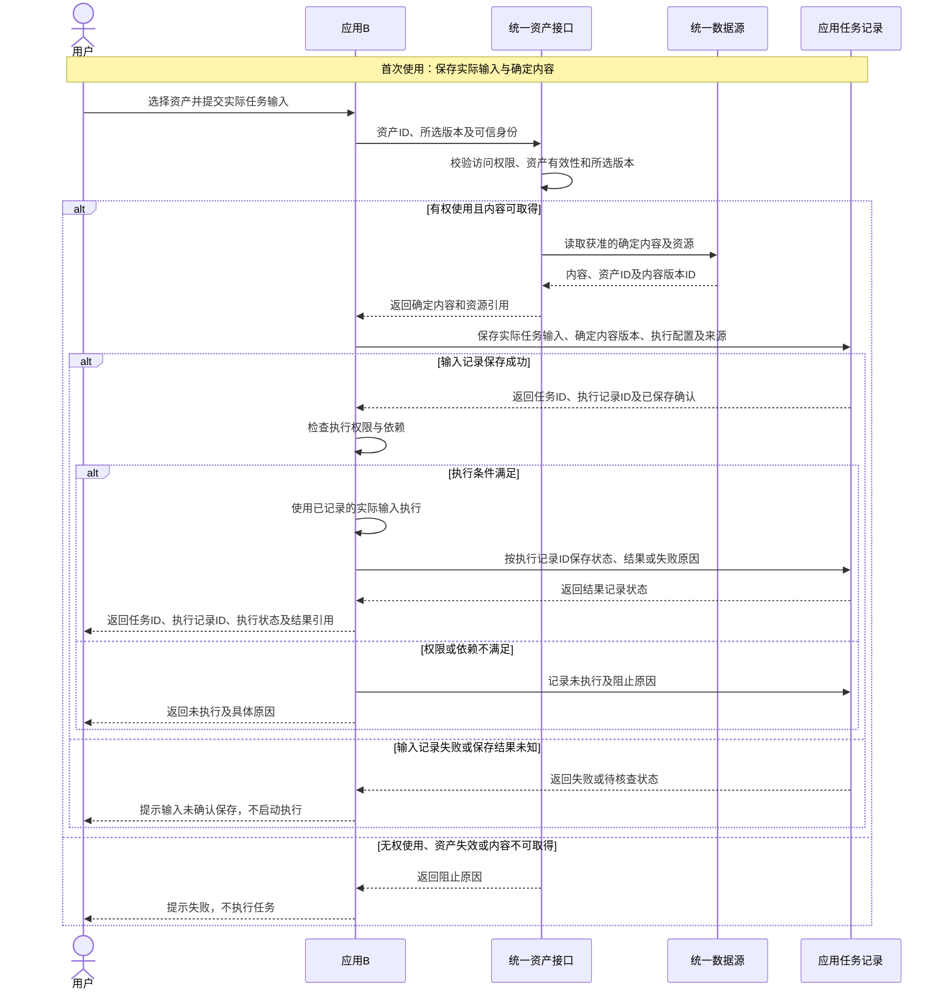

#### 9.2 内容更新：生成新版本，保留原任务引用

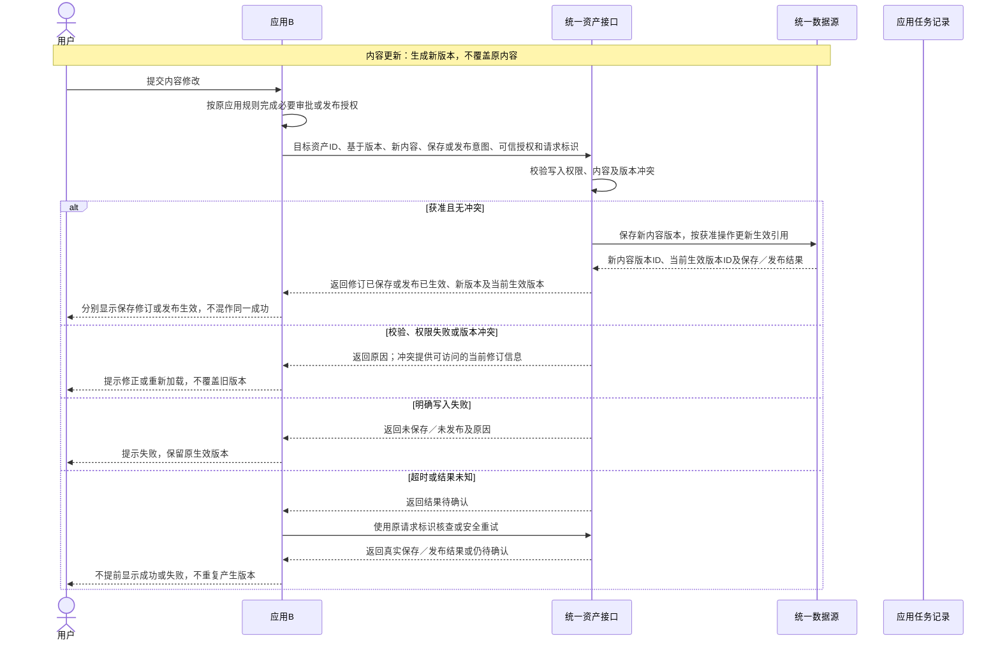

#### 9.3 旧任务重跑：沿用原输入，新增执行记录

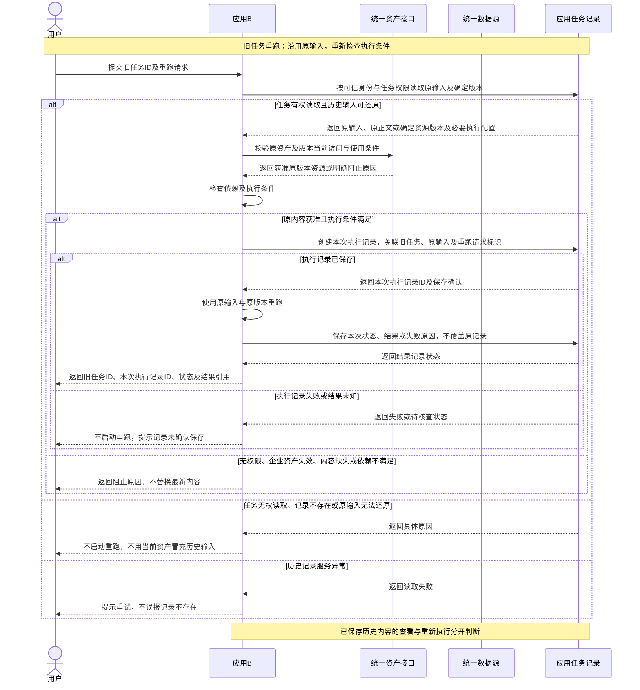

| 操作 | 处理原则 | 负责位置 |
|---|---|---|
| 修改个人未发布内容 | 有权限即可保存，校验编辑期间是否被他人修改 | 业务端编辑，统一接口写入 |
| 修改已发布内容 | 形成修订版本，按原业务流程完成发布，现行版本不被直接覆盖 | 审批在业务端，内容与发布结果在统一数据源 |
| 创建新任务 | 获取当前获准内容，并保存本次实际使用的输入 | 应用任务记录 |
| 修改标签或应用筛选配置 | 改变后续列表结果，不改旧任务的内容或版本 | 标签在数据源，筛选配置在应用 |
| 重新运行旧任务 | 默认沿用原内容或版本及已记录的任务输入 | 应用运行层 |
| 两个平台同时改同一内容 | 第一笔成功后，另一笔按旧修订提交时返回冲突，不无提示覆盖 | 统一资产接口 |

三库统一采用“记录本次实际输入，重跑默认沿用”的规则，保存形式随内容类型变化：

| 类型 | 任务应保存什么 | 需要避免的问题 |
|---|---|---|
| 提示词 | 实际使用正文；用户在工作台修改过的文字也计入任务输入 | 只存资产编号，重跑时误取最新正文 |
| 素材 | 资产编号、不可被覆盖的文件版本或受控快照引用 | 只存会被替换的文件地址，导致旧任务素材变化 |
| 技能 | 资产编号、确定的技能包版本及必要执行配置 | 重跑时悄悄装载新技能包 |

这些任务记录不是新增入库资产。实际文件保留、技能运行环境与外部依赖由研发核实；固定内容或版本不代表权限永远有效，也不保证 AI 输出或外部系统状态完全相同。

列表过滤不影响旧引用，不等于删除、撤权或下架也必须无条件放行。后者继续遵守相应资产和任务的实际权限；企业失效后的历史查看及禁止重跑、执行中受控操作停止规则见第一阶段交付说明第6章；物理清理仍需制度依据。

### 10. 审批留在业务端，底座只处理有效写入

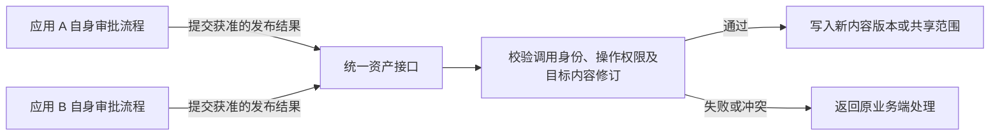

| 边界 | 本次处理 |
|---|---|
| 审批规则由谁制定 | 各业务方沿用自身规则 |
| 审批在哪处理 | 现有业务系统，不新增统一审批服务 |
| 是否要求同类资产都送到某个指定平台审批 | 不作为本次要求，不新增跨平台审批路由 |
| A、B 能否各有自己的审批单 | 由各业务系统管理，本次不新增“全局只能一张有效审批单”的限制 |
| 不同审批结果同时写同一资产 | 校验内容及相关共享信息的修订状态；冲突返回业务端，不自动合并或覆盖 |
| 资产服务是否相信任意“已通过”字段 | 不相信；仅允许获准的业务服务以可追溯身份提交相应操作，并检查其授权范围 |
| 审批通过但写入失败 | 业务端保留真实处理状态并重试或处理冲突，不能显示资产已发布成功 |
| 其他应用需要显示审批进度 | 如需建设，属于业务间接入，不是统一数据源首期前提 |

具体接入校验方式由研发结合现有身份和授权机制确定。这里需要的是可靠的写入授权与冲突保护，不是重新建设审批流程。

### 11. 删除与同步的最小边界

| 事项 | 当前处理口径 |
|---|---|
| 仅某个应用不展示 | 修改应用筛选条件，资产仍存在，已有引用不受影响 |
| 员工删除个人资料（三库通用） | 只移除个人侧记录或可见关系，不提供完整物理删除入口；首期不因个人删除自动物理清理 |
| 删除已共享／发布资料的个人侧记录 | 素材、提示词保留企业共享关系；技能保留独立企业快照，企业引用的正文、文件与技能包不被连带清除 |
| 已共享、已引用或正在使用的资产 | 个人删除、企业失效及历史查看按交付说明第4.5、6.4节处理；实际实现与留存期限由研发及制度依据核查 |
| 应用刷新 | 最低要求是重新查询时取得统一服务的最新有效数据；缓存刷新方式由研发确定 |
| 撤权与账号停用 | 由可信权限状态控制后续受控访问，不能靠列表标签代替 |
| 统一服务暂不可用 | 写入明确失败，不私自回到旧平台另存一份正式数据；可用性与恢复机制需技术设计 |

本次不把实时消息平台、复杂通知订阅或完整回收站作为先行建设条件。已有任务输入的留存与资产文件的物理删除也不能混为一个动作。员工个人删除及验收规则见[第一阶段开发交付说明第 4.5 节](三库统一数据源建设_第一阶段开发交付说明.md#45-三库员工个人删除规则)；物理清理条件与期限仍需制度及引用依据。

### 12. 分阶段建设、产品工作与迁移

> 优先建设统一数据底座，再对接现有设计平台与 Studio；新应用接入作为后续扩展，不纳入本次四阶段交付。第一阶段业务与字段明细在独立交付文件维护；待决事项不自动变成已确认规则。

当前已知：两个项目使用不同数据库，由同一开发团队中的不同人员负责。产品负责范围、业务规则和验收结果；开发负责真实存储、现有接口、技术方案、实现与迁移核查。数据库和文件存放位置等技术事实不要求产品代答。

#### 12.1 四个阶段及交付边界

| 阶段 | 核心目标 | 产品负责 | 开发与测试负责 | 阶段交付结果 |
|---|---|---|---|---|
| 第一阶段：现状盘点与底座设计 | 明确统一什么、业务怎样使用、现有实现如何承接 | 范围、业务对象、权限矩阵、规则、验收场景与待决事项 | 两项目技术盘点、接口复用判断、数据模型与迁移设计、工作量评估 | 需求与验收口径、技术设计、两端改造清单经联合评审 |
| 第二阶段：统一数据底座建设 | 底座具备三库统一存储与受控读写能力 | 核对接口表达的业务行为，准备样例，验收共性规则和异常结果 | 实现存储、接口、鉴权、条件查询、版本与冲突保护；提供独立验证证据 | 三库底座及接口说明可交付，独立测试通过 |
| 第三阶段：现有平台对接与联调 | 设计平台和 Studio 的资产入口接入统一服务 | 验收真实页面与任务行为，确认原审批和筛选逻辑得到保留 | 分别改造两端读写、发布结果写入和任务记录，完成联调 | 使用测试或受控样本跑通两平台完整业务链路 |
| 第四阶段：存量迁移与正式切换 | 真实数据归入统一底座，两平台正式使用 | 确认迁移批次的业务影响，组织抽验，确认切换后业务可用 | 备份、数据迁移、增量核对、读写切换、监控与回退验证 | 已切换资产只有一个权威写入入口，内容、权限和引用核对通过 |

底座设计必须以两平台实际业务契约为输入，但第二阶段不要求完成全部前端接入。阶段可提前准备、部分并行推进，不能把独立接口测试通过当作两平台已经联调或上线。迁移准备从第一阶段开始，正式生产切换放在第四阶段。

#### 12.2 第一阶段：现状盘点与底座设计

目标是让业务范围、对象关系和关键规则可执行，供研发完成设计与估算。产品交付范围说明、字段与校验、权限及状态影响、验收依据；研发交付真实存储与接口盘点、数据模型、两端改造和迁移设计。

第一阶段须同时形成受影响业务入口清单，供底座设计和估算使用，不等底座完成才盘点。具体字段要求、研发核查与第一阶段交付清单见[第一阶段开发交付说明](三库统一数据源建设_第一阶段开发交付说明.md)，不在整体方案重复维护。

**第一阶段完成条件：** 产品范围和关键业务规则可执行，开发已完成必要事实核查，形成可评审的数据模型、接口范围、两端改造和迁移方案。产品与研发对影响范围和验收口径无关键分歧，人员与排期由团队据实际工作量安排。

#### 12.3 第二阶段：统一数据底座建设

实现第一阶段确定的三库受控读写、权限与条件查询、正式内容版本、冲突保护、获准发布结果写入及必要关联。产品按第一阶段交付的验收要求检查业务行为；具体检查表和最小验证集见[第一阶段开发交付说明第 7 章](三库统一数据源建设_第一阶段开发交付说明.md#7-第一阶段交付的验收依据)。无需等新页面做完，可通过测试工具和可读的请求结果验证底座。

**第二阶段完成条件：** 三库统一接口及必要数据能力可交付，关键规则有可复核证据，阻断性问题已处理；接口身份、返回结果和异常语义能供两端开发使用。此时只表示底座独立验证通过，不表示两平台已接入、存量已迁移或生产已上线。

第二阶段保证确定内容或版本可获取，第三阶段验证任务实际输入记录与旧任务重跑完整链路。旧任务中用户临时修改过的提示词正文也必须由应用保留，不能只保存资产编号。

#### 12.4 第三阶段：设计平台与 Studio 对接联调

| 工作 | 产品关注 | 开发与测试执行 |
|---|---|---|
| 资产入口改接 | 原有用户操作意图不变，新增窗口仍由用户主动保存 | 两端列表、选择器、新增、编辑等入口调用统一接口 |
| 业务筛选接入 | 各应用可以展示不同结果，但不改变底层资产身份和实际权限 | 按第一阶段定义的条件查询，不在客户端自行扩大权限 |
| 原审批结果接入 | 审批继续在各业务端；成功与失败状态准确 | 将获准结果写入统一服务，处理冲突、失败及重试 |
| 任务引用与重跑 | 三库旧任务默认沿用实际使用内容或版本，标签过滤不破坏旧引用 | 接入任务输入记录，分别验证素材、提示词、技能 |
| 两端一致性 | 一端修改后，另一端重新读取能取得一致数据 | 验证刷新、缓存、旧编号兼容及跨端并发行为 |

同一团队中的两端负责人可以按统一接口并行开发，通过共同样例联调；正式切换仍按批次安排。第三阶段使用测试或受控样本确认真实业务链路，不能仅凭接口返回成功判定用户流程完成。

**第三阶段完成条件：** 两个平台约定范围内的实际入口和任务链路联调通过，原业务审批可继续运行，关键异常已验证，具备存量迁移和正式切换条件。

#### 12.5 第四阶段：存量迁移与正式切换

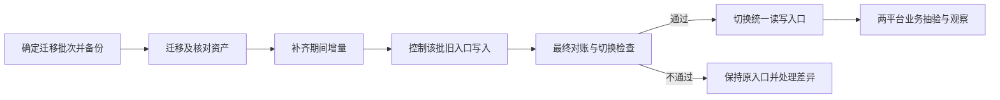

| 必须保留或核对 | 判定原则 |
|---|---|
| 个人归属、组织和共享范围 | 不能丢失创建人、扩大权限或把个人资产变成公共资产 |
| 资产编号与历史引用 | 保留旧编号映射，原任务能找到对应资产及可验证版本 |
| 三库对象关系 | 素材、提示词多视图不重复建资产；个人技能和企业快照不误合并 |
| 内容、文件和版本 | 数量、内容及文件可读性核对；没有历史版本证据时不伪造 |
| 分类、标签及个人关联 | 保留必要分类、标签、收藏和分组关系；差异按第一阶段规则处理 |
| 原审批关系 | 审批记录保留在业务系统，必要关联可追溯，不借迁移合并审批系统 |
| 迁移期间新增和修改 | 正式切换前纳入最终核对，每批仅保留一个权威写入入口 |
| 历史信息缺失 | 记录无法还原的具体范围，不能把当前内容冒充过去使用内容 |

产品确认业务抽验样例和可接受的切换影响，开发执行数据备份、迁移、对账和回退，测试记录结果。发现资产丢失、权限扩大或关键历史引用损坏时，该批不得通过切换验收。

切换后若需回退，先控制新写入并核对新入口产生的增量，再恢复明确的权威写入位置，不能直接打开旧库形成两边独立写入。切换后的观察期、恢复目标、具体批次和时间由产品与开发结合真实规模确定，不在本方案中虚构时长。

**第四阶段完成条件：** 两平台正式使用统一数据源，已迁移范围的内容、归属、权限和引用核对通过，旧独立写入链路已停用，恢复方案经过验证，业务抽验及运行观察达到事先约定的标准。

#### 12.6 本次阶段规划的控制原则

- 三库共性规则一起确定，建设和迁移可以分批，不能因分批而形成三套相互冲突的规则。
- 本次围绕统一数据源与现有两平台接入交付，不增加统一审批、全局审批排队、通用业务规则引擎或新的统一管理后台。
- 新应用扩展保留标准接口能力即可，不作为本次上线依赖或独立交付阶段。
- 只统一三库相关资产数据与必要关联，不将任务、对话、积分等全部业务数据一并迁入底座。
- 范围内新增需求或规则变化先评估对数据、接口和两端改造的影响，再决定是否纳入本期，不在开发过程中无记录地扩大范围。

### 13. 用具体场景验收

| 场景 | 预期结果 |
|---|---|
| 在设计平台新增个人提示词，Studio 查询全部本人提示词 | 看到同一资产，无需再次入库 |
| 在 Studio 查询另一位员工的个人资产 | 无授权时拒绝，不因修改查询条件越权 |
| Studio 展示某标签，设计平台排除该标签 | 两平台列表不同，底层内容仍只有一份 |
| 三库修改分类标签后打开已关联任务 | 原关联不失效，任务保留原内容或版本 |
| 三库内容普通更新后创建新任务 | 使用最新获准内容并记录本次实际输入 |
| 三库内容普通更新后重跑旧任务 | 提示词用原正文、素材用原文件版本、技能用原技能包版本，不自动切换最新内容 |
| 未点击新增窗口保存 | 不因输入、浏览或生成而自动创建资产 |
| 两个平台同时修改同一资产 | 不发生无提示覆盖；冲突交还业务端处理 |
| 业务审批完成后写入发布结果 | 只有获准写入才生效，失败不伪报发布成功 |
| 迁移存量资产 | 内容、归属、可见范围、旧引用与原记录核对一致 |

价值首先看跨平台重复录入是否减少、新应用接入工时是否降低、因旧任务输入变化导致的返工是否减少。当前缺少量化基线，不能填写预计节省比例或承诺上线日期。

### 14. 研发核查事项

| 待核实项 | 目的 |
|---|---|
| 现有存储、接口与文件读取方式 | 确定怎么集中数据、复用哪些已有实现 |
| 共享账号的组织与权限映射 | 让用户跨平台得到一致资产权限，避免把管理员权限直接合并 |
| 业务服务写入授权与冲突返回 | 保护数据一致性，不额外建设审批系统 |
| 任务是否已有输入正文或版本记录 | 确定旧任务重跑所需的最小改造及历史数据限制 |
| 删除、下架、引用及文件保留 | 补齐与现有生产规则一致的边界，避免损坏引用 |
| 迁移窗口、数据对账、备份与回退 | 保证切换可验证、可恢复 |
| 负责人、首批场景与排期 | 在实际工作量核实后安排，不由本方案虚构 |

## 事实来源

| 来源 | 使用范围 |
|---|---|
| [素材库、提示词库现状规则架构与业务流程（2026-09-28）](<D:/HermesVault/10_先马电商/03_项目/01_先马AI设计平台/02_产品输出/资源管理与权限/素材库提示词库现状规则架构与业务流程_260928.md>) | 两库既有对象关系、共享流程及上线证据边界 |
| [XMAI Studio 技能库架构与业务流程（2026-09-28）](<D:/HermesVault/10_先马电商/03_项目/02_AI CLI企业管理/00_项目公共资料/04_架构与流程/XMAI Studio-技能库架构与业务流程.md>) | 个人与企业技能对象、现有发布和使用规则 |

现状资料用于兼容核查，目标行为以本规划及第一阶段开发交付说明为准。本文件仍为方案规划，未验证生产数据库或接口，不表示已经开发、迁移或上线。
